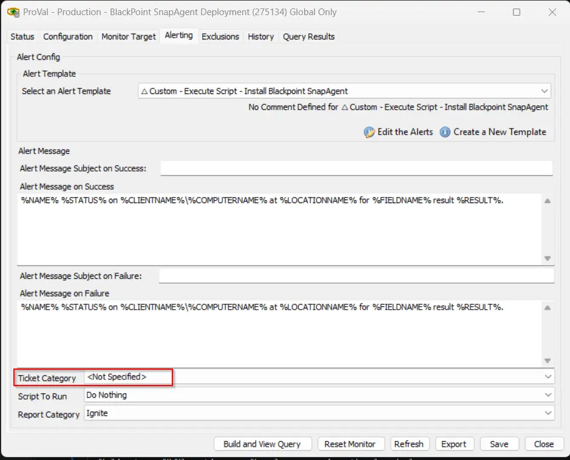

## Summary

This monitor detects online Windows and MAC agents where the SnapAgent is not installed.

It also depends on the following EDFs:
- **BlackPoint SnapAgent Deploy**: The Client EDF should be checked for deployment confirmation.
- **BlackPoint SnapAgent Exclude**: The location EDF should not be checked for deployment; otherwise, agents from those locations will be excluded.
- **BlackPoint SnapAgent Exclude**: The computer EDF should not be checked for deployment; otherwise, the agent will be excluded.

## Dependencies

- [Script : BlackPoint - SnapAgent Deployment](/docs/202e2dde-5865-4035-8410-37dc6cb92a60)
- [Solution : BlackPoint SnapAgent Deployment](/docs/ab272f63-2bea-430c-88ac-d8c90abbb051)

## Target

Global

## Ticketing

- The ticket is controlled by the script [BlackPoint - SnapAgent Deployment](/docs/202e2dde-5865-4035-8410-37dc6cb92a60).
- To enable the ticketing feature, it is mandatory to set the ticket category at the monitor level, as shown below:

## Alert Template

`△ Custom - Execute Script - Install BlackPoint SnapAgent`

## Changelog

### 2026-11-10

- Extended the monitor to detect MAC agents in addition to Windows agents.
- Removed the `BlackPoint SNAP URL` EDF dependency.
- Added the Alert Template section.

### 2025-04-10

- Initial version of the document
