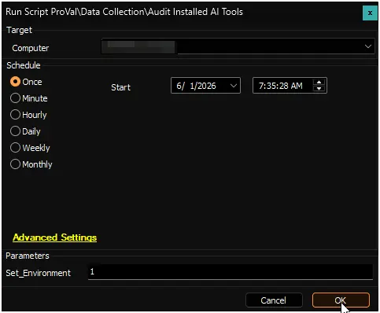
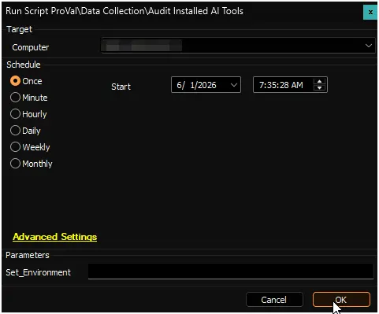

## Summary

This script scans Windows machines to identify Artificial Intelligence (AI) software, tools, frameworks, and browser extensions. It checks:

- System-level and user-level installations.
- Background app (Appx) packages.
- Claude Code installations made with Anthropic's native installer.
- AI command-line tools installed as global npm packages, such as `@anthropic-ai/claude-code`, `@openai/codex`, and `@google/gemini-cli`.
- Browser extensions in Google Chrome, Microsoft Edge, Brave, Vivaldi, Opera, and Mozilla Firefox, for every user and browser profile.

It also reports the built-in AI features of each installed browser, along with the status of the policy that controls each one, and the Gemini Nano model when Google Chrome has downloaded it for a user.

Once the scan is complete, the data is fetched and displayed by the [Installed AI Tools Audit](/docs/1ca43737-1bb0-4adf-be79-a6b9c3eaec54). All information regarding installed AI applications can be retrieved directly from that dataview.

- **If the dataview displays applications:** These are the AI tools, browser extensions, and built-in browser AI features currently detected on the machine, along with version details and installation dates.
- **If the dataview is empty:** Microsoft Edge is installed on almost every Windows machine, so a successful run usually returns at least its built-in AI feature rows. An empty dataview for a machine most likely means the script hasn't run on it yet or didn't finish.
- **Troubleshooting:** Script logs can be checked to verify successful execution or to investigate any scanning issues.

## Currently Audited AI Applications

The audit looks for the following keywords in installed application names, browser extension names, and npm package names, grouped by category or parent company:

| Category | Targeted Applications & Keywords |
| --- | --- |
| **Microsoft & OpenAI** | `Copilot`, `ChatGPT`, `OpenAI`, `Codex`, `DALL-E`, `GitHub Copilot` |
| **Google** | `Gemini`, `Bard`, `Vertex AI`, `Google AI Studio` |
| **Anthropic** | `Claude`, `Anthropic` |
| **Meta & xAI** | `LLaMA`, `Meta AI`, `Grok` |
| **Local AI Desktop Apps** | `LM Studio`, `Ollama`, `GPT4All`, `Jan`, `AnythingLLM`, `NVIDIA ChatRTX`, `ChatRTX`, `Msty`, `Faraday` |
| **AI Coding Assistants** | `Cursor`, `Windsurf`, `Codeium`, `Cody`, `Supermaven`, `Tabnine`, `Replit AI` |
| **Image & Creative AI** | `Stable Diffusion`, `ComfyUI`, `InvokeAI`, `Fooocus`, `Automatic1111`, `DreamStudio`, `Midjourney`, `Leonardo AI`, `Clipdrop`, `Krea`, `Canva AI`, `Firefly`, `Adobe Sensei` |
| **Marketing & Copywriting** | `Jasper`, `Copy.ai`, `Writesonic`, `Rytr`, `Anyword` |
| **Search & Chatbots** | `Perplexity`, `You.com`, `YouChat`, `Phind`, `Character.AI`, `Poe`, `Pi`, `Inflection` |
| **Cloud & Enterprise AI** | `Amazon Q`, `SageMaker`, `Watson`, `Databricks`, `Dolly`, `AI21`, `Jurassic` |
| **Frameworks & Platforms** | `Vercel AI`, `Botpress`, `LangChain`, `Flowise`, `Hugging Face`, `Transformers`, `Replicate`, `Groq`, `EleutherAI`, `GPT-NeoX` |
| **Other Global AI Models** | `Ernie`, `Mistral`, `Codestral`, `Falcon`, `DeepSeek`, `Cohere`, `Runway`, `RunwayML` |
| **Browser AI Extensions** | `Monica`, `Sider`, `Merlin`, `MaxAI`, `HARPA`, `AIPRM`, `QuillBot`, `Compose AI`, `Wiseone`, `Otter.ai`, `Fireflies` |

## Built-in Browser AI Features

These features are reported for every installed browser, regardless of the keywords.

| Browser | Built-in AI Feature | Policy Checked |
| --- | --- | --- |
| Microsoft Edge | Copilot | `Microsoft365CopilotChatIconEnabled` |
| Microsoft Edge | On-device AI model | `GenAILocalFoundationalModelSettings` |
| Google Chrome | Gemini in Chrome | `GeminiSettings`, then `GenAiDefaultSettings` |
| Google Chrome | On-device AI model | `GenAILocalFoundationalModelSettings` |
| Brave | Leo AI | `BraveAIChatEnabled` |
| Mozilla Firefox | AI features | `AIControls` (Firefox 149 and later), then `GenerativeAI` (Firefox 144 to 148) |
| Opera | Aria | None. Opera doesn't offer a policy for Aria. |

Only computer-wide policies are checked. When more than one policy is listed, the first one that's configured decides the reported status.

## Detection Sources

The `Source` and `Publisher` values tell you where each result was found and who or what it applies to.

| Source | Detected Item | Publisher Shows |
| --- | --- | --- |
| `SystemRegistry` | Application installed for all users | Software vendor |
| `UserRegistry` | Application installed for a single user | Software vendor |
| `AppxPackage` | Background app (Appx) package | Software vendor |
| `NativeInstall` | Claude Code installed with Anthropic's native installer | Windows user, for example `User: jdoe` |
| `NpmPackage` | AI command-line tool installed as a global npm package | Windows user, or `All users` when installed for the whole computer |
| Browser name followed by `Extension`, for example `Google Chrome Extension` | Browser extension | Windows user, browser profile, and extension ID |
| Browser name followed by `Built-in`, for example `Microsoft Edge Built-in` | Built-in browser AI feature | Policy status: `Policy: Disabled`, `Policy: Allowed`, `Policy: Not configured`, or `Policy: None available` |
| `Google Chrome Built-in` with the name `Gemini Nano on-device model` | Gemini Nano model downloaded by Google Chrome | Windows user |

For built-in browser AI features, the version shown is the browser version.

## Dependencies

- [Solution: Installed AI Tools Audit](/docs/e1783dde-9fda-4c89-80b3-0f5ecc73382c)

## Sample Run

### First Run

Run the script with the `Set_Environment` parameter set to `1` after import to create the custom table [pvl_installed_ai_applications_audit](/docs/fcd315e9-e261-4553-a9c3-8440f748cdc6).

### Regular Execution

## User Parameters

| Name     | Example | Required | Description                                                                                                                                                                                                                                         |
|----------|---------|----------|-----------------------------------------------------------------------------------------------------------------------------------------------------------------------------------------------------------------------------------------------------|
| `Set_Environment`            | `1`               | `First Run Only`      | If set to `1` it will create the custom table [pvl_installed_ai_applications_audit](/docs/fcd315e9-e261-4553-a9c3-8440f748cdc6).           |

## Output

- Script Logs
- [Custom Table: pvl_installed_ai_applications_audit](/docs/fcd315e9-e261-4553-a9c3-8440f748cdc6)
- [Dataview: Installed AI Tools Audit](/docs/1ca43737-1bb0-4adf-be79-a6b9c3eaec54)

## Changelog

### 2026-10-28

- Added detection of AI browser extensions in Google Chrome, Microsoft Edge, Brave, Vivaldi, Opera, and Mozilla Firefox for every user and browser profile.
- Added reporting of built-in browser AI features with the status of the policy that controls each one: Copilot and the on-device AI model in Microsoft Edge, Gemini and the on-device AI model in Google Chrome, Leo AI in Brave, AI features in Mozilla Firefox, and Aria in Opera.
- Added detection of the Gemini Nano model that Google Chrome downloads for each user.
- Added detection of Claude Code installations made with Anthropic's native installer, which don't create an uninstall entry.
- Added detection of AI command-line tools installed as global npm packages, such as `@anthropic-ai/claude-code`, `@openai/codex`, and `@google/gemini-cli`.
- Added browser AI extension keywords: `Monica`, `Sider`, `Merlin`, `MaxAI`, `HARPA`, `AIPRM`, `QuillBot`, `Compose AI`, `Wiseone`, `Otter.ai`, and `Fireflies`.
- The new results use the existing `Source` and `Publisher` fields, so the custom table and dataview are unchanged.

### 2026-07-01

- Updated the script to prevent duplicate entries from being written to the table.
- For duplicate records, the script now retains only the entry with the highest version.

### 2026-06-01

- Initial version of the document
