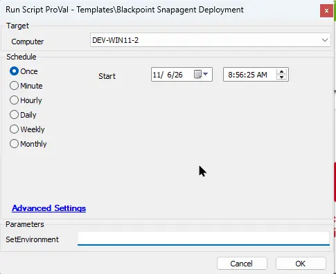
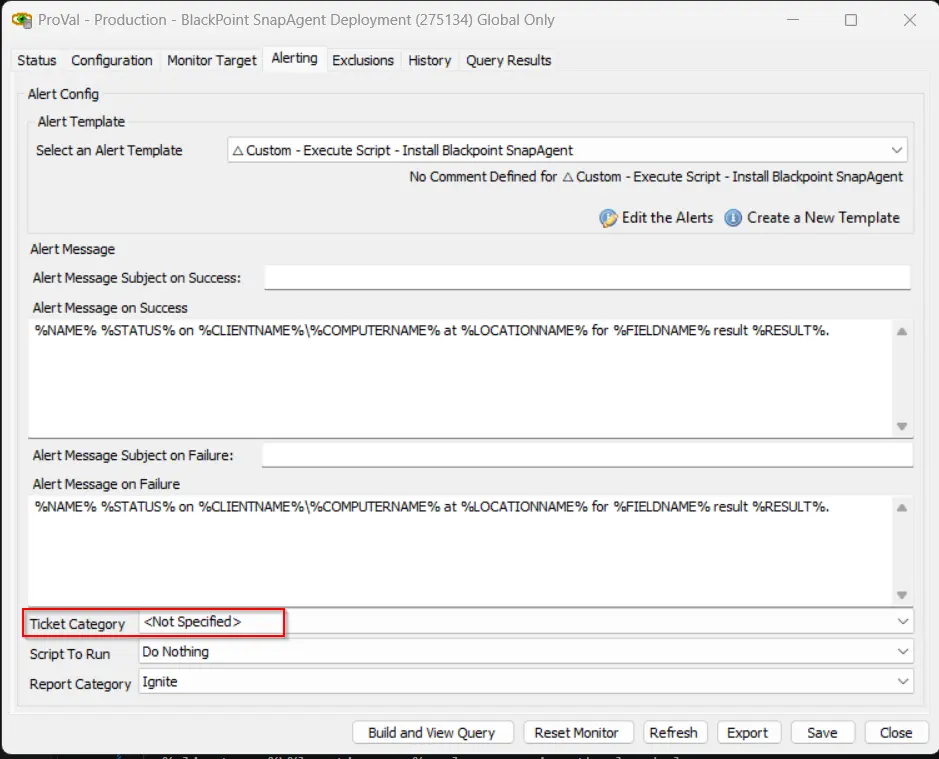

## Summary

This script installs the BlackPoint SnapAgent on Windows and macOS machines. It uses the BlackPoint Customer ID and authentication token stored in the client-level EDFs to link the endpoint to the correct BlackPoint account. If the installation fails, the script creates a ticket with the installation log.

## Sample Run



## Dependencies

- [Agnostic : Install-BlackPointAgent](/docs/0cf14533-c145-4a77-8ea7-8c70476768a9) 
- [Solution : BlackPoint SnapAgent Deployment](/docs/ab272f63-2bea-430c-88ac-d8c90abbb051) 

## Extra Data Fields

| Name                             | Level   | Type       | Description     |
|----------------------------------|---------|------------|------------------------------------|
| BlackPoint SnapAgent Deploy      | Client  | Check Box  | This client-level EDF needs to be checked for the SnapAgent installation. The monitor [BlackPoint SnapAgent Deployment](/docs/8dad86ab-7d59-43ef-b148-f4ab7df0b8f0) is directly proportional to this EDF.  |
| BlackPoint SnapAgent CustomerID | Client  | Text       | This client-level EDF must be filled with the Unique BlackPoint Account UID used to identify and link endpoints to the correct BlackPoint account. |
| BlackPoint SnapAgent Authentication Token | Client  | Text       | This client-level EDF must be filled with Unique BlackPoint Authentication Code required to authenticate and install the BlackPoint Agent on endpoints. |
| BlackPoint SnapAgent Exclude     | Location| Check Box  | If this location-level EDF is checked, then all agents of the location will be excluded from the monitor for the SnapAgent deployment. The monitor [Monitor - BlackPoint SnapAgent Deployment](/docs/8dad86ab-7d59-43ef-b148-f4ab7df0b8f0) is indirectly proportional to this EDF.              |
| BlackPoint SnapAgent Exclude     | Computer| Check Box  | If this computer-level EDF is checked, then the agent will be excluded from the monitor for the SnapAgent deployment. The monitor is indirectly [Monitor - BlackPoint SnapAgent Deployment](/docs/8dad86ab-7d59-43ef-b148-f4ab7df0b8f0) proportional to this EDF.                                 |


## User Parameters

| Name | Required | Example | Description   |
|---------|---------|---------|---------|
| Set_Environment    | 1      | False    | Required for the first run only to import the EDF's used by the solution.  |


## Ticketing

- To enable the ticketing feature, it is mandatory to set the ticket category at the monitor level as shown below:



- **Subject:**  
  SW - BlackPoint SnapAgent Installation Failed on %clientname%\%computername%

- **Body:** [Windows]
  ```
  The BlackPoint SnapAgent Installation Failed on %computername% at %clientname%\%locationname%. Please review the log below:

  @ErrorLog@.
  ```

- **Body:** [MAC]
  ```
  The BlackPoint SnapAgent Installation Failed on %computername% at %clientname%\%locationname%. Please review the log below:

  %Shellresult%
  ```
## Output

- Script log
- Local files on the computer

## Changelog

### 2026-11-10

- Renamed the script from `BlackPoint - SnapAgent Installer` to `BlackPoint - SnapAgent Deployment`.
- Added support for macOS machines.
- Replaced the `BlackPoint SNAP URL` EDF with the `BlackPoint SnapAgent CustomerID` and `BlackPoint SnapAgent Authentication Token` client-level EDFs.
- Added the `Set_Environment` user parameter to import the EDFs used by the solution.
- Updated the ticket subject and body, and added a separate ticket body for macOS machines.

### 2025-04-10

- Initial version of the document
