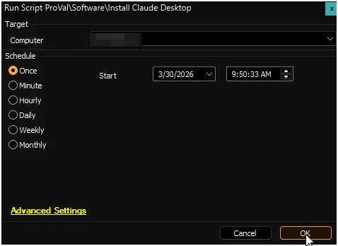

## Summary

Installs Claude Desktop as per the Anthropic’s deployment guide, which recommends installing it as a system application to provision Claude for every user on the device.

## Sample Run

## Global Variables

| Name | Value | Accepted Values | Description |
| ---- | ----- | --------------- | ----------- |
| ScriptEngineEnableLogger | `False` | `False`, `True` | When `True`, enables final (success/failure) logging; when `False` (default), these logs are suppressed to avoid adding entries to the `h_scripts` table. Set to `True` to assist with troubleshooting. |

## Output

- Script Log

## Changelog

### 2026-11-12

- Anthropic’s deployment guide, which recommends installing it as a system application to provision Claude for every user on the device to overcome the user admin permission issues from the previous version.

### 2026-04-06

- Code signed PowerShell script
- Updated the downloadUrl for both 7zr.exe and 7z.7z

### 2026-03-30

- Initial version of the document.
