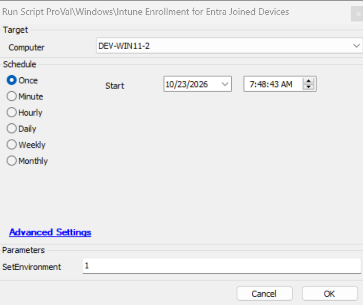
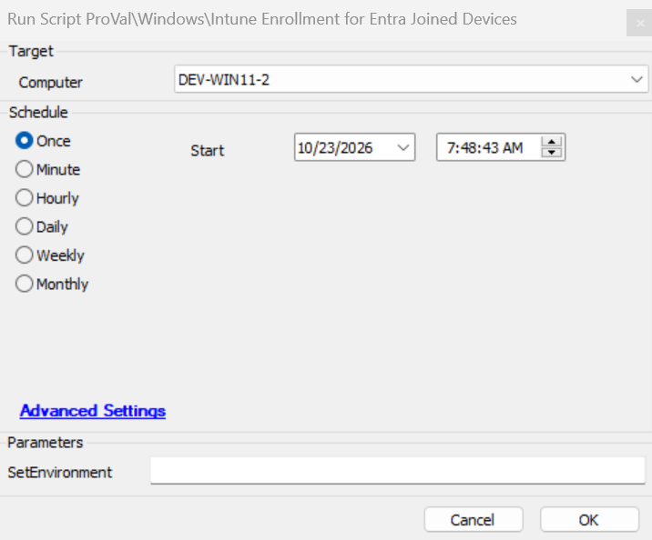

## Summary  

The script automates the Microsoft Intune enrollment process for Entra joined Windows devices.

**Note:** The end machine may require a restart to complete the enrollment process.

### Requirements

- Windows 10/11 device  
- PowerShell 5.1 or later  
- Azure AD joined status

## File Hash

**File Path:** `C:\ProgramData\_Automation\Script\Initialize-IntuneEnrollment\Initialize-IntuneEnrollment.ps1`  
**File Hash (Sha256):** `0750CF212F2BA69DF2A30B4D0215CF57DBAE61E5D7A0FBC96EBDE73B353275C7`  
**File Hash (MD5):** `DFA3C56BBBBF00EC8E4B9D5B42801FB0`

## Sample Run

- Set the `SetEnvironment` user parameter to 1 during importing the script, and execute on any random online machine.
- This will help to import the checkbox-type Client-EDF `Deploy Intune Enrollment`, location and computer-level EDF `Exclude Intune Enrollment` and the roles [Intune Enrolled](/docs/ec741594-23b2-4d0c-bf8d-337eefb44e83) and [Microsoft - Entra Joined](/docs/4da626c5-0cec-454e-a517-fc7bf22f80f2).

- To perform the Intune enrollment, execute the script leaving `SetEnvironment` blank.

## User Parameters

| Name | Required | Example | Description   |
|---------|---------|---------|---------|
| SetEnvironment | False | 1 | This is required to execute the script during importing of the solution by setting the value to 1 for SetEnvironment, so that it call import all required EDFs and roles. |

## EDFs

| Name | Type | Level | Section | Editable | Required | Description |
| ------------- | ------ | ------ | ----- | ----- | ----- | -------------------------------------------- |
| Deploy Intune Enrollment | Checkbox | Client | Entra AD | Yes | True | This client level checkbox EDF is required for the automation of the Intune Enrollment deployment. |
| Exclude Intune Enrollment | Checkbox | Location | Exclusions | Yes | False | If checked, then the agents of the location will be excluded from the Intune enrollment auto-deployment. |
| Exclude Intune Enrollment | Checkbox | Computer | Exclusions | Yes | False | If checked, then the agent will be excluded from the Intune enrollment auto-deployment. |

## Variables

| Name | Description |
| ---- | ----------- |
| projectName | Initialize-IntuneEnrollment |
| workingDirectory | C:\ProgramData\_Automation\Script\Initialize-IntuneEnrollment |
| ps1Path | C:\ProgramData\_Automation\Script\Initialize-IntuneEnrollment\Initialize-IntuneEnrollment.ps1 |

## Output

- Script Log

## Changelog

### 2026-10-23

- Added signature to the Intune-Enrollment.ps1.
- Replaced the "already enrolled" check. It now reads the device's Intune enrollment record (`HKLM:\SOFTWARE\Microsoft\Enrollments`, `ProviderID` = `MS DM Server`, `EnrollmentState` = 1) instead of the `AutoEnrollMDM` policy value. The old check reported "already enrolled" after any previous run, including failed ones, and missed devices enrolled through Autopilot or Settings.
- The script now reports the actual enrollment result. After starting `deviceenroller.exe`, it waits up to 180 seconds for the enrollment record or for event 75 (success) / 76 (failure) in the `DeviceManagement-Enterprise-Diagnostics-Provider/Admin` log, and includes the event 76 details on failure. Previously it always returned Success.
- Added a signed-in user check. Enrollment uses the signed-in user's Entra credentials (`UseAADCredentialType` = 1), so the enrollment step is skipped when nobody is signed in. The enrollment policy and MDM URLs are still configured in that case.
- Added the `Skipped:` and `Pending:` output statuses alongside `Success:` and `Failure:`.
- The script relaunches itself in 64-bit PowerShell when started from a 32-bit host.
- The MDM policy key is created only if it does not exist, instead of running `New-Item -Force` on every run.
- MDM URLs are now written to every tenant key under `CloudDomainJoin\TenantInfo`, and only where the value is missing. Previously the script assumed a single tenant key and overwrote existing values. It now fails with a clear message when no tenant key exists.
- `New-ItemProperty` output no longer appears in the script output.
- `gpupdate` now refreshes computer policy only and cannot hang on a restart prompt.
- Error messages now report the exception from the failing step (`$_`) instead of the last error in the session (`$Error[0]`).

### 2025-03-06

- Initial version of the document
