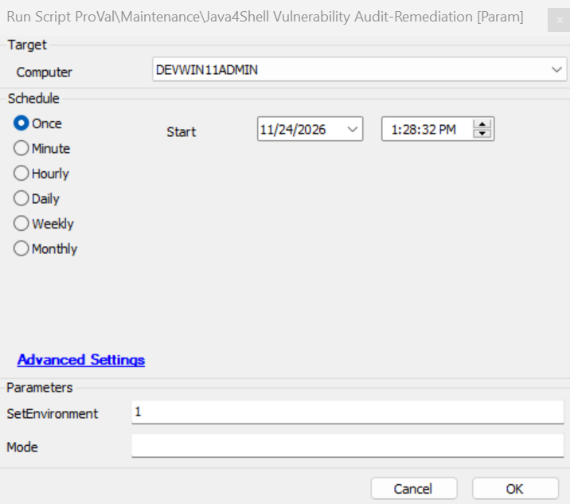
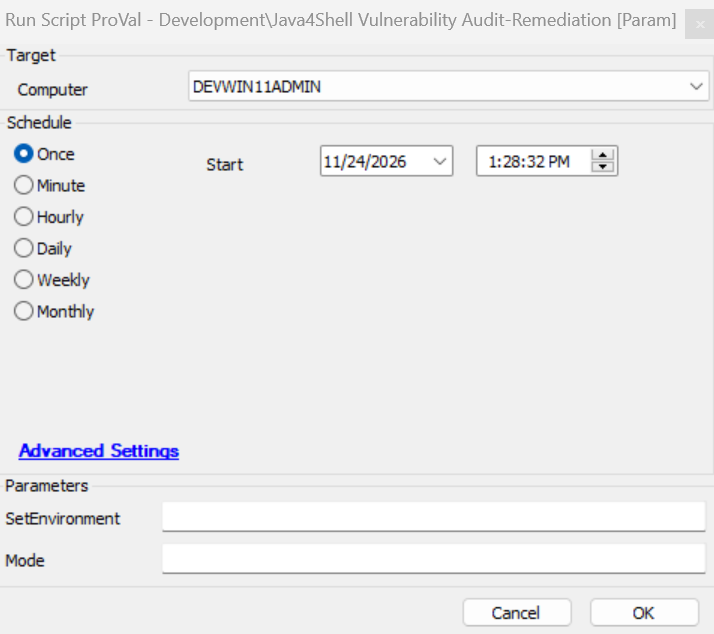
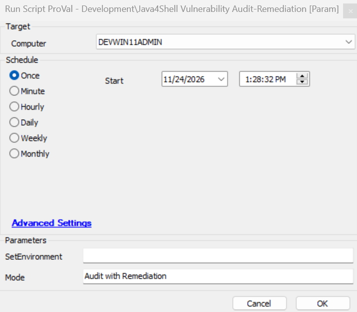

## Summary

This script finds every Java runtime on a Windows computer and records whether each one is affected by Java4Shell (CVE-2026-114938), a critical flaw in the Java Base64 decoder that can crash an application and, in some cases, let an attacker take over the server without a password. The results are stored in the custom table [pvl_java4shell_vulnerability_audit](/docs/40d1ea49-6613-41a2-8aac-ab43edfe39cb) and displayed in the [Java4Shell Vulnerability - Audit](/docs/bf75846d-01ad-4165-9bee-a90124b43120) dataview.

The search covers every NTFS drive, so it also finds Java bundled inside other products, such as Jira, Confluence, Jenkins, Keycloak, or a vendor's application. Each runtime is recorded with its location, owning product, vendor, version, whether the processor is affected, and status: `Patched`, `Vulnerable`, `EndOfLife`, `NotAffected`, or `Unknown`. A computer without any Java runtime is recorded once with the status `NotDetected`.

The script uses the [Detect-Java4ShellVulnerability](/docs/cb6146e2-f662-471e-8f50-b1bbaeb24826) agnostic script and runs in the mode selected in the client-level `Java4Shell Vulnerability` EDF:

- `Audit Only`: reports every Java runtime and changes nothing.
- `Audit with Remediation`: also updates vulnerable standalone Java installations that are not in use, and sets the temporary JVM flag `-XX:UseAVX=2` on the Windows services that still use a vulnerable runtime.
- `Disabled` or not set: the script exits without auditing.

The script also exits when the location-level or computer-level `Exclude From Java4Shell Vulnerability` EDF is checked.

Java4Shell is fixed in Oracle and OpenJDK **17.0.21.1**, **21.0.13.1**, **25.0.5.1**, and **27.0.1.1**. It affects Java 17.0.6 and later on x86-64 processors with AVX-512 VBMI. Java 8 and 11 are not affected.

**Supported OS:** Windows 10, Windows 11, Windows Server 2012 R2 and later (64-bit, Windows PowerShell 5.1)

**File Path:** `C:/ProgramData/_Automation/Script/Detect-Java4ShellVulnerability/Java4Shell-Vulnerability-Audit.ps1`

The script writes this implementation file and runs it in 64-bit PowerShell. The implementation downloads the agnostic script with `Invoke-WebRequest` on each run and keeps it only when its code signature is valid, timestamped, and made by an approved ProVal certificate.

:::note

- `Audit with Remediation` never restarts a service. A mitigation set on a service takes effect the next time the service starts, and an updated runtime is used once the application restarts. Plan the restarts in a maintenance window.
- Java that belongs to another product is never replaced. Update it through the owning product.
- Oracle JDK 17 and 21 are never updated, since their updates require an Oracle Java SE subscription.
- A failed run does not change the computer's rows in the custom table. The rows are replaced only after the PowerShell script reports success.

:::

## How It Works

1. **Downloads the agnostic script.** The implementation downloads the signed [Detect-Java4ShellVulnerability](/docs/cb6146e2-f662-471e-8f50-b1bbaeb24826) script into the working directory and checks its signature. If the download fails, an existing local copy is used when it still passes the check; otherwise the script exits with an error and the computer's rows stay unchanged.
1. **Searches the computer.** Uses the Everything search tool to find every `jvm.dll` on the computer's NTFS drives. Every Java runtime contains this file, whether or not it appears in Programs and Features. The tool is removed again afterwards, unless it was already installed.
2. **Identifies each runtime.** Reads the vendor and version from the runtime's `release` file, falling back to the `jvm.dll` version information and then to `java -version`, and works out who owns the runtime:
    - **Standalone:** a Java distribution registered in Programs and Features, such as Oracle Java, Eclipse Temurin, Amazon Corretto, Azul Zulu, or the Microsoft Build of OpenJDK.
    - **Portable:** an unregistered JDK or JRE folder with a version in its name, or one in a Java vendor folder.
    - **Bundled:** Java that is part of another product.
3. **Finds what uses each runtime.** Lists the running Java processes and the Windows services that use the runtime.
4. **Checks the processor.** Runs the newest Java 17 or later launcher on the computer with `-Xlog:os+cpu=info -version` and looks for `avx512_vbmi` in the processor features the JVM reports. This is the same check the JVM uses to switch the vulnerable code on, and it shows what a hypervisor exposes to a virtual machine.
5. **Checks each version** and records whether a mitigation is already in place.
6. **Remediates** when the mode is `Audit with Remediation`:
    - Each vulnerable standalone runtime that no running process or Windows service uses is updated through the [Invoke-WingetProcessor](/docs/8496c2e9-0e52-4961-a1f1-4a95296e8cf7) script, which is downloaded from the content repository and run only after its code signature passes validation.
    - Each Windows service that uses a runtime that is still vulnerable gets `JAVA_TOOL_OPTIONS=-XX:UseAVX=2` added to its own service environment, when the processor is affected or could not be checked. `-XX:UseAVX=2` turns off the JVM's AVX-512 code, including the vulnerable decoder. It is used instead of `-XX:-UseBASE64Intrinsics` because Java 8 refuses to start with that flag, and a service such as Jenkins can start child Java processes of an older version that inherit the setting.
    - A service the script mitigated earlier has the flag removed once it no longer uses a vulnerable runtime.
7. **Writes the results** to `Detect-Java4ShellVulnerability.json` in the working directory. The values are already escaped for SQL, and the [OverFlowedVariable - SQL Insert - Execute](/docs/34cee8fe-1b6b-4558-a890-2face427ceb8) script inserts them into the custom table.

## Dependencies

- [PowerShell: Detect-Java4ShellVulnerability](/docs/cb6146e2-f662-471e-8f50-b1bbaeb24826)
- [PowerShell: Invoke-WingetProcessor](/docs/8496c2e9-0e52-4961-a1f1-4a95296e8cf7)
- [Custom Table: pvl_java4shell_vulnerability_audit](/docs/40d1ea49-6613-41a2-8aac-ab43edfe39cb)
- [Script: OverFlowedVariable - SQL Insert - Execute](/docs/34cee8fe-1b6b-4558-a890-2face427ceb8)
- [Internal Monitor: Execute Script - Java4Shell Vulnerability Scan](/docs/e9c61746-87df-46a8-93e2-f909de158113)
- [Solution: Java4Shell Vulnerability Audit](/docs/c3c6579f-ecef-4d16-878f-60b4b3c19a62)

## Sample Run

### First Run

Run the script with the `SetEnvironment` parameter set to `1` after import to create the custom table [pvl_java4shell_vulnerability_audit](/docs/40d1ea49-6613-41a2-8aac-ab43edfe39cb) and the EDFs.

### Regular Execution

Run the script without parameters. The mode is taken from the client-level `Java4Shell Vulnerability` EDF.

### Manual Run With a Mode Override

Set the `Mode` parameter to `Audit Only` or `Audit with Remediation` to audit a single computer whose client EDF is not set, for example during an investigation. The exclusion EDFs still apply.

## User Parameters

| Name | Example | Required | Description |
| ---- | ------- | -------- | ----------- |
| `SetEnvironment` | `1` | `First Run Only` | Set to `1` to create the custom table [pvl_java4shell_vulnerability_audit](/docs/40d1ea49-6613-41a2-8aac-ab43edfe39cb) and the EDFs. |
| `Mode` | `Audit Only` | `False` | Overrides the client-level EDF for this run. Accepted values: `Audit Only`, `Audit with Remediation`. Leave it blank to use the EDF. |

## Global Variables

| Name | Value | Accepted Values | Description |
| ---- | ----- | --------------- | ----------- |
| Debug | `False` | `False`, `True` | When `True`, enables informational logging; when `False` (default), informational logs are suppressed to avoid adding entries to the `h_scripts` table. Set to `True` to assist with troubleshooting. |
| ScriptEngineEnableLogger | `False` | `False`, `True` | When `True`, enables final (success/failure) logging; when `False` (default), these logs are suppressed to avoid adding entries to the `h_scripts` table. Set to `True` to assist with troubleshooting. |

## Variables

| Name | Description |
| ---- | ----------- |
| TableName | `pvl_java4shell_vulnerability_audit` |
| ProjectName | `Detect-Java4ShellVulnerability` |
| WorkingDirectory | `C:\ProgramData\_Automation\Script\Detect-Java4ShellVulnerability` |
| JsonFileName | `Detect-Java4ShellVulnerability.json` |
| ClientMode | The value of the client-level `Java4Shell Vulnerability` EDF, or its Additional Field Default. |
| ScriptMode | The mode used for this run: the `Mode` parameter when it is set, otherwise `ClientMode`. |
| Excluded | `1` when the location-level or computer-level exclusion EDF is checked. |
| RemediateSwitch | `-Remediate` when `ScriptMode` is `Audit with Remediation`, otherwise empty. |
| PSOut | The output of the PowerShell script. The last line starts with `Java4Shell Result: Success`, `Java4Shell Result: Warning` (results stored, a remediation step failed), or `Java4Shell Result: Failure` (nothing stored). |
| SQLStartStatement | Required by [OverFlowedVariable - SQL Insert - Execute](/docs/34cee8fe-1b6b-4558-a890-2face427ceb8). |
| SQLTailString | Required by [OverFlowedVariable - SQL Insert - Execute](/docs/34cee8fe-1b6b-4558-a890-2face427ceb8). |
| DataPointNames | Required by [OverFlowedVariable - SQL Insert - Execute](/docs/34cee8fe-1b6b-4558-a890-2face427ceb8). |

## Client-Level EDF

| Name | Example | Type | Section | Dropdown Options | Description |
| ---- | ------- | ---- | ------- | ---------------- | ----------- |
| Java4Shell Vulnerability | `Audit Only` | Dropdown | Vulnerability | `Disabled`, `Audit with Remediation`, `Audit Only` | Disabled~Audit with Remediation~Audit Only|Enables the solution for the client. `Audit Only` reports and changes nothing. `Audit with Remediation` also updates vulnerable standalone Java that is not in use and sets the JVM mitigation on services that use a vulnerable runtime. |

## Location-Level EDF

| Name | Type | Section | Description |
| ---- | ---- | ------- | ----------- |
| Exclude From Java4Shell Vulnerability | Checkbox | Exclusions | Check this EDF to exclude every computer at the location from the solution. |

## Computer-Level EDF

| Name | Type | Section | Description |
| ---- | ---- | ------- | ----------- |
| Exclude From Java4Shell Vulnerability | Checkbox | Exclusions | Check this EDF to exclude the computer from the solution. |

## Troubleshooting

| Problem | Cause | Solution |
| ------- | ----- | -------- |
| The output ends with 'Java4Shell Result: Failure: No validly signed Detect-Java4ShellVulnerability.ps1 is available' | The content repository could not be reached, or the downloaded file failed the signature check, and there is no valid local copy. | Check that the computer can reach `https://contentrepo.net` or no security application blocking it. |
| The output ends with 'Run this script in 64-bit PowerShell' | The script was started in 32-bit PowerShell. | Start it with `C:\Windows\SysNative\WindowsPowerShell\v1.0\powershell.exe` from the Automate Shell step. |
| No Java is reported, but Java is installed | Java is on a network drive or a drive that is not formatted as NTFS. | Check that drive manually. |
| The search tool did not finish loading | The computer was too busy to build its file index within 60 seconds. | Run the script again. |
| `CpuAffected` is Unknown | No Java 17 or later launcher was found, or the JVM did not report its processor features. | Treat the runtime as exposed, or run `java -Xlog:os+cpu=info -version` with the runtime's own `java.exe` and look for `avx512_vbmi`. |
| A runtime is not updated because it is in use | A process or service runs from it. | Update it in a maintenance window, then run the script again. |
| Winget left the runtime at the old version | The vendor has not published a fixed package in winget yet. | The computer is audited again the next day. Or update it from the vendor's site. |
| The runtime moved to a new folder after the update | The vendor installs each version into its own folder. | Point anything that used the old folder at the new one. The `Action` column shows both paths. |
| Mitigation stays Pending Restart | The service has not restarted. | Restart the service. |
| A runtime used by an application that runs in a user session is not mitigated | The mitigation is only set on Windows services. Applications started from a user's desktop, such as the UniFi Network Server on Windows Server, are not services. | Update the runtime, or set `JAVA_TOOL_OPTIONS=-XX:UseAVX=2` for the user account that starts the application and restart it. |

## Output

- Script Log
- Local files in `C:\ProgramData\_Automation\Script\Detect-Java4ShellVulnerability\`: `Detect-Java4ShellVulnerability-log.txt`, `Detect-Java4ShellVulnerability-error.txt`, `Detect-Java4ShellVulnerability.json`
- Mitigation markers: `HKLM:\SOFTWARE\ProVal\Detect-Java4ShellVulnerability\ServiceMitigation\<service name>` (time the flag was set)
- Service mitigation: `HKLM:\SYSTEM\CurrentControlSet\Services\<service name>`, value `Environment`, entry `JAVA_TOOL_OPTIONS`
- [Custom Table: pvl_java4shell_vulnerability_audit](/docs/40d1ea49-6613-41a2-8aac-ab43edfe39cb)
- [Dataview: Java4Shell Vulnerability - Audit](/docs/bf75846d-01ad-4165-9bee-a90124b43120)

## Changelog

### 2026-11-23

- Initial version of the document.
