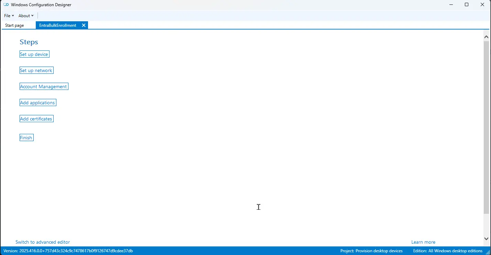
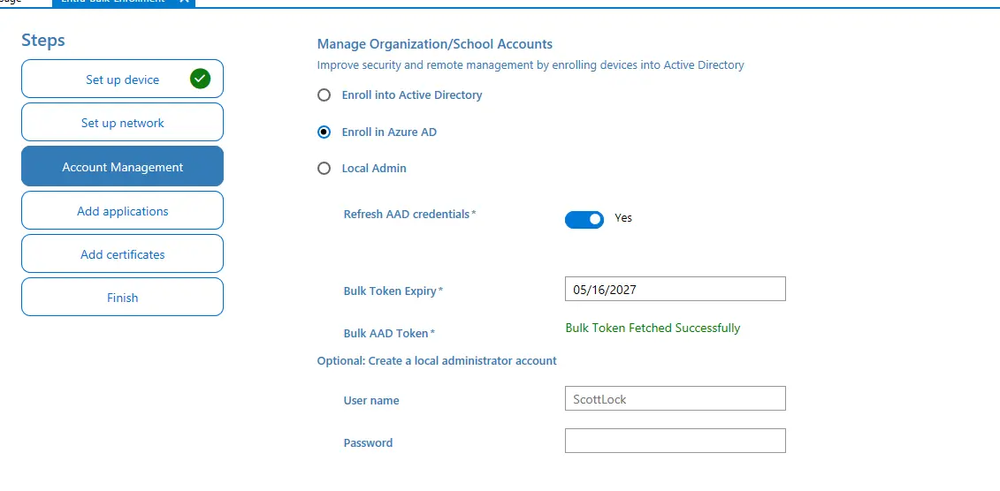
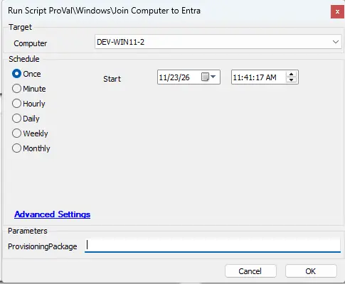

## Summary

This script joins a Windows workstation to Microsoft Entra ID by applying an Entra ID bulk enrollment provisioning package (`.ppkg`) created with Windows Configuration Designer. Run it after the computer has been removed from its Active Directory domain, renamed if needed, and restarted.

The script applies the package, confirms the join with `dsregcmd`, and backs up the BitLocker recovery keys to Entra ID, because the copies stored in Active Directory are lost along with the domain controllers. It then deletes its copy of the package, because the package contains the bulk enrollment token.

On a computer that's already Entra joined, the join is skipped and only the BitLocker backup runs, so the script is safe to run again.

Once users have signed in with their Entra ID accounts, run `Copy-DomainProfileToEntra` to bring their files across from their domain profiles.

:::note  
The script doesn't restart the computer. After a new join, restart it before users sign in with their Entra ID accounts. Nothing is changed until every pre-flight check passes, and the script log shows a failure when a check or the join fails.  
:::

## Requirements

- Windows 10 or Windows 11 Pro, Enterprise, or Education workstation. Servers and Home editions aren't supported.
- PowerShell 5.1
- Not joined to an Active Directory domain, and restarted since it was removed from the domain
- No computer rename waiting on a restart, because Entra ID registers the device under its current name
- Access on TCP port 443 to `login.microsoftonline.com` and `enterpriseregistration.windows.net`
- An Entra ID bulk enrollment provisioning package with a bulk token that hasn't expired, reachable from the computer. It isn't needed when the computer is already Entra joined. See [Create the Provisioning Package](#create-the-provisioning-package).

## Create the Provisioning Package

Create the package once for each client. Before you start, make sure you have:

- An Entra ID account with the **Cloud Device Administrator**, **Intune Administrator**, or **Password Administrator** role. The role must not be scoped to an administrative unit, and the account must be in the Intune MDM user scope.
- An account that signs in with a password or certificate-based authentication. Federated accounts in a staged rollout can't create a bulk token.
- A Windows 10 or Windows 11 computer with [Windows Configuration Designer](https://www.microsoft.com/p/windows-configuration-designer/9nblggh4tx22) installed from the Microsoft Store. Windows Server isn't supported for this task.
- These settings in the client's Entra ID tenant, under **Devices > Device settings**:
  - **Users may join devices to Microsoft Entra** set to **All**, or to a group you add the package account to after creating the package.
  - **Maximum number of devices per user** set to **Unlimited**, or higher than the number of computers you'll join with one package.
  - **Require Multifactor Authentication to register or join devices with Microsoft Entra** set to **No**.
- No Conditional Access policy requiring multifactor authentication (MFA) applied to the package account. Bulk enrollment doesn't support MFA, so add the package account as an exclusion after you create the package.
- The `Microsoft.Azure.SyncFabric` service principal (App ID `00000014-0000-0000-c000-000000000000`) present in the tenant. Without it, Windows Configuration Designer can't create the bulk token.

Then create the package in Windows Configuration Designer:

1. Open **Windows Configuration Designer** and select **Provision desktop devices**.
2. Enter `EntraBulkEnrollment` as the **Name**. The package file takes this name. Choose a **Project folder** in a secure location, then select **Finish**.

    

3. On **Set up device**, use these values:

    | Setting | Value | Why |
    |---|---|---|
    | **Device name** | Leave empty | Each computer keeps its current name. A name here renames every computer the package is applied to. |
    | **Enter product key** | Leave empty | The computers already run a supported edition. |
    | **Configure devices for shared use** | **No** | **Yes** turns on shared PC mode. |
    | **Remove pre-installed software** | **No** | **Yes** removes software already installed on the computers. |

4. On **Set up network**, leave **Set up network** set to **Off**. The computers already have a network connection.
5. On **Account Management**, select **Enroll in Azure AD**.
6. Turn on **Refresh AAD Credentials**, and enter your Entra ID credentials when asked.
7. Set **Bulk Token Expiry** to a date that covers the migration, up to 90 days ahead.
8. Select **Get Bulk Token** and sign in with the administrator account, using its password or a certificate.

    

9. On **Stay signed in to all your apps**, select **No, sign in to this app only**. Otherwise, the computer you're using becomes managed by the client's organization.
10. When the page shows that the bulk token was fetched successfully, select **Next**.
11. On **Add applications** and **Add certificates**, add nothing and select **Next**.
12. On **Finish**, set **Protect your package** to **No**. The script applies the package without user interaction, so it can't enter a password.
13. Select **Create**. When the package is built, select the link at the bottom of the page to open its folder. You only need `EntraBulkEnrollment.ppkg`.

Copy `EntraBulkEnrollment.ppkg` to the computer, or to an HTTPS location it can reach, and set `ProvisioningPackage` to that path or URL.

:::warning  
Windows Configuration Designer doesn't encrypt its project files, and the package contains the bulk token. Keep the project folder and the `.ppkg` file somewhere secure, and delete them when the migration is finished.  
:::

## Dependencies

- [Script: Local Machine - Domain - Remove](/docs/4bd0cdb9-f90e-4ffb-b880-52e4ff1c28c1)
- [Script: Intune Enrollment for Entra Joined Devices](/docs/9ea6eea1-814c-4642-bcad-fa34b361eb42)

## Sample Run

Run the script with `ProvisioningPackage` set to the path or URL of the provisioning package.

## User Parameters

| Name | Required | Example | Description |
| ---- | -------- | ------- | ----------- |
| ProvisioningPackage | False | `C:\ProgramData\_automation\script\Entra\EntraBulkEnrollment.ppkg` | Local path, UNC path, or HTTP(S) URL of the Entra ID bulk enrollment provisioning package (`.ppkg`). Required unless the computer is already Entra joined. Any query string on a URL, such as a SAS token, is left out of the script log. |

:::note  
The script runs as `System`. On a computer that has left the domain, it opens a UNC share without domain credentials, so a UNC path often fails. Use a local path or an HTTPS URL.  
:::

## Scenarios

- **Not Entra joined yet:** the script copies or downloads the package to the `TEMP` folder, checks that it can be read, applies it, and waits up to 5 minutes for the join. It then backs up the BitLocker recovery keys to Entra ID, reports the tenant, and asks for a restart.
- **Already Entra joined:** the join is skipped and only the BitLocker backup runs. No package is needed.
- **A pre-flight check fails:** for example, the computer is still joined to the domain, a rename is waiting on a restart, `ProvisioningPackage` is empty, or the Entra ID endpoints can't be reached. Nothing is changed and the script log shows the reason.
- **The join doesn't finish within 5 minutes:** the script reports a failure. Check that the bulk token hasn't expired and that the package account is allowed to join devices. The failure message gives the path of the provisioning logs.
- **The staged package can't be deleted:** the script reports a failure and gives the path of the file. Delete it by hand, because it contains the bulk enrollment token.

## Output

- Script log, ending with a line that starts with `Success:` or `Failure:`
- The computer joined to Microsoft Entra ID
- BitLocker recovery keys backed up to Entra ID

## Changelog

### 2026-11-23

- Initial version of the document
