## Summary

This is the ConnectWise Automate implementation of the agnostic script [Update-Office](/docs/498075f7-623c-4b92-9fbc-fe0f5e7113a4). It runs the Office Click-to-Run client to update Microsoft 365 Apps in one of two modes, chosen by the `PromptUser` setting.

**PromptUser 0 or not set (default):** the script works as it always has. Open Office apps are closed without asking and Office is updated straight away. Every other setting is ignored.

**PromptUser 1:** the signed-in user is asked to save their work and close Office first.

- The prompt lists the Office apps that are open and offers **Postpone** and **Update Now**.
- Once the postponements are used up, a final prompt offers **Update Now** only, and Office is updated anyway if there is no answer.
- Office is updated straight away, without a prompt, when nobody is signed in or no Office app is open.
- Nothing happens when Office is already on the latest build of its update channel.
- After a postponement, the script schedules its own next prompt on the endpoint, so Automate only needs to run it once per update.
- After the update, a short notice tells the user they can reopen Office.

For screenshots of the prompts, see [Sample Prompts](/docs/498075f7-623c-4b92-9fbc-fe0f5e7113a4#sample-prompts) in the Update-Office document.

## Where the Settings Come From

Automate allows five parameters per script, so most prompt settings are stored in system properties and client-level EDFs. Each setting is taken from the first of these that holds a value:

1. The user parameter, for the five settings that have one.
2. The client-level EDF `UpdateOffice_<Setting>` of the computer's client.
3. The system property `UpdateOffice_<Setting>`.
4. The default of the Update-Office script.

Use the system properties for the partner-wide defaults, the client-level EDFs for clients that need something different, and the user parameters for a one-off run. The script log lists every setting it used and where it came from.

The script creates any missing system properties and client-level EDFs each time it runs. It never changes a value that already exists.

## Requirements

- Windows with Microsoft 365 Apps (Click-to-Run) installed
- Windows PowerShell 5.1
- Internet access to `contentrepo.net`, the PowerShell Gallery and the Office CDN
- With `PromptUser` set to `1`, access to Microsoft's Office release feed (`clients.config.office.net`), unless `SkipVersionCheck` is `1`
- With `PromptUser` set to `1`, only one user may be signed in. Computers with more than one interactive session, such as terminal servers, are skipped without updating.

## Dependencies

- [PowerShell: Update-Office](/docs/498075f7-623c-4b92-9fbc-fe0f5e7113a4)
- [OmniPrompt](/docs/8ead1ffd-dade-4e17-9958-3313da9a7aa8): downloaded by the agnostic script when a prompt is needed
- [SilentLauncher](/docs/b0b9f423-eee3-4148-b8a0-e99400c45698): downloaded by the agnostic script when a prompt is needed

## Sample Run

- **Example 1:** Update without prompting

  Run the script with every parameter empty, with the `UpdateOffice_PromptUser` system property at its default of `0` and the client-level EDF empty. Open Office apps are closed without warning and Office is updated, as in earlier versions of this script.

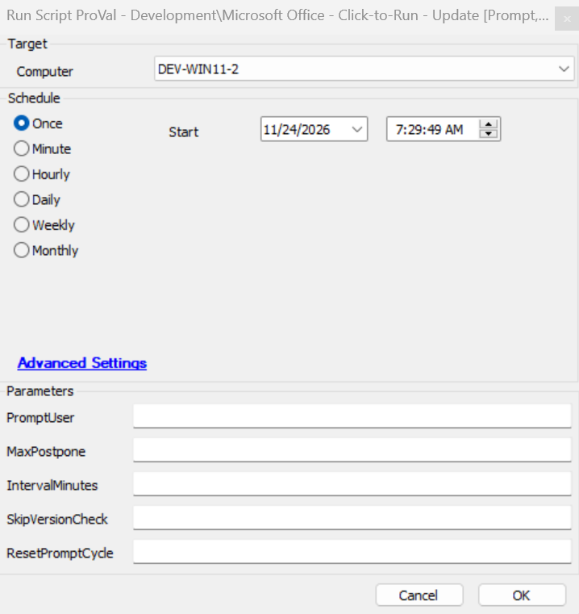

- **Example 2:** Prompt with the defaults

  The user can postpone up to 3 times, 2 hours apart. Each prompt stays open for 10 minutes, and an unanswered prompt counts as a postponement. The final prompt updates Office after 10 minutes without an answer.

  **PromptUser:** `1`

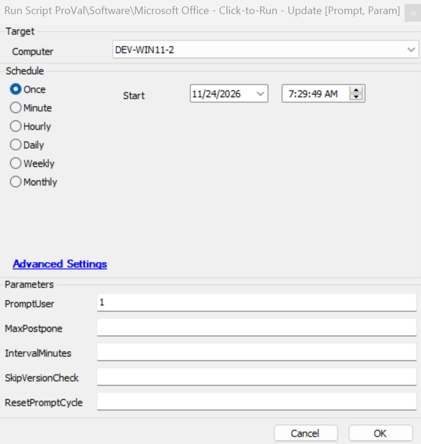

- **Example 3:** Single warning before the update

  The user sees the final prompt straight away, with 15 minutes to save their work before Office is updated. `FinalPromptTimeout` has no user parameter, so set it in the client-level EDF.

  **PromptUser:** `1`  
  **MaxPostpone:** `0`  
  **Client-level EDF `UpdateOffice_FinalPromptTimeout`:** `900`

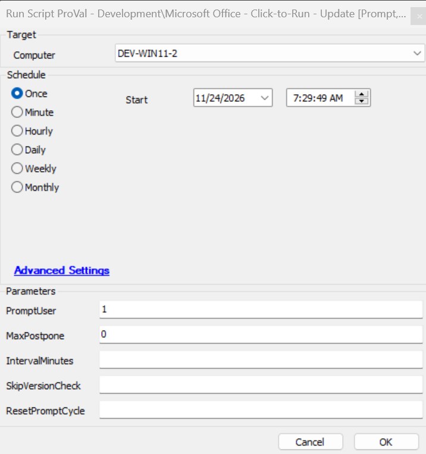

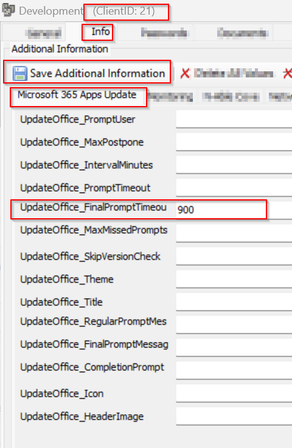

- **Example 4:** Hourly prompts, and force the update on computers left locked

  Prompts come every hour. If 4 passes in a row find the screen locked with Office open, the update runs without a prompt. The count resets when the user is found at an unlocked screen.

  **PromptUser:** `1`  
  **IntervalMinutes:** `60`  
  **Client-level EDF `UpdateOffice_MaxMissedPromptsBeforeForce`:** `4`

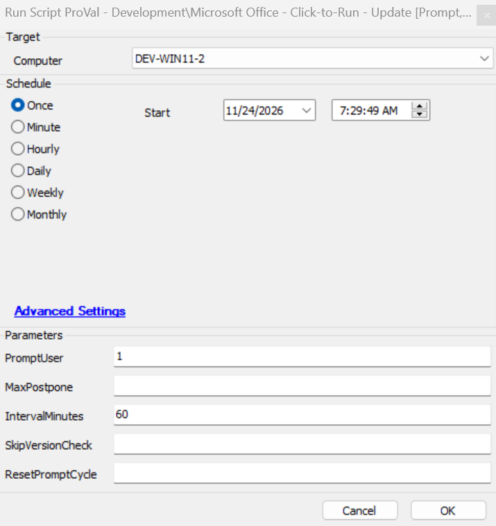

- **Example 5:** Computers that update from a network share or Configuration Manager

  Prompts without first comparing the installed build with Microsoft's latest build. Use it when the computers don't take updates from the Office CDN, because their latest available build can differ from Microsoft's. To make it permanent for a client, set the client-level EDF `UpdateOffice_SkipVersionCheck` to `1` instead.

  **PromptUser:** `1`  
  **SkipVersionCheck:** `1`

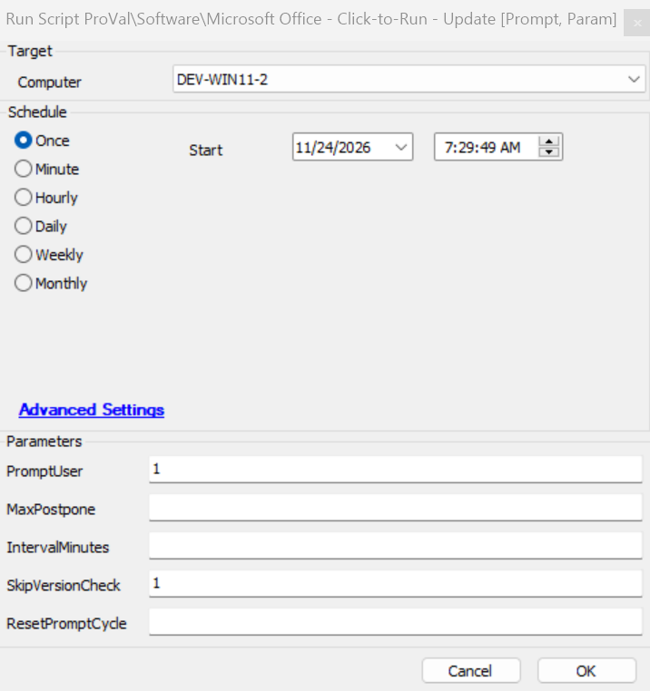

- **Example 6:** Restart a prompt cycle in progress

  Discards the postponements and scheduled prompts left by an earlier run and starts again from the first prompt. Without `ResetPromptCycle`, a run that finds a cycle in progress logs its state and exits.

  **PromptUser:** `1`  
  **ResetPromptCycle:** `1`

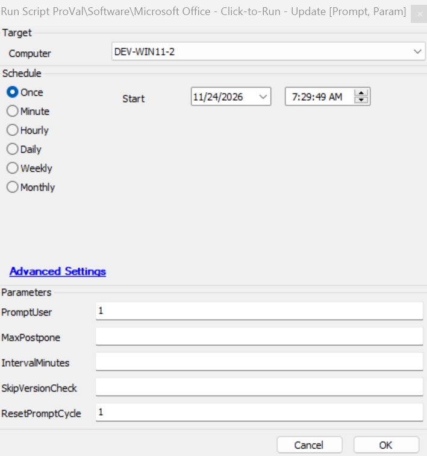

- **Example 7:** Company branding and custom wording for one client

  Set these client-level EDFs, then run with `PromptUser` set to `1`, or set the client-level EDF `UpdateOffice_PromptUser` to `1` as well. `UserName`, `OpenApplications` and `PostponesLeft` are replaced with live values, and `\n` starts a new line.

  **UpdateOffice_Title:** `ProValTech - Office update`  
  **UpdateOffice_Theme:** `Light`  
  **UpdateOffice_Icon:** `https://proval.com/icon.webp`  
  **UpdateOffice_RegularPromptMessage:** `Hi UserName, Office needs to update. Please save your work in OpenApplications and click Update Now.\n\nYou can postpone PostponesLeft more time(s).`

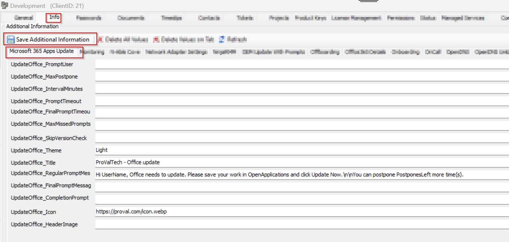

- **Example 8:** Fast cycle for testing

  Uses short intervals so the whole prompt cycle can be seen quickly. `SkipVersionCheck` makes the prompt appear on a test computer that's already up to date. Set the client-level EDF on a test client.

  **PromptUser:** `1`  
  **MaxPostpone:** `2`  
  **IntervalMinutes:** `15`  
  **SkipVersionCheck:** `1`  
  **Client-level EDF `UpdateOffice_FinalPromptTimeout`:** `60`

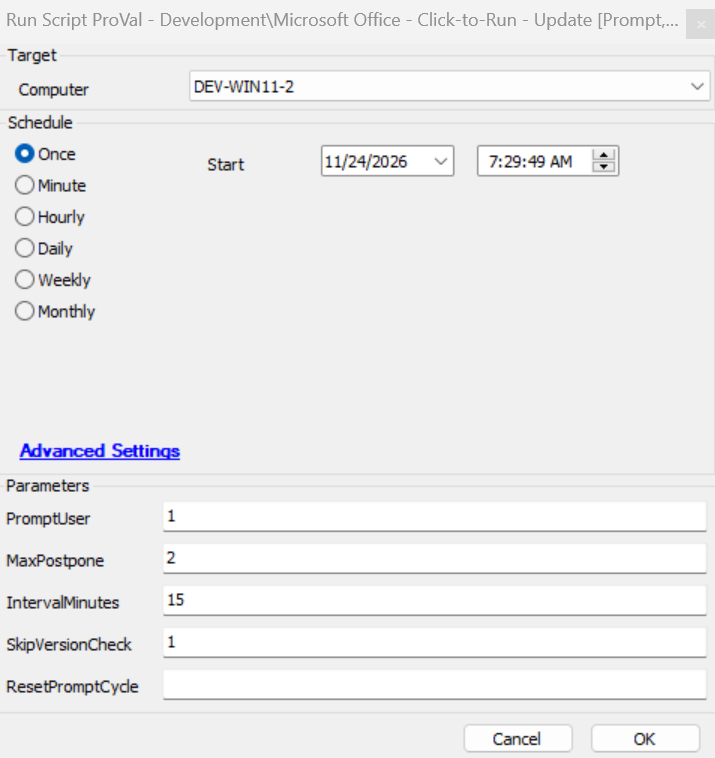

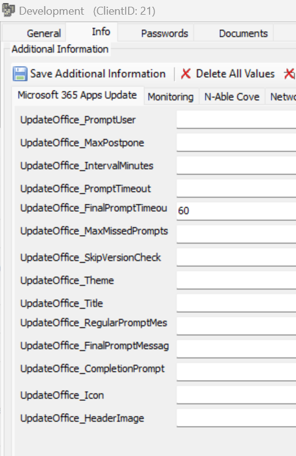

  Outcome:

  1. With Word open, the user sees the regular prompt with two postponements left and clicks **Postpone**. The script ends, and the next pass is scheduled on the endpoint 15 minutes later.
  2. At the next pass, the regular prompt shows one postponement left. The user clicks **Postpone** again.
  3. At the third pass, the final prompt offers **Update Now** only. When the user clicks it, or after 60 seconds without an answer, Word closes and Microsoft 365 Apps updates.
  4. If the update raised the Office version, a short notice tells the user they can reopen Office. On a test computer that was already up to date, no update is applied, so the notice doesn't appear and the endpoint log reports that the version didn't increase.

- **Example 9:** Prompt by default for every client

  Set the system property `UpdateOffice_PromptUser` to `1`. Runs with an empty `PromptUser` parameter then prompt, unless a client's EDF `UpdateOffice_PromptUser` is `0`. To turn prompting on for one client only, set that client's EDF to `1` and leave the system property at `0`.

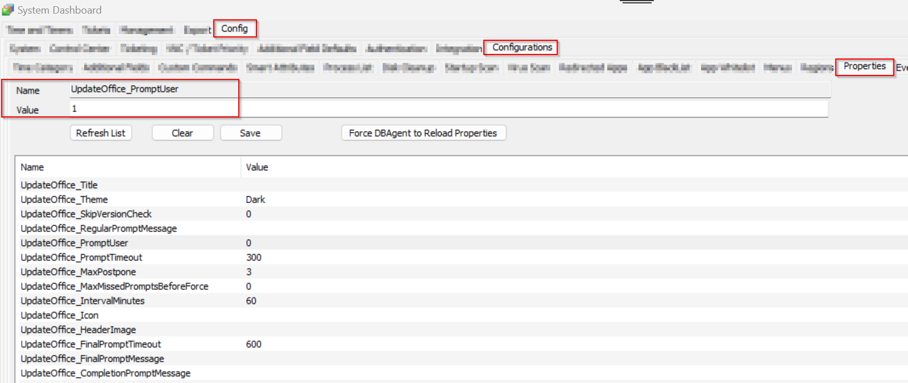

## User Parameters

| Name | Required | Example | Description |
| ---- | -------- | ------- | ----------- |
| `PromptUser` | False | `1` | `1` asks the signed-in user to save their work and close Office before the update. `0` closes open Office apps without asking, as in earlier versions of this script. Empty uses the client-level EDF, then the system property. |
| `MaxPostpone` | False | `2` | Times the user can postpone before the final prompt, `0` to `10`. A prompt left unanswered also uses one. `0` shows the final prompt straight away. Empty uses the client-level EDF, then the system property. |
| `IntervalMinutes` | False | `60` | Minutes between prompts after a postponement, an unanswered prompt, a locked screen or a prompt that failed to display, `15` to `1440`. Empty uses the client-level EDF, then the system property. |
| `SkipVersionCheck` | False | `1` | `1` prompts even when Office may already be on the latest build. Use it for computers that update from a network share or Configuration Manager, or for testing. Empty uses the client-level EDF, then the system property. |
| `ResetPromptCycle` | False | `1` | `1` discards a prompt cycle left by an earlier run and starts again from the first prompt. Passed to the agnostic script as `-Force`. Applies to the current run only, so it has no EDF or system property. |

:::note

- Every setting except `PromptUser` applies only when `PromptUser` resolves to `1`. When it resolves to `0` or isn't set, any other user parameter entered is ignored and listed in the script log.
- With `PromptUser` resolved to `1`, a value outside its accepted range, from any level, stops the script before anything is changed. The script log names the setting, the level it came from and the accepted values.
- Enter numbers and `1` or `0` only in the user parameters.

:::

## System Properties

Created by the script with these defaults when they don't exist. The defaults are those of the Update-Office script, so a new installation behaves as before until `UpdateOffice_PromptUser` is set to `1`.

| Name | Default | Accepted Values | Description |
| ---- | ------- | --------------- | ----------- |
| `UpdateOffice_PromptUser` | `0` | `1`, `0` | Prompt mode for every client that doesn't set its own EDF. |
| `UpdateOffice_MaxPostpone` | `3` | `0` to `10` | Times the user can postpone before the final prompt. |
| `UpdateOffice_IntervalMinutes` | `120` | `15` to `1440` | Minutes between prompts. |
| `UpdateOffice_PromptTimeout` | `600` | `60` to `3600` | Seconds a regular prompt stays open before it counts as a postponement. |
| `UpdateOffice_FinalPromptTimeout` | `600` | `60` to `3600` | Seconds the final prompt stays open before Office is closed and updated anyway. |
| `UpdateOffice_MaxMissedPromptsBeforeForce` | `0` | `0` to `50` | Passes in a row that find the screen locked with Office open before the update is forced without a prompt. `0` never forces. |
| `UpdateOffice_SkipVersionCheck` | `0` | `1`, `0` | `1` prompts even when Office may already be on the latest build. |
| `UpdateOffice_Theme` | `Dark` | `Dark`, `Light` | Prompt window theme. |
| `UpdateOffice_Title` | Empty | Plain text | Title of the regular and final prompts, also used for the completion notice. Empty uses the built-in title, `Microsoft 365 Apps Update`. |
| `UpdateOffice_RegularPromptMessage` | Empty | Plain text | Message of the regular prompt. Empty uses the built-in message. |
| `UpdateOffice_FinalPromptMessage` | Empty | Plain text | Message of the final prompt. Empty uses the built-in message. |
| `UpdateOffice_CompletionPromptMessage` | Empty | Plain text | Message of the notice shown after the update. Empty uses the built-in message. |
| `UpdateOffice_Icon` | Empty | URL, local path or UNC path | Icon shown in the prompt. |
| `UpdateOffice_HeaderImage` | Empty | URL, local path or UNC path | Header image shown at the top of the prompt. |

Titles and messages accept the [substitution variables](/docs/498075f7-623c-4b92-9fbc-fe0f5e7113a4#substitution-variables), such as `UserName`, `OpenApplications` and `PostponesLeft`, and `\n` for a line break. Keep custom text to plain ASCII characters, and keep the custom titles, messages and paths of the system properties and a client's EDFs under about 5,000 characters in total. Automate passes them to the endpoint on a command line, and a longer command is refused, so the script fails without changing anything. The built-in titles and messages are shown in Dutch when the signed-in user's display language is Dutch. See [Default Messages](/docs/498075f7-623c-4b92-9fbc-fe0f5e7113a4#default-messages) for the full text.

To change a property, see [Add/Edit System Properties in Automate](/docs/a4c1ce0c-c270-49fb-8688-4390482b6395).

## Client-Level EDFs

Created by the script when they don't exist. A value in a client-level EDF overrides the system property of the same name for that client's computers. Leave an EDF empty to use the system property.

| Name | Type | Level | Section | Editable | Required | Description |
| ---- | ---- | ----- | ------- | -------- | -------- | ----------- |
| `UpdateOffice_PromptUser` | Text | Client | Microsoft 365 Apps Update | Yes | No | `1` or `0`. Overrides `UpdateOffice_PromptUser` for this client. |
| `UpdateOffice_MaxPostpone` | Text | Client | Microsoft 365 Apps Update | Yes | No | `0` to `10`. Overrides `UpdateOffice_MaxPostpone`. |
| `UpdateOffice_IntervalMinutes` | Text | Client | Microsoft 365 Apps Update | Yes | No | `15` to `1440`. Overrides `UpdateOffice_IntervalMinutes`. |
| `UpdateOffice_PromptTimeout` | Text | Client | Microsoft 365 Apps Update | Yes | No | `60` to `3600`. Overrides `UpdateOffice_PromptTimeout`. |
| `UpdateOffice_FinalPromptTimeout` | Text | Client | Microsoft 365 Apps Update | Yes | No | `60` to `3600`. Overrides `UpdateOffice_FinalPromptTimeout`. |
| `UpdateOffice_MaxMissedPromptsBeforeForce` | Text | Client | Microsoft 365 Apps Update | Yes | No | `0` to `50`. Overrides `UpdateOffice_MaxMissedPromptsBeforeForce`. |
| `UpdateOffice_SkipVersionCheck` | Text | Client | Microsoft 365 Apps Update | Yes | No | `1` or `0`. Overrides `UpdateOffice_SkipVersionCheck`. |
| `UpdateOffice_Theme` | Text | Client | Microsoft 365 Apps Update | Yes | No | `Dark` or `Light`. Overrides `UpdateOffice_Theme`. |
| `UpdateOffice_Title` | Text | Client | Microsoft 365 Apps Update | Yes | No | Overrides `UpdateOffice_Title`. |
| `UpdateOffice_RegularPromptMessage` | Text | Client | Microsoft 365 Apps Update | Yes | No | Overrides `UpdateOffice_RegularPromptMessage`. |
| `UpdateOffice_FinalPromptMessage` | Text | Client | Microsoft 365 Apps Update | Yes | No | Overrides `UpdateOffice_FinalPromptMessage`. |
| `UpdateOffice_CompletionPromptMessage` | Text | Client | Microsoft 365 Apps Update | Yes | No | Overrides `UpdateOffice_CompletionPromptMessage`. |
| `UpdateOffice_Icon` | Text | Client | Microsoft 365 Apps Update | Yes | No | Overrides `UpdateOffice_Icon`. |
| `UpdateOffice_HeaderImage` | Text | Client | Microsoft 365 Apps Update | Yes | No | Overrides `UpdateOffice_HeaderImage`. |

:::note

Set partner-wide defaults in the system properties, not in Additional Field Defaults. The script doesn't read EDF defaults.

:::

## What Happens When PromptUser Is 1

Each run works through these checks in order, and the first one that applies decides what happens.

| Situation on the endpoint | Result |
| ------------------------- | ------ |
| A prompt cycle from an earlier run is still in progress | Logs the cycle state and exits, unless `ResetPromptCycle` is `1`. |
| Office is already on the latest build of its channel | Exits without prompting or updating, unless `SkipVersionCheck` is `1`. |
| More than one user is signed in, for example on a terminal server | Logs a warning and doesn't update, because closing Office could cost other users unsaved work. Update these computers with `PromptUser` set to `0` in a maintenance window. |
| Nobody is signed in | Updates straight away. |
| No Office app is open | Updates straight away. |
| The screen is locked | Defers the update to the next pass, or forces it once `MaxMissedPromptsBeforeForce` is reached. |
| Office is open and the user is at the desktop | Shows the regular prompt, or the final prompt once the postponements are used up. |

The run that shows the first prompt waits for the user's answer and for the update, up to about 45 minutes with the default timeouts. For more details and troubleshooting, see [Update-Office](/docs/498075f7-623c-4b92-9fbc-fe0f5e7113a4).

## Recommended Schedule

- **PromptUser 1:** schedule the script weekly during business hours on a group of Windows workstations with Microsoft 365 Apps. Set `PromptUser` to `1` in the schedule's parameters, or leave the parameters empty and turn prompting on with `UpdateOffice_PromptUser` at the client or system level. A weekly run picks up each new Office build within a week. A run that finds Office already up to date, or a prompt cycle still in progress, exits without prompting, so repeating the script is safe.
- **PromptUser 0:** open Office apps are closed without warning, so schedule the script outside business hours.

## Output

- Script log, which shows the mode, each prompt setting with the level it came from, any user parameters that were ignored and the agnostic script's log for this run. The last line starts with `Success:` or `Failure:`. A run without a `Success:` line is recorded as failed.
- Script files on the endpoint, replaced on each run:
  - `C:\ProgramData\_Automation\Script\Update-Office\Update-Office-CWA.ps1`, the signed script that Automate saves and runs
  - `C:\ProgramData\_Automation\Script\Update-Office\Update-Office.ps1`, the agnostic script it downloads
- Log files on the endpoint, for the run started by Automate:
  - `C:\ProgramData\_Automation\Script\Update-Office\Update-Office-log.txt`
  - `C:\ProgramData\_Automation\Script\Update-Office\Update-Office-error.txt`
- Log files on the endpoint, for the prompt passes the script schedules for itself when `PromptUser` is `1`:
  - `C:\ProgramData\_Automation\Script\Update-Office\Scheduled\Update-Office-log.txt`
  - `C:\ProgramData\_Automation\Script\Update-Office\Scheduled\Update-Office-error.txt`

The script log shows the result of the run started by Automate, such as an update, a postponement or "already up to date". When a postponement schedules a next pass, the script log gives its time. The outcome of later prompt passes is only in the endpoint log under `Scheduled`.

## FAQ

**Q: Which value wins when the same setting is in a user parameter, a client-level EDF and a system property?**

**A:** The user parameter, then the client-level EDF, then the system property. For example, with the system property `UpdateOffice_PromptUser` at `1`, the client-level EDF at `0` and the user parameter empty, that client's computers update without prompting. Running the script with `PromptUser` set to `1` prompts on those computers for that run.

**Q: Why are only five settings available as user parameters?**

**A:** Automate allows five parameters per script. The other prompt settings are in the system properties and client-level EDFs.

**Q: The script failed with "Invalid setting". What do I change?**

**A:** The script log names the setting, the level it came from and the accepted values, for example `MaxPostpone from the client EDF UpdateOffice_MaxPostpone is '12'. Use a whole number from 0 to 10.` Correct that value. Nothing was changed on the computer.

**Q: Where do I see whether the user eventually updated?**

**A:** In the endpoint log under `C:\ProgramData\_Automation\Script\Update-Office\Scheduled\`. Passes after the first run are started by a scheduled task on the computer, not by Automate.

## Changelog

### 2026-11-23

- Rebuilt the script on the current [Update-Office](/docs/498075f7-623c-4b92-9fbc-fe0f5e7113a4) agnostic script. With `PromptUser` set to `1`, the signed-in user is asked to save their work and close Office before the update, can postpone it a set number of times, and gets a final prompt. With `PromptUser` at `0` or not set, the script works as before.
- Added the user parameters `PromptUser`, `MaxPostpone`, `IntervalMinutes`, `SkipVersionCheck` and `ResetPromptCycle`.
- Added 14 system properties and 14 client-level EDFs named `UpdateOffice_<Setting>`, created by the script when missing, for every prompt setting including timeouts, prompt text and branding.
- With `PromptUser` at `1`, a value outside its accepted range now stops the script with a message instead of running with no effect.
- The script now saves a signed script, `Update-Office-CWA.ps1`, on the endpoint and runs it with the settings as parameters. That script runs Update-Office in 64-bit PowerShell, and the script log ends with a `Success:` or `Failure:` line.
- Renamed the script to `Microsoft Office - Click-to-Run - Update [Prompt, Param]`.
- Rewrote the document on the current template.

### 2025-04-10

- Initial version of the document