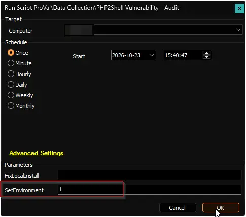
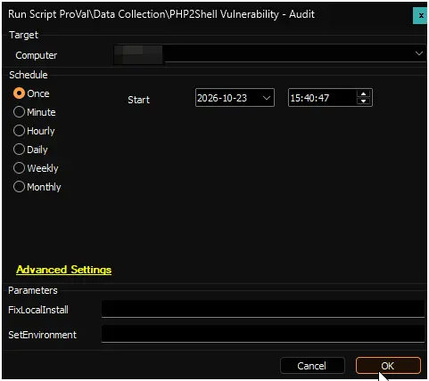
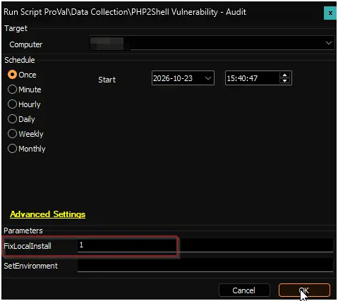

## Summary

This script finds every PHP installation on a Windows computer and records whether each one is affected by PHP2Shell, two critical PHP vulnerabilities (CVE-2026-109618 and CVE-2026-109619) that let an attacker take control of a web server without signing in. The results are stored in the custom table [pvl_php2shell_vulnerability_audit](/docs/b43cda86-3b83-46f0-95dd-c709203c7be3) and displayed in the [PHP2Shell Vulnerability - Audit](/docs/5b5af2c3-fdc1-4d61-bb6f-566cd10a7bee) dataview.

The search covers every NTFS drive, so it also finds PHP bundled inside other products, such as XAMPP or a vendor's application. Each installation is recorded with its location, owner, version, and status: `Patched`, `Vulnerable`, `EndOfLife`, or `Unknown`. A computer without any PHP installation is recorded once with the status `NotDetected`.

By default, the script only audits and changes nothing. With the `FixLocalInstall` parameter set to `1`, it also updates every vulnerable standalone PHP installation to the latest patched release of its version line.

PHP2Shell is fixed in PHP **8.5.12**, **8.4.27**, **8.3.36**, and **8.2.35**. PHP 8.1 and older no longer receive fixes.

**Supported OS:** Windows 10, Windows 11, Windows Server 2016 and later (64-bit)

:::note

- `FixLocalInstall` restarts IIS when IIS uses an updated PHP installation, which briefly takes down every website on the server, not only the PHP sites. Services that use the installation are stopped and started again, and running PHP processes are ended. Run it inside a maintenance window.
- PHP that belongs to a stack such as XAMPP, or to another vendor's product, is never changed. Update it through the owning product.
- PHP 8.1 and older have no fix and are never changed. They need an upgrade to PHP 8.2 or later after the application is tested.

:::

## Dependencies

- [PowerShell: Detect-PHP2ShellVulnerability](/docs/f72fd964-8053-48be-9245-7383b3a4db17)
- [Custom Table: pvl_php2shell_vulnerability_audit](/docs/b43cda86-3b83-46f0-95dd-c709203c7be3)
- [Script: OverFlowedVariable - SQL Insert - Execute](/docs/34cee8fe-1b6b-4558-a890-2face427ceb8)
- [Solution: PHP2Shell Vulnerability Audit](/docs/756f165f-071f-486a-86b4-cd0890b43bd0)

## Sample Run

Run the script with the `SetEnvironment` parameter set to `1` after import to create the custom table [pvl_php2shell_vulnerability_audit](/docs/b43cda86-3b83-46f0-95dd-c709203c7be3).

**Example 1:**

Running the script without parameters to audit the computer and record every PHP installation. Nothing is changed.

**Example 2:**

Running the script with `FixLocalInstall` set to `1` to audit the computer and update every vulnerable standalone PHP installation.

## User Parameters

| Name | Example | Required | Description |
| ---- | ------- | -------- | ----------- |
| `SetEnvironment` | `1` | `First Run Only` | Set to `1` to create the custom table [pvl_php2shell_vulnerability_audit](/docs/b43cda86-3b83-46f0-95dd-c709203c7be3). |
| `FixLocalInstall` | `1` | `False` | Set to `1` to update every vulnerable standalone PHP installation to the latest patched release of its version line. A backup is taken before each update and restored automatically if the update fails. IIS restarts when it uses an updated installation. Leave it blank to audit only. |

## Global Variables

| Name | Value | Accepted Values | Description |
| ---- | ----- | --------------- | ----------- |
| Debug | `False` | `False`, `True` | When `True`, enables informational logging; when `False` (default), informational logs are suppressed to avoid adding entries to the `h_scripts` table. Set to `True` to assist with troubleshooting. |
| ScriptEngineEnableLogger | `False` | `False`, `True` | When `True`, enables final (success/failure) logging; when `False` (default), these logs are suppressed to avoid adding entries to the `h_scripts` table. Set to `True` to assist with troubleshooting. |

## Output

- Script Log
- [Custom Table: pvl_php2shell_vulnerability_audit](/docs/b43cda86-3b83-46f0-95dd-c709203c7be3)
- [Dataview: PHP2Shell Vulnerability - Audit](/docs/5b5af2c3-fdc1-4d61-bb6f-566cd10a7bee)

## Changelog

### 2026-10-23

- Initial version of the document.
