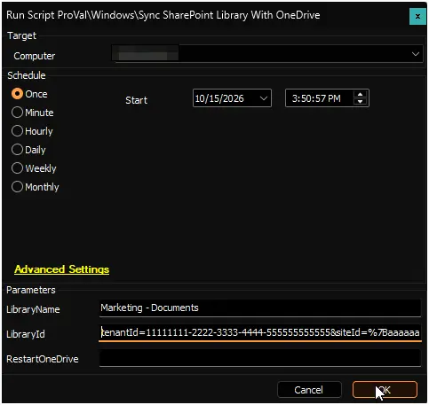

## Summary

Makes OneDrive automatically sync a SharePoint document library for every user on a computer. Users with access to the library see it in File Explorer without selecting **Sync** themselves.

The library is added to Microsoft's OneDrive policy for every user profile, including users who are not signed in. To learn how the policy works, see [Configure team site libraries to sync automatically](https://learn.microsoft.com/en-us/sharepoint/use-group-policy#configure-team-site-libraries-to-sync-automatically).

It works by running the [Set-OneDriveLibraryAutoSync](/docs/e359e323-4c2e-43a0-b6c6-5d82e4e50984) script. Run it once for each library.

:::warning  
Users cannot stop syncing a library added this way. Microsoft recommends it only for libraries with up to 5,000 files and folders, and for no more than 1,000 devices per library.  
:::

:::note  
Users need access to the library in SharePoint and must be signed in to OneDrive with their work or school account. Users without access are not affected.  
:::

## Sample Run

## Dependencies

- [PowerShell: Set-OneDriveLibraryAutoSync](/docs/e359e323-4c2e-43a0-b6c6-5d82e4e50984)

## Get the Library ID

1. Sign in to SharePoint as a Global Administrator or SharePoint Administrator.
2. Open the document library to sync.
3. Select **Sync**. If the browser asks to open OneDrive, select **Cancel**.
4. In the **Starting sync** dialog, select **Copy library ID**.
5. Paste the value into the `LibraryId` parameter exactly as it is.

If **Copy library ID** is not shown, build the library ID manually as described in the [Set-OneDriveLibraryAutoSync](/docs/e359e323-4c2e-43a0-b6c6-5d82e4e50984#build-it-manually) document.

## Global Variables

| Name | Value | Accepted Values | Description |
| ---- | ----- | --------------- | ----------- |
| Debug | `False` | `False`, `True` | When `True`, enables informational logging; when `False` (default), informational logs are suppressed to avoid adding entries to the `h_scripts` table. Set to `True` to assist with troubleshooting. |
| ScriptEngineEnableLogger | `False` | `False`, `True` | When `True`, enables final (success/failure) logging; when `False` (default), these logs are suppressed to avoid adding entries to the `h_scripts` table. Set to `True` to assist with troubleshooting. |

## User Parameters

| Name | Example | Required | Description |
|------|---------|----------|-------------|
| LibraryName | Marketing - Documents | True | Name that identifies the library on the computer. Use a different name for each library. Running again with the same name replaces the library ID. |
| LibraryId | tenantId=1111...&version=1 | True | Library ID of the SharePoint document library, as copied from SharePoint. See [Get the Library ID](#get-the-library-id). |
| RestartOneDrive | 1 | False | Set to `1` to restart OneDrive for signed-in users, so the library appears within a few minutes. Users only see the OneDrive icon disappear and come back. |

## Results

| Situation | Result |
|-----------|--------|
| Library ID complete | Success. The library is added for every user profile on the computer. |
| Library ID incomplete | Failure. No changes. Copy the full library ID again and run again. |
| No user has signed in to the computer yet | Failure. No changes. Run again after a user has signed in. |

## When the Library Appears

| User | Library Appears |
|------|-----------------|
| Signed in, `RestartOneDrive` set to `1` | Within a few minutes |
| Signed in | The next time OneDrive starts, or within 8 hours |
| Not signed in | At the user's next sign-in |
| Signs in to the computer for the first time after the script ran | After the script runs again |
| No access to the library | Never |

:::note  
On shared computers, schedule the script (for example daily) so new users also get the library. Leave `RestartOneDrive` empty for scheduled runs, so OneDrive is not restarted every day.  
:::

## Output

- Script log
- Script logs on the device:
  - `C:\ProgramData\_Automation\Script\Set-OneDriveLibraryAutoSync\Set-OneDriveLibraryAutoSync-log.txt`
  - `C:\ProgramData\_Automation\Script\Set-OneDriveLibraryAutoSync\Set-OneDriveLibraryAutoSync-error.txt`

## Changelog

### 2026-10-15

- Initial version of the document.
