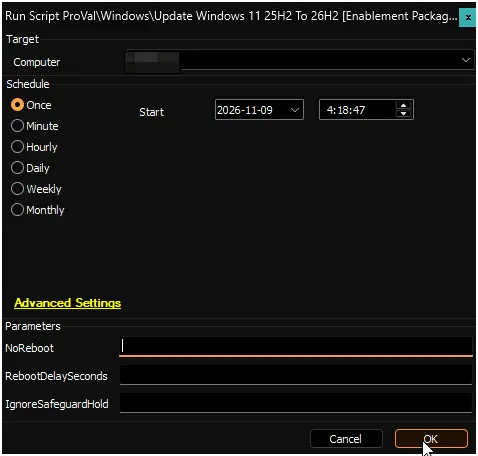

## Summary

Upgrades Windows 11 version 25H2 devices to version 26H2 with a single restart. Apps, files, and settings stay in place.

The upgrade uses Microsoft's enablement package (KB5121794), a small update that switches on 26H2 features already delivered to the device by monthly updates. To learn how it works, see [KB5121794: Feature update to Windows 11, version 26H2](https://support.microsoft.com/en-us/servicing/os/windows-11/2026/09/kb5121794-feature-update-to-windows-11-version-26h2).

It works by running the [Update-Windows11To26H2](/docs/37299bd4-991c-4c27-a8bf-96a86d348896) script. Devices that do not qualify are left unchanged and reported as failures.

:::warning  
`NoReboot` does not guarantee that the device stays up. It only stops this script from restarting the device. Windows Update can still restart it on its own schedule, for example to finish installing other updates, and patch policies or users can restart it too. Any restart completes the upgrade, so run this script inside a maintenance window if restart timing matters.  
:::

:::note  
Devices need Windows 11 version 25H2 with the September 2026 update (KB5124010) or any later monthly update.  
:::

## Sample Run

## Dependencies

- [PowerShell: Update-Windows11To26H2](/docs/37299bd4-991c-4c27-a8bf-96a86d348896)

## Global Variables

| Name | Value | Accepted Values | Description |
| ---- | ----- | --------------- | ----------- |
| Debug | `False` | `False`, `True` | When `True`, enables informational logging; when `False` (default), informational logs are suppressed to avoid adding entries to the `h_scripts` table. Set to `True` to assist with troubleshooting. |
| ScriptEngineEnableLogger | `False` | `False`, `True` | When `True`, enables final (success/failure) logging; when `False` (default), these logs are suppressed to avoid adding entries to the `h_scripts` table. Set to `True` to assist with troubleshooting. |

## User Parameters

| Name | Example | Required | Description |
|------|---------|----------|-------------|
| NoReboot | 1 | False | Set to `1` to install the upgrade without restarting the device. The upgrade completes on the next restart from any source. See the warning in the Summary. |
| RebootDelaySeconds | 900 | False | Seconds to wait before restarting, from 60 to 86400. Signed-in users see a restart warning during this time. Any other value stops the script before it makes changes. Ignored when `NoReboot` is set. Default: `300`. |
| IgnoreSafeguardHold | 1 | False | Set to `1` to install the upgrade even when Microsoft has placed a safeguard hold on the device. Use only on tested devices. |

## Results by Device

| Device | Result |
|--------|--------|
| Windows 11 25H2, all requirements met | Upgraded to 26H2. Restarts after the delay unless `NoReboot` is set. |
| Windows 11 26H2 or newer (including 26H1) | Success. No changes. |
| Windows 11 25H2 without the required update | Failure. No changes. Install the latest monthly update and run again. |
| Windows 11 24H2 | Failure. No changes. This script upgrades 25H2 only. Upgrade to 25H2 first. |
| Windows 11 23H2 or earlier, or Windows 10 | Failure. No changes. These versions need a full feature update instead. |
| Windows 11 LTSC edition or Windows Server | Failure. No changes. Not eligible for this upgrade. |
| Device under a safeguard hold | Failure. No changes, unless `IgnoreSafeguardHold` is set. |

:::note  
A safeguard hold is Microsoft blocking an update on devices with a known problem, such as an incompatible driver. The failure message includes the safeguard ID, which you can look up on the [Windows 11, version 26H2 known issues](https://learn.microsoft.com/en-us/windows/release-health/status-windows-11-26h2) page.  
:::

## Output

- Script log
- Script logs on the device:
  - `C:\ProgramData\_Automation\Script\Update-Windows11To26H2\Update-Windows11To26H2-log.txt`
  - `C:\ProgramData\_Automation\Script\Update-Windows11To26H2\Update-Windows11To26H2-error.txt`

## Changelog

### 2026-11-09

- Initial version of the document.
