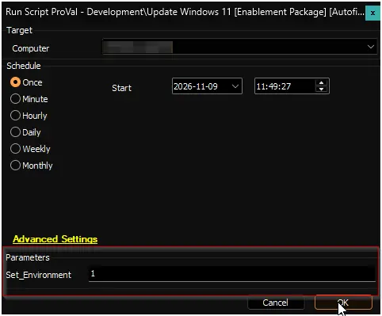
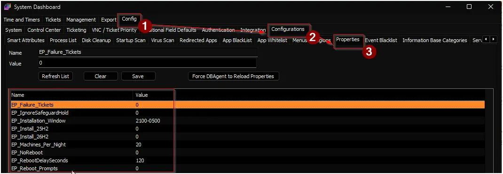
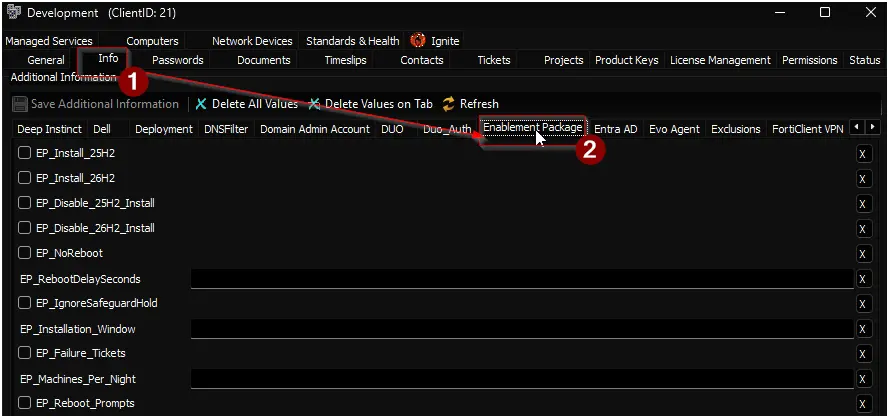
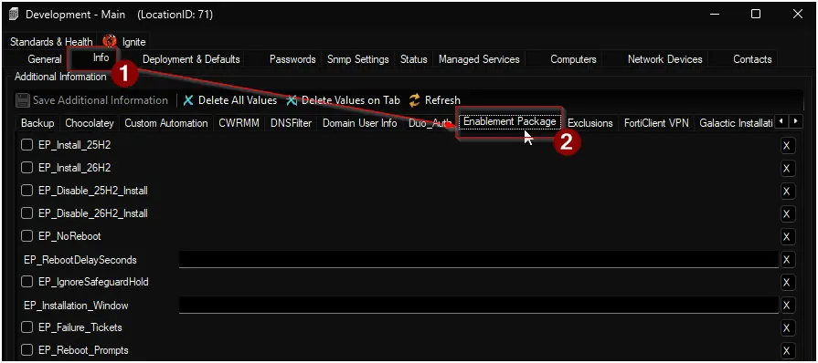
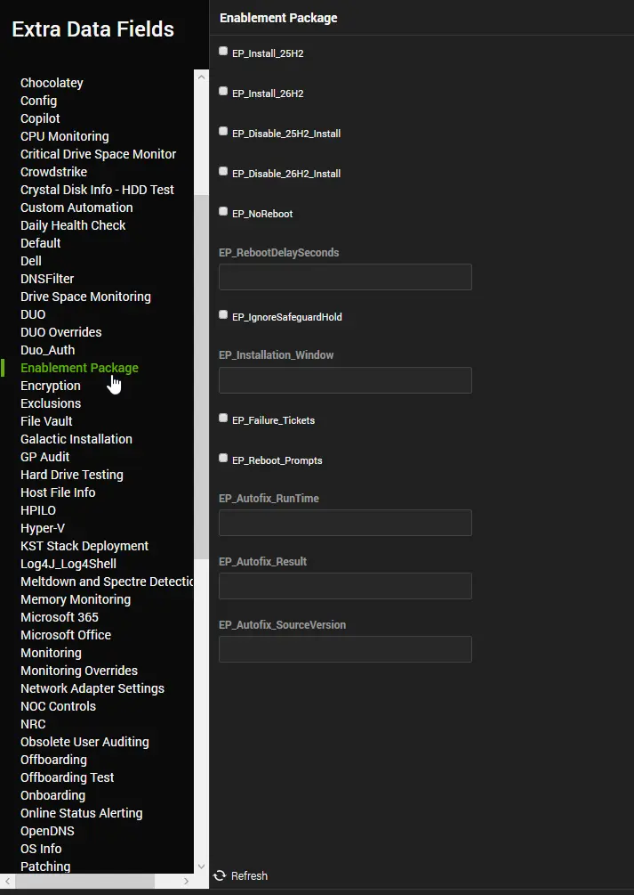

## Summary

Upgrades Windows 11 devices to their next version when the [Windows 11 Enablement Package Eligible Machine](/docs/475a45ea-c16f-4772-bb15-868d5a51fe6f) internal monitor detects them, then records the result.

| Current version | Upgrade script it runs | New version |
|---|---|---|
| 24H2 | [Update Windows 11 24H2 To 25H2 [Enablement Package]](/docs/39e0c09c-9219-4c86-acb5-b2c34b7e95fc) | 25H2 |
| 25H2 | [Update Windows 11 25H2 To 26H2 [Enablement Package]](/docs/7d8e9f0a-1b2c-4d3e-8f9a-0b1c2d3e4f5a) | 26H2 |

The monitor passes each device's settings to this script, such as the restart delay and whether to create failure tickets. You control these settings with the system properties and EDFs described below.

This script is part of the [Windows 11 Enablement Package Upgrade](/docs/b3a6abf9-10cd-40fe-a628-d736665b8963) solution.

## Dependencies

- [Internal Monitor: Windows 11 Enablement Package Eligible Machine](/docs/475a45ea-c16f-4772-bb15-868d5a51fe6f)
- [Script: Update Windows 11 24H2 To 25H2 [Enablement Package]](/docs/39e0c09c-9219-4c86-acb5-b2c34b7e95fc)
- [Script: Update Windows 11 25H2 To 26H2 [Enablement Package]](/docs/7d8e9f0a-1b2c-4d3e-8f9a-0b1c2d3e4f5a)
- [Solution: Windows 11 Compatibility Audit](/docs/f0bb3ffc-60cb-484c-b7fa-27a386ac664c)
- [Solution: User Prompt for Reboot](/docs/32d2254e-c2a4-4f2d-a029-b74f6d3c8b1a) (only needed for reboot prompts)
- [Solution: Windows 11 Enablement Package Upgrade](/docs/b3a6abf9-10cd-40fe-a628-d736665b8963)

## Sample Run

**First run:** Run the script once against any online Windows 11 device with `Set_Environment` set to `1`. This creates the system properties and EDFs the solution uses, with their default values. The device is not upgraded.



:::note  
This script runs only from the [Windows 11 Enablement Package Eligible Machine](/docs/475a45ea-c16f-4772-bb15-868d5a51fe6f) monitor, through the `△ Custom - Execute Script - Update Windows 11 [Enablement Package] [Autofix]` alert template. It is not designed for manual runs, except the first run with `Set_Environment`. A manual run exits without making changes.  
:::

:::tip  
To upgrade a single device right away, run [Update Windows 11 24H2 To 25H2 [Enablement Package]](/docs/39e0c09c-9219-4c86-acb5-b2c34b7e95fc) or [Update Windows 11 25H2 To 26H2 [Enablement Package]](/docs/7d8e9f0a-1b2c-4d3e-8f9a-0b1c2d3e4f5a) on it directly.  
:::

## User Parameters

| Name | Required | Example | Description |
|------|----------|---------|-------------|
| Set_Environment | True (first run only) | 1 | Set to `1` to create the system properties and EDFs used by the solution. The script exits after creating them and makes no changes to the device. |

## How Settings Are Applied

Each setting has a system property that acts as the default for all clients. You can override it with EDFs at the client, location, and computer level.

- **Text settings** (`EP_RebootDelaySeconds`, `EP_Installation_Window`) – The most specific value wins, in this order: computer, location, client, system property. Blank or invalid values are skipped.
- **Check-box settings** – A setting is on when it is checked at any level, or when its system property is `1`. Unchecking a box at a lower level does not turn the setting off.
- **Disable EDFs** – `EP_Disable_25H2_Install` and `EP_Disable_26H2_Install` block their upgrade when checked at any level. They override every setting that turns the upgrade on.
- **Machines per night** – `EP_Machines_Per_Night` exists only as a system property and a client EDF. The client EDF wins.

Changes apply from the monitor's next run. EDF changes can take up to 20 minutes to reach the monitor.

## Properties

System properties are text fields. For on/off settings, enter `1` for on and `0` for off.

| Name | Default | Description |
| ---- | ------- | ----------- |
| `EP_Install_25H2` | `0` | Set to `1` to turn on the 25H2 upgrade for eligible 24H2 devices in all clients. |
| `EP_Install_26H2` | `0` | Set to `1` to turn on the 26H2 upgrade for eligible 25H2 devices in all clients. |
| `EP_NoReboot` | `0` | Set to `1` to install the upgrade without restarting the device. The upgrade finishes on the device's next restart. |
| `EP_RebootDelaySeconds` | `120` | Seconds to wait before restarting, from 60 to 86400. Other values make the upgrade fail. Ignored when `EP_NoReboot` is on. |
| `EP_IgnoreSafeguardHold` | `0` | Set to `1` to install the upgrade even when Microsoft has blocked it on the device with a safeguard hold (a known compatibility issue). Use only on tested devices. |
| `EP_Installation_Window` | `2100-0500` | Hours when upgrades can start, in 24-hour `HHMM-HHMM` format. `2100-0500` means 9:00 PM to 5:00 AM. Times use the Automate server's time zone. |
| `EP_Failure_Tickets` | `0` | Set to `1` to create a ticket when an upgrade fails. See [Ticketing](#ticketing). |
| `EP_Machines_Per_Night` | `20` | Maximum number of devices per client to upgrade in any 24 hours. |
| `EP_Reboot_Prompts` | `0` | Set to `1` to prompt users to restart when `EP_NoReboot` is on. Requires the [User Prompt for Reboot](/docs/32d2254e-c2a4-4f2d-a029-b74f6d3c8b1a) solution. |



## Client-Level EDFs

| Name | Type | Level | Section | Editable | Required | Description |
| ------------- | ------ | ------ | ----- | ----- | ----- | -------------------------------------------- |
| `EP_Install_25H2` | Check-Box | Client | Enablement Package | Yes | False | Turns on the 25H2 upgrade for eligible 24H2 devices in this client. |
| `EP_Install_26H2` | Check-Box | Client | Enablement Package | Yes | False | Turns on the 26H2 upgrade for eligible 25H2 devices in this client. |
| `EP_Disable_25H2_Install` | Check-Box | Client | Enablement Package | Yes | False | Blocks the 25H2 upgrade for all devices in this client, even if it is turned on at another level. |
| `EP_Disable_26H2_Install` | Check-Box | Client | Enablement Package | Yes | False | Blocks the 26H2 upgrade for all devices in this client, even if it is turned on at another level. |
| `EP_NoReboot` | Check-Box | Client | Enablement Package | Yes | False | Installs the upgrade without restarting devices in this client. |
| `EP_RebootDelaySeconds` | Text | Client | Enablement Package | Yes | False | Restart delay in seconds for devices in this client, from 60 to 86400. Leave blank to use the system property. |
| `EP_IgnoreSafeguardHold` | Check-Box | Client | Enablement Package | Yes | False | Installs the upgrade on devices in this client even when a safeguard hold applies. Use only on tested devices. |
| `EP_Installation_Window` | Text | Client | Enablement Package | Yes | False | Installation window for devices in this client, in `HHMM-HHMM` format. Leave blank to use the system property. |
| `EP_Failure_Tickets` | Check-Box | Client | Enablement Package | Yes | False | Creates a ticket when an upgrade fails on a device in this client. |
| `EP_Machines_Per_Night` | Text | Client | Enablement Package | Yes | False | Maximum number of devices in this client to upgrade in any 24 hours. Leave blank to use the system property. |
| `EP_Reboot_Prompts` | Check-Box | Client | Enablement Package | Yes | False | Prompts users in this client to restart when `EP_NoReboot` is on. |



## Location-Level EDFs

| Name | Type | Level | Section | Editable | Required | Description |
| ------------- | ------ | ------ | ----- | ----- | ----- | -------------------------------------------- |
| `EP_Install_25H2` | Check-Box | Location | Enablement Package | Yes | False | Turns on the 25H2 upgrade for eligible 24H2 devices in this location. |
| `EP_Install_26H2` | Check-Box | Location | Enablement Package | Yes | False | Turns on the 26H2 upgrade for eligible 25H2 devices in this location. |
| `EP_Disable_25H2_Install` | Check-Box | Location | Enablement Package | Yes | False | Blocks the 25H2 upgrade for all devices in this location, even if it is turned on at another level. |
| `EP_Disable_26H2_Install` | Check-Box | Location | Enablement Package | Yes | False | Blocks the 26H2 upgrade for all devices in this location, even if it is turned on at another level. |
| `EP_NoReboot` | Check-Box | Location | Enablement Package | Yes | False | Installs the upgrade without restarting devices in this location. |
| `EP_RebootDelaySeconds` | Text | Location | Enablement Package | Yes | False | Restart delay in seconds for devices in this location, from 60 to 86400. Leave blank to use the client or system value. |
| `EP_IgnoreSafeguardHold` | Check-Box | Location | Enablement Package | Yes | False | Installs the upgrade on devices in this location even when a safeguard hold applies. Use only on tested devices. |
| `EP_Installation_Window` | Text | Location | Enablement Package | Yes | False | Installation window for devices in this location, in `HHMM-HHMM` format. Leave blank to use the client or system value. |
| `EP_Failure_Tickets` | Check-Box | Location | Enablement Package | Yes | False | Creates a ticket when an upgrade fails on a device in this location. |
| `EP_Reboot_Prompts` | Check-Box | Location | Enablement Package | Yes | False | Prompts users in this location to restart when `EP_NoReboot` is on. |



## Computer-Level EDFs

| Name | Type | Level | Section | Editable | Required | Description |
| ------------- | ------ | ------ | ----- | ----- | ----- | -------------------------------------------- |
| `EP_Install_25H2` | Check-Box | Computer | Enablement Package | Yes | False | Turns on the 25H2 upgrade for this device if it runs 24H2. |
| `EP_Install_26H2` | Check-Box | Computer | Enablement Package | Yes | False | Turns on the 26H2 upgrade for this device if it runs 25H2. |
| `EP_Disable_25H2_Install` | Check-Box | Computer | Enablement Package | Yes | False | Blocks the 25H2 upgrade for this device, even if it is turned on at another level. |
| `EP_Disable_26H2_Install` | Check-Box | Computer | Enablement Package | Yes | False | Blocks the 26H2 upgrade for this device, even if it is turned on at another level. |
| `EP_NoReboot` | Check-Box | Computer | Enablement Package | Yes | False | Installs the upgrade without restarting this device. |
| `EP_RebootDelaySeconds` | Text | Computer | Enablement Package | Yes | False | Restart delay in seconds for this device, from 60 to 86400. Leave blank to use the location, client, or system value. |
| `EP_IgnoreSafeguardHold` | Check-Box | Computer | Enablement Package | Yes | False | Installs the upgrade on this device even when a safeguard hold applies. Use only on tested devices. |
| `EP_Installation_Window` | Text | Computer | Enablement Package | Yes | False | Installation window for this device, in `HHMM-HHMM` format. Leave blank to use the location, client, or system value. |
| `EP_Failure_Tickets` | Check-Box | Computer | Enablement Package | Yes | False | Creates a ticket when an upgrade fails on this device. |
| `EP_Reboot_Prompts` | Check-Box | Computer | Enablement Package | Yes | False | Prompts the user of this device to restart when `EP_NoReboot` is on. |
| `EP_Autofix_RunTime` | Text | Computer | Enablement Package | No | False | Date and time the script last ran on this device, in `yyyy-MM-dd HH:mm:ss` format. Set by the script. |
| `EP_Autofix_Result` | Text | Computer | Enablement Package | No | False | Result of the last run: `Success`, `Reboot Pending`, or `Failed`. Set by the script. |
| `EP_Autofix_SourceVersion` | Text | Computer | Enablement Package | No | False | Windows 11 version this device had when the script last ran: `24H2` or `25H2`. Set by the script. |



## Results

After the upgrade script finishes, this script checks the device and saves one of these results in `EP_Autofix_Result`:

| Result | Meaning | What happens next |
|---|---|---|
| `Success` | The device already runs the target version. | Nothing else is needed. |
| `Reboot Pending` | The upgrade is installed and finishes on the next restart. | The device restarts after the delay, unless `EP_NoReboot` is on. When `EP_NoReboot` and `EP_Reboot_Prompts` are both on, the script turns on the `Pending Reboot` EDF, and the [User Prompt for Reboot](/docs/32d2254e-c2a4-4f2d-a029-b74f6d3c8b1a) solution prompts the user to restart. |
| `Failed` | The upgrade did not install. | The script logs the output and creates a ticket if `EP_Failure_Tickets` is on. |

The monitor skips a device for 7 days after each run, whatever the result. A device that has moved from 24H2 to 25H2 since its last run is the exception: it can be picked up for the 26H2 upgrade right away.

`EP_Autofix_Result` keeps its value until the script runs again. Restarting the device does not change it. The [Windows 11 Upgrade Audit [Enablement Package]](/docs/1488c8ab-6719-4b0b-987a-a2e163a0b26a) dataview shows `Success` once the device reports the new version.

## Ticketing

When an upgrade fails and `EP_Failure_Tickets` is on for the device, the script creates a ticket. If the device still has an open ticket with the same subject from an earlier failure, the script adds the new details to that ticket as a comment instead of creating a duplicate.

To control the board and priority of these tickets, set the Ticket Category on the monitor. See the [solution FAQ](/docs/b3a6abf9-10cd-40fe-a628-d736665b8963#faq).

**Subject:**

```text
Windows 11 <Target Version> Enablement Package Installation Failed on <Computer Name>
```

**Body:**

```text
The Windows 11 <Target Version> enablement package failed to install on <Computer Name> at <Client Name> - <Location Name>.

Current version: Windows 11 <Current Version>
Target version: Windows 11 <Target Version>

The Enablement Package solution won't attempt this upgrade on the device again for 7 days.

Common causes are a Microsoft safeguard hold on the device, a missing prerequisite cumulative update, a pending restart from earlier updates, or low disk space. Review the output below for the exact error.

After fixing the issue, run "Update Windows 11 <Current Version> To <Target Version> [Enablement Package]" on the device to retry. Otherwise, the Windows 11 Enablement Package Eligible Machine monitor will detect it again after 7 days.

PowerShell Script Output:

<Output of the upgrade script>

Script Log Content:

<Content of the upgrade script's log file>
```

The **Script Log Content** section is included only when the upgrade script's log file exists on the device.

## Output

- Script log
- Computer-level EDFs: `EP_Autofix_RunTime`, `EP_Autofix_Result`, and `EP_Autofix_SourceVersion`
- `Pending Reboot` EDF, when reboot prompts apply
- Ticket, when `EP_Failure_Tickets` is on and the upgrade fails

## Changelog

### 2026-11-09

- Initial version of the document.
