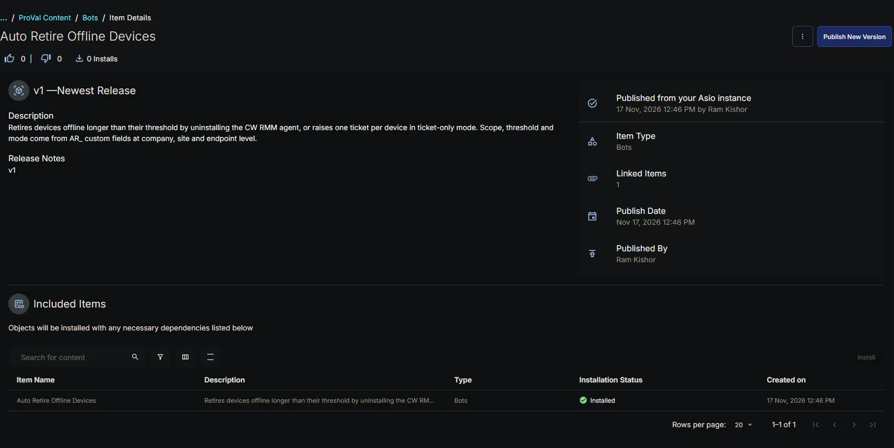

## Summary

The **Auto Retire Offline Devices** bot finds devices that have been offline in CW RMM for longer than their threshold and retires them by uninstalling the CW RMM agent. In ticket-only mode, it raises one ticket for each of those devices instead and removes nothing. It runs at each daily run of the [Auto Retire Offline Devices](/docs/a8e23aed-1111-4543-8f9c-8fbb24e73c99) workflow.

The bot runs inside the platform, so it uses the pre-authenticated RPA HTTP client for CW RMM and needs no CW RMM client ID or client secret. The base URL arrives automatically through the `cwOpenAPIURL` input.

**How it works:**

1. Every company is checked for devices that have been offline for 7 days or more. Online devices are never looked at.
2. Each device's name, OS, type and serial number are read.
3. The device's settings are read from its endpoint, site and company custom fields.
4. **Scope:** the device is skipped unless its settings cover it.
5. **Threshold:** the device is skipped unless it has been offline for at least its threshold in days.
6. **Mode:** in ticket-only mode, a ticket is raised unless the device's stored ticket is still open. Otherwise, the CW RMM agent is uninstalled.
7. If a setting can't be used or a step fails, the device is left alone, the reason is written to its [AR_Last_Result](/docs/b539484e-1f3b-4383-8ad7-4e37c19ef9eb) field, and the device is tried again at the next run.

**Settings and how they're chosen**

Each setting exists at three levels. The most specific level that holds a value wins, `Disabled` included, so a device set to `Enabled` is handled even when its company is `Disabled`. An empty value uses the level above. When the company has no value of its own, the default value of the company field applies, so the company fields' default values act as portal-wide defaults.

| Setting | Company | Site | Endpoint |
|---|---|---|---|
| Scope | [AR_Enable](/docs/5563ad64-f1a5-4245-9c3f-ded7303a1ae1) | [AR_Enable_Site](/docs/3bbf928b-d145-4fc9-9de4-16145479308d) | [AR_Enable_Endpoint](/docs/13205a0e-1d98-45b6-9806-5278edde1459) |
| Threshold in days | [AR_Threshold_Days](/docs/b0574e34-64f1-4c4f-9371-8c0a0b8a1b44) | [AR_Threshold_Days_Site](/docs/3eb97aa2-def8-4c0d-a956-856a22c826a7) | [AR_Threshold_Days_Endpoint](/docs/e078f89d-a405-471c-8b26-55a138657fdb) |
| Ticket-only mode | [AR_Ticket_Only](/docs/7579b40b-c4f1-4f78-afce-7507516787c8) | [AR_Ticket_Only_Site](/docs/5b330773-7b20-41a7-a3f7-8c542c876d63) | [AR_Ticket_Only_Endpoint](/docs/4b815d93-67d7-4071-ba16-e787f6b3174c) |

- **Scope:** the company and site fields cover devices by OS type, such as `Windows Workstations Only`. A Windows device counts as a server when CW RMM reports it as a server or its OS name includes Server. Devices that are neither Windows nor macOS, such as Linux, are only handled when [AR_Enable_Endpoint](/docs/13205a0e-1d98-45b6-9806-5278edde1459) is `Enabled`.
- **Threshold:** the offline time is counted from the last time the device contacted CW RMM. Thresholds below 7 days are refused.
- **Ticket-only mode:** when it isn't set at any level, the device is handled in ticket-only mode, so nothing is removed until someone sets it to `Disabled`.

**Tickets**

In ticket-only mode, each device gets one ticket, raised on the `MSP` board, assigned to the `MSP` team, with `Medium` priority and the `Alerting` source. The device is attached to the ticket, and the summary reads `Auto Retire: <device> is offline beyond its retirement threshold`. The description lists the device's company, site, OS, serial number, last contact, days offline and threshold, and says which field to change to retire or keep the device.

The ticket's number is stored in [AR_Ticket_Number](/docs/0fba3c3b-e142-43ce-9a28-5bdce021bd68). No new ticket is raised while that ticket is open. Once it's Closed or Resolved, a new ticket is raised at the next run if the device is still offline past its threshold and still in ticket-only mode.

**Safety limits**

- No more than 50 devices are retired in one run, so a setting changed by mistake can't clear out a whole company at once. Devices over the limit are retired at the following runs.
- A device whose settings can't be read, or hold a value the bot doesn't recognize, is left alone.
- Retiring is never retried blindly. If CW RMM reports an error, the bot checks whether the device is already gone before sending the uninstall again.

**Run time**

CW RMM stops a bot after 20 minutes. The bot doesn't start a new device after 14 minutes, and the devices it didn't reach are picked up at the next run. Devices are processed in random order, so in a very large environment every device is reached over a few runs. Temporary errors from CW RMM are retried up to five times.

**API endpoints used**

| Method | Endpoint | Purpose |
| ------ | -------- | ------- |
| GET | `/api/platform/v1/custom-field/definitions` | Find the AR custom fields and the company fields' default values |
| GET | `/api/platform/v1/company/companies` | List the companies |
| GET | `/api/platform/v1/company/sites` | Read site names for tickets |
| GET | `/api/platform/v2/device/endpoints/heartbeat` | Find the devices offline for 7 days or more, with their last contact time |
| POST | `/api/platform/v2/device/categories/platform/endpoints` | Read each device's name, OS, type and serial number |
| GET | `/api/platform/v1/company/companies/{companyId}/custom-fields` | Read the company settings |
| GET | `/api/platform/v1/company/sites/{siteId}/custom-fields` | Read the site settings |
| GET | `/api/platform/v2/device/endpoints/{endpointId}/custom-fields` | Read the endpoint settings and the stored ticket number |
| PUT | `/api/platform/v2/device/endpoints/{endpointId}/custom-fields` | Write AR_Ticket_Number and AR_Last_Result |
| DELETE | `/api/platform/v2/device/endpoints/uninstall` | Uninstall the CW RMM agent |
| GET | `/api/platform/v1/service/ticketing/service-boards` | Find the MSP board |
| GET | `/api/platform/v1/service/ticketing/service-boards/{boardId}/teams` | Find the MSP team |
| GET | `/api/platform/v1/service/ticketing/priorities` | Find the Medium priority |
| GET | `/api/platform/v1/service/ticketing/sources` | Find the Alerting source |
| GET | `/api/platform/v1/service/ticketing/statuses` | Tell open tickets from Closed and Resolved ones |
| GET | `/api/platform/v2/service/ticketing/tickets` | Find the stored ticket, or an open ticket already raised for the device |
| POST | `/api/platform/v2/service/ticketing/tickets` | Raise the ticket |

## Details

| Bot Name | Description | Execution Environment |
| -------- | ----------- | --------------------- |
| Auto Retire Offline Devices | Retires devices offline longer than their threshold by uninstalling the CW RMM agent, or raises one ticket per device in ticket-only mode. Scope, threshold and mode come from AR_ custom fields at company, site and endpoint level. | Cloud |

## Integration Configuration

| Platform | Platform Scopes | 3rd Party Apps | Integrations |
| -------- | --------------- | -------------- | ------------ |
| True | <ul><li>`Platform - Devices - Read`</li><li> `Platform - Devices - Update`</li><li> `Platform - Devices - Delete`</li><li> `Platform - Companies - Read`</li><li> `Platform - Sites - Read`</li><li> `Platform - Custom Fields - Read`</li><li> `Platform - Tickets - Read`</li><li> `Platform - Tickets - Create`</li></ul> | False |  |

## Form Setup

| Form Required | Form Template |
| ------------- | ------------- |
| No | N/A |

## Functions

- [app.py](https://github.com/ProVal-Tech/cw-rmm/blob/main/bots/auto-retire-offline-devices/app.py)

## Forms Setup Path

- **Tasks Path:** `Automation` ➞ `Bots`

## Dependencies

- [Custom Field: AR_Enable](/docs/5563ad64-f1a5-4245-9c3f-ded7303a1ae1)
- [Custom Field: AR_Threshold_Days](/docs/b0574e34-64f1-4c4f-9371-8c0a0b8a1b44)
- [Custom Field: AR_Ticket_Only](/docs/7579b40b-c4f1-4f78-afce-7507516787c8)
- [Custom Field: AR_Enable_Site](/docs/3bbf928b-d145-4fc9-9de4-16145479308d)
- [Custom Field: AR_Threshold_Days_Site](/docs/3eb97aa2-def8-4c0d-a956-856a22c826a7)
- [Custom Field: AR_Ticket_Only_Site](/docs/5b330773-7b20-41a7-a3f7-8c542c876d63)
- [Custom Field: AR_Enable_Endpoint](/docs/13205a0e-1d98-45b6-9806-5278edde1459)
- [Custom Field: AR_Threshold_Days_Endpoint](/docs/e078f89d-a405-471c-8b26-55a138657fdb)
- [Custom Field: AR_Ticket_Only_Endpoint](/docs/4b815d93-67d7-4071-ba16-e787f6b3174c)
- [Custom Field: AR_Ticket_Number](/docs/0fba3c3b-e142-43ce-9a28-5bdce021bd68)
- [Custom Field: AR_Last_Result](/docs/b539484e-1f3b-4383-8ad7-4e37c19ef9eb)

The bot takes no form input. It stops the run if any of the first ten custom fields is missing or was created at the wrong level, and the run's result message names the fields. [AR_Last_Result](/docs/b539484e-1f3b-4383-8ad7-4e37c19ef9eb) is optional: without it, the reasons only appear in the run's log.

**Consumed by:**

- [Workflows: Auto Retire Offline Devices](/docs/a8e23aed-1111-4543-8f9c-8fbb24e73c99)

**Related content:**

- [Solution: Auto Retire Offline Devices](/docs/e73836cc-f9c8-432c-bc6f-dc3bf2d36065)

## Implementation

Install the bot from the `ProVal - Content` Community, selecting the **Bots** repository, then publish the bot. After installation, the following configuration steps are mandatory.

### 1. Install the Custom Fields

Install the eleven custom fields listed in [Dependencies](#dependencies) from the `ProVal - Content` Community, selecting the **Custom Fields** repository.

### 2. Allow Agent Uninstallation

The bot uninstalls agents through the CW RMM API. It runs under the account that created the [workflow](/docs/a8e23aed-1111-4543-8f9c-8fbb24e73c99), so that account needs access to every device you want handled and must be allowed to uninstall agents. If agent uninstallation is turned off for it, CW RMM answers `ErrAgentUninstallationDisabled`, and that message is written to [AR_Last_Result](/docs/b539484e-1f3b-4383-8ad7-4e37c19ef9eb).

### 3. Check the Ticket Settings

Ticket-only mode raises tickets on the `MSP` board, assigned to the `MSP` team, with `Medium` priority and the `Alerting` source. Confirm these exist in your CW RMM ticketing settings. If one is missing, the ticket isn't raised, and [AR_Last_Result](/docs/b539484e-1f3b-4383-8ad7-4e37c19ef9eb) lists the names that do exist.

**Primary Note: Retiring Is Permanent**  
CW RMM removes a retired device from the portal straight away and uninstalls its agent the next time the device comes online. To bring it back, the agent has to be installed again. Protect devices that are only used now and then with [AR_Enable_Endpoint](/docs/13205a0e-1d98-45b6-9806-5278edde1459) set to `Disabled`, and run in ticket-only mode first.

**Primary Note: Reading the Bot Output**  
The bot's result message gives the totals for the run: devices offline for 7 days or more, out of scope, under threshold, tickets raised, open tickets left as they are, retired and failed. It also lists the devices retired, and says how many were held back by the 50 device limit or weren't reached in time. The reason for each failed device is in its [AR_Last_Result](/docs/b539484e-1f3b-4383-8ad7-4e37c19ef9eb) field, which also lists the common reasons and how to fix them.

## Changelog

### 2026-11-17

- Initial version of the document
