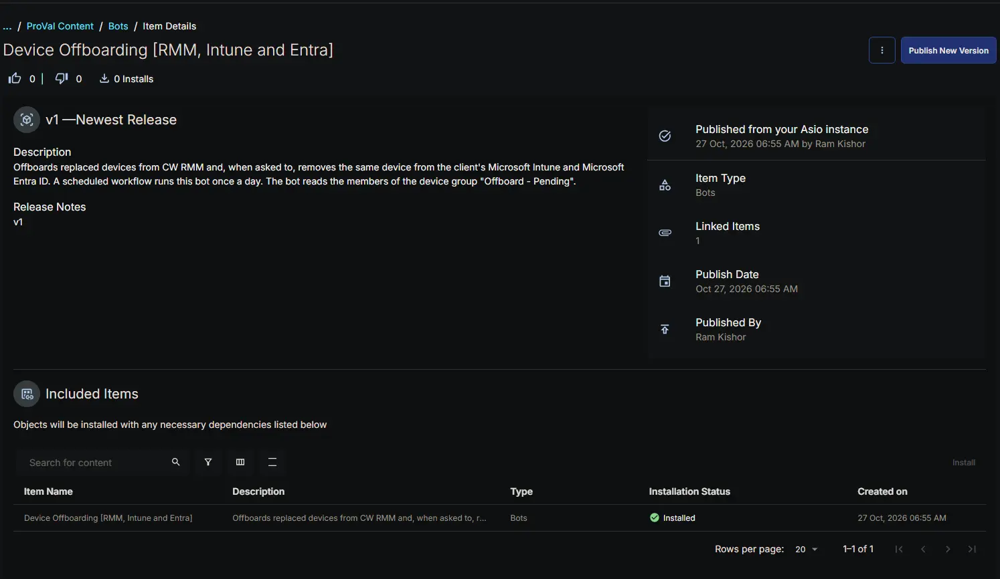
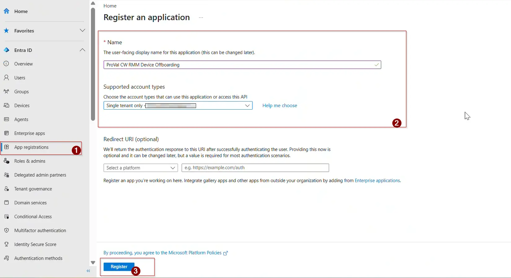
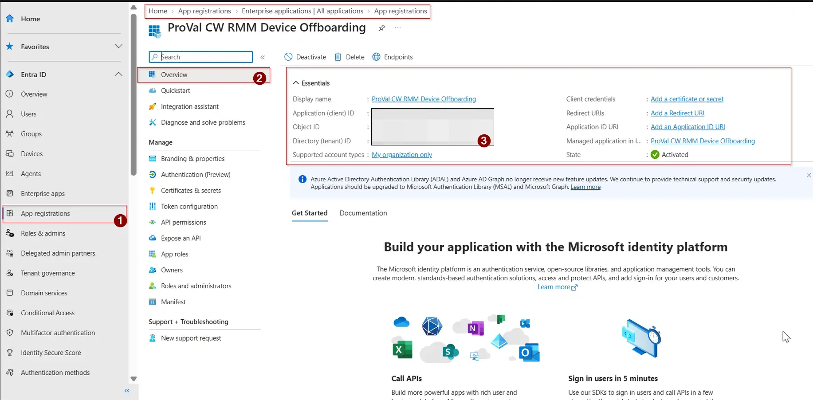
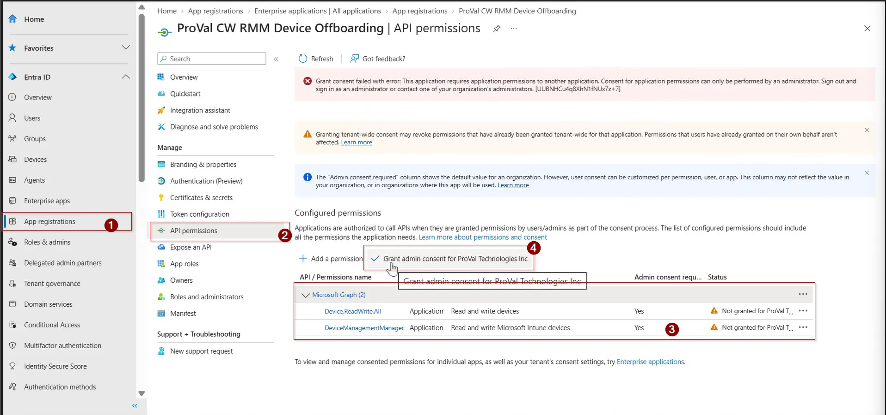
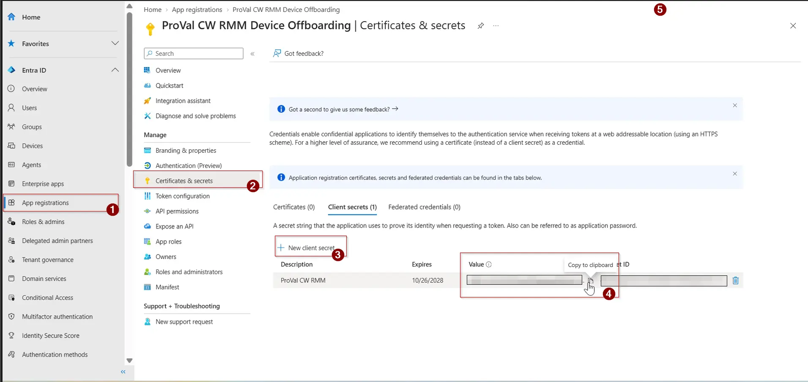

## Summary

The **Device Offboarding [RMM, Intune and Entra]** bot removes replaced devices from CW RMM and, when asked to, from the client's Microsoft Intune and Microsoft Entra ID. A technician marks the old device with the [Offboard_Action](/docs/e18f1709-6273-4086-b9f0-43bbb62c8644) custom field, and the bot offboards it at the next daily run of the [Device Offboarding [RMM, Intune and Entra]](/docs/d400b357-1c79-431a-a5b2-9de6a619bffe) workflow.

The bot runs inside the platform, so it uses the pre-authenticated RPA HTTP client for CW RMM and needs no CW RMM client ID or client secret. The base URL arrives automatically through the `cwOpenAPIURL` input. Microsoft is contacted separately, with each client's own app registration credentials read from client-level custom fields. The CW RMM credentials are never sent to Microsoft.

**How it works:**

1. The members of the [Offboard - Pending](/docs/0208ca42-8ad2-4026-8c77-1eb5d23d7d15) group are read, along with each device's name, serial number, company, site and online status.
2. Each device's [Offboard_Action](/docs/e18f1709-6273-4086-b9f0-43bbb62c8644) is read again. A device set to `None` is left alone.
3. An offline device is skipped unless [Offboard_Skip_Offline_Check](/docs/e767b472-e81b-44cf-9b80-dffbd039b090) is checked.
4. For `RMM and Intune` and `RMM Intune and Entra`, the bot reads the client's credentials, signs in to the client's tenant (once per client per run), and confirms the app registration has the Microsoft Graph permissions it needs.
5. The device is found in Intune, and in Entra when needed, before anything is deleted.
6. The device is deleted from Intune, then from Entra, then the CW RMM agent is uninstalled. CW RMM is always last.
7. If any step fails, the reason is written to the device's [Offboard_Failure_Reason](/docs/674f4c6d-b2e7-4ee8-a25a-d8674ec7e704) field, and the device is retried at the next daily run.

| Offboard_Action | Intune | Entra | CW RMM |
|---|---|---|---|
| `None` | - | - | - |
| `RMM Only` | - | - | Agent uninstalled |
| `RMM and Intune` | Deleted | Left in place | Agent uninstalled |
| `RMM Intune and Entra` | Deleted | Deleted | Agent uninstalled |

**Why nothing is deleted when a check fails**

Everything that can be checked is checked before anything is deleted: the client's credentials are filled in, the sign-in to the client's tenant works, the app registration has the right permissions, and the device can be identified in Intune and Entra without any doubt. If any of that fails, nothing is deleted anywhere, CW RMM included. Because CW RMM is always the last system the device is removed from, a device that fails in Intune or Entra is still in CW RMM with the reason on it.

**How the device is matched in Microsoft**

Replaced devices often get a new device with the same name, so matching on the name alone could delete the replacement.

- **Intune:** Devices are searched by the CW RMM device name, and only those whose serial number equals the one CW RMM reports are kept. When CW RMM has no serial number for the device, the name alone is used. More than one match fails the device instead of guessing. No match means the device is already gone from Intune.
- **Entra:** The Entra device ID recorded on the matched Intune device is used. Entra devices carry no serial number, so when the device isn't in Intune, its Entra device can't be identified safely and the device fails with a request for manual removal.

**Run time**

CW RMM stops a bot after 20 minutes. The bot doesn't start a new device after 15 minutes, and any devices left over are picked up by the next daily run. Temporary errors from CW RMM or Microsoft are retried up to five times.

**API endpoints used**

| Method | Endpoint | Purpose |
| ------ | -------- | ------- |
| GET | `/api/platform/v1/custom-field/definitions` | Find the Offboard custom fields |
| GET | `/api/platform/v1/device-groups` | Find the Offboard - Pending group |
| GET | `/api/platform/v2/device-groups/{deviceGroupId}/endpoints` | Read the devices queued for offboarding |
| POST | `/api/platform/v2/device/categories/platform/endpoints` | Read each device's name, serial number, company and site |
| GET | `/api/platform/v2/device/endpoints/heartbeat` | Check which devices are online |
| GET | `/api/platform/v2/device/endpoints/{endpointId}/custom-fields` | Read Offboard_Action and Offboard_Skip_Offline_Check |
| PUT | `/api/platform/v2/device/endpoints/{endpointId}/custom-fields` | Write Offboard_Failure_Reason |
| GET | `/api/platform/v1/company/companies/{companyId}/custom-fields` | Read the client's Microsoft credentials |
| DELETE | `/api/platform/v2/device/endpoints/uninstall` | Uninstall the CW RMM agent |
| POST | `https://login.microsoftonline.com/{tenantId}/oauth2/v2.0/token` | Sign in to the client's tenant |
| GET | `https://graph.microsoft.com/v1.0/deviceManagement/managedDevices` | Find the device in Intune |
| DELETE | `https://graph.microsoft.com/v1.0/deviceManagement/managedDevices/{id}` | Delete the device from Intune |
| GET | `https://graph.microsoft.com/v1.0/devices` | Find the device in Entra |
| DELETE | `https://graph.microsoft.com/v1.0/devices/{id}` | Delete the device from Entra |

## Details

| Bot Name | Description | Execution Environment |
| -------- | ----------- | --------------------- |
| Device Offboarding [RMM, Intune and Entra] | Offboards the devices in the Offboard - Pending group from CW RMM and, per each device's Offboard_Action, from the client's Intune and Entra. Checks everything before deleting anything and writes failure reasons to the device. | Cloud |

## Integration Configuration

| Platform | Platform Scopes | 3rd Party Apps | Integrations |
| -------- | --------------- | -------------- | ------------ |
| True | <ul><li>`Platform - Devices - Read`</li><li> `Platform - Devices - Update`</li><li> `Platform - Devices - Delete`</li><li> `Platform - Device Groups - Read`</li><li> `Platform - Companies - Read`</li><li> `Platform - Custom Fields - Read`</li></ul> | False |  |

## Form Setup

| Form Required | Form Template |
| ------------- | ------------- |
| No | N/A |

## Functions

- [app.py](https://github.com/ProVal-Tech/cw-rmm/blob/main/bots/device-offboarding-rmm-intune-and-entra/app.py)
- [conda.yaml](https://github.com/ProVal-Tech/cw-rmm/blob/main/bots/device-offboarding-rmm-intune-and-entra/conda.yaml)

## Forms Setup Path

- **Tasks Path:** `Automation` ➞ `Bots`

## Dependencies

- [Custom Field: Offboard_Action](/docs/e18f1709-6273-4086-b9f0-43bbb62c8644)
- [Custom Field: Offboard_Skip_Offline_Check](/docs/e767b472-e81b-44cf-9b80-dffbd039b090)
- [Custom Field: Offboard_Failure_Reason](/docs/674f4c6d-b2e7-4ee8-a25a-d8674ec7e704)
- [Custom Field: Offboard_Tenant_ID](/docs/7cd5a6d6-655c-4b39-8819-1122c799f24a)
- [Custom Field: Offboard_App_Client_ID](/docs/7857a579-d691-4a79-a959-211c45a09d8f)
- [Custom Field: Offboard_App_Client_Secret](/docs/c51ae730-a3fd-4ad6-818f-25b5ec4e2936)
- [Group: Offboard - Pending](/docs/0208ca42-8ad2-4026-8c77-1eb5d23d7d15)

The bot takes no form input. It stops the run if any of the three device-level custom fields or the group is missing. The three client-level fields are only checked for devices set to `RMM and Intune` or `RMM Intune and Entra`.

**Consumed by:**

- [Workflows: Device Offboarding [RMM, Intune and Entra]](/docs/d400b357-1c79-431a-a5b2-9de6a619bffe)

**Related content:**

- [Solution: Device Offboarding [RMM, Intune and Entra]](/docs/02e3ba26-1e13-4485-8194-69cb7434c412)

## Implementation

Install the bot from the `ProVal - Content` Community, selecting the **Bots** repository, then publish the bot. After installation, the following configuration steps are mandatory.

### 1. Create the Custom Fields and Group

Create the six custom fields listed in [Dependencies](#dependencies), then the [Offboard - Pending](/docs/0208ca42-8ad2-4026-8c77-1eb5d23d7d15) group. The field names and the group name must match exactly.

### 2. Allow Agent Uninstallation

The bot uninstalls agents through the CW RMM API. It runs under the account that created the [workflow](/docs/d400b357-1c79-431a-a5b2-9de6a619bffe), so that account needs access to every device you'll offboard and must be allowed to uninstall agents. If agent uninstallation is turned off for it, CW RMM answers `ErrAgentUninstallationDisabled`, and that message is written to [Offboard_Failure_Reason](/docs/674f4c6d-b2e7-4ee8-a25a-d8674ec7e704).

### 3. Create the Microsoft Entra App Registration

Only needed for clients that use `RMM and Intune` or `RMM Intune and Entra`. Do this once per client tenant, signed in as a Global Administrator (or a Privileged Role Administrator plus an Application Administrator) of the **client's** tenant. The client's tenant also needs an Intune licence.

1. Sign in to [https://entra.microsoft.com](https://entra.microsoft.com) with an admin account of the client's tenant.
2. Go to **Entra ID** ➞ **App registrations** ➞ **New registration**, and fill in:
    - **Name:** `ProVal CW RMM Device Offboarding` (any name works)
    - **Supported account types:** `Accounts in this organizational directory only`
    - **Redirect URI:** leave empty
3. Select **Register**.

    

4. On the app's **Overview** page, copy the **Directory (tenant) ID** for [Offboard_Tenant_ID](/docs/7cd5a6d6-655c-4b39-8819-1122c799f24a) and the **Application (client) ID** for [Offboard_App_Client_ID](/docs/7857a579-d691-4a79-a959-211c45a09d8f).

    

5. Go to **API permissions** ➞ **Add a permission** ➞ **Microsoft Graph** ➞ **Application permissions** (not Delegated), and add:

    | Permission | Needed for | Used to |
    |---|---|---|
    | `DeviceManagementManagedDevices.ReadWrite.All` | `RMM and Intune`, `RMM Intune and Entra` | Find and delete the Intune device, and read the Entra device ID used to find the Entra device |
    | `Device.ReadWrite.All` | `RMM Intune and Entra` | Find and delete the Entra device |

    The default delegated `User.Read` permission isn't used and can be removed.

6. Select **Grant admin consent for** `<tenant>` and confirm. Every permission must show a green **Granted** status. Without consent, the sign-in still works but the bot has no permissions, and it reports which ones are missing.

    

7. Go to **Certificates & secrets** ➞ **Client secrets** ➞ **New client secret**. Give it a description and an expiry (24 months at most), then select **Add**.
8. Copy the **Value** column straight away for [Offboard_App_Client_Secret](/docs/c51ae730-a3fd-4ad6-818f-25b5ec4e2936). It's shown only once, and the **Secret ID** column isn't the secret.

    

9. Note the secret's expiry date. Create a new secret before it expires and save it in [Offboard_App_Client_Secret](/docs/c51ae730-a3fd-4ad6-818f-25b5ec4e2936).

### 4. Fill In the Client Custom Fields

In CW RMM, open the client and set [Offboard_Tenant_ID](/docs/7cd5a6d6-655c-4b39-8819-1122c799f24a), [Offboard_App_Client_ID](/docs/7857a579-d691-4a79-a959-211c45a09d8f) and [Offboard_App_Client_Secret](/docs/c51ae730-a3fd-4ad6-818f-25b5ec4e2936) to the values copied above.

**Primary Note: Client Secret Storage**  
CW RMM has no encrypted or masked custom field type, so the client secret is stored in plain text and is visible to anyone who can view the client's custom fields. The app registration can delete devices from the client's Intune and Entra, and anyone who has the secret can do the same. Limit who can view client custom fields in CW RMM, and rotate the secret regularly.

**Primary Note: Reading the Bot Output**  
The bot's result message gives the totals for the run: devices queued, offboarded, skipped because they were offline, and failed. The reason for each skipped or failed device is in its [Offboard_Failure_Reason](/docs/674f4c6d-b2e7-4ee8-a25a-d8674ec7e704) field, which also lists the common reasons and how to fix them.

**Primary Note: Before Removing a Device From Entra**

- Deleting a device from Entra also deletes the BitLocker recovery keys stored on it. Back them up first if the old drive might still need to be read.
- Hybrid joined devices are synced from on-premises Active Directory and can't be deleted from Entra directly. The bot flags them without deleting anything. Delete the computer object from Active Directory instead, then set Offboard_Action to `RMM and Intune`.
- The bot doesn't touch Windows Autopilot, and an Autopilot registration can block the Entra deletion. Remove the device from Autopilot first if it's registered.

## Changelog

### 2026-10-27

- Initial version of the document
