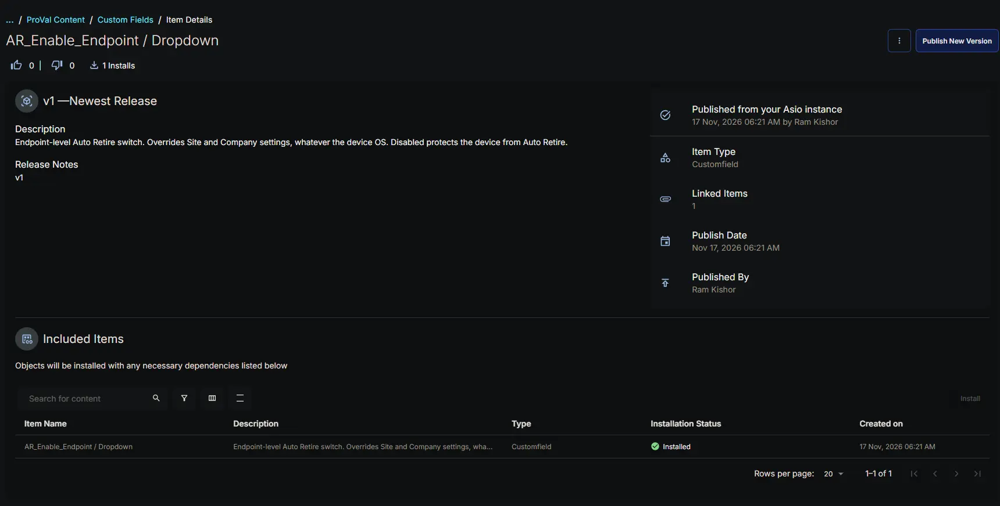

## Summary

Includes or protects a single device, whatever its site and company say. Leave it empty to use [AR_Enable_Site](/docs/3bbf928b-d145-4fc9-9de4-16145479308d) or [AR_Enable](/docs/5563ad64-f1a5-4245-9c3f-ded7303a1ae1).

| Option | What happens |
|---|---|
| `Enabled` | The [Auto Retire Offline Devices](/docs/6ae2e972-aa74-4fc8-b266-bf702722cb4b) bot handles the device, even when its site or company is `Disabled` and even when their setting doesn't cover its OS, such as Linux. |
| `Disabled` | The device is never retired and never gets a ticket. |
| Empty | The site or company setting applies. |

## Dependencies

- [Solution: Auto Retire Offline Devices](/docs/e73836cc-f9c8-432c-bc6f-dc3bf2d36065)
- [Bots: Auto Retire Offline Devices](/docs/6ae2e972-aa74-4fc8-b266-bf702722cb4b)
- [Custom Field: AR_Enable](/docs/5563ad64-f1a5-4245-9c3f-ded7303a1ae1)
- [Custom Field: AR_Enable_Site](/docs/3bbf928b-d145-4fc9-9de4-16145479308d)

## Custom Field Setup Location

**Custom Fields Path:** SETTINGS ➞ Custom Fields

## Details

| Name | Description | Level | Type | Option Type | Options | Help Text | Default Value | Editable |
|---|---|---|---|---|---|---|---|---|
| AR_Enable_Endpoint | Endpoint-level Auto Retire switch. Overrides Site and Company settings, whatever the device OS. Disabled protects the device from Auto Retire. | `Endpoint` | `Dropdown` | `String` | `Enabled`, `Disabled` | Leave blank to inherit. Select Enabled to include this device, or Disabled to protect it, for example a laptop that is only used now and then. |  | `Yes` |

:::note

Use `Disabled` for devices that are only used now and then, such as a laptop taken on site visits once a month. A retired device loses its CW RMM agent the next time it comes online, so protect these devices before retire mode is turned on for their company.

This field has no default value, and shouldn't be given one. A default value would apply to every device and override the level above it everywhere.

:::

## Implementation

Install the custom field from the `ProVal - Content` Community, selecting the **Custom Fields** repository.

## Changelog

### 2026-11-17

- Initial version of the document
