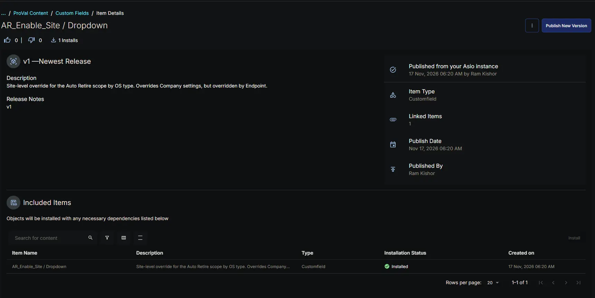

## Summary

Overrides [AR_Enable](/docs/5563ad64-f1a5-4245-9c3f-ded7303a1ae1) for one site. Leave it empty to use the company's value. [AR_Enable_Endpoint](/docs/13205a0e-1d98-45b6-9806-5278edde1459) overrides it for a single device.

A site set to `Disabled` is excluded even when its company is enabled, and a site set to an OS option is included even when its company is `Disabled`.

| Option | Devices in scope |
|---|---|
| `Windows Workstations and Servers` | Windows workstations and Windows servers |
| `Windows Workstations Only` | Windows workstations |
| `Windows Servers Only` | Windows servers |
| `Macintosh Only` | macOS devices |
| `Windows Workstations and Macintosh` | Windows workstations and macOS devices |
| `Disabled` | None. The devices are left alone. |

## Dependencies

- [Solution: Auto Retire Offline Devices](/docs/e73836cc-f9c8-432c-bc6f-dc3bf2d36065)
- [Bots: Auto Retire Offline Devices](/docs/6ae2e972-aa74-4fc8-b266-bf702722cb4b)
- [Custom Field: AR_Enable](/docs/5563ad64-f1a5-4245-9c3f-ded7303a1ae1)
- [Custom Field: AR_Enable_Endpoint](/docs/13205a0e-1d98-45b6-9806-5278edde1459)

## Custom Field Setup Location

**Custom Fields Path:** SETTINGS ➞ Custom Fields

## Details

| Name | Description | Level | Type | Option Type | Options | Help Text | Default Value | Editable |
|---|---|---|---|---|---|---|---|---|
| AR_Enable_Site | Site-level override for the Auto Retire scope by OS type. Overrides Company settings, but overridden by Endpoint. | `Site` | `Dropdown` | `String` | `Windows Workstations and Servers`, `Windows Workstations Only`, `Windows Servers Only`, `Macintosh Only`, `Windows Workstations and Macintosh`, `Disabled` | Leave blank to inherit. Select which offline devices Auto Retire may handle, or Disabled to exclude the site. |  | `Yes` |

:::note

This field has no default value, and shouldn't be given one. A default value would apply to every site and override the level above it everywhere. Leave it empty on sites that should follow their company.

:::

## Implementation

Install the custom field from the `ProVal - Content` Community, selecting the **Custom Fields** repository.

## Changelog

### 2026-11-17

- Initial version of the document
