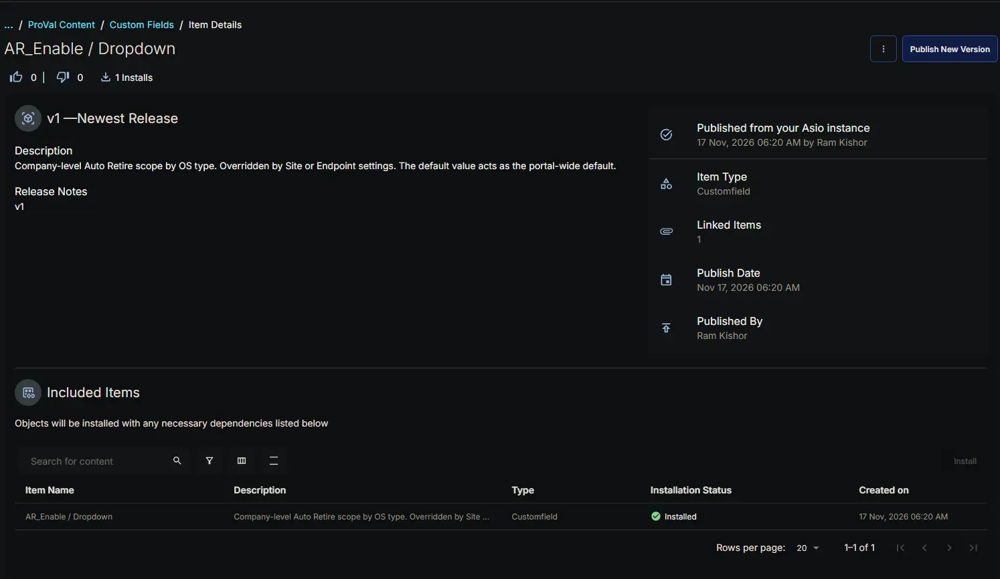

## Summary

Sets which offline devices the [Auto Retire Offline Devices](/docs/6ae2e972-aa74-4fc8-b266-bf702722cb4b) bot may handle for a company, by OS type. [AR_Enable_Site](/docs/3bbf928b-d145-4fc9-9de4-16145479308d) overrides it for a site, and [AR_Enable_Endpoint](/docs/13205a0e-1d98-45b6-9806-5278edde1459) overrides both for a single device.

The field's default value applies to every company that doesn't have its own value, so it works as the portal-wide default. It's `Disabled` out of the box, so nothing is handled until you choose otherwise.

| Option | Devices in scope |
|---|---|
| `Windows Workstations and Servers` | Windows workstations and Windows servers |
| `Windows Workstations Only` | Windows workstations |
| `Windows Servers Only` | Windows servers |
| `Macintosh Only` | macOS devices |
| `Windows Workstations and Macintosh` | Windows workstations and macOS devices |
| `Disabled` | None. The devices are left alone. |

## Dependencies

- [Solution: Auto Retire Offline Devices](/docs/e73836cc-f9c8-432c-bc6f-dc3bf2d36065)
- [Bots: Auto Retire Offline Devices](/docs/6ae2e972-aa74-4fc8-b266-bf702722cb4b)
- [Custom Field: AR_Enable_Site](/docs/3bbf928b-d145-4fc9-9de4-16145479308d)
- [Custom Field: AR_Enable_Endpoint](/docs/13205a0e-1d98-45b6-9806-5278edde1459)

## Custom Field Setup Location

**Custom Fields Path:** SETTINGS ➞ Custom Fields

## Details

| Name | Description | Level | Type | Option Type | Options | Help Text | Default Value | Editable |
|---|---|---|---|---|---|---|---|---|
| AR_Enable | Company-level Auto Retire scope by OS type. Overridden by Site or Endpoint settings. The default value acts as the portal-wide default. | `Company` | `Dropdown` | `String` | `Windows Workstations and Servers`, `Windows Workstations Only`, `Windows Servers Only`, `Macintosh Only`, `Windows Workstations and Macintosh`, `Disabled` | Select which offline devices Auto Retire may handle, or Disabled to exclude the client. | `Disabled` | `Yes` |

:::note

To turn Auto Retire on for every company at once, change this field's default value instead of setting each company. For example, `Windows Workstations Only` covers workstations everywhere and leaves servers out. A company that needs something different can still have its own value.

Devices that are neither Windows nor macOS, such as Linux, are only handled when [AR_Enable_Endpoint](/docs/13205a0e-1d98-45b6-9806-5278edde1459) is set to `Enabled` on the device.

:::

## Implementation

Install the custom field from the `ProVal - Content` Community, selecting the **Custom Fields** repository.

## Changelog

### 2026-11-17

- Initial version of the document
