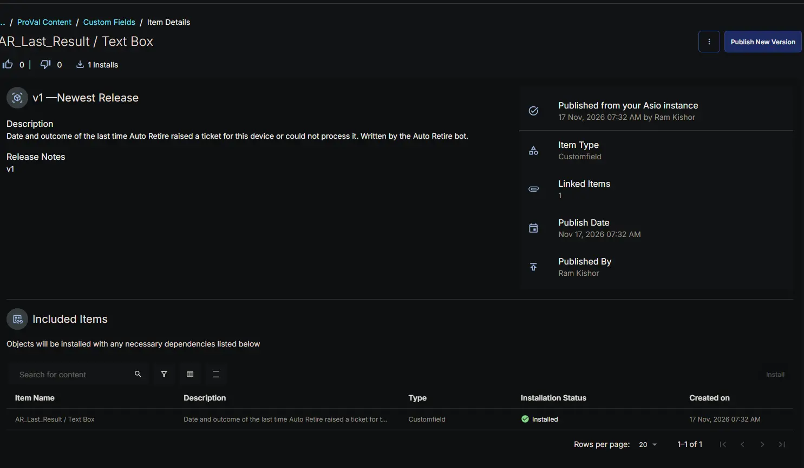

## Summary

Written by the [Auto Retire Offline Devices](/docs/6ae2e972-aa74-4fc8-b266-bf702722cb4b) bot. Holds the date (in UTC) and the outcome of the last time the bot raised a ticket for the device or couldn't process it, for example `2026-11-20 14:00 UTC Ticket 5003 raised. Offline 45 days, threshold 30 days.`

Nothing is written when a device is retired, because by then it's no longer in CW RMM. Nothing is written either when a device is out of scope or under its threshold.

A device that can't be processed is left alone and tried again at the next run, so fixing the reported problem is all that's needed.

## Dependencies

- [Solution: Auto Retire Offline Devices](/docs/e73836cc-f9c8-432c-bc6f-dc3bf2d36065)
- [Bots: Auto Retire Offline Devices](/docs/6ae2e972-aa74-4fc8-b266-bf702722cb4b)
- [Custom Field: AR_Ticket_Number](/docs/0fba3c3b-e142-43ce-9a28-5bdce021bd68)

## Custom Field Setup Location

**Custom Fields Path:** SETTINGS ➞ Custom Fields

## Details

| Name | Description | Level | Type | Help Text | Default Value | Editable |
|---|---|---|---|---|---|---|
| AR_Last_Result | Date and outcome of the last time Auto Retire raised a ticket for this device or could not process it. Written by the Auto Retire bot. | `Endpoint` | `Text Box` | Do not edit. Shows the ticket raised, or why the device was skipped, such as an invalid setting. |  | `No` |

:::note

The bot keeps the text under 1,000 characters and replaces special characters with spaces, so error text from CW RMM may read slightly differently from the original.

:::

## Common Results

The text after the date starts with one of these.

| Text starts with | What to do |
|---|---|
| `Ticket ... raised` | Ticket-only mode raised a ticket for the device. Review the ticket. |
| `Ticket ... found open by summary` | The device already had an open ticket, and its number was stored in [AR_Ticket_Number](/docs/0fba3c3b-e142-43ce-9a28-5bdce021bd68). Nothing to do. |
| `AR_... is set to ..., which is not a recognised option` | Set the named field to one of its options, or clear it. |
| `AR_Threshold_Days... is set to ..., which is not a whole number of days` | Enter a whole number in the named field, such as `90`. |
| `AR_Threshold_Days... is set to ... days, below the minimum of 7` | Enter 7 or more in the named field. |
| `no threshold is set` | Set [AR_Threshold_Days](/docs/b0574e34-64f1-4c4f-9371-8c0a0b8a1b44) for the company, or give the field a default value. |
| `client settings could not be read`, `site settings could not be read`, `read custom fields failed`, `read ticket failed` or `search tickets failed` | Usually a temporary CW RMM error, and the device is tried again at the next run. If it keeps happening, check that the account the workflow runs as can see the device. |
| `CW RMM did not report a usable last contact time` | CW RMM has no last contact time for the device. Check the device in CW RMM. |
| `no ticket board named`, `no ticket team named`, `no ticket priority named` or `no ticket source named` | Tickets are raised on the `MSP` board, assigned to the `MSP` team, with `Medium` priority and the `Alerting` source. Create the missing one in your ticketing settings. The text lists the names that exist. |
| `create ticket failed` | CW RMM refused the ticket. The rest of the text says why. |
| `CW RMM refused the uninstall` or `uninstall agent failed` | `ErrAgentUninstallationDisabled` means agent uninstallation is turned off for the account the workflow runs as. Turn it on, or recreate the workflow with an account that's allowed to uninstall agents. |

## Implementation

Install the custom field from the `ProVal - Content` Community, selecting the **Custom Fields** repository.

## Changelog

### 2026-11-17

- Initial version of the document
