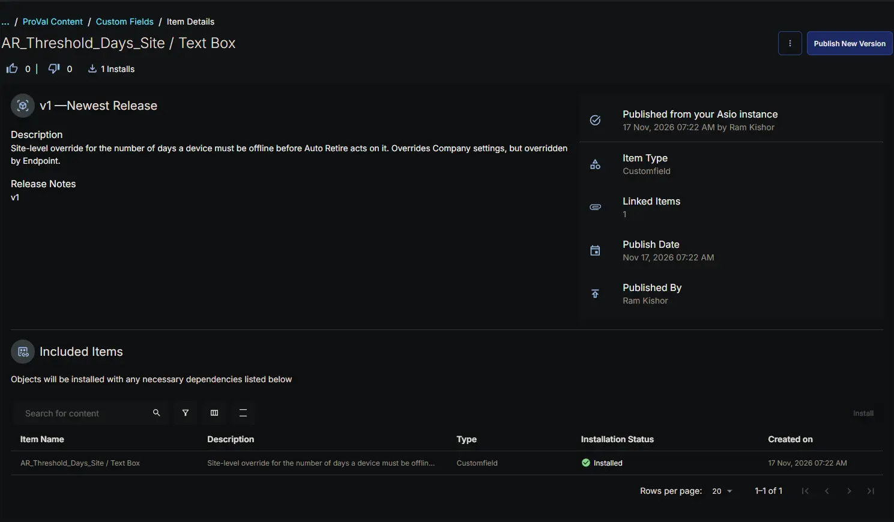

## Summary

Overrides [AR_Threshold_Days](/docs/b0574e34-64f1-4c4f-9371-8c0a0b8a1b44) for one site. Leave it empty to use the company's value. [AR_Threshold_Days_Endpoint](/docs/e078f89d-a405-471c-8b26-55a138657fdb) overrides it for a single device.

For example, give a site whose devices are only used now and then, such as a seasonal office, a longer threshold than the rest of the company.

## Dependencies

- [Solution: Auto Retire Offline Devices](/docs/e73836cc-f9c8-432c-bc6f-dc3bf2d36065)
- [Bots: Auto Retire Offline Devices](/docs/6ae2e972-aa74-4fc8-b266-bf702722cb4b)
- [Custom Field: AR_Threshold_Days](/docs/b0574e34-64f1-4c4f-9371-8c0a0b8a1b44)
- [Custom Field: AR_Threshold_Days_Endpoint](/docs/e078f89d-a405-471c-8b26-55a138657fdb)

## Custom Field Setup Location

**Custom Fields Path:** SETTINGS ➞ Custom Fields

## Details

| Name | Description | Level | Type | Help Text | Default Value | Editable |
|---|---|---|---|---|---|---|
| AR_Threshold_Days_Site | Site-level override for the number of days a device must be offline before Auto Retire acts on it. Overrides Company settings, but overridden by Endpoint. | `Site` | `Text Box` | Leave blank to inherit. Enter a whole number of days, 7 or more. Example: 90. |  | `Yes` |

:::note

Enter a whole number of 7 or more. Anything else leaves the site's devices alone and writes the reason to [AR_Last_Result](/docs/b539484e-1f3b-4383-8ad7-4e37c19ef9eb).

This field has no default value, and shouldn't be given one. A default value would apply to every site and override the level above it everywhere.

:::

## Implementation

Install the custom field from the `ProVal - Content` Community, selecting the **Custom Fields** repository.

## Changelog

### 2026-11-17

- Initial version of the document
