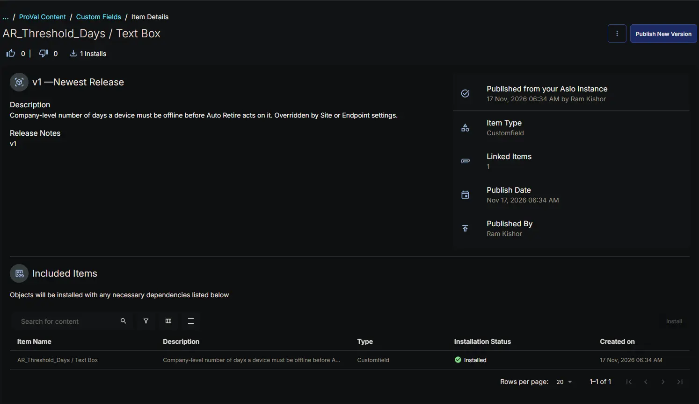

## Summary

Sets how many days a device must be offline before the [Auto Retire Offline Devices](/docs/6ae2e972-aa74-4fc8-b266-bf702722cb4b) bot acts on it, either retiring it or raising a ticket in ticket-only mode. [AR_Threshold_Days_Site](/docs/3eb97aa2-def8-4c0d-a956-856a22c826a7) overrides it for a site, and [AR_Threshold_Days_Endpoint](/docs/e078f89d-a405-471c-8b26-55a138657fdb) overrides both for a single device.

The offline time is counted from the last time the device contacted CW RMM. The field's default value, `30`, applies to every company that doesn't have its own value, so it works as the portal-wide default.

## Dependencies

- [Solution: Auto Retire Offline Devices](/docs/e73836cc-f9c8-432c-bc6f-dc3bf2d36065)
- [Bots: Auto Retire Offline Devices](/docs/6ae2e972-aa74-4fc8-b266-bf702722cb4b)
- [Custom Field: AR_Threshold_Days_Site](/docs/3eb97aa2-def8-4c0d-a956-856a22c826a7)
- [Custom Field: AR_Threshold_Days_Endpoint](/docs/e078f89d-a405-471c-8b26-55a138657fdb)

## Custom Field Setup Location

**Custom Fields Path:** SETTINGS ➞ Custom Fields

## Details

| Name | Description | Level | Type | Help Text | Default Value | Editable |
|---|---|---|---|---|---|---|
| AR_Threshold_Days | Company-level number of days a device must be offline before Auto Retire acts on it. Overridden by Site or Endpoint settings. | `Company` | `Text Box` | Enter a whole number of days, 7 or more. Example: 90. | `30` | `Yes` |

:::note

Enter a whole number of 7 or more. Anything else, such as `30 days` or `5`, leaves the company's devices alone and writes the reason to [AR_Last_Result](/docs/b539484e-1f3b-4383-8ad7-4e37c19ef9eb).

A longer threshold gives a device that's only used now and then more time to come back online before it's retired. Starting with 90 days, and lowering it once the tickets raised in ticket-only mode look right, is a safe way to begin.

:::

## Implementation

Install the custom field from the `ProVal - Content` Community, selecting the **Custom Fields** repository.

## Changelog

### 2026-11-17

- Initial version of the document
