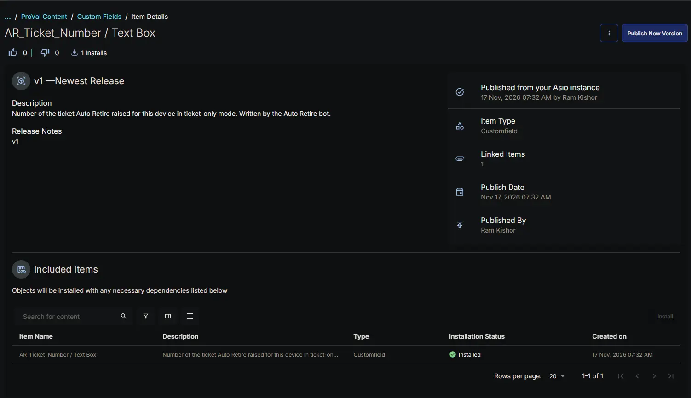

## Summary

Written by the [Auto Retire Offline Devices](/docs/6ae2e972-aa74-4fc8-b266-bf702722cb4b) bot. Holds the number of the ticket raised for the device in ticket-only mode. At each run, the bot checks that ticket before raising another one.

| Stored ticket | What happens at the next run |
|---|---|
| Open (any status other than Closed or Resolved) | Nothing. No new ticket is raised. |
| Closed or Resolved | A new ticket is raised if the device is still past its threshold and still in ticket-only mode, and its number replaces the old one. |
| Not found | A new ticket is raised. |

## Dependencies

- [Solution: Auto Retire Offline Devices](/docs/e73836cc-f9c8-432c-bc6f-dc3bf2d36065)
- [Bots: Auto Retire Offline Devices](/docs/6ae2e972-aa74-4fc8-b266-bf702722cb4b)
- [Custom Field: AR_Ticket_Only](/docs/7579b40b-c4f1-4f78-afce-7507516787c8)
- [Custom Field: AR_Last_Result](/docs/b539484e-1f3b-4383-8ad7-4e37c19ef9eb)

## Custom Field Setup Location

**Custom Fields Path:** SETTINGS ➞ Custom Fields

## Details

| Name | Description | Level | Type | Help Text | Default Value | Editable |
|---|---|---|---|---|---|---|
| AR_Ticket_Number | Number of the ticket Auto Retire raised for this device in ticket-only mode. Written by the Auto Retire bot. | `Endpoint` | `Text Box` | Do not edit. No new ticket is raised for this device while this ticket is open. |  | `No` |

:::note

Don't edit this field. If you close a ticket while the device stays offline, a new ticket is raised at the next run. To stop the tickets for a device you want to keep, set [AR_Enable_Endpoint](/docs/13205a0e-1d98-45b6-9806-5278edde1459) to `Disabled`. To have the device removed, set [AR_Ticket_Only_Endpoint](/docs/4b815d93-67d7-4071-ba16-e787f6b3174c) to `Disabled`.

If the number can't be written, the bot finds the open ticket by its summary at the next run and stores it then, so the device doesn't get a second ticket.

:::

## Implementation

Install the custom field from the `ProVal - Content` Community, selecting the **Custom Fields** repository.

## Changelog

### 2026-11-17

- Initial version of the document
