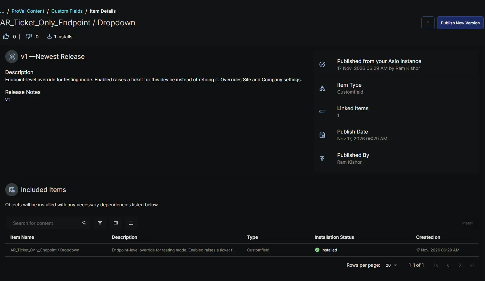

## Summary

Overrides [AR_Ticket_Only_Site](/docs/5b330773-7b20-41a7-a3f7-8c542c876d63) and [AR_Ticket_Only](/docs/7579b40b-c4f1-4f78-afce-7507516787c8) for a single device. Leave it empty to use the site's or company's value.

| Option | What happens when the device is past its threshold |
|---|---|
| `Enabled` | A ticket is raised with the device attached. Nothing is removed. |
| `Disabled` | The device is retired: its CW RMM agent is uninstalled. |
| Empty | The site or company setting applies. |

For example, after you've checked the ticket raised for a device and confirmed it's gone for good, set this field to `Disabled` and the device is retired at the next run, while the rest of the company stays in ticket-only mode.

## Dependencies

- [Solution: Auto Retire Offline Devices](/docs/e73836cc-f9c8-432c-bc6f-dc3bf2d36065)
- [Bots: Auto Retire Offline Devices](/docs/6ae2e972-aa74-4fc8-b266-bf702722cb4b)
- [Custom Field: AR_Ticket_Only](/docs/7579b40b-c4f1-4f78-afce-7507516787c8)
- [Custom Field: AR_Ticket_Only_Site](/docs/5b330773-7b20-41a7-a3f7-8c542c876d63)
- [Custom Field: AR_Ticket_Number](/docs/0fba3c3b-e142-43ce-9a28-5bdce021bd68)

## Custom Field Setup Location

**Custom Fields Path:** SETTINGS ➞ Custom Fields

## Details

| Name | Description | Level | Type | Option Type | Options | Help Text | Default Value | Editable |
|---|---|---|---|---|---|---|---|---|
| AR_Ticket_Only_Endpoint | Endpoint-level override for testing mode. Enabled raises a ticket for this device instead of retiring it. Overrides Site and Company settings. | `Endpoint` | `Dropdown` | `String` | `Enabled`, `Disabled` | Leave blank to inherit. Select Enabled to raise a ticket only, or Disabled to retire the device. |  | `Yes` |

:::note

This field has no default value, and shouldn't be given one. A default value would apply to every device and override the level above it everywhere.

:::

## Implementation

Install the custom field from the `ProVal - Content` Community, selecting the **Custom Fields** repository.

## Changelog

### 2026-11-17

- Initial version of the document
