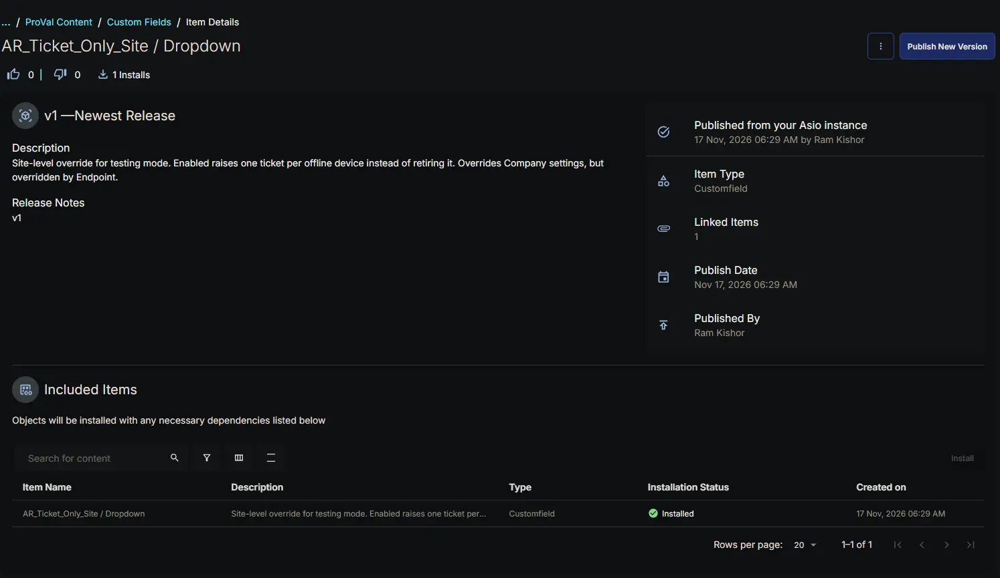

## Summary

Overrides [AR_Ticket_Only](/docs/7579b40b-c4f1-4f78-afce-7507516787c8) for one site. Leave it empty to use the company's value. [AR_Ticket_Only_Endpoint](/docs/4b815d93-67d7-4071-ba16-e787f6b3174c) overrides it for a single device.

| Option | What happens to a device past its threshold |
|---|---|
| `Enabled` | A ticket is raised with the device attached. Nothing is removed. |
| `Disabled` | The device is retired: its CW RMM agent is uninstalled. |
| Empty | The company's value applies. |

For example, keep one site in ticket-only mode while the rest of the company is retired, or the other way round.

## Dependencies

- [Solution: Auto Retire Offline Devices](/docs/e73836cc-f9c8-432c-bc6f-dc3bf2d36065)
- [Bots: Auto Retire Offline Devices](/docs/6ae2e972-aa74-4fc8-b266-bf702722cb4b)
- [Custom Field: AR_Ticket_Only](/docs/7579b40b-c4f1-4f78-afce-7507516787c8)
- [Custom Field: AR_Ticket_Only_Endpoint](/docs/4b815d93-67d7-4071-ba16-e787f6b3174c)

## Custom Field Setup Location

**Custom Fields Path:** SETTINGS ➞ Custom Fields

## Details

| Name | Description | Level | Type | Option Type | Options | Help Text | Default Value | Editable |
|---|---|---|---|---|---|---|---|---|
| AR_Ticket_Only_Site | Site-level override for testing mode. Enabled raises one ticket per offline device instead of retiring it. Overrides Company settings, but overridden by Endpoint. | `Site` | `Dropdown` | `String` | `Enabled`, `Disabled` | Leave blank to inherit. Select Enabled to raise tickets only, or Disabled to retire devices. |  | `Yes` |

:::note

This field has no default value, and shouldn't be given one. A default value would apply to every site and override the level above it everywhere.

:::

## Implementation

Install the custom field from the `ProVal - Content` Community, selecting the **Custom Fields** repository.

## Changelog

### 2026-11-17

- Initial version of the document
