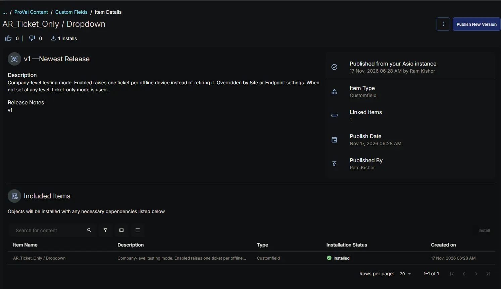

## Summary

Turns ticket-only mode on or off for a company. In ticket-only mode, the [Auto Retire Offline Devices](/docs/6ae2e972-aa74-4fc8-b266-bf702722cb4b) bot raises one ticket for each device that's past its threshold instead of retiring it, so you can see what would be removed before anything is. [AR_Ticket_Only_Site](/docs/5b330773-7b20-41a7-a3f7-8c542c876d63) overrides it for a site, and [AR_Ticket_Only_Endpoint](/docs/4b815d93-67d7-4071-ba16-e787f6b3174c) overrides both for a single device.

| Option | What happens to a device past its threshold |
|---|---|
| `Enabled` | A ticket is raised with the device attached. Nothing is removed. |
| `Disabled` | The device is retired: its CW RMM agent is uninstalled. |
| Not set at any level | The same as `Enabled`. |

## Dependencies

- [Solution: Auto Retire Offline Devices](/docs/e73836cc-f9c8-432c-bc6f-dc3bf2d36065)
- [Bots: Auto Retire Offline Devices](/docs/6ae2e972-aa74-4fc8-b266-bf702722cb4b)
- [Custom Field: AR_Ticket_Only_Site](/docs/5b330773-7b20-41a7-a3f7-8c542c876d63)
- [Custom Field: AR_Ticket_Only_Endpoint](/docs/4b815d93-67d7-4071-ba16-e787f6b3174c)
- [Custom Field: AR_Ticket_Number](/docs/0fba3c3b-e142-43ce-9a28-5bdce021bd68)

## Custom Field Setup Location

**Custom Fields Path:** SETTINGS ➞ Custom Fields

## Details

| Name | Description | Level | Type | Option Type | Options | Help Text | Default Value | Editable |
|---|---|---|---|---|---|---|---|---|
| AR_Ticket_Only | Company-level testing mode. Enabled raises one ticket per offline device instead of retiring it. Overridden by Site or Endpoint settings. When not set at any level, ticket-only mode is used. | `Company` | `Dropdown` | `String` | `Enabled`, `Disabled` | Select Enabled to raise tickets only, or Disabled to retire devices. |  | `Yes` |

:::note

This field has no default value. When it isn't set on the device, its site or its company, the device is handled in ticket-only mode, so nothing is removed until someone sets it to `Disabled`.

Only one ticket is kept open per device. Its number is stored in [AR_Ticket_Number](/docs/0fba3c3b-e142-43ce-9a28-5bdce021bd68), and no new ticket is raised while it's open.

:::

## Implementation

Install the custom field from the `ProVal - Content` Community, selecting the **Custom Fields** repository.

## Changelog

### 2026-11-17

- Initial version of the document
