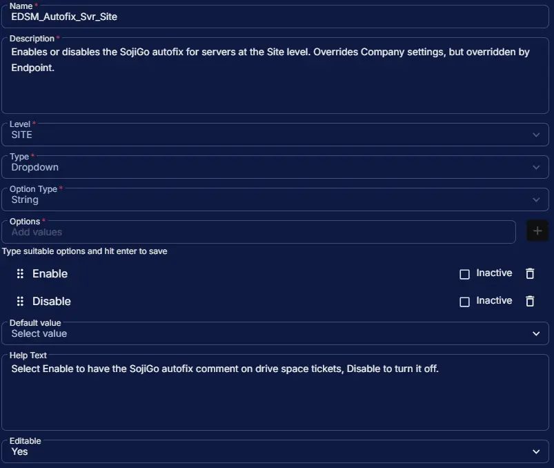

## Summary

Enables or disables the SojiGo autofix for servers at the Site level. Overrides Company settings, but overridden by Endpoint. When enabled, the [SojiGo task](/docs/5e38eb11-8e17-4aa6-a917-e06d78d026e0), running as the Enhanced Drive Space Monitoring autofix, adds its cleanup results to the open drive space ticket as a comment.

## Dependencies

- [Solution: Enhanced Drive Space Monitoring](/docs/e9cf4ff0-4413-447b-97dd-b8b2abd59597)
- [Task: Enhanced Drive Space Monitoring Configuration Writer](/docs/b2a4b9ec-08bd-4bce-8db7-b155c6bc03bc)
- [Task: SojiGo](/docs/5e38eb11-8e17-4aa6-a917-e06d78d026e0)

## Custom Field Setup Location

**Custom Fields Path:** SETTINGS ➞ Custom Fields

## Details

| Name | Description | Level | Type | Option Type | Options | Help Text | Default Value | Editable |
|---|---|---|---|---|---|---|---|---|
| EDSM_Autofix_Svr_Site | Enables or disables the SojiGo autofix for servers at the Site level. Overrides Company settings, but overridden by Endpoint. | `Site` | `Dropdown` | `String` | `Enable`, `Disable` | Select Enable to have the SojiGo autofix comment on drive space tickets, Disable to turn it off. |  | `Yes` |

:::note

Autofix is off unless a level is set to `Enable`. While it is off, the SojiGo task does nothing when the monitor starts it. Changes take effect after the next run of the [Enhanced Drive Space Monitoring Configuration Writer](/docs/b2a4b9ec-08bd-4bce-8db7-b155c6bc03bc) task.

:::

## Completed Custom Field

## Changelog

### 2026-10-20

- Initial version of the document
