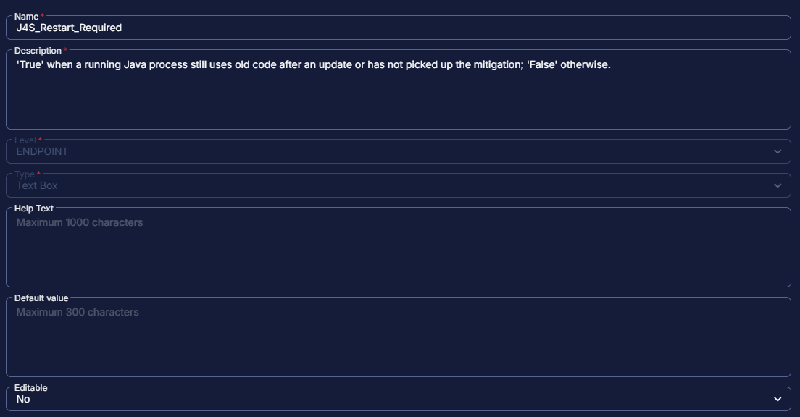

## Summary

Endpoint-level custom field populated by the [Task: Java4Shell Vulnerability Audit-Remediation](/docs/2511ac9a-4b2b-45d9-9d3c-8056c1c21655). 'True' when a running Java process still uses old code after an update or has not picked up the mitigation; 'False' otherwise.

## Dependencies

- [Solution: Java4Shell Vulnerability Audit (ConnectWise RMM)](/docs/a0ee9b5c-fa3c-4f2e-b7ca-71da1cf3e7cd)
- [Task: Java4Shell Vulnerability Audit-Remediation](/docs/2511ac9a-4b2b-45d9-9d3c-8056c1c21655)

## Details

**Custom Fields Path:** `SETTINGS` ➞ `Custom Fields`

| Name | Description | Level | Type | Help Text | Default Value | Editable |
|---|---|---|---|---|---|---|
| J4S_Restart_Required | 'True' when a running Java process still uses old code after an update or has not picked up the mitigation; 'False' otherwise. | Endpoint | Text Box | Populated by the Java4Shell Vulnerability Audit-Remediation task. Do not edit. |  | `No` |

## Completed Custom Field

## Changelog

### 2026-11-23

- Initial version of the document.
