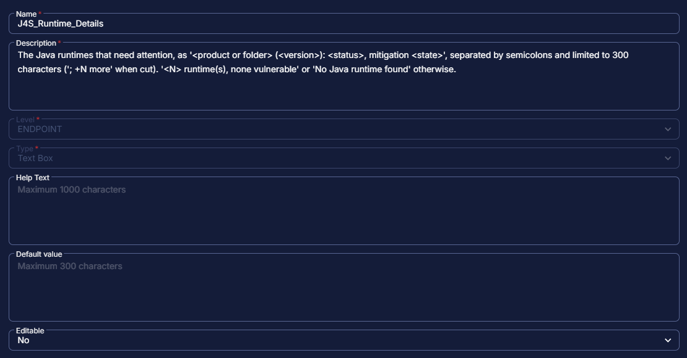

## Summary

Endpoint-level custom field populated by the Java4Shell Vulnerability Audit task. The Java runtimes that need attention, as '<product or folder> (<version>): <status>, mitigation <state>', separated by semicolons and limited to 300 characters ('; +N more' when cut). Folder paths use forward slashes, such as C:/Jenkins/jre. '<N> runtime(s), none vulnerable' or 'No Java runtime found' otherwise.

## Dependencies

- [Solution - Java4Shell Vulnerability Audit (ConnectWise RMM)](/docs/a0ee9b5c-fa3c-4f2e-b7ca-71da1cf3e7cd)
- [Task - Java4Shell Vulnerability Audit](/docs/2511ac9a-4b2b-45d9-9d3c-8056c1c21655)

## Details

**Custom Fields Path:** `SETTINGS` ➞ `Custom Fields`

| Name | Description | Level | Type | Help Text | Default Value | Editable |
|---|---|---|---|---|---|---|
| J4S_Runtime_Details | The Java runtimes that need attention, as '<product or folder> (<version>): <status>, mitigation <state>', separated by semicolons and limited to 300 characters ('; +N more' when cut). Folder paths use forward slashes, such as C:/Jenkins/jre. '<N> runtime(s), none vulnerable' or 'No Java runtime found' otherwise. | Endpoint | Text Box | Populated by the Java4Shell Vulnerability Audit task. Do not edit. |  | `No` |

## Completed Custom Field

## Changelog

### 2026-11-23

- Initial version of the document.
