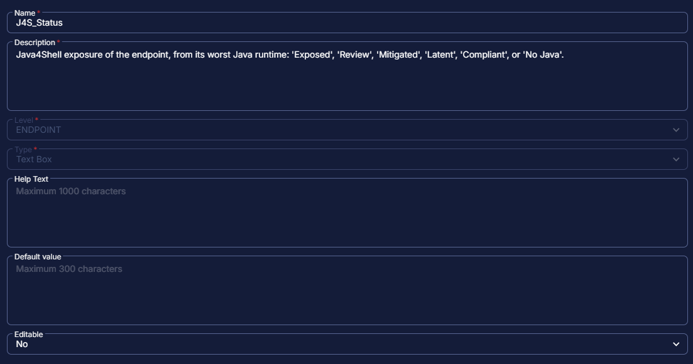

## Summary

Endpoint-level custom field populated by the Java4Shell Vulnerability Audit task. Java4Shell exposure of the endpoint, from its worst Java runtime: 'Exposed', 'Review', 'Mitigated', 'Latent', 'Compliant', or 'No Java'.

## Dependencies

- [Solution - Java4Shell Vulnerability Audit (ConnectWise RMM)](/docs/a0ee9b5c-fa3c-4f2e-b7ca-71da1cf3e7cd)
- [Task - Java4Shell Vulnerability Audit](/docs/2511ac9a-4b2b-45d9-9d3c-8056c1c21655)

## Details

**Custom Fields Path:** `SETTINGS` ➞ `Custom Fields`

| Name | Description | Level | Type | Help Text | Default Value | Editable |
|---|---|---|---|---|---|---|
| J4S_Status | Java4Shell exposure of the endpoint, from its worst Java runtime: 'Exposed', 'Review', 'Mitigated', 'Latent', 'Compliant', or 'No Java'. | Endpoint | Text Box | Populated by the Java4Shell Vulnerability Audit task. Do not edit. |  | `No` |

## Values

| Value | Meaning |
| ----- | ------- |
| `Exposed` | A runtime is Vulnerable or EndOfLife, the processor is affected or could not be checked, and the mitigation is not active. Also a patched runtime whose running Java process started before the update. |
| `Review` | The version of a runtime could not be read. |
| `Mitigated` | Every vulnerable runtime has the mitigation active on its running Java processes. The runtimes still need the update. |
| `Latent` | Vulnerable runtimes on a processor without AVX-512 VBMI. Update them anyway; a virtual machine moved to a newer host can become exposed. |
| `Compliant` | Java is present and no runtime is vulnerable. |
| `No Java` | No Java runtime was found. |

## Completed Custom Field

## Changelog

### 2026-11-23

- Initial version of the document.
