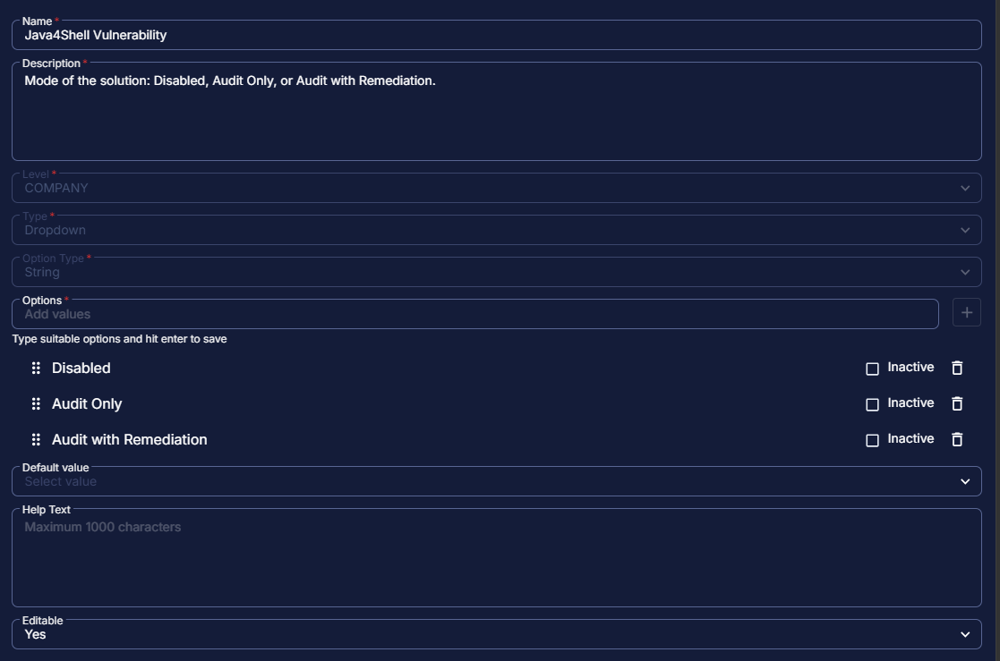

## Summary

Company-level custom field that enables the Java4Shell Vulnerability Audit for the company and selects Audit Only or Audit with Remediation.

## Dependencies

- [Solution - Java4Shell Vulnerability Audit (ConnectWise RMM)](/docs/a0ee9b5c-fa3c-4f2e-b7ca-71da1cf3e7cd)
- [Task - Java4Shell Vulnerability Audit](/docs/2511ac9a-4b2b-45d9-9d3c-8056c1c21655)

## Details

**Custom Fields Path:** `SETTINGS` ➞ `Custom Fields`

| Name | Description | Level | Type | Option Type | Options | Help Text | Default Value | Editable |
|---|---|---|---|---|---|---|---|---|
| Java4Shell Vulnerability | Company-level custom field that enables the Java4Shell Vulnerability Audit for the company and selects Audit Only or Audit with Remediation. | Company | Dropdown | String | `Disabled`, `Audit Only`, `Audit with Remediation` | Select the Java4Shell (CVE-2026-114938) mode for the company. **Disabled**: the solution does not run. **Audit Only**: reports every Java runtime and changes nothing. **Audit with Remediation**: also updates vulnerable standalone Java that is not in use and sets the temporary JVM mitigation on Windows services that use a vulnerable runtime. Services are not restarted. | `Disabled` | `Yes` |

## Completed Custom Field

## Changelog

### 2026-11-23

- Initial version of the document.