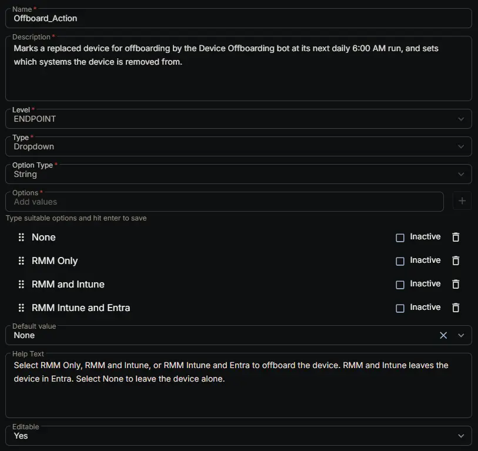

## Summary

Marks a replaced device for offboarding by the [Device Offboarding [RMM, Intune and Entra]](/docs/39a88b59-e48a-4c72-bba3-fbe5ff1839ab) bot, and sets which systems the device is removed from. Setting any option other than `None` adds the device to the [Offboard - Pending](/docs/0208ca42-8ad2-4026-8c77-1eb5d23d7d15) group, and the bot offboards it at the next daily 6:00 AM run.

| Option | What happens |
|---|---|
| `None` | Nothing. The device is left alone. |
| `RMM Only` | The CW RMM agent is uninstalled. Microsoft isn't contacted, so the client doesn't need any credentials set. |
| `RMM and Intune` | The device is deleted from Intune, then the CW RMM agent is uninstalled. The device stays in Entra. |
| `RMM Intune and Entra` | The device is deleted from Intune, then from Entra, then the CW RMM agent is uninstalled. |

## Dependencies

- [Solution: Device Offboarding [RMM, Intune and Entra]](/docs/02e3ba26-1e13-4485-8194-69cb7434c412)
- [Bots: Device Offboarding [RMM, Intune and Entra]](/docs/39a88b59-e48a-4c72-bba3-fbe5ff1839ab)
- [Group: Offboard - Pending](/docs/0208ca42-8ad2-4026-8c77-1eb5d23d7d15)

## Custom Field Setup Location

**Custom Fields Path:** SETTINGS ➞ Custom Fields

## Details

| Name | Description | Level | Type | Option Type | Options | Help Text | Default Value | Editable |
|---|---|---|---|---|---|---|---|---|
| Offboard_Action | Marks a replaced device for offboarding by the Device Offboarding bot at its next daily 6:00 AM run, and sets which systems the device is removed from. | `Endpoint` | `Dropdown` | `String` | `None`, `RMM Only`, `RMM and Intune`, `RMM Intune and Entra` | Select RMM Only, RMM and Intune, or RMM Intune and Entra to offboard the device. RMM and Intune leaves the device in Entra. Select None to leave the device alone. | `None` | `Yes` |

:::note

Type the options exactly as shown. The [Offboard - Pending](/docs/0208ca42-8ad2-4026-8c77-1eb5d23d7d15) group and the bot both look for this text, and a device set to an option the bot doesn't recognize fails with the reason written to [Offboard_Failure_Reason](/docs/674f4c6d-b2e7-4ee8-a25a-d8674ec7e704).

`RMM and Intune` and `RMM Intune and Entra` need the client's [Offboard_Tenant_ID](/docs/7cd5a6d6-655c-4b39-8819-1122c799f24a), [Offboard_App_Client_ID](/docs/7857a579-d691-4a79-a959-211c45a09d8f) and [Offboard_App_Client_Secret](/docs/c51ae730-a3fd-4ad6-818f-25b5ec4e2936) fields filled in.

:::

## Completed Custom Field

## Changelog

### 2026-10-27

- Initial version of the document
