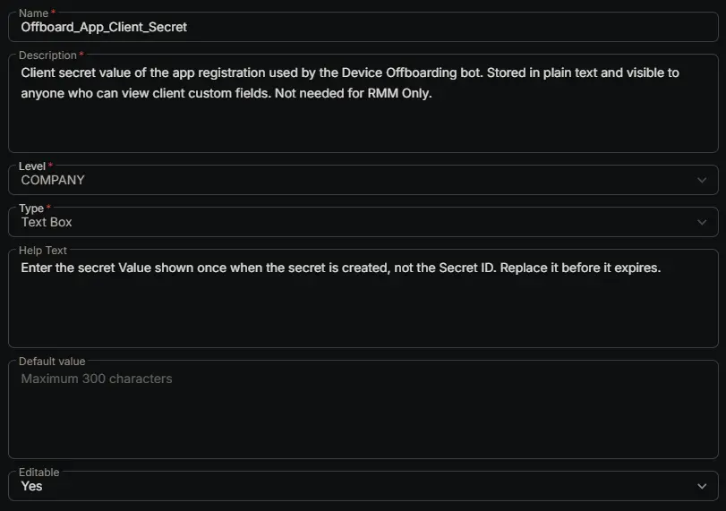

## Summary

Holds the client secret value of the app registration the [Device Offboarding [RMM, Intune and Entra]](/docs/39a88b59-e48a-4c72-bba3-fbe5ff1839ab) bot signs in with.

Copy the **Value** column when you create the secret. It's shown only once, and the **Secret ID** column isn't the secret. See the [app registration steps](/docs/39a88b59-e48a-4c72-bba3-fbe5ff1839ab#3-create-the-microsoft-entra-app-registration).

## Dependencies

- [Solution: Device Offboarding [RMM, Intune and Entra]](/docs/02e3ba26-1e13-4485-8194-69cb7434c412)
- [Bots: Device Offboarding [RMM, Intune and Entra]](/docs/39a88b59-e48a-4c72-bba3-fbe5ff1839ab)

## Custom Field Setup Location

**Custom Fields Path:** SETTINGS ➞ Custom Fields

## Details

| Name | Description | Level | Type | Help Text | Default Value | Editable |
|---|---|---|---|---|---|---|
| Offboard_App_Client_Secret | Client secret value of the app registration used by the Device Offboarding bot. Stored in plain text and visible to anyone who can view client custom fields. Not needed for RMM Only. | `Company` | `Text Box` | Enter the secret Value shown once when the secret is created, not the Secret ID. Replace it before it expires. |  | `Yes` |

:::note

This field is only needed for clients that use the `RMM and Intune` or `RMM Intune and Entra` options of [Offboard_Action](/docs/e18f1709-6273-4086-b9f0-43bbb62c8644). Leave it empty for clients that only use `RMM Only`.

CW RMM has no encrypted or masked custom field type, so the secret is stored in plain text. Anyone who can view the client's custom fields in CW RMM can see it. The app registration can delete devices from the client's Intune and Entra, and anyone who has the secret can do the same. Limit who can view client custom fields in CW RMM, and rotate the secret regularly.

A client secret expires after 24 months at most. When it does, the bot can't sign in and writes the reason to [Offboard_Failure_Reason](/docs/674f4c6d-b2e7-4ee8-a25a-d8674ec7e704) on each queued device. Create a new secret before the old one expires and save it here.

:::

## Completed Custom Field

## Changelog

### 2026-10-27

- Initial version of the document
