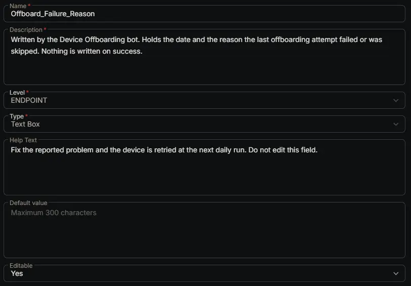

## Summary

Written by the [Device Offboarding [RMM, Intune and Entra]](/docs/39a88b59-e48a-4c72-bba3-fbe5ff1839ab) bot. Holds the date (in UTC) and the reason the last offboarding attempt failed or was skipped, for example `2026-10-27 06:00 UTC Skipped: the device is offline.`

The device stays in the [Offboard - Pending](/docs/0208ca42-8ad2-4026-8c77-1eb5d23d7d15) group and is retried at the next daily run, so fixing the reported problem is all that's needed. Nothing is written on success, because by then the device is no longer in CW RMM.

When a failure happens after the device was already removed from Intune or Entra, the reason ends with `Already removed from Intune` (or `Intune and Entra`), so you know what's left to do.

## Dependencies

- [Solution: Device Offboarding [RMM, Intune and Entra]](/docs/02e3ba26-1e13-4485-8194-69cb7434c412)
- [Bots: Device Offboarding [RMM, Intune and Entra]](/docs/39a88b59-e48a-4c72-bba3-fbe5ff1839ab)

## Custom Field Setup Location

**Custom Fields Path:** SETTINGS ➞ Custom Fields

## Details

| Name | Description | Level | Type | Help Text | Default Value | Editable |
|---|---|---|---|---|---|---|
| Offboard_Failure_Reason | Written by the Device Offboarding bot. Holds the date and the reason the last offboarding attempt failed or was skipped. Nothing is written on success. | `Endpoint` | `Text Area` | Fix the reported problem and the device is retried at the next daily run. Do not edit this field. |  | `Yes` |

:::note

The bot keeps the reason under 1,000 characters and replaces special characters with spaces, so error text from Microsoft or CW RMM may read slightly differently from the original.

:::

## Common Reasons

| Reason starts with | What to do |
|---|---|
| `Skipped: the device is offline` | Wait for the device to come online, or check [Offboard_Skip_Offline_Check](/docs/e767b472-e81b-44cf-9b80-dffbd039b090) if it won't come back. |
| `Offboard_Action is set to ..., which is not a recognised option` | Set [Offboard_Action](/docs/e18f1709-6273-4086-b9f0-43bbb62c8644) to one of its listed options. |
| `Set Offboard_Tenant_ID ... at the client level` | Fill in the listed client fields. See the [app registration steps](/docs/39a88b59-e48a-4c72-bba3-fbe5ff1839ab#3-create-the-microsoft-entra-app-registration). |
| `client level custom fields ... do not exist in CW RMM` | Create the [Offboard_Tenant_ID](/docs/7cd5a6d6-655c-4b39-8819-1122c799f24a), [Offboard_App_Client_ID](/docs/7857a579-d691-4a79-a959-211c45a09d8f) and [Offboard_App_Client_Secret](/docs/c51ae730-a3fd-4ad6-818f-25b5ec4e2936) fields, then fill them in for the client. |
| `Microsoft sign in failed` | Check the client's tenant ID, client ID and secret. An expired secret causes this too, so create a new one and save it in [Offboard_App_Client_Secret](/docs/c51ae730-a3fd-4ad6-818f-25b5ec4e2936). |
| `The app registration lacks the Microsoft Graph application permission` | Add the listed permission as an **Application** permission and select **Grant admin consent**. |
| `... Intune devices match` | Remove the right device from Intune and Entra by hand, then set Offboard_Action to `RMM Only`. |
| `The device is not in Intune, so its Entra device cannot be identified safely` | Remove the device from Entra by hand, then set Offboard_Action to `RMM Only`. |
| `... Entra devices match` | Remove the right device from Entra by hand, then set Offboard_Action to `RMM and Intune`. |
| `The Entra device is synced from on-premises Active Directory` | Delete the computer object from Active Directory (the sync then removes it from Entra), then set Offboard_Action to `RMM and Intune`. |
| `Entra removal failed` | Often a Windows Autopilot registration. The device was already removed from Intune, so the bot can't find the Entra device again. Remove the device from Autopilot and from Entra by hand, then set Offboard_Action to `RMM Only`. |
| `CW RMM uninstall failed` or `CW RMM uninstall was refused` | `ErrAgentUninstallationDisabled` means agent uninstallation is turned off for the account the workflow runs as. Turn it on, or recreate the workflow with an account that's allowed to uninstall agents. |

## Completed Custom Field

## Changelog

### 2026-10-27

- Initial version of the document
