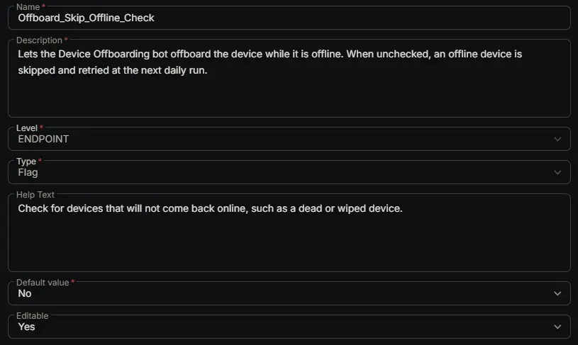

## Summary

Lets the [Device Offboarding [RMM, Intune and Entra]](/docs/39a88b59-e48a-4c72-bba3-fbe5ff1839ab) bot offboard the device while it's offline. When unchecked, an offline device is skipped, the skip is written to [Offboard_Failure_Reason](/docs/674f4c6d-b2e7-4ee8-a25a-d8674ec7e704), and the device is retried at the next daily run.

Check it for devices that won't come back online, such as a dead laptop or one that's already been wiped.

## Dependencies

- [Solution: Device Offboarding [RMM, Intune and Entra]](/docs/02e3ba26-1e13-4485-8194-69cb7434c412)
- [Bots: Device Offboarding [RMM, Intune and Entra]](/docs/39a88b59-e48a-4c72-bba3-fbe5ff1839ab)
- [Custom Field: Offboard_Action](/docs/e18f1709-6273-4086-b9f0-43bbb62c8644)

## Custom Field Setup Location

**Custom Fields Path:** SETTINGS ➞ Custom Fields

## Details

| Name | Description | Level | Type | Help Text | Default Value | Editable |
|---|---|---|---|---|---|---|
| Offboard_Skip_Offline_Check | Lets the Device Offboarding bot offboard the device while it is offline. When unchecked, an offline device is skipped and retried at the next daily run. | `Endpoint` | `Flag` | Check for devices that will not come back online, such as a dead or wiped device. |  | `Yes` |

:::note

This field only matters when [Offboard_Action](/docs/e18f1709-6273-4086-b9f0-43bbb62c8644) is set to an offboarding option. It has no effect on its own.

:::

## Completed Custom Field

## Changelog

### 2026-10-27

- Initial version of the document
