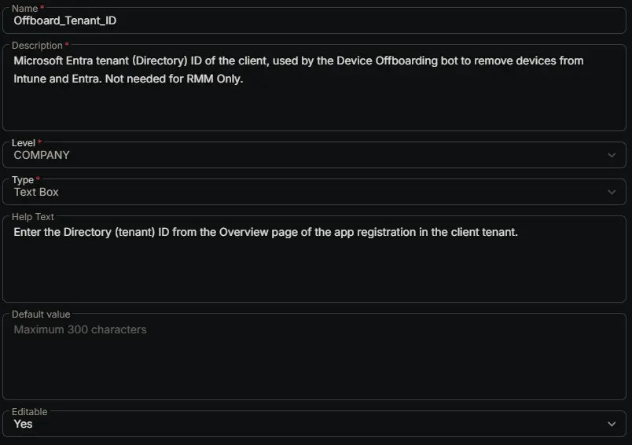

## Summary

Holds the client's Microsoft Entra tenant (Directory) ID. The [Device Offboarding [RMM, Intune and Entra]](/docs/39a88b59-e48a-4c72-bba3-fbe5ff1839ab) bot uses it, with [Offboard_App_Client_ID](/docs/7857a579-d691-4a79-a959-211c45a09d8f) and [Offboard_App_Client_Secret](/docs/c51ae730-a3fd-4ad6-818f-25b5ec4e2936), to sign in to the client's tenant and remove devices from Intune and Entra.

Copy the value from the **Directory (tenant) ID** on the app registration's **Overview** page. See the [app registration steps](/docs/39a88b59-e48a-4c72-bba3-fbe5ff1839ab#3-create-the-microsoft-entra-app-registration).

## Dependencies

- [Solution: Device Offboarding [RMM, Intune and Entra]](/docs/02e3ba26-1e13-4485-8194-69cb7434c412)
- [Bots: Device Offboarding [RMM, Intune and Entra]](/docs/39a88b59-e48a-4c72-bba3-fbe5ff1839ab)

## Custom Field Setup Location

**Custom Fields Path:** SETTINGS ➞ Custom Fields

## Details

| Name | Description | Level | Type | Help Text | Default Value | Editable |
|---|---|---|---|---|---|---|
| Offboard_Tenant_ID | Microsoft Entra tenant (Directory) ID of the client, used by the Device Offboarding bot to remove devices from Intune and Entra. Not needed for RMM Only. | `Company` | `Text Box` | Enter the Directory (tenant) ID from the Overview page of the app registration in the client tenant. |  | `Yes` |

:::note

This field is only needed for clients that use the `RMM and Intune` or `RMM Intune and Entra` options of [Offboard_Action](/docs/e18f1709-6273-4086-b9f0-43bbb62c8644). Leave it empty for clients that only use `RMM Only`.

:::

## Completed Custom Field

## Changelog

### 2026-10-27

- Initial version of the document
