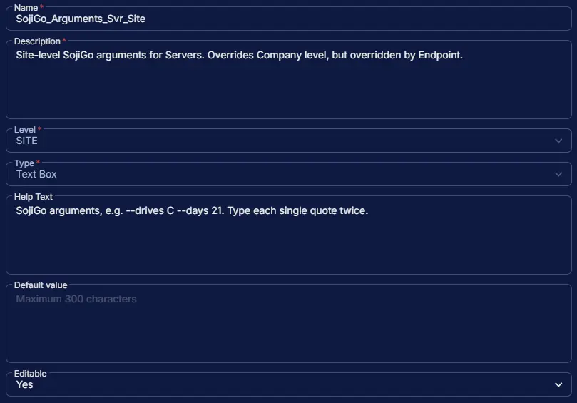

## Summary

Site-level SojiGo arguments for Servers. Overrides Company level, but overridden by Endpoint. The [SojiGo task](/docs/5e38eb11-8e17-4aa6-a917-e06d78d026e0) runs the [SojiGo](/docs/6b7cbccd-c62f-457a-a97e-0b861b27b9df) drive cleaner with these arguments.

## Dependencies

- [Task: SojiGo](/docs/5e38eb11-8e17-4aa6-a917-e06d78d026e0)
- [Application: SojiGo](/docs/6b7cbccd-c62f-457a-a97e-0b861b27b9df)
- [Solution: SojiGo](/docs/215f93ac-aca7-4ccd-8f3e-1b241bd32353)

## Custom Field Setup Location

**Custom Fields Path:** SETTINGS ➞ Custom Fields

## Details

| Name | Description | Level | Type | Help Text | Default Value | Editable |
|---|---|---|---|---|---|---|
| SojiGo_Arguments_Svr_Site | Site-level SojiGo arguments for Servers. Overrides Company level, but overridden by Endpoint. | `Site` | `Text Area` | SojiGo arguments, e.g. --drives C --days 21. Type each single quote twice. |  | `Yes` |

:::note

Type every single quote twice. Wrap values that contain spaces, commas or `|` in two single quotes on each side, for example `--exclude-volumecache ''Temporary Files,Recycle Bin''`. See [Writing arguments](/docs/5e38eb11-8e17-4aa6-a917-e06d78d026e0#writing-arguments) for all the rules.

:::

## Completed Custom Field

## Changelog

### 2026-10-20

- Initial version of the document
