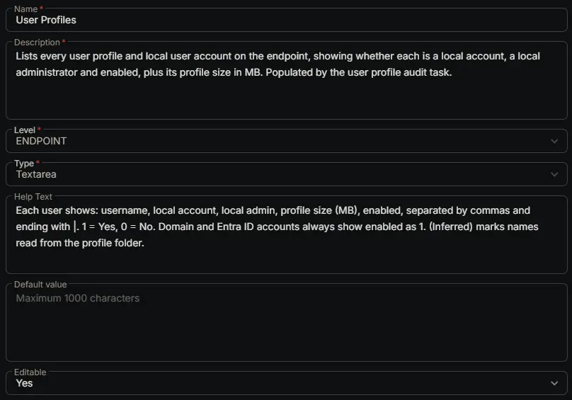

## Summary

Stores the user profile audit results for each Windows machine: every user profile and local user account, with its local account, local administrator, profile size, and enabled status. The value is written by the [User Profile - Get Information](/docs/aeb4ccec-bf76-436d-8b0c-cd3ec3d39131) task.

## Dependencies

- [Solution: Windows User Profiles](/docs/0ebb7e89-d2d8-40d4-ba1e-330ab20f86cd)
- [Task: User Profile - Get Information](/docs/aeb4ccec-bf76-436d-8b0c-cd3ec3d39131)

## Custom Field Setup Location

**Custom Fields Path:** `SETTINGS` ➞ `Custom Fields`

## Details

| Name | Description | Level | Type | Help Text | Default Value | Editable |
|---|---|---|---|---|---|---|
| User Profiles | Lists every user profile and local user account on the endpoint, showing whether each is a local account, a local administrator and enabled, plus its profile size in MB. Populated by the user profile audit task. | `Endpoint` | `Textarea` | Each user shows: username, local account, local admin, profile size (MB), enabled, separated by commas and ending with \|. 1 = Yes, 0 = No. Domain and Entra ID accounts always show enabled as 1. (Inferred) marks names read from the profile folder. | | `Yes` |

## Reading the Value

Each user is one entry. The five values in an entry are separated by commas, and each entry ends with `|`.

| Position | Value | Meaning |
|---|---|---|
| 1 | Username | The account name, such as `CONTOSO\jdoe` or `AzureAD\JaneSmith`. Local accounts without a profile show the name only, such as `Guest`. Names that end with `(Inferred)` were taken from the profile folder because the account couldn't be looked up. |
| 2 | Local account | `1` for accounts created on the machine itself, `0` for domain and Microsoft Entra ID accounts. |
| 3 | Local admin | `1` when the account has local administrator rights, directly or through a nested group. |
| 4 | Profile size | The profile size in MB. `0` for accounts that have never signed in. |
| 5 | Enabled | `1` when the account is enabled. Always `1` for domain and Entra ID accounts, whose status is managed outside the machine. |

**Example:**

```PlainText
CONTOSO\jdoe,0,1,20480.75,1|AzureAD\JaneSmith,0,0,5120.4,1|PC01\support,1,1,312.5,1|Administrator,1,1,0,0|Guest,1,0,0,0|
```

This machine has a domain user with local administrator rights and a 20 GB profile, an Entra ID user without administrator rights, a local administrator account named `support`, and the built-in Administrator and Guest accounts, which are disabled and have never signed in.

## Character Limit

A **Textarea** custom field holds up to 1,000 characters, and automation can write at most 999 of them. A **Text** field holds only 255 characters, which is why this field uses the Textarea type.

When the audit results are longer than 999 characters, the task drops whole entries from the end of the list until the value fits, so every stored entry is complete. Local accounts without a profile are listed last, so they are dropped first. The task's script log shows a warning with both the stored value and the complete list.

## Completed Custom Field



## Changelog

### 2026-10-22

- Changed the field type from **Text** to **Textarea** so it can store up to 999 characters instead of 255.
- Updated the description and added help text that explains the value format.
- Added the value format, an example, and the character limit to the document.

### 2026-03-11

- Initial version of the document
