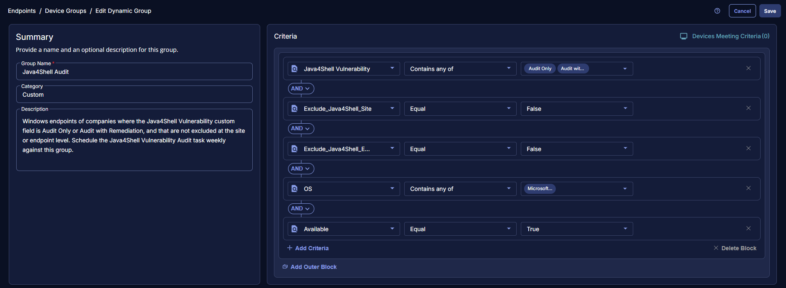

## Summary

Windows endpoints of companies where the Java4Shell Vulnerability custom field is `Audit Only` or `Audit with Remediation`, and that are not excluded at the site or endpoint level. Schedule the [Task: Java4Shell Vulnerability Audit-Remediation](/docs/2511ac9a-4b2b-45d9-9d3c-8056c1c21655) weekly against this group.

## Dependencies

- [Custom Field: Exclude_Java4Shell_Endpoint](/docs/515dc9f8-fab0-425e-800f-f1bb25419292)
- [Custom Field: Exclude_Java4Shell_Site](/docs/e930bd04-92b1-4635-a307-e4bedafd872e)
- [Custom Field: Java4Shell Vulnerability](/docs/4734f06e-5f74-4072-beb5-8e2a661e8f1f)
- [Solution: Java4Shell Vulnerability Audit (ConnectWise RMM)](/docs/a0ee9b5c-fa3c-4f2e-b7ca-71da1cf3e7cd)
- [Task: Java4Shell Vulnerability Audit-Remediation](/docs/2511ac9a-4b2b-45d9-9d3c-8056c1c21655)

## Group Setup Location

- **Group Path:** `ENDPOINTS` ➞ `Groups`
- **Group Type:** `Dynamic Group`

## Group Summary

- **Group Name:** `Java4Shell Audit`
- **Category:** `Custom`
- **Description:** `Windows endpoints of companies where the Java4Shell Vulnerability custom field is Audit Only or Audit with Remediation, and that are not excluded at the site or endpoint level. Schedule the Java4Shell Vulnerability Audit-Remediation task weekly against this group.`

## Criteria

| Block | Criteria Name | Operator | Value(s) |
|-------|---------------|----------|----------|
| 1     | Java4Shell Vulnerability | Contains any of | `Audit Only`,`Audit with Remediation` |
| 1     | Exclude_Java4Shell_Site | Equal | `False` |
| 1     | Exclude_Java4Shell_Endpoint | Equal | `False` |
| 1     | OS Type | Contains any of | `Windows` |
| 1     | Available | Equal | `True` |

**Logic:**
A machine matches the group if it meets ALL criteria in Block 1: the company has the solution enabled, the site and the endpoint are not excluded, the operating system is Windows, and the endpoint is available.

## Completed Group

## Changelog

### 2026-11-23

- Initial version of the document.
