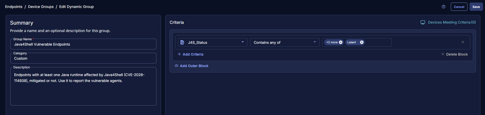

## Summary

Endpoints with at least one Java runtime affected by Java4Shell (CVE-2026-114938), mitigated or not. Use it to report the vulnerable agents.

## Dependencies

- [Custom Field: J4S_Status](/docs/b4eef927-7da8-47c0-90da-dd6c6f2bdc08)
- [Solution: Java4Shell Vulnerability Audit (ConnectWise RMM)](/docs/a0ee9b5c-fa3c-4f2e-b7ca-71da1cf3e7cd)
- [Task: Java4Shell Vulnerability Audit-Remediation](/docs/2511ac9a-4b2b-45d9-9d3c-8056c1c21655)

## Group Setup Location

- **Group Path:** `ENDPOINTS` ➞ `Groups`
- **Group Type:** `Dynamic Group`

## Group Summary

- **Group Name:** `Java4Shell Vulnerable Endpoints`
- **Category:** `Custom`
- **Description:** `Endpoints with at least one Java runtime affected by Java4Shell (CVE-2026-114938), mitigated or not. Use it to report the vulnerable agents.`

## Criteria

| Block | Criteria Name | Operator | Value(s) |
|-------|---------------|----------|----------|
| 1     | J4S_Status | Contains any of | `Exposed`,`Mitigated`,`Latent` |

**Logic:**
A machine matches the group if its J4S_Status is Exposed, Mitigated, or Latent.

## Completed Group

## Changelog

### 2026-11-23

- Initial version of the document.
