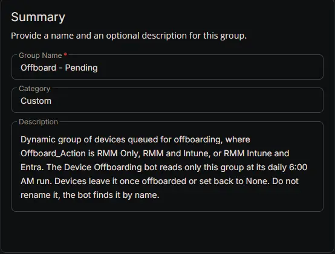
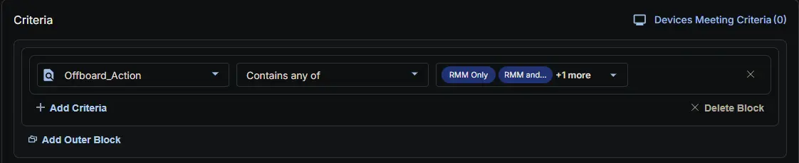
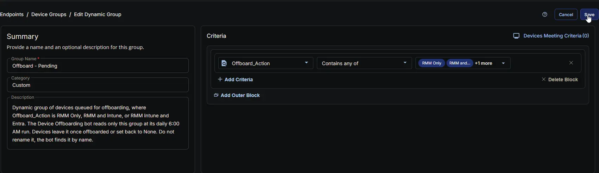

## Summary

Target group for the [Device Offboarding [RMM, Intune and Entra]](/docs/39a88b59-e48a-4c72-bba3-fbe5ff1839ab) bot. Includes every device whose [Offboard_Action](/docs/e18f1709-6273-4086-b9f0-43bbb62c8644) is set to an offboarding option.

The bot reads only the members of this group, so the daily run doesn't have to read the custom fields of every device in CW RMM. Devices leave the group once they're offboarded or set back to `None`.

:::note

The bot finds this group by its name. Name it exactly `Offboard - Pending`, and don't rename it afterwards.

:::

## Dependencies

- [Custom Field: Offboard_Action](/docs/e18f1709-6273-4086-b9f0-43bbb62c8644)
- [Bots: Device Offboarding [RMM, Intune and Entra]](/docs/39a88b59-e48a-4c72-bba3-fbe5ff1839ab)
- [Solution: Device Offboarding [RMM, Intune and Entra]](/docs/02e3ba26-1e13-4485-8194-69cb7434c412)

## Group Setup Location

- **Group Path:** `ENDPOINTS` ➞ `Groups`  
- **Group Type:** `Dynamic Group`

## Group Summary

- **Group Name:** `Offboard - Pending`  
- **Category:** `Custom`  
- **Description:** `Dynamic group of devices queued for offboarding, where Offboard_Action is RMM Only, RMM and Intune, or RMM Intune and Entra. The Device Offboarding bot reads only this group at its daily 6:00 AM run. Devices leave it once offboarded or set back to None. Do not rename it, the bot finds it by name.`  

## Criteria

The group is defined by a single **criteria block**.

| Block | Criteria Name | Operator | Value(s) |
|-------|---------------|----------|----------|
| 1 | Offboard_Action | Contains any of | `RMM Only`, `RMM and Intune`, `RMM Intune and Entra` |

- **Block 1:** Targets any device where [Offboard_Action](/docs/e18f1709-6273-4086-b9f0-43bbb62c8644) is set to one of the three offboarding options. Devices set to `None` are left out.

**Logic:**  
A device matches the group when its **Offboard_Action** is `RMM Only`, `RMM and Intune` or `RMM Intune and Entra`. The bot reads Offboard_Action again before acting on each member, so a device that's set back to `None` just before the run is never touched.

## Completed Group

## Changelog

### 2026-10-27

- Initial version of the document
