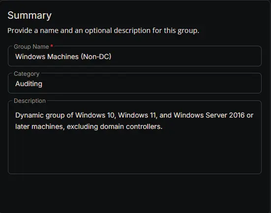
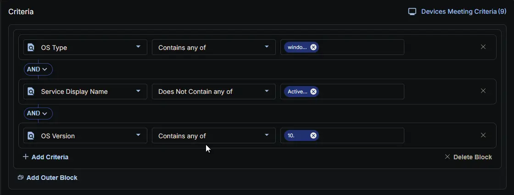
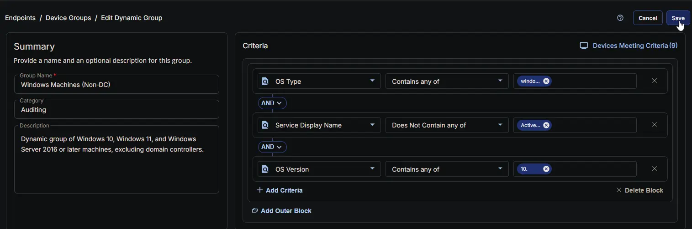

## Summary

Dynamic group of Windows 10, Windows 11, and Windows Server 2016 or later machines, excluding domain controllers.

## Dependencies

- [Solution: Windows User Profiles](/docs/0ebb7e89-d2d8-40d4-ba1e-330ab20f86cd)

## Group Setup Location

**Group Path:** `ENDPOINTS` ➞ `Groups`  
**Group Type:** `Dynamic Group`

## Group Summary

**Group Name:** `Windows Machines (Non‑DC)`  
**Category:** `Auditing`  
**Description:** `Dynamic group of Windows 10, Windows 11, and Windows Server 2016 or later machines, excluding domain controllers.`

## Group Criteria

The group is defined by the following **conditions**, joined by an **AND** logic.

| Condition             | Operator                | Value(s)                           |
|-----------------------|-------------------------|------------------------------------|
| OS Type               | Contains any of         | `Windows`                          |
| Service Display Name  | Does Not Contain any of | `Active Directory Domain Services` |
| OS Version            | Contains any of         | `10.`                              |

**Logic:** Detects Windows machines with an OS version that starts with `10.`, which covers Windows 10, Windows 11, and Windows Server 2016 or later. Machines running the Active Directory Domain Services service are domain controllers and are excluded. Offline machines stay in the group.

## Completed Group

## Changelog

### 2026-10-22

- Added the **OS Version** criterion so the group only includes Windows 10, Windows 11, and Windows Server 2016 or later machines.
- Removed the **Available** criterion, so offline machines are no longer dropped from the group.
- Changed the **OS Type** operator to **Contains any of**.
- Updated the group description.

### 2026-03-11

- Initial version of the document
