## Summary

The **Cisco Secure Client Package Installation (Windows)** task installs the full Cisco Secure Client suite or selected modules on Windows endpoints. It runs the agnostic script [Install-CiscoSecureClient](/docs/fc6bcac9-770a-46dc-902c-7176cb1d73ea) with the install options stored in the company-level [Cisco Secure Client Parameter](/docs/0dc22f98-f39e-4d02-9716-19087ff35e03) custom field.

### How it works

1. **Read the install options.** The task reads the [Cisco Secure Client Parameter](/docs/0dc22f98-f39e-4d02-9716-19087ff35e03) custom field of the endpoint's company.
2. **Copy the package from File Sharing.** If `cisco_secure_client.zip` is stored in CW RMM File Sharing, the task copies it to `C:\ProgramData\_Automation\script\Cisco Secure Client`. If it isn't stored there, this step fails and the task continues.
3. **Install the modules.** The task downloads the [Install-CiscoSecureClient](/docs/fc6bcac9-770a-46dc-902c-7176cb1d73ea) script and runs it with the custom field value. The script gets the package from the location set in `-DownloadURL`, either a URL or the local copy, and installs or updates the requested modules.
4. **Report the result.** The script output, including any installation errors, appears in the script log.

**Requirements:** PowerShell 5.1, internet access to `contentrepo.net` and the PowerShell Gallery, and the Cisco Secure Client package hosted at a download URL or in CW RMM File Sharing. See [Prerequisites](#prerequisites).

## Sample Run

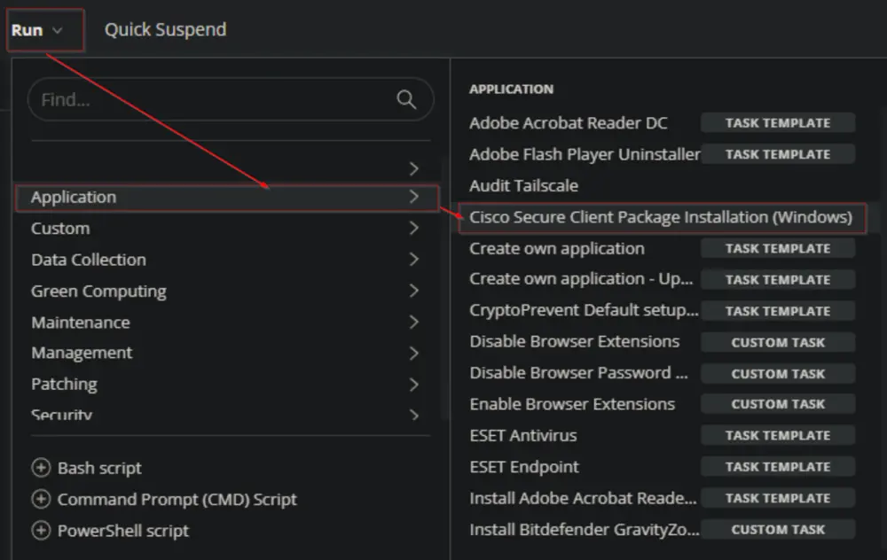

## Dependencies

- [PowerShell: Install-CiscoSecureClient](/docs/fc6bcac9-770a-46dc-902c-7176cb1d73ea)
- [Custom Field: Cisco Secure Client Parameter](/docs/0dc22f98-f39e-4d02-9716-19087ff35e03)
- [Solution: Cisco Secure Client - CW RMM](/docs/7637a958-9383-46af-99f9-4146ea097bf0)

## Custom Fields

| Name | Example | Level | Type | Default Value | Description |
| --- | --- | --- | --- | --- | --- |
| [Cisco Secure Client Parameter](/docs/0dc22f98-f39e-4d02-9716-19087ff35e03) | `-DownloadURL 'https://downloadpath/CiscoSecureClient.zip' -Core -Dart` | `Company` | `Text Box` | | Install options passed to the [Install-CiscoSecureClient](/docs/fc6bcac9-770a-46dc-902c-7176cb1d73ea) script. Must include at least one module switch. |

Create the custom field before you build the task, and set its value for each company before you run or schedule the task. See [Cisco Secure Client Parameter](/docs/0dc22f98-f39e-4d02-9716-19087ff35e03) for sample values and all available switches.

:::note

Use `-DownloadURL` only when the package isn't stored in CW RMM File Sharing. If the package is in File Sharing, leave `-DownloadURL` out. The task copies the package from File Sharing, and the script uses that copy automatically.

**Package stored in CW RMM File Sharing:**

```PlainText
-Core -Dart
```

**Package hosted at a download URL:**

```PlainText
-DownloadURL 'https://downloadpath/CiscoSecureClient.zip' -Core -Dart
```

Keep the single quotes around the URL.

:::

## Prerequisites

The task needs the `Cisco Secure Client Pre-Deployment Package (Windows) - includes individual MSI files` zip file, hosted in one of these locations:

- **A download URL:** upload the zip file to a location the endpoints can download from, for example `https://file.provaltech.com/apps/packages/cisco_secure_client.zip`, and set `-DownloadURL` to that URL.
- **CW RMM File Sharing:** upload the zip file as described in [Upload the Package to File Sharing](#upload-the-package-to-file-sharing), and leave `-DownloadURL` out. The task copies the package from File Sharing, and the script uses that copy automatically.

### Download the Package

Download the package from [Cisco Software Download](https://software.cisco.com/download/home/286330811/type/282364313/release/5.0.03076). Cisco changes this URL with each release, so download the latest stable version.

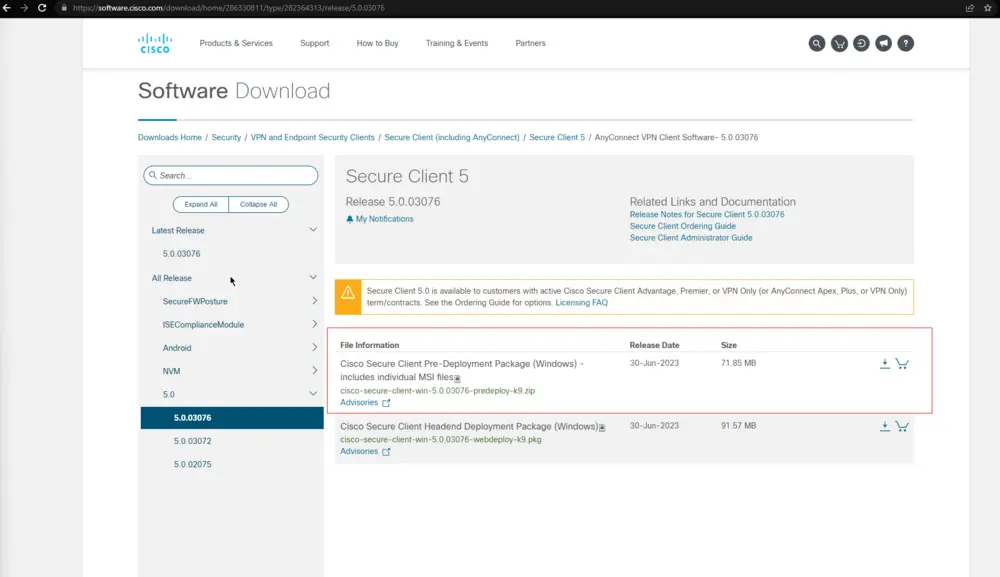

:::note

You need a Cisco portal login to download the package. If you don't have one, create it and confirm your access before downloading, or you'll see this error:

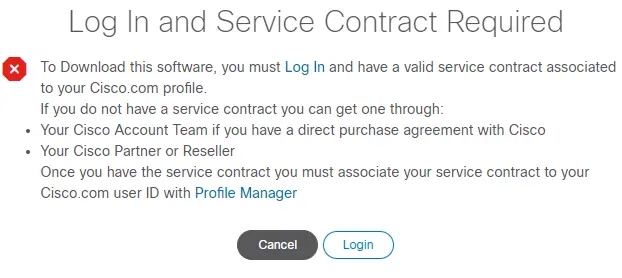

:::

### Upload the Package to File Sharing

Skip this section if the package is hosted at a download URL.

1. Go to `SETTINGS` ➞ `File Sharing`.
2. Click **Create Folder** next to `Files/Folders`.
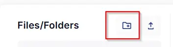
3. Name the folder `Cisco Secure Client` and click **Create**.
4. Open the `Cisco Secure Client` folder, click **Upload File** on the right, and then click **Choose File**.
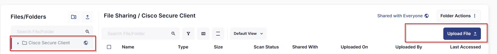
5. Select the downloaded zip file and upload it. The file must be named `cisco_secure_client.zip`.

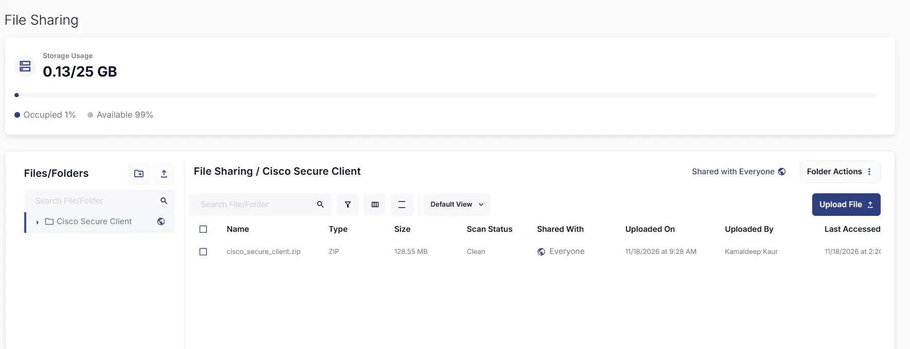

## Task Setup Path

- **Tasks Path:** `AUTOMATION` ➞ `Tasks`
- **Task Type:** `Script Editor`

## Task Creation

### Description

- **Name:** `Cisco Secure Client Package Installation (Windows)`
- **Description:**

```PlainText
How to use parameters: https://content.provaltech.com/docs/0dc22f98-f39e-4d02-9716-19087ff35e03
Note: To install the Umbrella module, it is required to install the Core VPN module.
```

- **Category:** `Application`

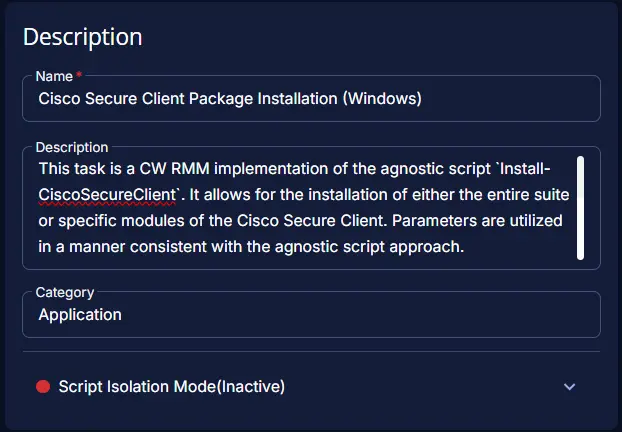

### Script Editor

#### Row 1 Function: Set Pre-defined Variable ( @Parameters@ = Cisco Secure Client Parameter )

- **Notes:** `<Leave it Blank>`
- **Continue on Failure:** `False`
- **Operating System:** `Windows`
- **Variable Name:** `Parameters`
- **Custom Field:** `Cisco Secure Client Parameter (STRING - COMPANY)`

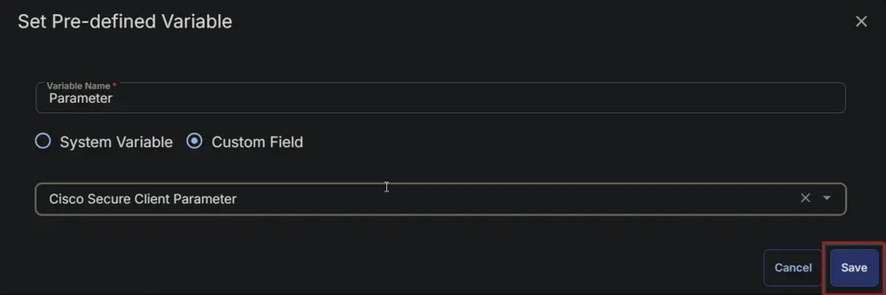

#### Row 2 Function: ConnectWise File Sharing

- **Notes:** `<Leave it Blank>`
- **Continue on Failure:** `True`
- **Operating System:** `Windows`
- **Path:** `File Sharing / Cisco Secure Client / cisco_secure_client.zip`
- **Output Path:** `C:\ProgramData\_Automation\script\Cisco Secure Client`

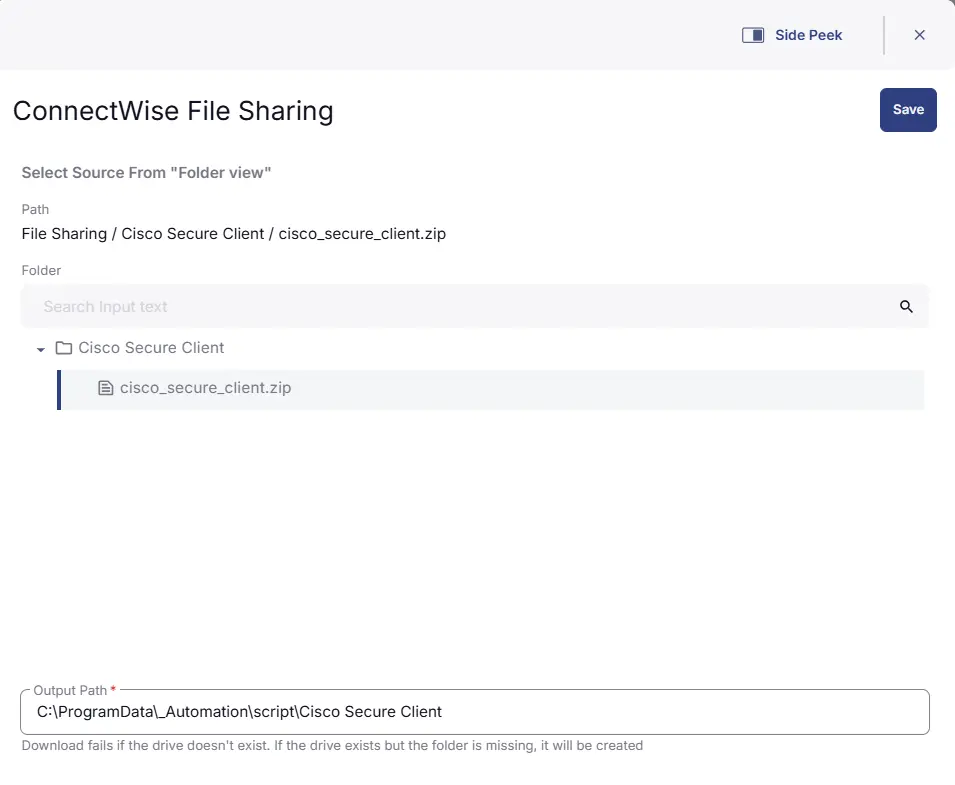

:::warning

Check `Continue on Failure` for this row. When the package isn't stored in File Sharing, this row fails, and without `Continue on Failure` the task stops before the installation.

:::

#### Row 3 Function: PowerShell script

- **Notes:** `<Leave it Blank>`
- **Use Generative AI Assist for script creation:** `False`
- **Expected time of script execution in seconds:** `900`
- **Continue on Failure:** `True`
- **Run As:** `System`
- **Operating System:** `Windows`
- **PowerShell Script Editor:**

[PowerShell Script](https://github.com/ProVal-Tech/cw-rmm/blob/main/tasks/cisco-secure-client-package-installation-windows/script.ps1)

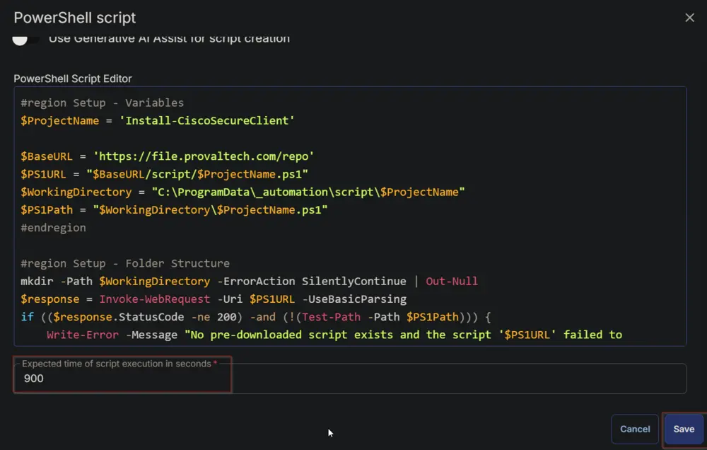

#### Row 4 Function: Script Log

- **Notes:** `<Leave it Blank>`
- **Continue on Failure:** `False`
- **Operating System:** `Windows`
- **Script Log Message:** `%Output%`

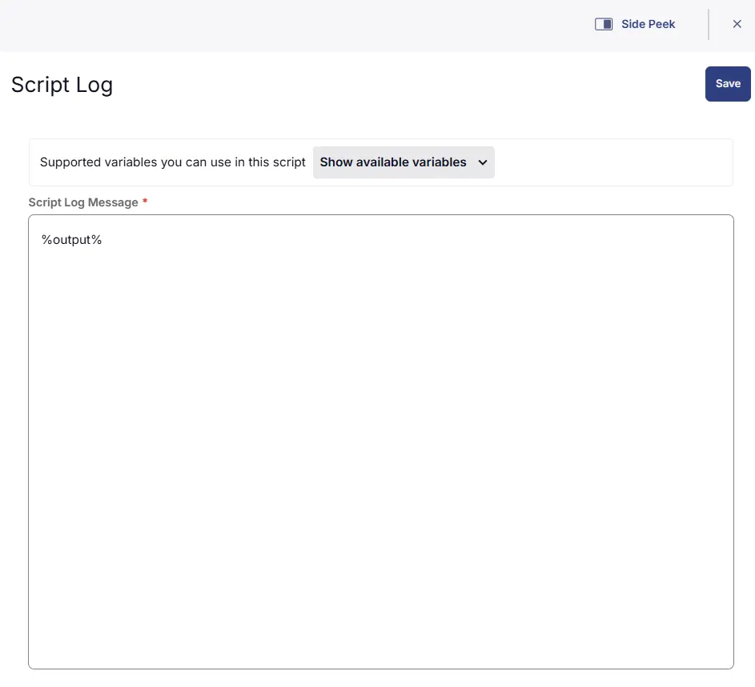

## Completed Task

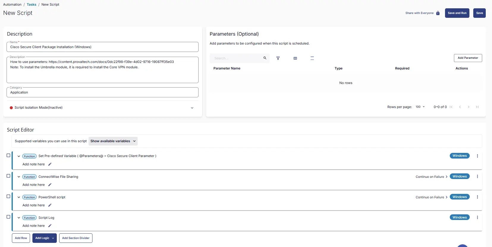

## Module Definitions

### Core-VPN

- Core-VPN must be installed with any additional module.
- All modules require that Core-VPN be installed.
- When only installing Core-VPN, you can expect to see the following.

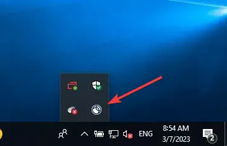  
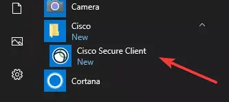  
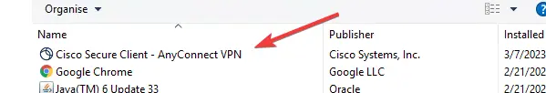  
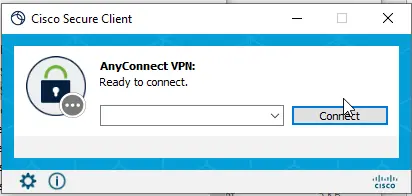  

### Start Before Login

- SBL stands for Start Before Login; it adds no direct user GUI, however, it does add an entry into programs and features.
- It enables the execution of the AnyConnect VPN prior to a user being logged in.

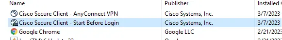

### Diagnostic and Reporting Tool

- DART stands for Diagnostics and Reporting Tool.
- When installing this, you can expect to see the following items.

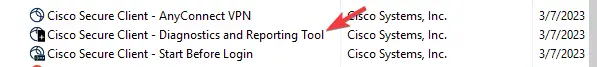  
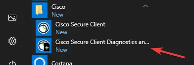  
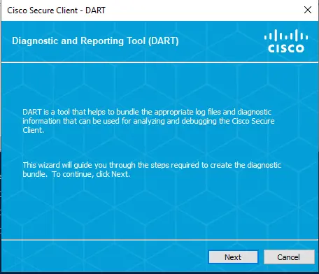  

### Network Access Manager

- NAM stands for Network Access Manager.
- When installing this module, you can expect to see the following items.

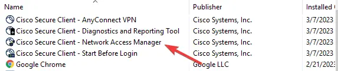  
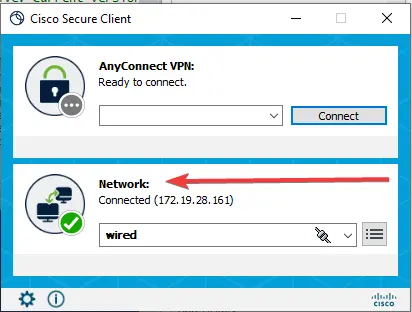  

### Network Visibility Module

- NVM stands for Network Visibility Manager.
- Network Visibility Manager does not include a GUI but does the following:
- Network Visibility Manager **helps you see user and endpoint behavior both on and off premises**. It collects standard flows from endpoints (laptops, for example) along with context like user, application, device, location, and destination information.

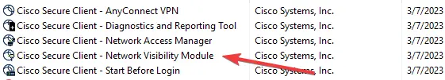

### VPN Posture - HostScan Module

- Posture provides the Cisco AnyConnect Secure Mobility Client with the ability to assess an endpoint's compliance for things like antivirus, antispyware, and firewall software installed on the host.
- It does not provide a User GUI.

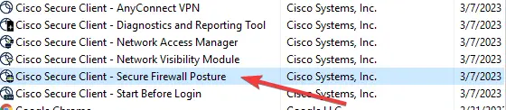

### ISE Posture

- ISE Posture provides the Cisco AnyConnect Secure Mobility Client with the ability to assess an endpoint's compliance for things like antivirus, antispyware, and firewall software installed on the host, with a user GUI interface.
- When installing this module, you can expect to see the following:

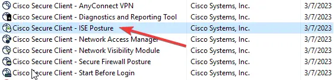  
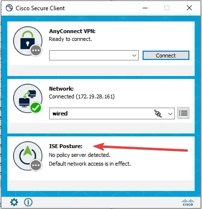  

### Umbrella

- Umbrella installs the Cisco Umbrella module.
- When installing this module, you can expect to see the following:

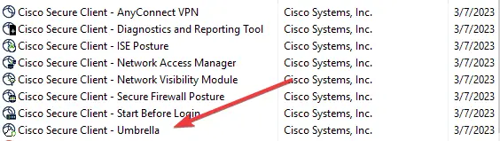  
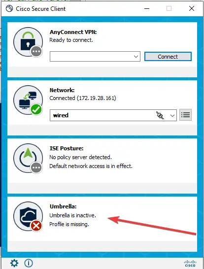  

## Uninstalling

Uninstalling the Core-VPN module removes all other modules except DART, which must be removed separately. To uninstall the package with CW RMM, use the [Cisco Secure Client - Package Uninstallation [Windows]](/docs/b2f98721-b82c-48ad-9bf9-83f0d82c5204) task.

## FAQ

- Will this installation update older versions of Cisco AnyConnect?
  - Yes, each requested component will be updated if run against a machine that has that component already installed. Components that are not requested will not be updated.

## Output

- Script Log
- Script logs in `C:\ProgramData\_Automation\Script\Install-CiscoSecureClient`
- The package copied from File Sharing, in `C:\ProgramData\_Automation\script\Cisco Secure Client`, when File Sharing is used

## Changelog

### 2026-11-18

- Updated the document to the current task template.
- Added the option to store the installation package in CW RMM File Sharing.
- Reduced the task to four rows. The parameter check, error log and exit rows were removed.
- Added the [Cisco Secure Client - CW RMM](/docs/7637a958-9383-46af-99f9-4146ea097bf0) solution to the dependencies.

### 2025-04-10

- Initial version of the document
