## Summary

Installs the Blackpoint SNAP Agent on Windows and macOS machines.

Both platforms use the same Blackpoint Customer ID and Authentication Token. These come from the `BP_Customer_ID` and `BP_Authentication_Token` custom fields, or from the `Customer_ID` and `Authentication_Token` user parameters. When both are populated, the custom fields take precedence.

On Windows, the task downloads the agnostic script [Install-BlackpointAgent](/docs/0cf14533-c145-4a77-8ea7-8c70476768a9) from the ProVal content repository, validates its code signature, and runs it with the Customer ID and Authentication Token. The script downloads the installer from the Blackpoint installer API, installs the agent, and verifies the installation.

On macOS, the task runs a Bash script that:

- Exits without making changes if `/Library/LaunchDaemons/snap-agent.plist` already exists.
- Resolves the authentication token and customer ID from the custom fields or the user parameters.
- Confirms that the customer ID is a valid UUID.
- Downloads the Blackpoint deployment installer and removes any `license.yaml` left behind by a previous incomplete installation, so the supplied credentials are always applied.
- Runs the Blackpoint installer and verifies the installation by checking for `snap-agent.plist` and confirming that the service is loaded.

Every macOS failure path exits with a non-zero code and writes an `ERROR:` line to the script log.

## Sample Run
 
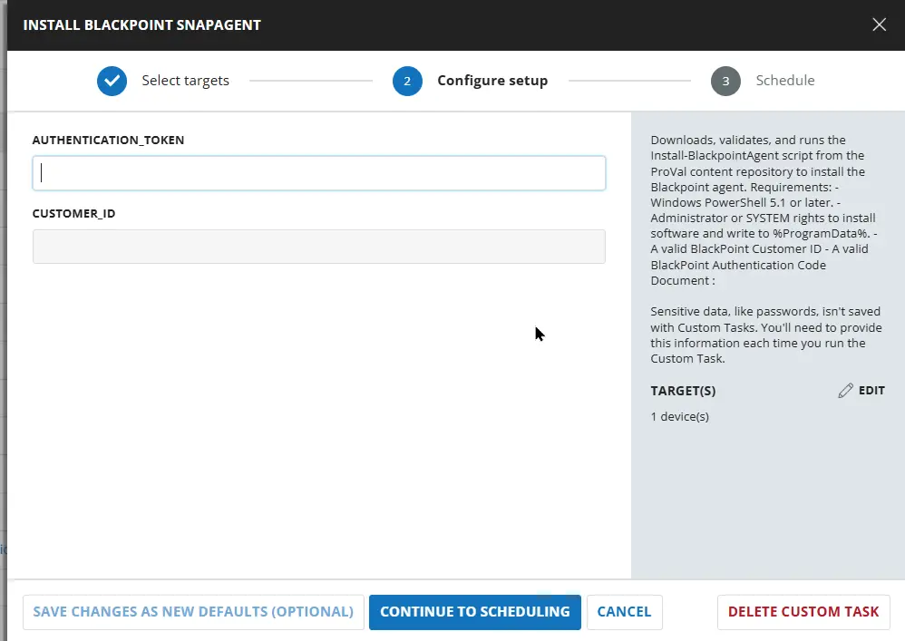

## Dependencies

- [Agnostic: Install-BlackPointAgent](/docs/0cf14533-c145-4a77-8ea7-8c70476768a9)
- [Solution: BlackPoint SnapAgent Deployment](/docs/b99808e9-5148-47f6-9da4-bc4eeb590f2a)

## User Parameters

| Name | Example | Accepted Values | Required | Default | Type | Description |
|------|---------|-----------------|----------|---------|------|-------------|
| Authentication_Token | `abc.xyz` | Blackpoint authentication token | `No` | | `Text String` | Unique BlackPoint Authentication Code required to authenticate and install the BlackPoint Agent on endpoints. |
| Customer_ID | `00000000-0000-0000-0000-000000000000` | UUID | `No` | | `Text String` | Unique BlackPoint Account UID used to identify and link endpoints to the correct BlackPoint account. |

## Custom Fields

| Name | Level | Type | Required | Description |
|------|-------|------|----------|-------------|
| BP_Authentication_Token | Company | Text | No | Unique BlackPoint Authentication Code required to authenticate and install the BlackPoint Agent on endpoints. |
| BP_Customer_ID | Company | Text | No | Unique BlackPoint Account UID used to identify and link endpoints to the correct BlackPoint account. |

**Note:** Either the custom fields or the user parameters must be populated for the installation to proceed. Custom Fields takes precedence over User parameters.

## Task Setup Path

- **Tasks Path:** `AUTOMATION` ➞ `Tasks`  
- **Task Type:** `Script Editor`  

## Task Creation

### Description

- **Name:** `Install BlackPoint SnapAgent`  
- **Description:** 
    ```
   Downloads, validates, and runs the 'Install-BlackpointAgent' script from the ProVal content repository to install the Blackpoint agent.
    
   Requirements:
   - Windows PowerShell 5.1 or later.
    - Administrator or SYSTEM rights to install software and write to %ProgramData%.
    - A valid BlackPoint Customer ID
    - A valid BlackPoint Authentication Code
    ```

- **Category:** `Application`  
- **Script Isolation Mode:** `Inactive`

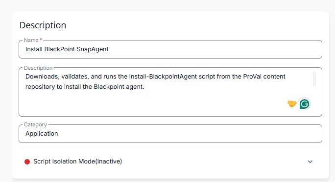

### Parameters

| Parameter Name | Required Field | Parameter Type | Default Value |
| -------------- | -------------- | -------------- | ------------- |
| Authentication_Token | Disabled | Text String | |
| Customer_ID | Disabled | Text String | |

**Authentication_Token:**  
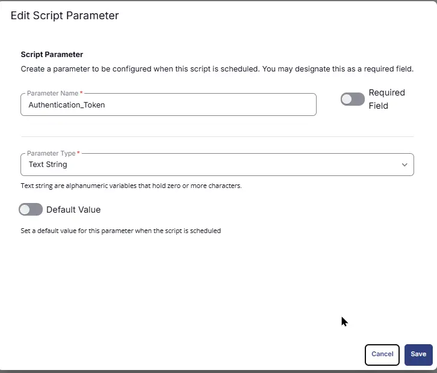

**Customer_ID:**  
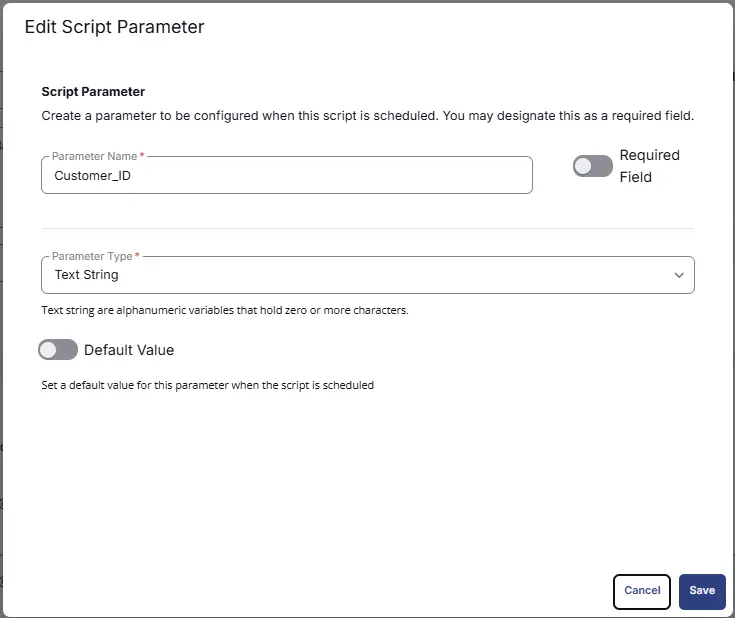

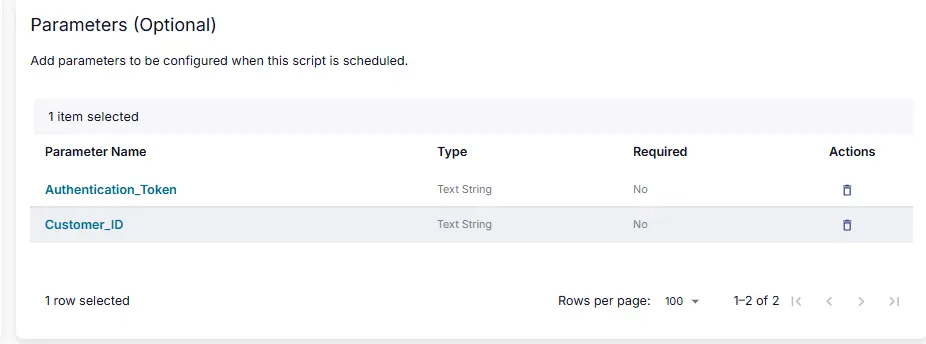

### Script Editor

#### Row 1: Set Pre-defined Variable ( @Client_Authentication_Token@ = BP_Authentication_Token )

- **Variable Name:** `Client_Authentication_Token`  
- **Type:** `Custom Field`  
- **Custom Field:** `BP_Authentication_Token`  
- **Continue on Failure:** `False`  
- **Operating System:** `Windows,MacOS`

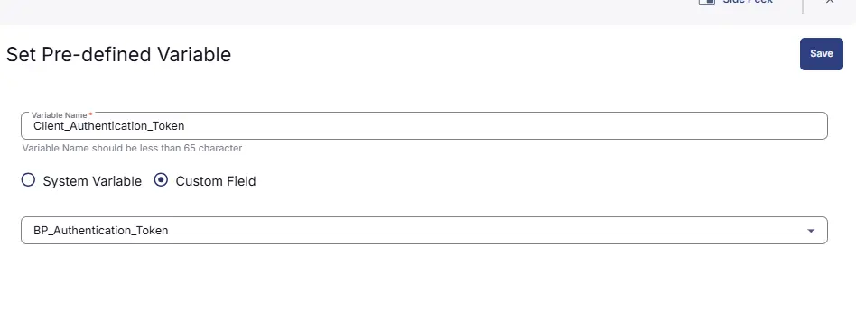

#### Row 2: Set Pre-defined Variable ( @Client_Customer_ID@ = BP_Customer_ID )

- **Variable Name:** `Client_Customer_ID`  
- **Type:** `Custom Field`  
- **Custom Field:** `BP_Customer_ID`  
- **Continue on Failure:** `False`  
- **Operating System:** `Windows,MacOS`

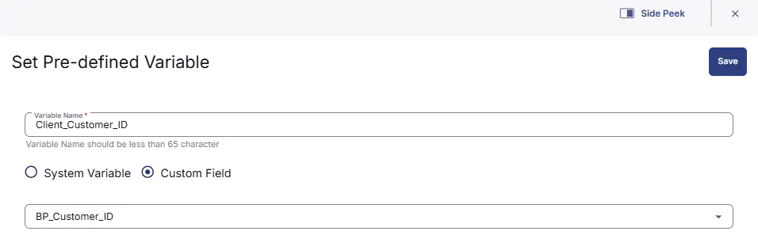

#### Row 4: PowerShell script

- **Use Generative AI Assist for script creation:** `False`  
- **Expected time of script execution in seconds:** `1800`  
- **Continue on Failure:** `False`  
- **Run As:** `System`  
- **Operating System:** `Windows`  
- **PowerShell Script Editor:**

[PowerShell Script](https://github.com/ProVal-Tech/cw-rmm/blob/main/tasks/install-blackpoint-snapagent/script.ps1)

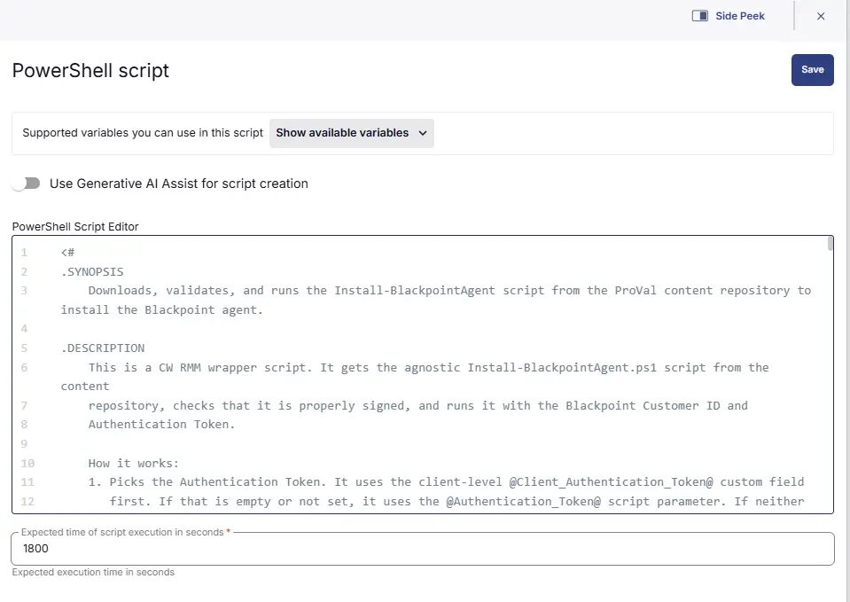

#### Row 5: Bash script

- **Use Generative AI Assist for script creation:** `False`  
- **Expected time of script execution in seconds:** `1800`  
- **Continue on Failure:** `False`  
- **Run As:** `System`  
- **Operating System:** `MacOS`  
- **Bash Script Editor:**

[Bash Script](https://github.com/ProVal-Tech/cw-rmm/blob/main/tasks/install-blackpoint-snapagent/script.sh)

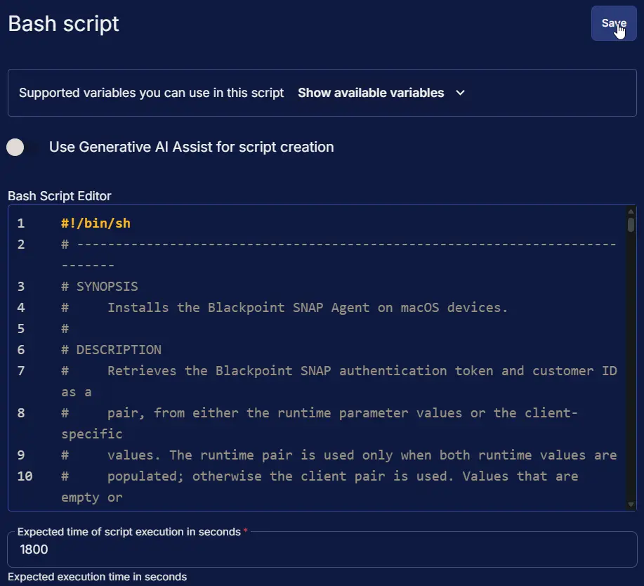

#### Row 6: Script Log

- **Script Log Message:** `%Output%`  
- **Continue on Failure:** `False`  
- **Operating System:** `Windows`, `MacOS`

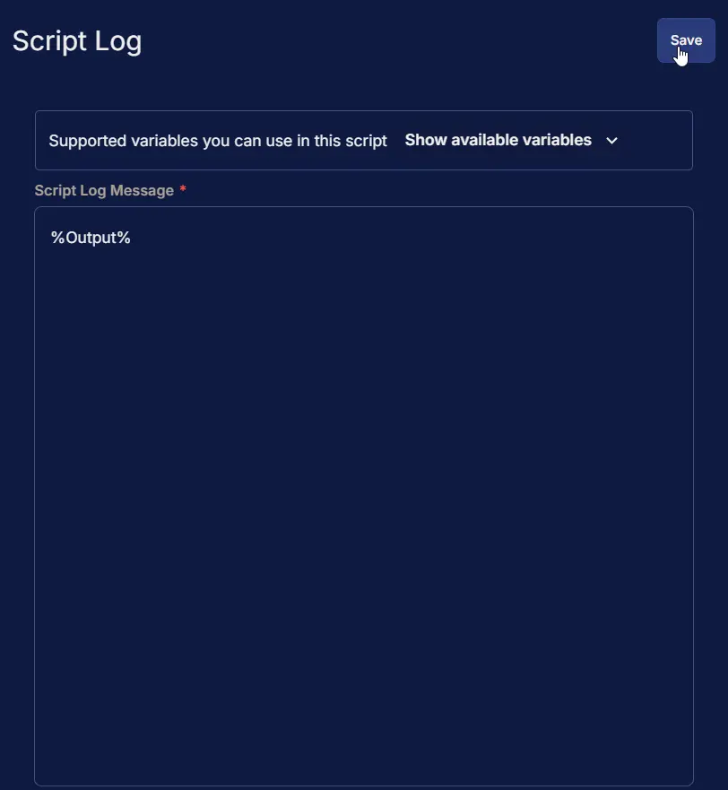

## Completed Script

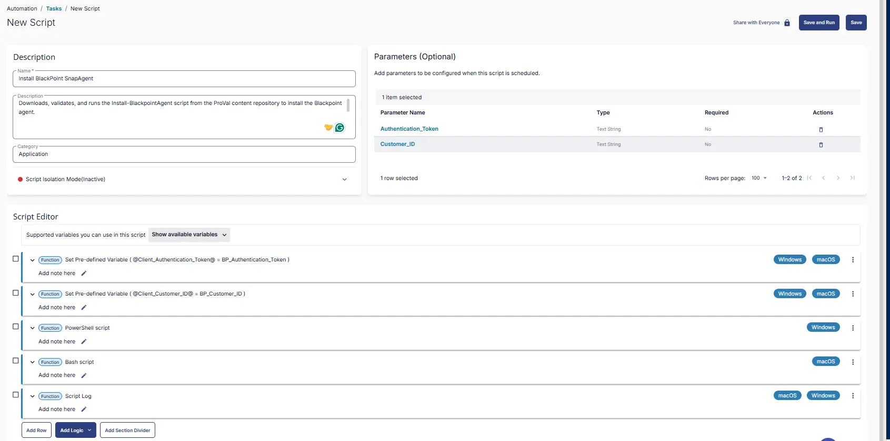

## Output

- Script Log

## Schedule Task

### Task Details

- **Name:** `Install BlackPoint SnapAgent`  
- **Description:** `Installs the Blackpoint SNAP Agent on Windows and macOS machines.`  
- **Category:** `Application`


### Schedule

- **Schedule Type:** `Schedule`  
- **Timezone:** `Local Machine Time`  
- **Start:** `<Current Date>`  
- **Trigger:** `Time` `At` `<Current Time>`  
- **Recurrence:** `Every day`  
- **Execute at next agent check-in:** `True`  
- **Stop After:** `22`  
- **Unit:** `Hour(s)`

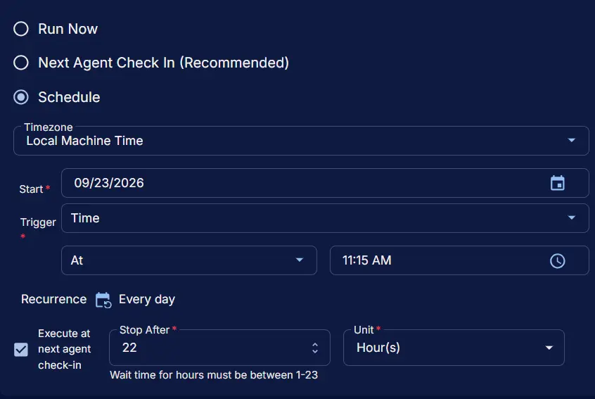

### Targeted Resource

**Device Group:** `Deploy BlackPoint SnapAgent`

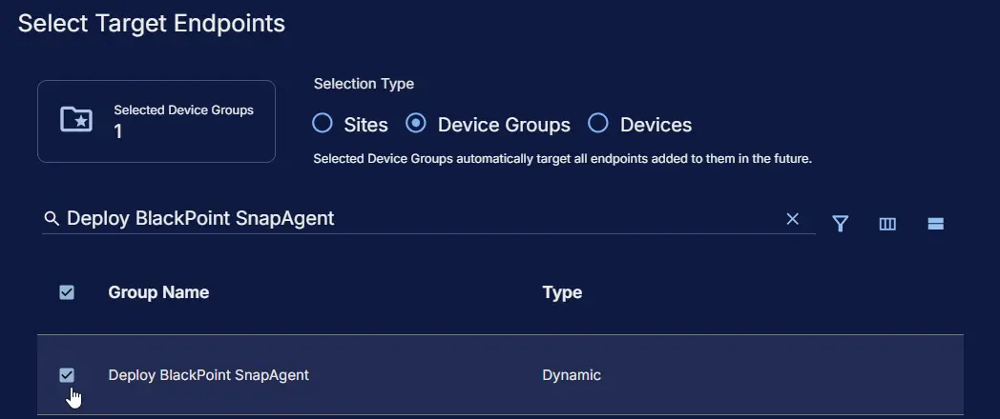

### Completed Scheduled Task

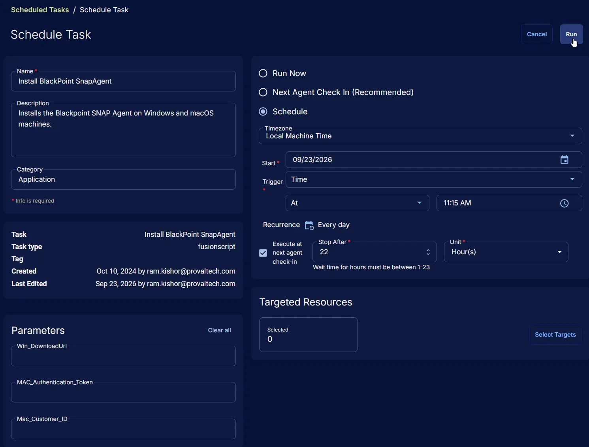

## Changelog

### 2026-10-30

- Replaced the `Win_DownloadUrl`, `MAC_Authentication_Token`, and `Mac_Customer_ID` user parameters with the `Authentication_Token` and `Customer_ID` parameters, used on both Windows and macOS.
- Replaced the `BP_WIN_URL`, `BP_MAC_Authentication_Token`, and `BP_Mac_Customer_ID` custom fields with the `BP_Authentication_Token` and `BP_Customer_ID` custom fields, used on both Windows and macOS. The `BP_WIN_URL` custom field is no longer required.
- Removed the `Set Pre-defined Variable` row for `BP_WIN_URL` and set the remaining variable rows to run on both Windows and macOS.
- Updated the powershell for windows to use updated agnostic script
- updated the shell script, changed the names of the parameters used in it.

### 2026-09-23

- Rewrote the document in the current format.
- Corrected the documented credential precedence for macOS: the user parameters take precedence over the custom fields when both are populated, and the authentication token and customer ID are always taken from the same source.
- Updated the macOS script to validate the customer ID format, remove a stale `license.yaml` before installing, download the installer to a secure temporary file, and confirm that the service is loaded after installation.
- Corrected Row 5 to the `Bash script` function and set the Script Log row to run on both Windows and macOS.
- Fixed potential issues with the `PowerShell script`.

### 2026-08-25

- Updated the script to include MAC installation as well.

### 2025-04-10

- Initial version of the document
