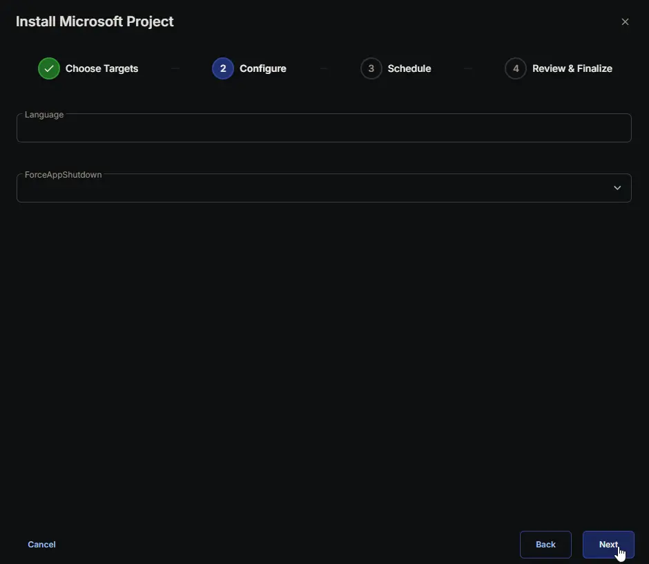
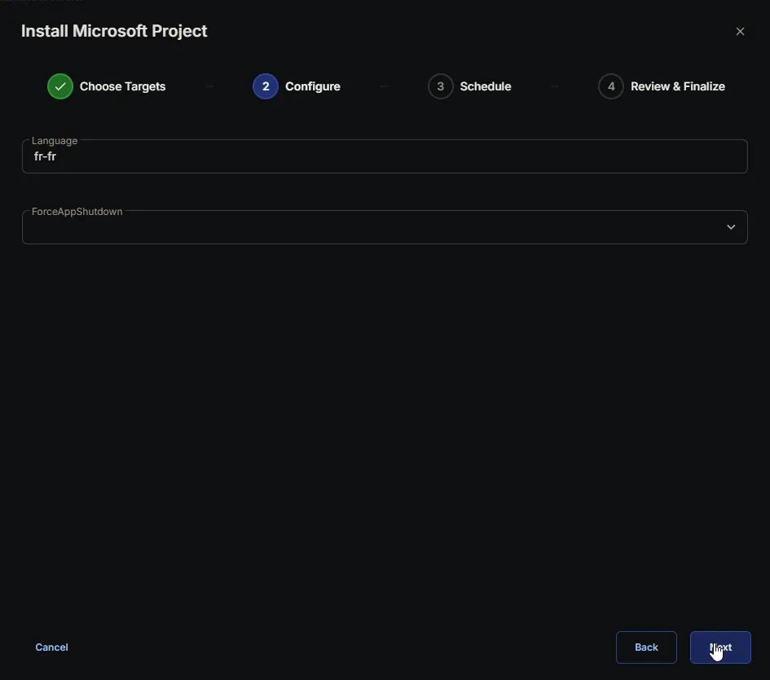
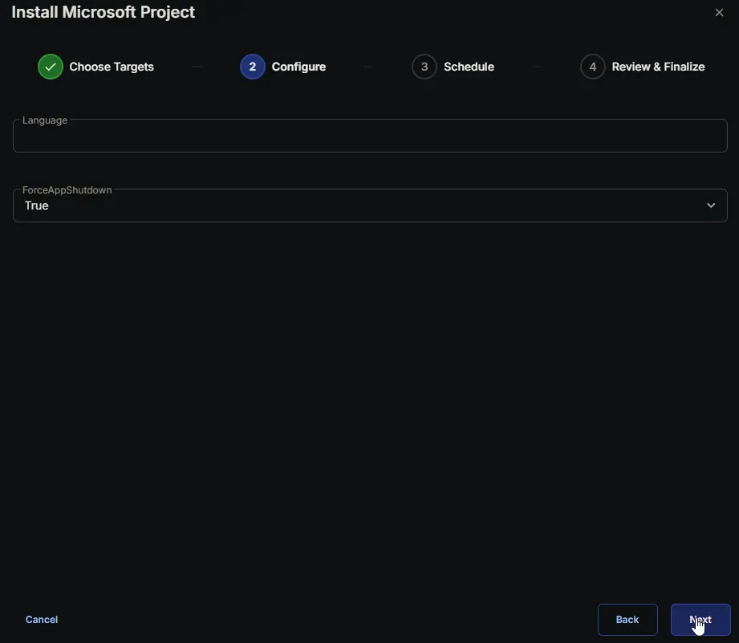
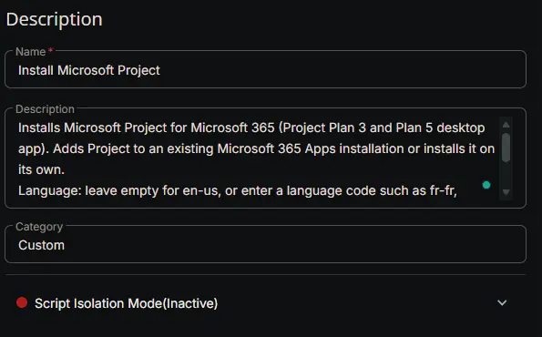
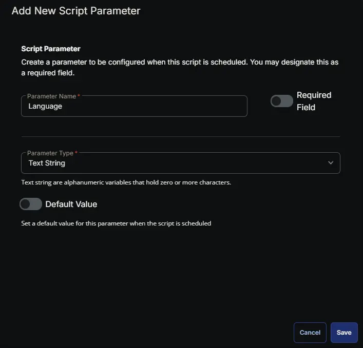
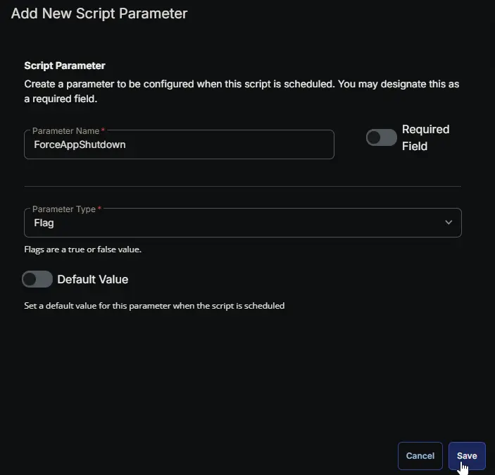
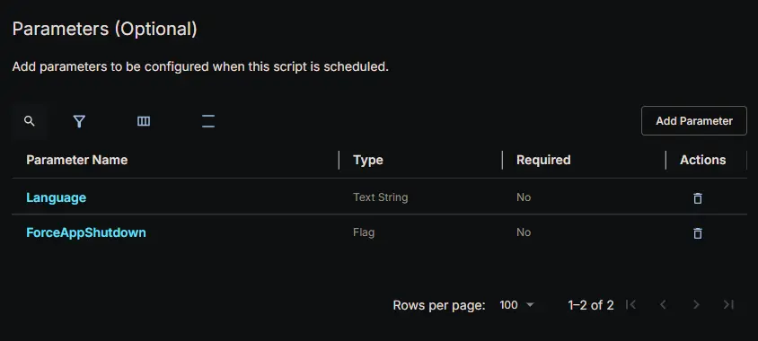
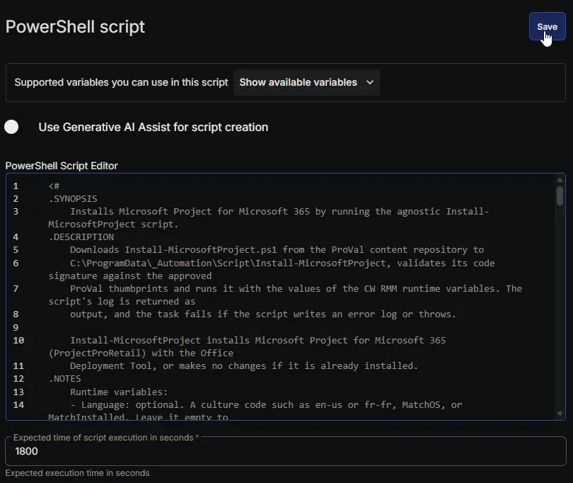
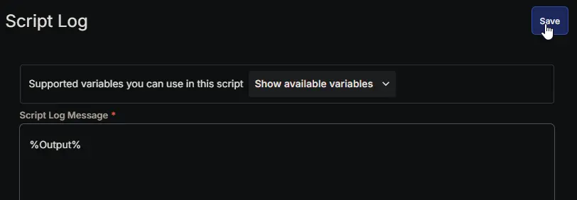
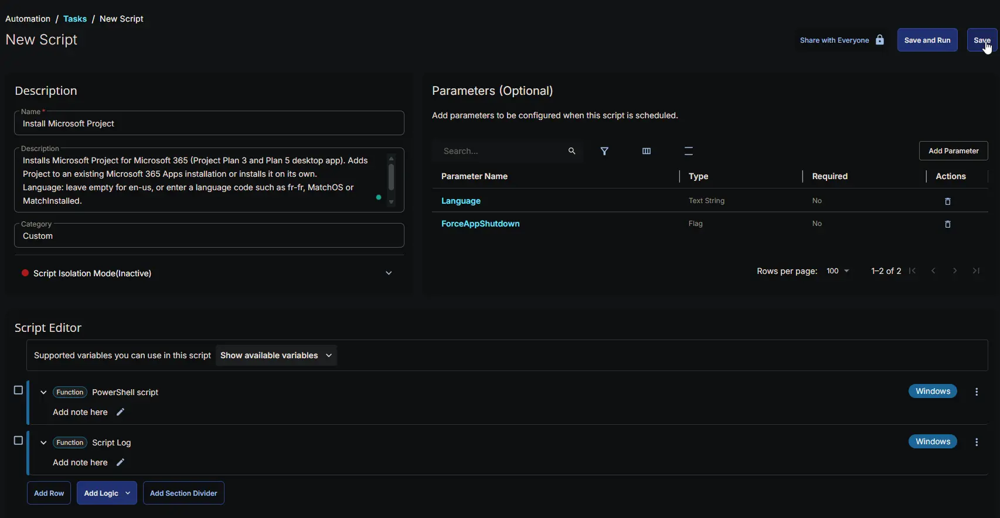

## Summary

The **Install Microsoft Project** task installs Microsoft Project for Microsoft 365, the Project desktop app included with Project Plan 3 and Project Plan 5. It runs the [Install-MicrosoftProject](/docs/37da9163-8eda-45cf-bc0f-7103282b0d85) script, which adds Project to an existing Microsoft 365 Apps installation or installs it on its own. Endpoints that already have Project for Microsoft 365 are left unchanged.

### How it works

1. **Get the script.** The task downloads the [Install-MicrosoftProject](/docs/37da9163-8eda-45cf-bc0f-7103282b0d85) script to `C:\ProgramData\_Automation\Script\Install-MicrosoftProject` and checks its digital signature before running it.
2. **Install Project.** The script downloads the latest Office Deployment Tool from Microsoft and installs Project silently, using the `Language` and `ForceAppShutdown` parameters of the task.
3. **Report the result.** The script log appears in the task output. If the install fails, the task fails and the output shows the reason.

**Requirements:** PowerShell 5.1, and internet access to `contentrepo.net`, the PowerShell Gallery and `officecdn.microsoft.com`. Users need a Project Plan 3 or Project Plan 5 license to use Project.

## Sample Run

**Default install:** leave both parameters empty. Project is installed in English (United States), and the install fails if Office apps are open.



**Install in another language:** set `Language` to a language code, for example `fr-fr`.



**Close open Office apps:** check `ForceAppShutdown`, so open Office apps don't block the install.



## Dependencies

- [PowerShell: Install-MicrosoftProject](/docs/37da9163-8eda-45cf-bc0f-7103282b0d85)
- [PowerShell: Install-PSGalleryModule](/docs/858fa597-2e08-4da4-ad6d-27ca62858547)

## User Parameters

| Name | Example | Accepted Values | Required | Default | Type | Description |
| ---- | ------- | --------------- | -------- | ------- | ---- | ----------- |
| `Language` | `fr-fr` | A language code supported by Project, such as `fr-fr` or `de-de`, `MatchOS`, or `MatchInstalled` | False | | Text String | Language to install Project in. Leave empty for English (United States). `MatchOS` uses the Windows language, and `MatchInstalled` uses the languages of the installed Office apps. Any other value is ignored, and English (United States) is used. |
| `ForceAppShutdown` | `Checked` | `Checked` or `Unchecked` | False | False | Flag | Closes open Office apps that block the install. When unchecked, open apps keep running and the install fails on endpoints where Office apps are open. |

:::warning

`ForceAppShutdown` closes Office apps, such as Outlook and Word, without warning the user. Unsaved work in those apps can be lost.

:::

:::note

Project supports fewer languages than the other Office apps. English (United Kingdom) `en-gb`, French (Canada) `fr-ca` and Spanish (Mexico) `es-mx` aren't available, and the install fails if one of them is selected. See [Install-MicrosoftProject](/docs/37da9163-8eda-45cf-bc0f-7103282b0d85) for details and troubleshooting.

:::

## Task Setup Path

- **Tasks Path:** `AUTOMATION` ➞ `Tasks`
- **Task Type:** `Script Editor`

## Task Creation

### Description

- **Name:** `Install Microsoft Project`
- **Description:**

```PlainText
Installs Microsoft Project for Microsoft 365 (Project Plan 3 and Plan 5 desktop app). Adds Project to an existing Microsoft 365 Apps installation or installs it on its own.
Language: leave empty for en-us, or enter a language code such as fr-fr, MatchOS or MatchInstalled.
ForceAppShutdown: closes open Office apps that block the install. Unsaved work can be lost.
```

- **Category:** `Custom`



### Parameters

#### Language

| Parameter Name | Required Field | Parameter Type | Default Value |
| --- | --- | --- | --- |
| `Language` | `False` | `Text String` | |



#### ForceAppShutdown

| Parameter Name | Required Field | Parameter Type | Default Value |
| --- | --- | --- | --- |
| `ForceAppShutdown` | `False` | `Flag` | |



### Completed Parameters Section



:::note

Name the parameters exactly `Language` and `ForceAppShutdown`. The script reads them by these names.

:::

### Script Editor

#### Row 1 Function: PowerShell script

- **Notes:** `<Leave it Blank>`
- **Use Generative AI Assist for script creation:** `False`
- **Expected time of script execution in seconds:** `1800`
- **Continue on Failure:** `False`
- **Run As:** `System`
- **Operating System:** `Windows`
- **PowerShell Script Editor:**

[PowerShell Script](https://github.com/ProVal-Tech/cw-rmm/blob/main/tasks/install-microsoft-project/script.ps1)



#### Row 2 Function: Script Log

- **Notes:** `<Leave it Blank>`
- **Continue on Failure:** `False`
- **Operating System:** `Windows`
- **Script Log Message:** `%Output%`



## Completed Task



## Output

- Script Log
- Script logs in `C:\ProgramData\_Automation\Script\Install-MicrosoftProject`

## Changelog

### 2026-10-28

- Initial version of the document
