## Summary

This ConnectWise RMM task finds every Java runtime on a Windows endpoint, including runtimes bundled inside other products such as Jira, Confluence, Jenkins, or Keycloak, and works out whether the endpoint is exposed to Java4Shell (CVE-2026-114938). It writes a summary to eight endpoint custom fields with the `J4S_` prefix, which the [Java4Shell Vulnerable Endpoints](/docs/50dba57c-06b0-4be8-a303-882fceb414c3) and [Java4Shell Exposed Endpoints](/docs/453048a4-1542-4f24-b5e5-4d9e26ed262b) groups use.

The task uses the [Detect-Java4ShellVulnerability](/docs/cb6146e2-f662-471e-8f50-b1bbaeb24826) agnostic script. The data collection script downloads it from the content repository with `Invoke-WebRequest` and runs it only when its code signature is valid, timestamped, and made by an approved ProVal certificate.

The data collection script summarizes the runtimes into colon-delimited `key:value` lines. The Script Editor's `Parse` function turns that output into the `javaaudit` variable, and each `Set Custom Field` row takes its value from that variable, such as `@javaaudit:status@`. One script and one `Parse` row replace a separate reader script for each custom field.

The mode comes from the company-level [Java4Shell Vulnerability](/docs/4734f06e-5f74-4072-beb5-8e2a661e8f1f) custom field:

- `Audit with Remediation`: updates vulnerable standalone Java that is not in use, through [Invoke-WingetProcessor](/docs/8496c2e9-0e52-4961-a1f1-4a95296e8cf7), and sets the temporary JVM flag `-XX:UseAVX=2` on the Windows services that use a vulnerable runtime. Services are not restarted. Oracle JDK 17 and 21 are never updated, since their updates require an Oracle Java SE subscription.
- Any other value, including a manual run on an endpoint of a company where the field is not set: audit only, nothing is changed.

:::warning

End-of-life Java versions are not updated, because their vendors have not released a fixed build. Java4Shell is fixed only in Java 17, 21, 25, and 27. Java 18 to 20, 22 to 24, and 26 are end of life and get no fix. For example, Java 23 has no fixed release, so an endpoint running it is reported as `EndOfLife`, and `Audit with Remediation` only sets the temporary JVM mitigation on the Windows services that use it. Move these applications to a fixed release (17.0.21.1, 21.0.13.1, 25.0.5.1, 27.0.1.1, or later), or ask the application vendor for a build that bundles one.

:::

When the audit fails, the output of the data collection script has no `datacollectiontime:` line. The If/Then of row 3 then runs `Script Exit` with the output as the error message, so the task ends as failed before `Parse`, and the custom fields keep their previous values. This does not depend on how the platform treats the exit code of the script.

## Sample Run

- Navigate to Action ➞ Run. Search for `Java4Shell` and then click the task `Java4Shell Vulnerability Audit-Remediation`

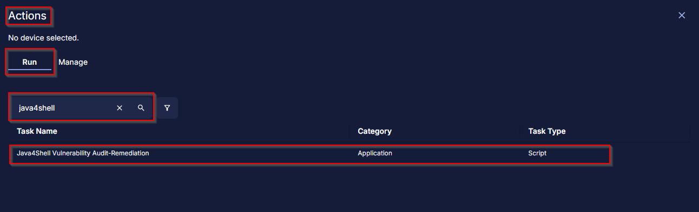

- The task opens. Click `Next`.

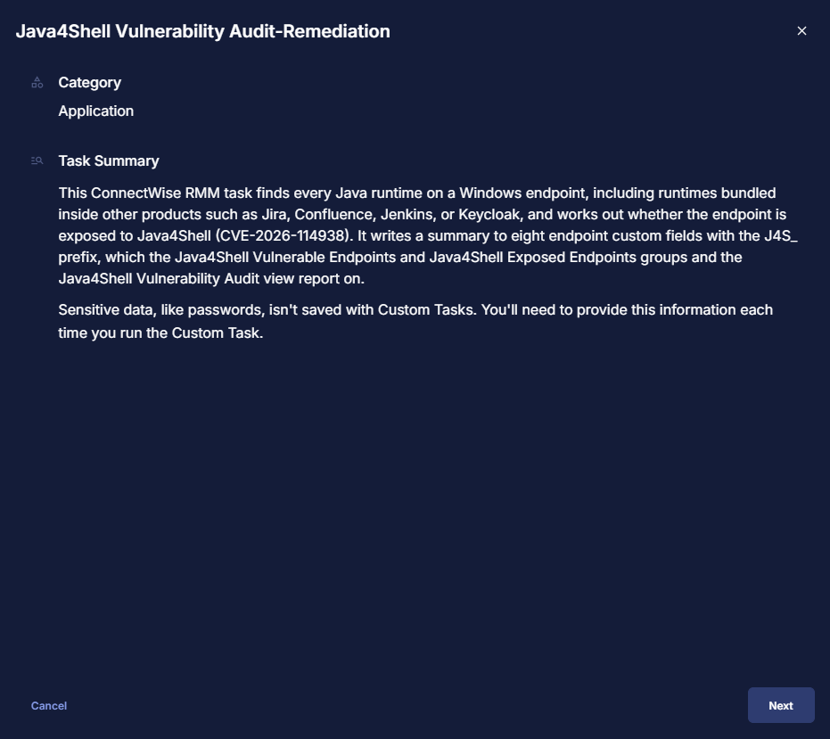

- Choose target `Device Groups` [Java4Shell Audit](/docs/bab85989-7271-4db6-a5d9-3bc0aeab1f57) and click `Next`

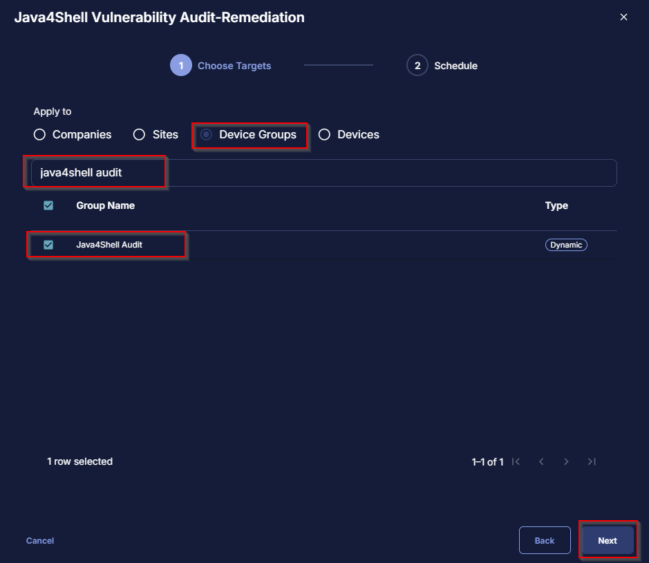

- Schedule the task. Select the options you need.

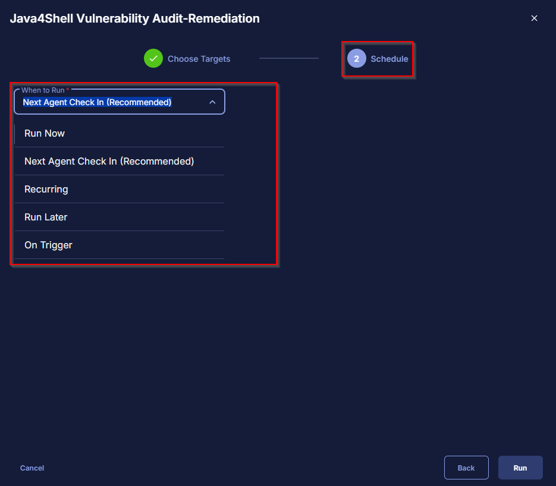

- Select `Run` once the schedule is selected.

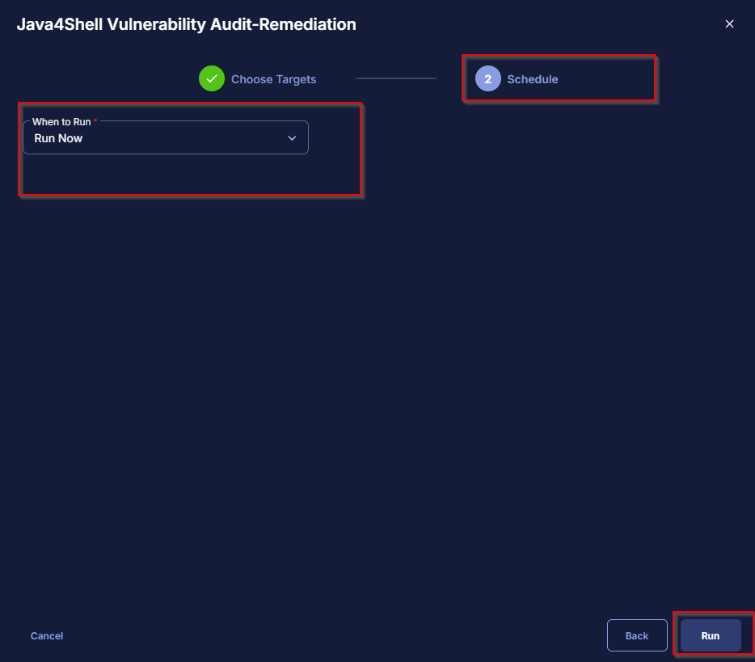

## Dependencies

- [Custom Field: Java4Shell Vulnerability](/docs/4734f06e-5f74-4072-beb5-8e2a661e8f1f)
- [Custom Field: Exclude_Java4Shell_Site](/docs/e930bd04-92b1-4635-a307-e4bedafd872e)
- [Custom Field: Exclude_Java4Shell_Endpoint](/docs/515dc9f8-fab0-425e-800f-f1bb25419292)
- [Custom Field: J4S_Status](/docs/b4eef927-7da8-47c0-90da-dd6c6f2bdc08)
- [Custom Field: J4S_Vulnerable_Count](/docs/31b7aacb-94e9-4839-86e5-d3a49cfdebcf)
- [Custom Field: J4S_Runtime_Details](/docs/07d3161b-52fc-4584-8878-6b4a2ea9f932)
- [Custom Field: J4S_CPU_AVX512_VBMI](/docs/bf17cd4d-3653-45a2-85a5-376d17c568bc)
- [Custom Field: J4S_Mitigation](/docs/09f06685-632c-4217-a7ea-c745ccbdd1f2)
- [Custom Field: J4S_Restart_Required](/docs/578ef29d-9a35-4249-9d76-f88ebbcd9ee0)
- [Custom Field: J4S_Remediation_Result](/docs/345424ba-97c8-4a0c-ae6b-d1fe283c777d)
- [Custom Field: J4S_Data_Collection_Time](/docs/4143e9ad-c957-46be-b449-4b08bb60d60e)
- [PowerShell: Detect-Java4ShellVulnerability](/docs/cb6146e2-f662-471e-8f50-b1bbaeb24826)
- [PowerShell: Invoke-WingetProcessor](/docs/8496c2e9-0e52-4961-a1f1-4a95296e8cf7)
- [Solution: Java4Shell Vulnerability Audit (ConnectWise RMM)](/docs/a0ee9b5c-fa3c-4f2e-b7ca-71da1cf3e7cd)

## Custom Fields

| Name | Example | Level | Type | Editable | Description |
| --- | --- | --- | --- | --- | --- |
| Java4Shell Vulnerability | Audit Only | Company | Dropdown | Yes | Mode of the solution: Disabled, Audit Only, or Audit with Remediation. Read by row 1. |
| J4S_Status | Exposed | Endpoint | Text Box | No | Java4Shell exposure of the endpoint, from its worst Java runtime: 'Exposed', 'Review', 'Mitigated', 'Latent', 'Compliant', or 'No Java'. |
| J4S_Vulnerable_Count | 2 | Endpoint | Text Box | No | Number of Java runtimes on the endpoint that are Vulnerable or EndOfLife. |
| J4S_Runtime_Details | Atlassian JIRA 9.12.15 (17.0.12): Vulnerable, mitigation Pending Restart | Endpoint | Text Box | No | The Java runtimes that need attention, as '`product or folder` (`version`): `status`, mitigation `state`', separated by semicolons and limited to 300 characters ('; +N more' when cut). Folder paths use forward slashes, such as C:/Jenkins/jre. '`N` runtime(s), none vulnerable' or 'No Java runtime found' otherwise. |
| J4S_CPU_AVX512_VBMI | Yes | Endpoint | Text Box | No | Whether the JVM reports AVX-512 VBMI on the endpoint's processor, the condition for Java4Shell: 'Yes', 'No', 'Unknown', or 'Not Checked' (no Java runtime). |
| J4S_Mitigation | Pending Restart | Endpoint | Text Box | No | Weakest mitigation state across the vulnerable runtimes: 'None', 'Configured', 'Pending Restart', 'Active', or 'Not Required'. |
| J4S_Restart_Required | True | Endpoint | Text Box | No | 'True' when a running Java process still uses old code after an update or has not picked up the mitigation; 'False' otherwise. |
| J4S_Remediation_Result | Updated: 1; Mitigation set: 2; Mitigation removed: 0; Errors: No | Endpoint | Text Box | No | 'Audit Only', or what the last remediation run did: runtimes updated, services the mitigation was set on or removed from, and whether any step failed. |
| J4S_Data_Collection_Time | 2026-11-23 14:05:12 | Endpoint | Text Box | No | Timestamp (yyyy-MM-dd HH:mm:ss) when the data was collected. |

## Parsed Variable

Row 3 parses `%output%`, the output of row 2, into the variable `javaaudit`. The output uses the key-value format of the `Parse` function: one `key:value` pair per line, each written with an explicit newline. Everything before the first colon is the key, and colons in the value are kept. Keys and the variable name are lowercase letters only. Values are single-line text with no backslash, double quote or control character, because `Parse` converts the pairs to JSON (its error is `ConvertToJsonAndParse failed`) and those characters can break the conversion, which leaves every reference unresolved. Paths are therefore written with forward slashes, such as `C:/Jenkins/jre`, and double quotes as single quotes.

| Key | Reference | Custom Field | Example |
| --- | --- | --- | --- |
| `status` | `@javaaudit:status@` | J4S_Status | Exposed |
| `vulnerablecount` | `@javaaudit:vulnerablecount@` | J4S_Vulnerable_Count | 2 |
| `runtimedetails` | `@javaaudit:runtimedetails@` | J4S_Runtime_Details | Atlassian JIRA 9.12.15 (17.0.12): Vulnerable, mitigation Pending Restart |
| `cpuaffected` | `@javaaudit:cpuaffected@` | J4S_CPU_AVX512_VBMI | Yes |
| `mitigation` | `@javaaudit:mitigation@` | J4S_Mitigation | Pending Restart |
| `restartrequired` | `@javaaudit:restartrequired@` | J4S_Restart_Required | True |
| `remediationresult` | `@javaaudit:remediationresult@` | J4S_Remediation_Result | Updated: 1; Mitigation set: 2; Mitigation removed: 0; Errors: No |
| `datacollectiontime` | `@javaaudit:datacollectiontime@` | J4S_Data_Collection_Time | 2026-11-23 14:05:12 |
| `result` | `@javaaudit:result@` | Not stored | Success |
| `summary` | `@javaaudit:summary@` | Not stored | Java4Shell Result: Success: Exposed; Runtimes: 3; Vulnerable or end-of-life: 2; Mode: Audit Only |
| `log` | `@javaaudit:log@` | Not stored, written by the Script Log row | The messages and one entry per runtime, then the summary, separated by a vertical bar. |

Sample output of row 2:

```text
result:Success
summary:Java4Shell Result: Success: Exposed; Runtimes: 3; Vulnerable or end-of-life: 2; Mode: Audit Only
status:Exposed
vulnerablecount:2
runtimedetails:Atlassian JIRA 9.12.15 (17.0.12): Vulnerable, mitigation None; C:/Jenkins/jre (19.0.2): EndOfLife, mitigation None
cpuaffected:Yes
mitigation:None
restartrequired:False
remediationresult:Audit Only
datacollectiontime:2026-11-25 04:10:12
log:Mode: Audit Only | C:/Jenkins/jre: Eclipse Adoptium 19.0.2, EndOfLife, CPU affected Yes, mitigation None. Action: None | ...
```

## Task Setup Path

- **Tasks Path:** `AUTOMATION` ➞ `Tasks`
- **Task Type:** `Script Editor`

## Task Creation

### Description

- **Name:** `Java4Shell Vulnerability Audit-Remediation`
- **Description:** `Finds every Java runtime on a Windows endpoint, including runtimes bundled inside other applications, works out its Java4Shell (CVE-2026-114938) exposure, optionally updates or mitigates vulnerable runtimes, and writes a summary to the J4S_ custom fields.`
- **Category:** `Application`

### Script Editor

- Navigate to `Automation` ➞ `Tasks`  
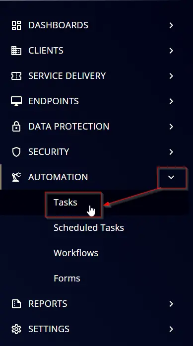

Create a new `Script Editor` style task by choosing the `Script Editor` option from the `Add` dropdown menu  
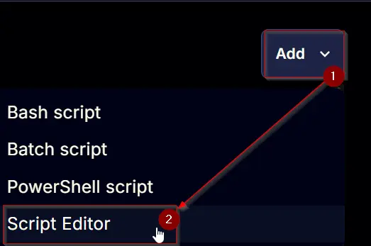

The `New Script` page will appear on clicking the `Script Editor` button:  
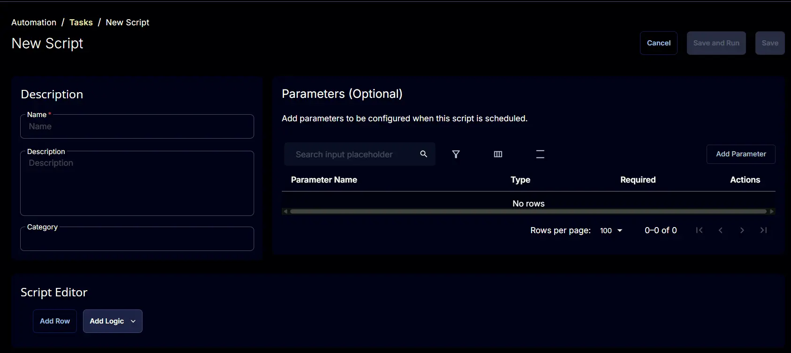

Add a new row by clicking the `Add Row` button.  


A blank function will appear.  
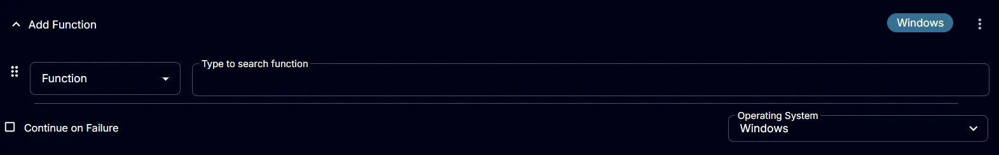

#### Row 1: Set Pre-defined Variable (@CF_J4S_Mode@ = Java4Shell Vulnerability)

- **Notes:** `Java4Shell mode from the company custom field`
- **Continue on Failure:** `False`
- **Operating System:** `Windows`
- **Variable Name:** `CF_J4S_Mode`
- **Custom Field:** `Java4Shell Vulnerability`

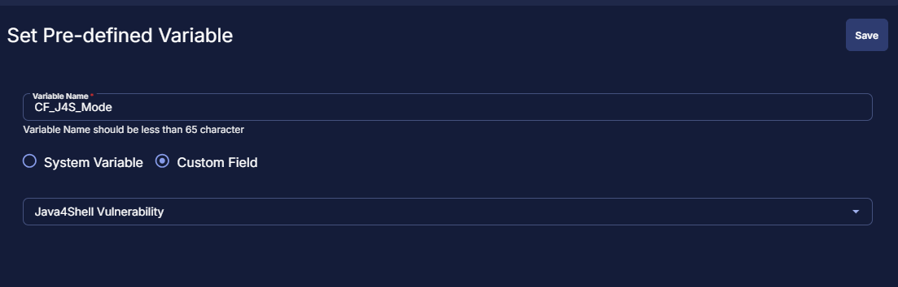

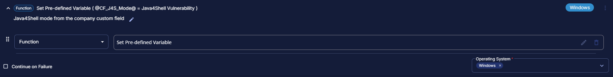

#### Row 2: PowerShell script

- **Notes:** `Data Collection Script`
- **Use Generative AI Assist for script creation:** `False`
- **Expected time of script execution in seconds:** `3600`
- **Continue on Failure:** `True`
- **Run As:** `System`
- **Operating System:** `Windows`
- **PowerShell Script Editor:**
[PowerShell Script](https://github.com/ProVal-Tech/cw-rmm/blob/main/tasks/java4shell-vulnerability-audit-remediation/script1.ps1)

On success, the only output of the script is colon-delimited `key:value` lines, one per line, for the `Parse` row, including a `datacollectiontime:` line. When the audit fails, the script writes the messages and `Java4Shell Result: Failure:` followed by the reason, as plain text, with no `datacollectiontime:` line, and exits with code 1. Row 3 ends the task in that case.

Search and select the `PowerShell Script` function.  
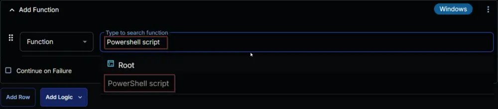  
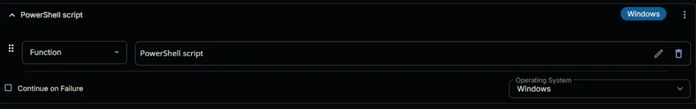  

The following function will pop up on the screen:  
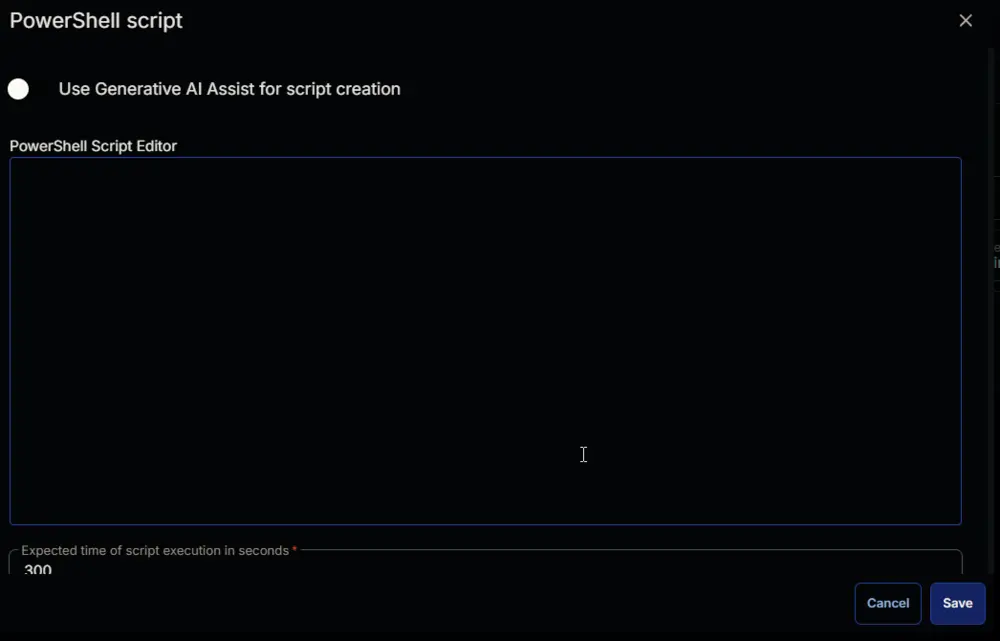  

Paste in the following PowerShell script and set the `Expected time of script execution in seconds` to `3600` seconds. Click the `Save` button.

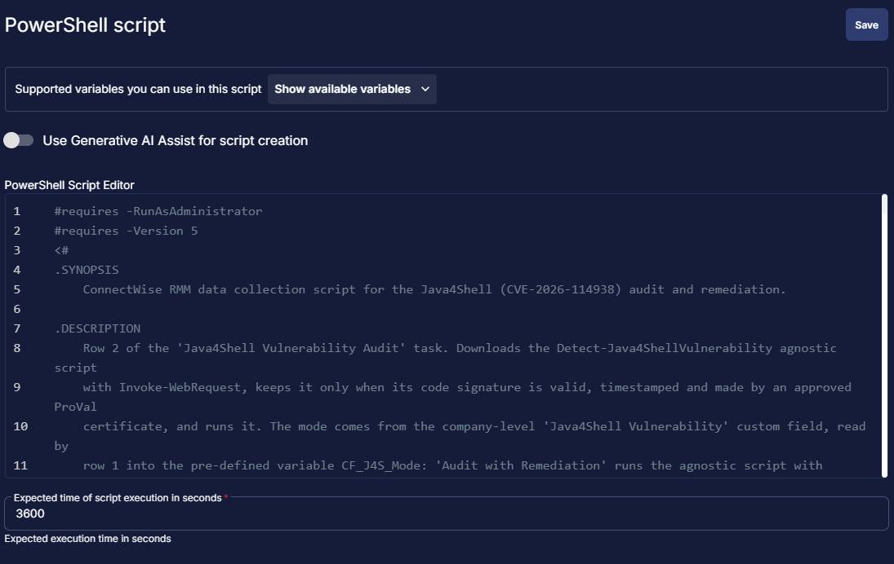

#### Row 3: Logic If/Then

- Add a logic `If/Then` by clicking the `Add Logic` button.

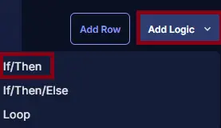

#### Row 3a: Condition Output Does Not Contain

- **Condition:** `Output` ➞ `Does not contain` ➞ `datacollectiontime:`

The script writes the `datacollectiontime:` line only when the audit completed. The condition therefore catches a failed audit, a script that timed out or could not start, and empty output, whatever exit code the row returned.

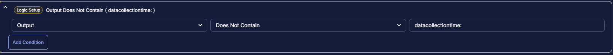

#### Row 3b: Script Exit

Add a row inside the If/Then section and select the `Script Exit` function.

- **Error Message:** `Java4Shell Vulnerability Audit failed. %output%`

This ends the task with a failure before `Parse`, so the custom fields keep their previous values. The message carries the output of row 2, which ends with `Java4Shell Result: Failure` and the reason.

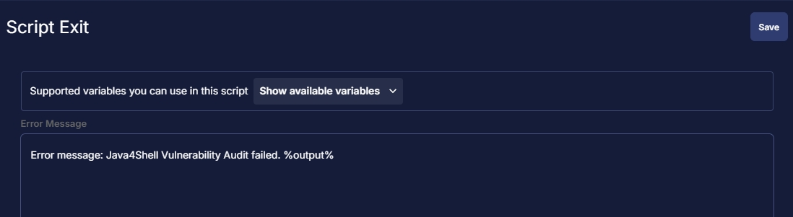

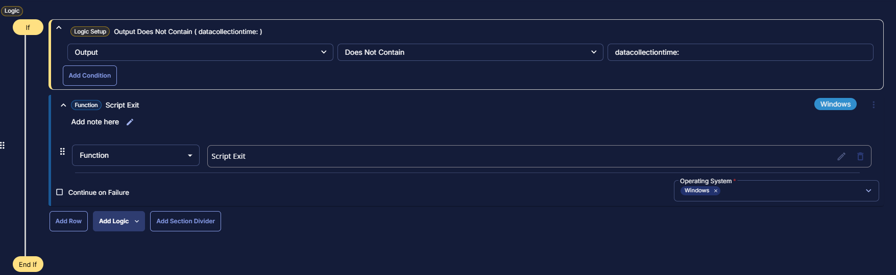

#### Row 4: Parse

- **Notes:** `Parse the data collection result`
- **Continue on Failure:** `False`
- **Operating System:** `Windows`
- **Variable Name:** `javaaudit`
- **Value:** `%output%` (lowercase, as in the ConnectWise system variable list and Parse examples)

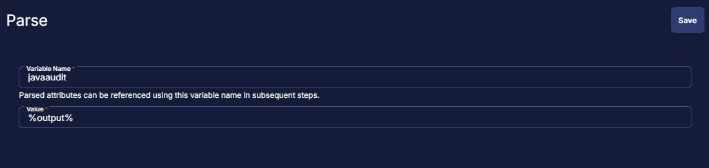

#### Row 5: Script Log

- **Notes:** `Data Collection Log`
- **Continue on Failure:** `True`
- **Operating System:** `Windows`
- **Script Log Message:** `@javaaudit:log@`

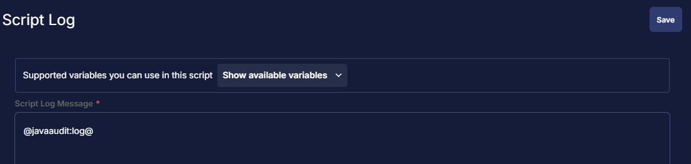

#### Row 6: Set Custom Field ( J4S_Status = @javaaudit:status@ )

- **Notes:** `J4S_Status`
- **Custom Field:** `J4S_Status`
- **Value:** `@javaaudit:status@`
- **Continue on Failure:** `True`
- **Operating System:** `Windows`

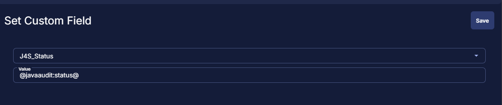

#### Row 7: Set Custom Field ( J4S_Vulnerable_Count = @javaaudit:vulnerablecount@ )

- **Notes:** `J4S_Vulnerable_Count`
- **Custom Field:** `J4S_Vulnerable_Count`
- **Value:** `@javaaudit:vulnerablecount@`
- **Continue on Failure:** `True`
- **Operating System:** `Windows`

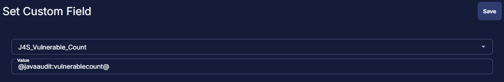

#### Row 8: Set Custom Field ( J4S_Runtime_Details = @javaaudit:runtimedetails@ )

- **Notes:** `J4S_Runtime_Details`
- **Custom Field:** `J4S_Runtime_Details`
- **Value:** `@javaaudit:runtimedetails@`
- **Continue on Failure:** `True`
- **Operating System:** `Windows`

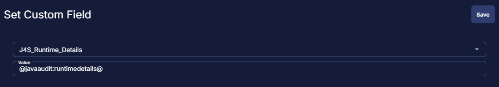

#### Row 9: Set Custom Field ( J4S_CPU_AVX512_VBMI = @javaaudit:cpuaffected@ )

- **Notes:** `J4S_CPU_AVX512_VBMI`
- **Custom Field:** `J4S_CPU_AVX512_VBMI`
- **Value:** `@javaaudit:cpuaffected@`
- **Continue on Failure:** `True`
- **Operating System:** `Windows`

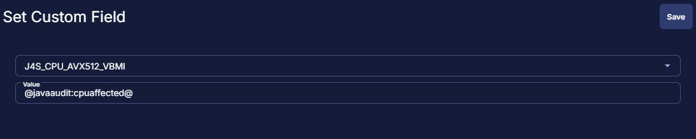

#### Row 10: Set Custom Field ( J4S_Mitigation = @javaaudit:mitigation@ )

- **Notes:** `J4S_Mitigation`
- **Custom Field:** `J4S_Mitigation`
- **Value:** `@javaaudit:mitigation@`
- **Continue on Failure:** `True`
- **Operating System:** `Windows`

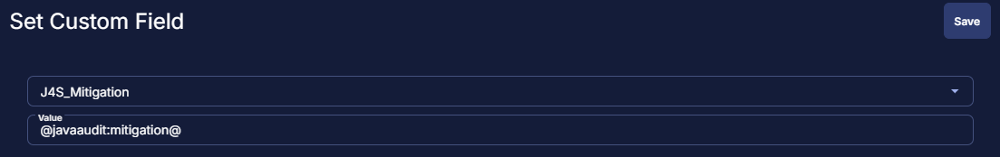

#### Row 11: Set Custom Field ( J4S_Restart_Required = @javaaudit:restartrequired@ )

- **Notes:** `J4S_Restart_Required`
- **Custom Field:** `J4S_Restart_Required`
- **Value:** `@javaaudit:restartrequired@`
- **Continue on Failure:** `True`
- **Operating System:** `Windows`

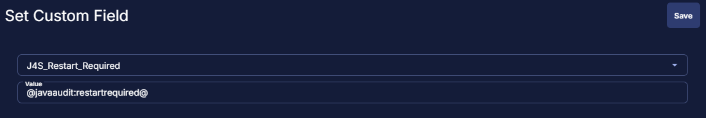

#### Row 12: Set Custom Field ( J4S_Remediation_Result = @javaaudit:remediationresult@ )

- **Notes:** `J4S_Remediation_Result`
- **Custom Field:** `J4S_Remediation_Result`
- **Value:** `@javaaudit:remediationresult@`
- **Continue on Failure:** `True`
- **Operating System:** `Windows`

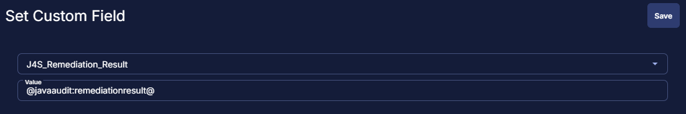

#### Row 13: Set Custom Field ( J4S_Data_Collection_Time = @javaaudit:datacollectiontime@ )

- **Notes:** `J4S_Data_Collection_Time`
- **Custom Field:** `J4S_Data_Collection_Time`
- **Value:** `@javaaudit:datacollectiontime@`
- **Continue on Failure:** `True`
- **Operating System:** `Windows`

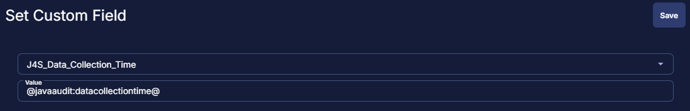

## Save Task

Click the `Save` button at the top-right corner of the screen to save the script.  


## Completed Task

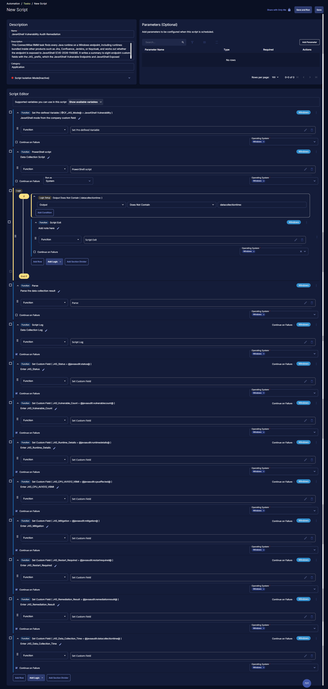

## Schedule Task

### Deployment

- Navigate to Task ➞ Schedule

### Schedule

- **Schedule Type:** `Schedule`
- **Timezone:** `Local Machine Time`
- **Start:** `Current Date`
- **Trigger:** `Time` `At` `Current Time`
- **Recurrence:** `Weekly On Monday`
- **Execute at next agent check-in:** `15` `Day(s)`

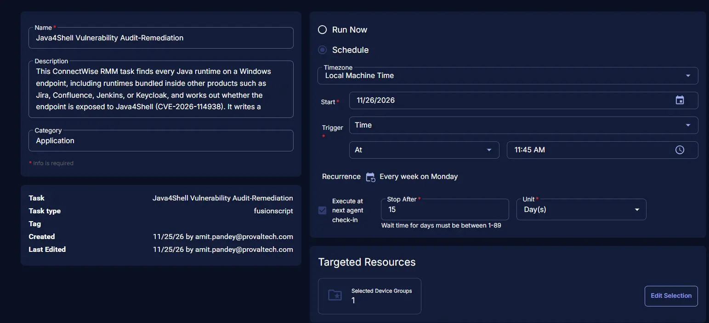

### Targeted Resource

- Select target `Device Groups` ➞ [Java4Shell Audit](/docs/bab85989-7271-4db6-a5d9-3bc0aeab1f57)

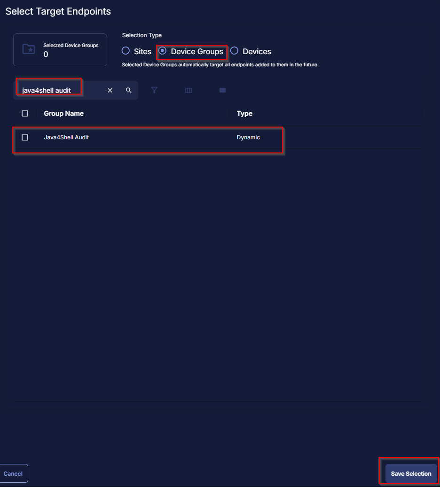

### Completed Scheduled Task

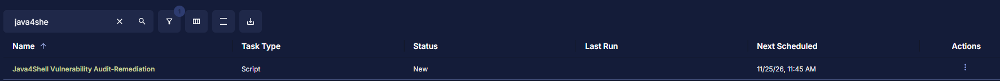

## Output

- Script Log
- Custom Fields
- Local files in `C:\ProgramData\_Automation\Script\Detect-Java4ShellVulnerability\`: `Detect-Java4ShellVulnerability-log.txt`, `Detect-Java4ShellVulnerability-error.txt`

## Changelog

### 2026-11-23

- Initial version of the document.
