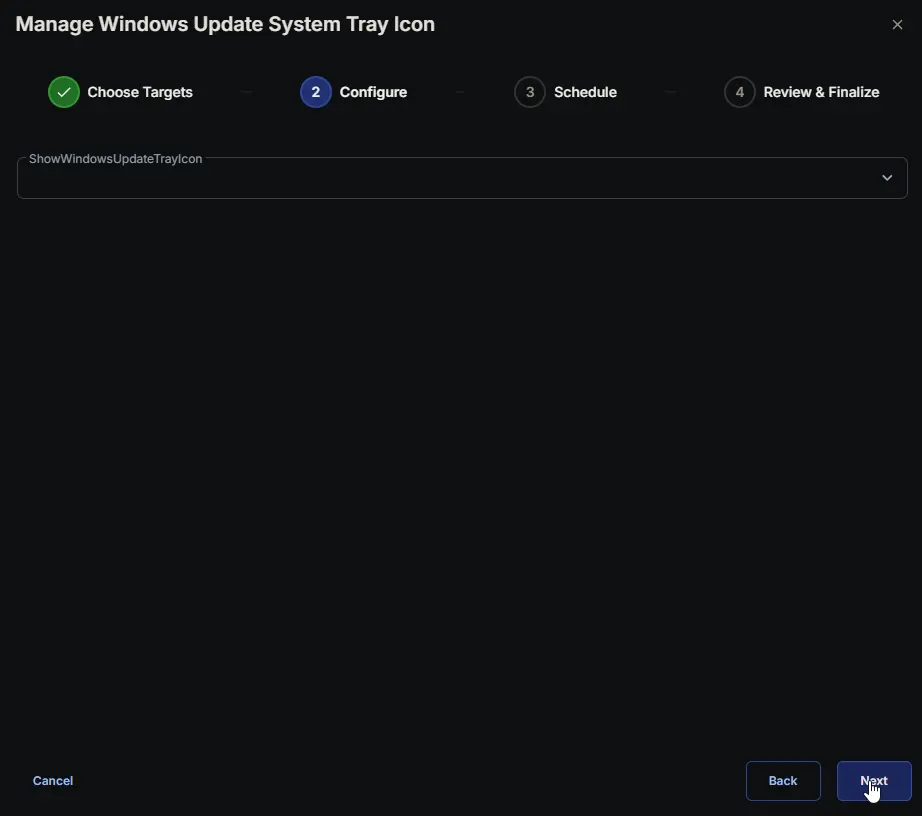
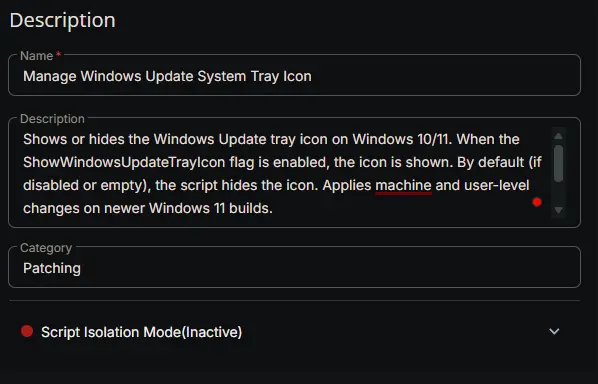
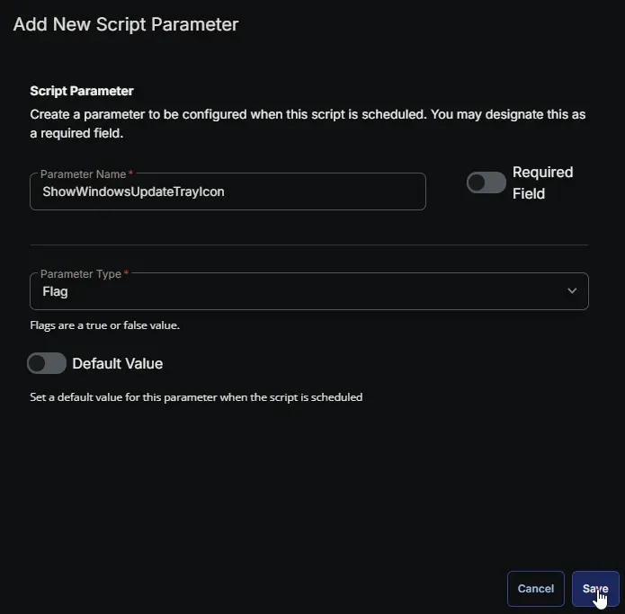
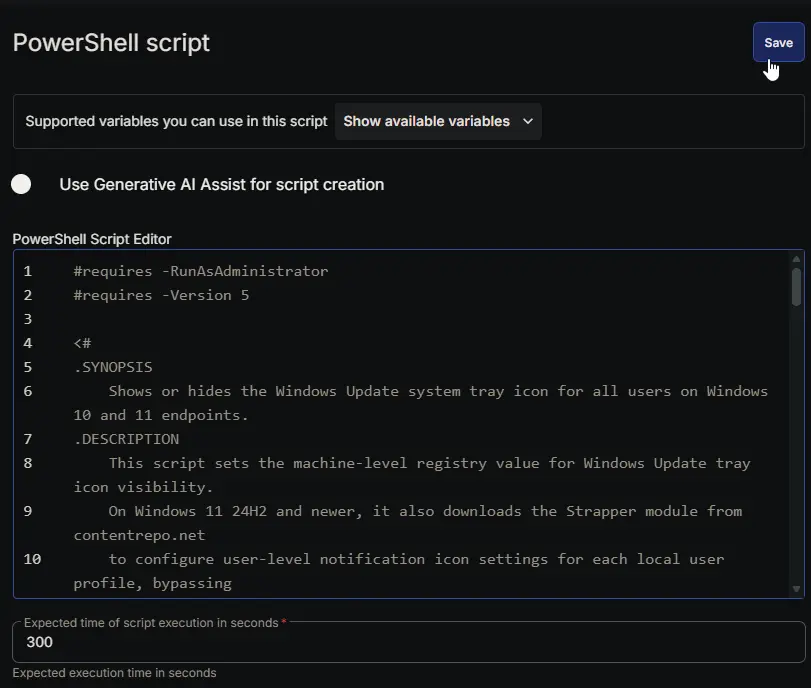
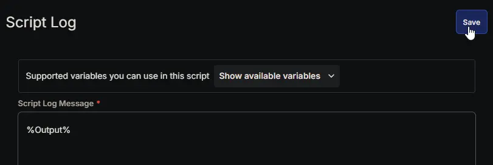
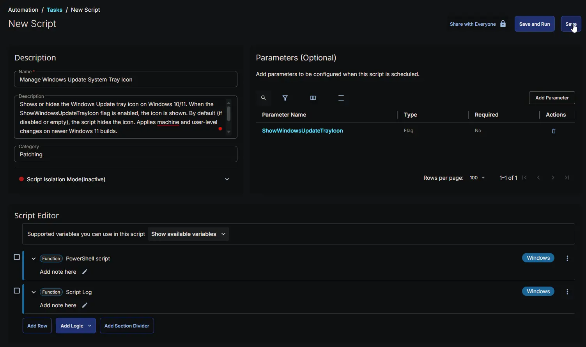

## Summary

Shows or hides the Windows Update system tray icon on Windows 10 and Windows 11 endpoints.

On all supported Windows versions, the script sets the machine-level registry value `TrayIconVisibility` at `HKLM:\SOFTWARE\Microsoft\WindowsUpdate\UX\Settings`.

On Windows 11 version 24H2 (Build 26100) and newer, the system-level value no longer fully controls tray icon visibility. For these newer builds, the script additionally downloads the `Strapper` module and updates the user-level notification icon settings (`IsPromoted`) for each local user profile to ensure the icon is properly hidden or shown.

:::note  
By default, if the `ShowWindowsUpdateTrayIcon` parameter is not set or disabled, the script will **hide** the Windows Update tray icon.  
:::

## Sample Run




## User Parameters

| Name | Example | Accepted Values | Required | Default | Type | Description |
|------|---------|-----------------|----------|---------|------|-------------|
| ShowWindowsUpdateTrayIcon | `True` | | `No` | `False` | `Flag` | When enabled (True/1/Yes), the script shows the Windows Update tray icon. When disabled or left empty, the icon is hidden. |

## Results by Device

| Device | Result |
|--------|--------|
| Windows 10 | Success. Machine-level registry updated. |
| Windows 11 (Older than 24H2) | Success. Machine-level registry updated. |
| Windows 11 24H2 or newer | Success. Machine-level and user-level registry updated for all local profiles. |
| Windows 8.1 or earlier | Failure. Unsupported OS. |

## Task Setup Path

- **Tasks Path:** `AUTOMATION` ➞ `Tasks`  
- **Task Type:** `Script Editor`  

## Task Creation

### Description

- **Name:** `Manage Windows Update System Tray Icon`  
- **Description:**  

  ```plainText
  Shows or hides the Windows Update tray icon on Windows 10/11. When the ShowWindowsUpdateTrayIcon flag is enabled, the icon is shown. By default (if disabled or empty), the script hides the icon. Applies machine and user-level changes on newer Windows 11 builds.

  https://content.provaltech.com/docs/5b0fdce0-f4b2-4e08-9e7f-eb711738a7b2
  ```

- **Category:** `Registry`  
- **Script Isolation Mode:** `Inactive`



### Parameters

| Parameter Name | Required Field | Parameter Type | Default Value |
| -------------- | -------------- | -------------- | ------------- |
| ShowWindowsUpdateTrayIcon | Disabled | Flag | Disabled |

**ShowWindowsUpdateTrayIcon:**  


### Script Editor

#### Row 1: PowerShell script

- **Use Generative AI Assist for script creation:** `False`  
- **Expected time of script execution in seconds:** `300`  
- **Continue on Failure:** `False`  
- **Run As:** `System`  
- **Operating System:** `Windows`  
- **PowerShell Script Editor:**

[PowerShell Script](https://github.com/ProVal-Tech/cw-rmm/blob/main/tasks/manage-windows-update-system-tray-icon/script.ps1)

For detailed instructions on creating the task, see [Workflow for Implementing Engineers](https://github.com/ProVal-Tech/cw-rmm#-workflow-for-implementing-engineers).



#### Row 2: Script Log

- **Script Log Message:** `%Output%`  
- **Continue on Failure:** `False`  
- **Operating System:** `Windows`



## Completed Script



## Output

- Script Log

## Changelog

### 2026-10-22

- Initial version of the document.
