## Summary

The **SojiGo** task frees up drive space on Windows endpoints by running the [SojiGo](/docs/6b7cbccd-c62f-457a-a97e-0b861b27b9df) drive cleaner. It downloads SojiGo when needed, confirms the file is genuine, and runs a cleanup with the arguments set in custom fields.

Use it in either of two ways:

- **Enhanced Drive Space Monitoring autofix:** attach it to the [Enhanced Drive Space Monitoring [Workflow]](/docs/2c9dd7bc-f5aa-48c2-be76-1348e13cda07) monitor. When a drive runs low on a device where Autofix is enabled, the task cleans up the device and adds the results to the open ticket as a comment. On every other device it does nothing, so it is safe to attach to the monitor for all devices.
- **Manual or scheduled cleanup:** run or schedule the task with the `Manual_Run` parameter checked.

### How it works

1. **Choose the arguments.** The task uses the first of these that contains at least one SojiGo option (`--`):
   1. The `Arguments` parameter of the task.
   2. The [SojiGo_Arguments](/docs/0d0cfdb2-351b-404a-979d-e73ef4583933) endpoint-level field.
   3. The [SojiGo_Arguments_Svr_Site](/docs/ec1c9648-be61-4d3d-abfa-f3c0f3d0cd3b) or [SojiGo_Arguments_Wks_Site](/docs/248a3007-7a4f-4962-91f3-01ec4d2c8a39) site-level field.
   4. The [SojiGo_Arguments_Svr](/docs/c51eb5bd-5636-4a67-896f-ec19626d3831) or [SojiGo_Arguments_Wks](/docs/91d0fa29-3c12-4e9c-b65b-b23e64a93c66) company-level field.
   5. The built-in low-impact default.

   Servers use the `_Svr` fields and workstations use the `_Wks` fields.
2. **Get SojiGo.** SojiGo is kept in `C:\ProgramData\_Automation\App\SojiGo`. A new copy is downloaded only when the stored copy is missing or out of date, and ARM64 devices get the ARM64 version. The file's digital signature is checked before every run.
3. **Run the cleanup.** SojiGo runs with the chosen arguments, and its output appears in the task's script log.
4. **Comment on the ticket.** This step only applies to the autofix. See [Autofix behavior](#autofix-behavior).

### Default arguments

The task falls back to these arguments when no level is set. They are also the default value of the company-level fields.

```plaintext
--drives C --days 21 --csv --log-retention-days 60 --exclude-path ''C:\Windows\SoftwareDistribution\Download'' --exclude-volumecache ''Temporary Files,Recycle Bin,Update Cleanup''
```

With these arguments, SojiGo:

- Cleans drive C only, removing files older than 21 days.
- Saves CSV reports and keeps 60 days of earlier reports.
- Leaves the Windows Update download cache untouched, so RMM patching is not affected.
- Leaves recycle bins untouched and keeps the ability to uninstall installed updates.

See the [SojiGo](/docs/6b7cbccd-c62f-457a-a97e-0b861b27b9df) document for every available option, with examples.

### Writing arguments

CW RMM places the value of each field and parameter inside a single-quoted PowerShell string. Follow these rules so the task can read it.

| To write | Type it like this |
| --- | --- |
| A simple value | `--drives C --days 21` |
| A value with spaces, commas or `\|` | `--exclude-volumecache ''Temporary Files,Recycle Bin''` (two single quotes on each side) |
| A single quote inside a value | `--exclude-path ''D:\Mary''''s Files''` (four single quotes) |
| A value with no `$` sign, in double quotes | `--exclude-volumecache "Temporary Files,Recycle Bin"` |

Line breaks in a field are treated as spaces. Variables and expressions, such as `$env:ProgramData`, are not supported. The task stops with a clear message when it finds one.

:::warning

A single quote typed only once breaks the task, and SojiGo does not run. Always type single quotes twice.

:::

### Autofix behavior

When `Manual_Run` is unchecked, as when the monitor starts the task, the task acts only when both of these are true:

- The [EDSM_Autofix](/docs/fdf87d82-1984-496f-aae4-1d2d3b6d5cd9) fields set Autofix to `Enable` for the device, and the [Enhanced Drive Space Monitoring Configuration Writer](/docs/b2a4b9ec-08bd-4bce-8db7-b155c6bc03bc) task has run since.
- The device has an open Enhanced Drive Space Monitoring ticket.

| Situation | What happens |
| --- | --- |
| Autofix is not enabled, or Enhanced Drive Space Monitoring is not set up on the device | Nothing. SojiGo does not run, and the script log says why. |
| No open ticket, including the monitor's runs that close a ticket | Nothing. SojiGo does not run. |
| The ticket is for a drive the arguments clean | SojiGo runs with a CSV report, and the results are added to the ticket. |
| The ticket is for a drive the arguments do not clean, for example the arguments clean C: and the ticket is for D: | SojiGo does not run. The comment gives the arguments to use for that drive. |
| The ticket closes while SojiGo runs | No comment is added. |

The task only adds comments. It never creates or closes tickets. The monitor closes the ticket at its next check once free space is above the threshold.

Before commenting, the task waits until the ticket is at least 90 seconds old, so the workflow has time to create it. Each comment stays within 900 characters, for example:

```plaintext
SojiGo cleanup ran on DESKTOP01 at 2026-10-20 08:00 -04:00 (exit code 0).
Drive C: freed 14.44 GB. Free space before: 10.21 GB, after: 24.65 GB.
Removed 56103 files and 1192 folders. 98 files and 2 folders could not be removed (in use or access denied).
Arguments: --drives C --days 21 --csv --log-retention-days 60 --exclude-path C:\Windows\SoftwareDistribution\Download ...
Report: C:\ProgramData\_Automation\App\SojiGo\SojiGoLogs\SojiGo-files.csv
Log: C:\ProgramData\_Automation\App\SojiGo\SojiGoLogs\SojiGo.log
This ticket closes automatically at the next monitor check once free space is above the threshold.
```

:::note

Attach this task to the [Enhanced Drive Space Monitoring [Workflow]](/docs/2c9dd7bc-f5aa-48c2-be76-1348e13cda07) monitor only. The built-in [Enhanced Drive Space Monitoring](/docs/70d7b9fd-8311-4470-9e7a-674cf577d371) monitor does not keep the ticket records this task reads, so the task would never act.

:::

:::tip

Check `Manual_Run` for every manual or scheduled cleanup, including on devices without Enhanced Drive Space Monitoring. With it unchecked, the task does nothing unless Autofix is enabled and a ticket is open. To clean a drive named in a ticket comment, leave it unchecked so the results are added to that ticket.

:::

## Sample Run

**Manual cleanup with the configured arguments:** enable `Manual_Run` and leave `Arguments` empty. The task uses the arguments from the custom fields, or the built-in default.

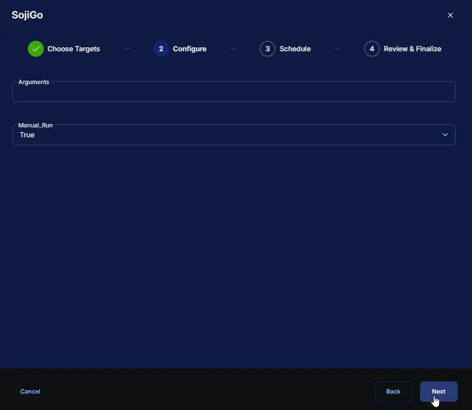

**Manual cleanup with your own arguments:** enable `Manual_Run` and set `Arguments`, for example `--drives D --days 30 --csv`.

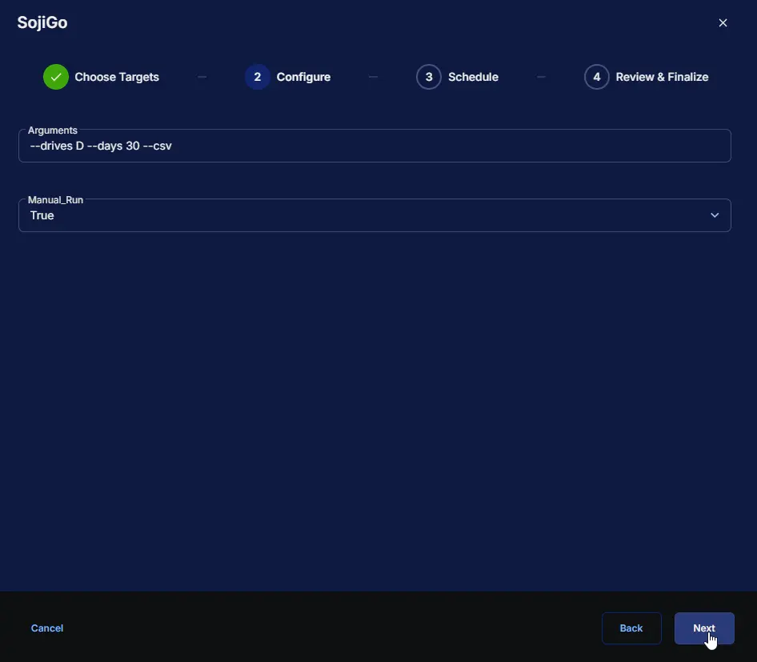

**Follow up on a ticket:** leave `Manual_Run` unchecked and set `Arguments` to the ones given in a ticket comment, for example `--drives D --days 21 --csv`. The results are added to the open ticket. This only runs where Autofix is enabled.

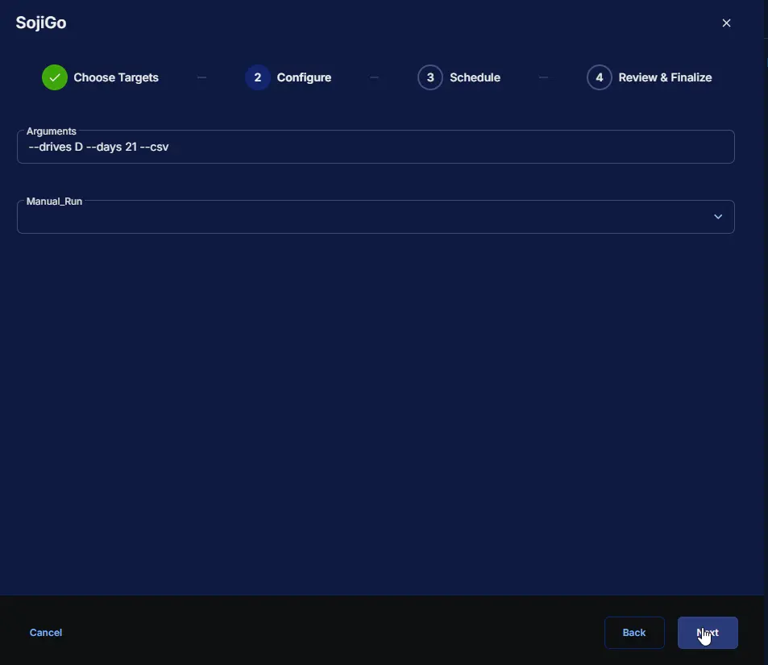

## Dependencies

- [Solution: SojiGo](/docs/215f93ac-aca7-4ccd-8f3e-1b241bd32353)
- [Application: SojiGo](/docs/6b7cbccd-c62f-457a-a97e-0b861b27b9df)
- [Custom Field: SojiGo_Arguments_Svr](/docs/c51eb5bd-5636-4a67-896f-ec19626d3831)
- [Custom Field: SojiGo_Arguments_Wks](/docs/91d0fa29-3c12-4e9c-b65b-b23e64a93c66)
- [Custom Field: SojiGo_Arguments_Svr_Site](/docs/ec1c9648-be61-4d3d-abfa-f3c0f3d0cd3b)
- [Custom Field: SojiGo_Arguments_Wks_Site](/docs/248a3007-7a4f-4962-91f3-01ec4d2c8a39)
- [Custom Field: SojiGo_Arguments](/docs/0d0cfdb2-351b-404a-979d-e73ef4583933)

**Autofix only:**

- [Custom Field: EDSM_Autofix_Svr](/docs/0633eb30-42d1-4b39-a81f-8ddcdf343041)
- [Custom Field: EDSM_Autofix_Wks](/docs/be43ba2c-9066-47c2-89c0-cd81a219f00f)
- [Custom Field: EDSM_Autofix_Svr_Site](/docs/f39306a9-d782-42c8-a9c7-df8f37d9b06e)
- [Custom Field: EDSM_Autofix_Wks_Site](/docs/0cea4c75-a11c-4466-b8d3-4df2717ea9c2)
- [Custom Field: EDSM_Autofix](/docs/fdf87d82-1984-496f-aae4-1d2d3b6d5cd9)
- [Task: Enhanced Drive Space Monitoring Configuration Writer](/docs/b2a4b9ec-08bd-4bce-8db7-b155c6bc03bc)
- [Monitor: Enhanced Drive Space Monitoring [Workflow]](/docs/2c9dd7bc-f5aa-48c2-be76-1348e13cda07)
- [Workflow: CWRMM Ticket Management for Monitors](/docs/57daa951-2acc-4be7-a025-0d0ca729ef57)
- [Solution: Enhanced Drive Space Monitoring](/docs/e9cf4ff0-4413-447b-97dd-b8b2abd59597)

## Custom Fields

| Name | Example | Level | Type | Default Value | Description |
| --- | --- | --- | --- | --- | --- |
| [SojiGo_Arguments_Svr](/docs/c51eb5bd-5636-4a67-896f-ec19626d3831) | `--drives C --days 21 --csv` | `Company` | `Text Area` | The [default arguments](#default-arguments) | Company baseline SojiGo arguments for Servers. Overridden if Site or Endpoint arguments exist. |
| [SojiGo_Arguments_Wks](/docs/91d0fa29-3c12-4e9c-b65b-b23e64a93c66) | `--drives C --days 21 --csv` | `Company` | `Text Area` | The [default arguments](#default-arguments) | Company baseline SojiGo arguments for Workstations. Overridden if Site or Endpoint arguments exist. |
| [SojiGo_Arguments_Svr_Site](/docs/ec1c9648-be61-4d3d-abfa-f3c0f3d0cd3b) | `--drives C,D --days 30` | `Site` | `Text Area` |  | Site-level SojiGo arguments for Servers. Overrides Company level, but overridden by Endpoint. |
| [SojiGo_Arguments_Wks_Site](/docs/248a3007-7a4f-4962-91f3-01ec4d2c8a39) | `--drives C --days 14` | `Site` | `Text Area` |  | Site-level SojiGo arguments for Workstations. Overrides Company level, but overridden by Endpoint. |
| [SojiGo_Arguments](/docs/0d0cfdb2-351b-404a-979d-e73ef4583933) | `--drives D --days 30 --skip-volumecaches` | `Endpoint` | `Text Area` |  | Endpoint-level SojiGo arguments. Overrides any Site or Company level setting. |

## Task Setup Path

- **Tasks Path:** `AUTOMATION` ➞ `Tasks`
- **Task Type:** `Script Editor`

## Task Creation

### **Description**

- **Name:** `SojiGo`
- **Description:**

```PlainText
Runs SojiGo to free up drive space with arguments from the SojiGo_Arguments custom fields.
As the Enhanced Drive Space Monitoring autofix, acts only where Autofix is enabled and comments on the open ticket.
Check Manual_Run for manual or scheduled cleanups.
Logs = %ProgramData%\_Automation\App\SojiGo\SojiGoLogs
```

- **Category:** `Maintenance`

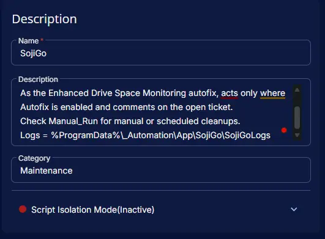

### **Parameters**

| Parameter Name | Required Field | Parameter Type | Default Value | Description |
| --- | --- | --- | --- | --- |
| `Arguments` | `False` | `Text String` | | SojiGo arguments for this run. Overrides every custom field. Type each single quote twice. |
| `Manual_Run` | `False` | `Flag` | | Enable for manual or scheduled cleanups. Leave unchecked for the Enhanced Drive Space Monitoring autofix, which acts only where Autofix is enabled and a ticket is open. |

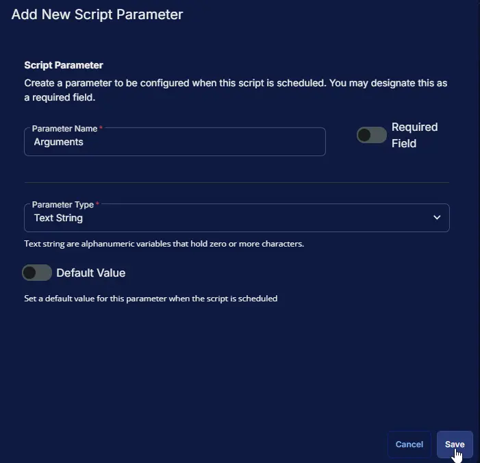

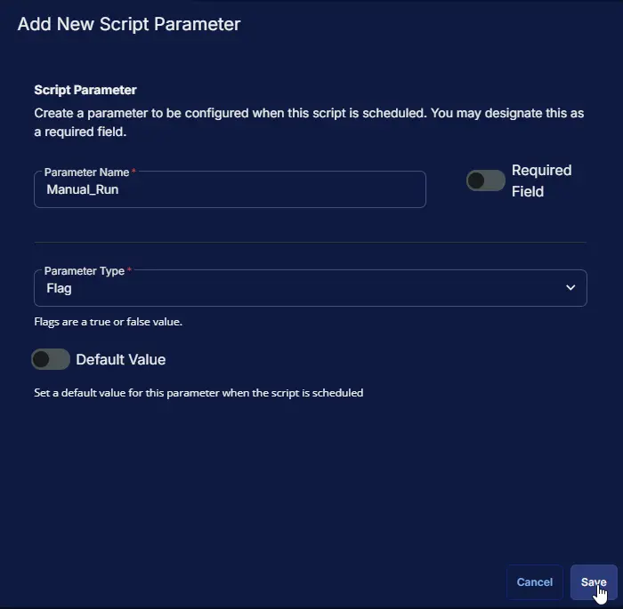

### **Script Editor**

### Row 1 Function: Set Pre-defined Variable ( @SojiGo_Arguments_Svr@ = SojiGo_Arguments_Svr )

- **Notes:** `SojiGo_Arguments_Svr`
- **Continue on Failure:** `False`
- **Operating System:** `Windows`
- **Variable Name:** `SojiGo_Arguments_Svr`
- **Custom Field:** `SojiGo_Arguments_Svr (STRING - COMPANY)`

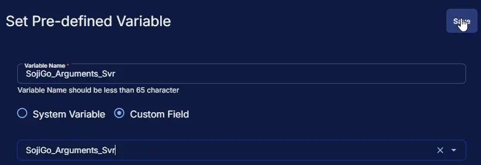

### Row 2 Function: Set Pre-defined Variable ( @SojiGo_Arguments_Wks@ = SojiGo_Arguments_Wks )

- **Notes:** `SojiGo_Arguments_Wks`
- **Continue on Failure:** `False`
- **Operating System:** `Windows`
- **Variable Name:** `SojiGo_Arguments_Wks`
- **Custom Field:** `SojiGo_Arguments_Wks (STRING - COMPANY)`

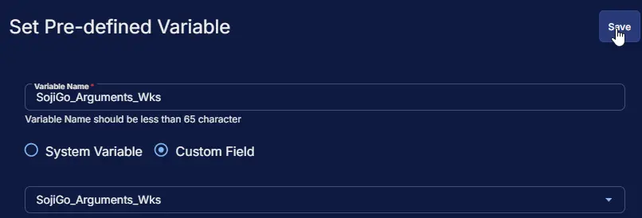

### Row 3 Function: Set Pre-defined Variable ( @SojiGo_Arguments_Svr_Site@ = SojiGo_Arguments_Svr_Site )

- **Notes:** `SojiGo_Arguments_Svr_Site`
- **Continue on Failure:** `False`
- **Operating System:** `Windows`
- **Variable Name:** `SojiGo_Arguments_Svr_Site`
- **Custom Field:** `SojiGo_Arguments_Svr_Site (STRING - SITE)`

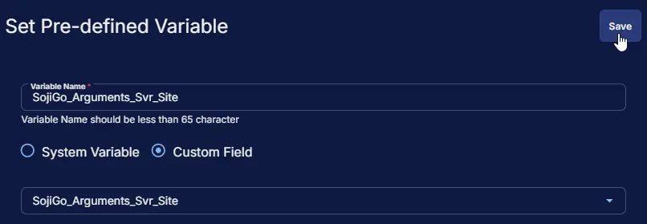

### Row 4 Function: Set Pre-defined Variable ( @SojiGo_Arguments_Wks_Site@ = SojiGo_Arguments_Wks_Site )

- **Notes:** `SojiGo_Arguments_Wks_Site`
- **Continue on Failure:** `False`
- **Operating System:** `Windows`
- **Variable Name:** `SojiGo_Arguments_Wks_Site`
- **Custom Field:** `SojiGo_Arguments_Wks_Site (STRING - SITE)`

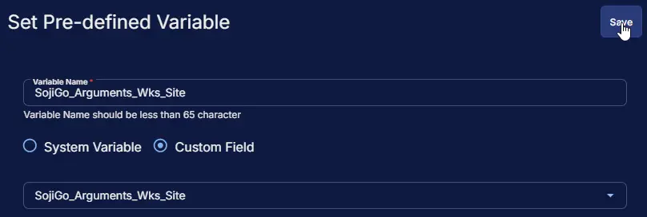

### Row 5 Function: Set Pre-defined Variable ( @SojiGo_Arguments@ = SojiGo_Arguments )

- **Notes:** `SojiGo_Arguments`
- **Continue on Failure:** `False`
- **Operating System:** `Windows`
- **Variable Name:** `SojiGo_Arguments`
- **Custom Field:** `SojiGo_Arguments (STRING - ENDPOINT)`

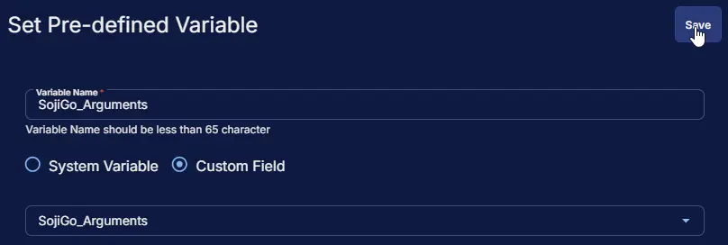

#### Row 6 Function: PowerShell script

- **Notes:** `<Leave it Blank>`
- **Use Generative AI Assist for script creation:** `False`
- **Expected time of script execution in seconds:** `2700`
- **Continue on Failure:** `False`
- **Run As:** `System`
- **Operating System:** `Windows`
- **PowerShell Script Editor:**

[PowerShell Script](https://github.com/ProVal-Tech/cw-rmm/blob/main/tasks/sojigo/script.ps1)

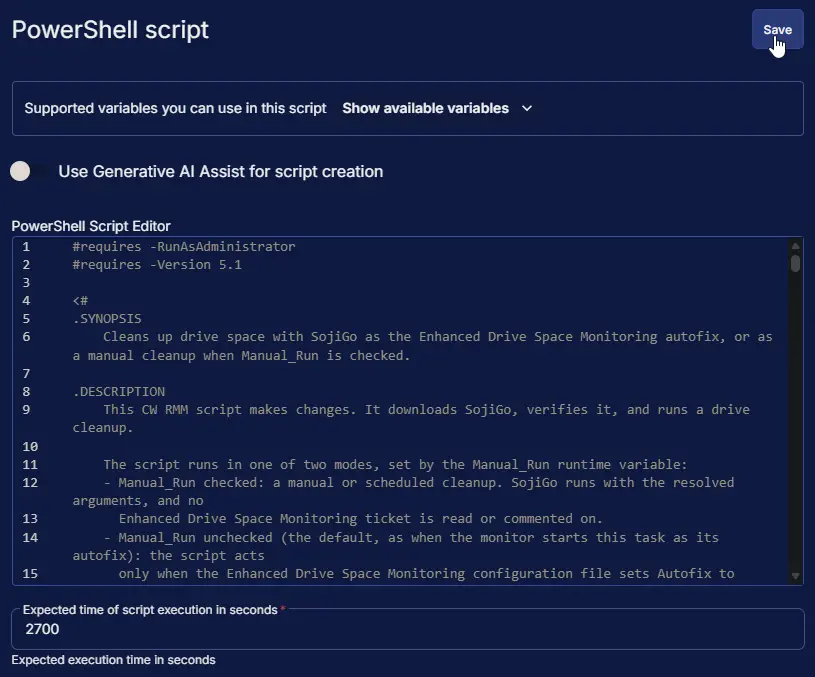

:::note

A full cleanup can take several minutes, and the autofix waits up to 90 seconds before commenting. Keep the expected time at `2700` seconds or more.

:::

#### Row 7 Function: Script Log

- **Notes:** `<Leave it Blank>`
- **Continue on Failure:** `False`
- **Operating System:** `Windows`
- **Script Log Message:** `%Output%`

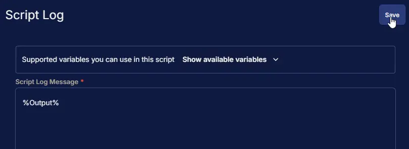

## Completed Task

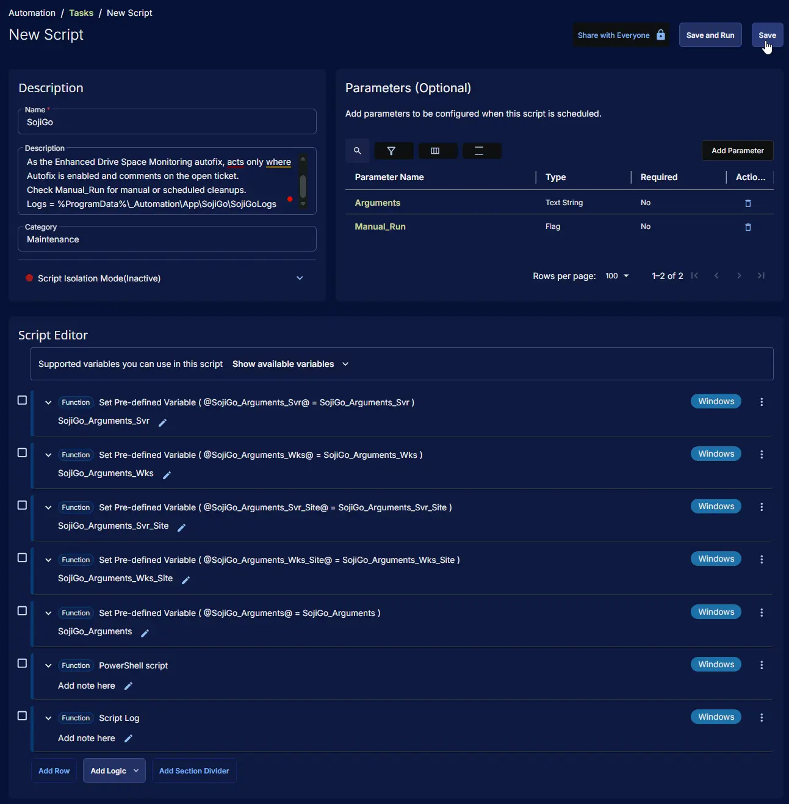

## Set Up the Enhanced Drive Space Monitoring Autofix

Follow these steps to have the task clean up devices and comment on drive space tickets automatically. The [Enhanced Drive Space Monitoring](/docs/e9cf4ff0-4413-447b-97dd-b8b2abd59597) solution must already be deployed with the Workflow ticketing option.

1. Create the five SojiGo_Arguments fields and the five EDSM_Autofix fields listed in [Dependencies](#dependencies).
2. Update the [Enhanced Drive Space Monitoring Configuration Writer](/docs/b2a4b9ec-08bd-4bce-8db7-b155c6bc03bc) task with its Autofix rows.
3. Set the EDSM_Autofix fields to `Enable` for the companies, sites or endpoints that should use the autofix. Then run the configuration writer task, or wait for its next daily run.
4. Open the [Enhanced Drive Space Monitoring [Workflow]](/docs/2c9dd7bc-f5aa-48c2-be76-1348e13cda07) monitor. In **Add Automation**, select the **SojiGo** task and save the monitor. The task does nothing on devices where Autofix is not enabled, so it is safe to attach for all devices.

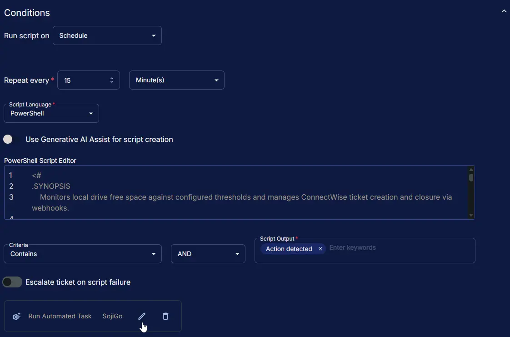

You'll know it worked when the next drive space ticket gets a comment from SojiGo shortly after it is created.

## Output

- Script Log
- Ticket comment on the open Enhanced Drive Space Monitoring ticket (autofix only)
- SojiGo logs and reports in `C:\ProgramData\_Automation\App\SojiGo\SojiGoLogs`

## Changelog

### 2026-10-20

- Initial version of the document
