## Summary

The Update Microsoft 365 Apps task runs the Office Click-to-Run client to update Microsoft 365 Apps on Windows endpoints. It runs the agnostic script [Update-Office](/docs/498075f7-623c-4b92-9fbc-fe0f5e7113a4) in one of two modes, chosen by the PromptUser parameter.

### How it works
**PromptUser unchecked (default)**: the task works as it always has. Open Office apps are closed without asking and Office is updated straight away. Every other parameter is ignored.  

**PromptUser checked:** the signed-in user is asked to save their work and close Office first.  
The prompt lists the Office apps that are open and offers Postpone and Update Now.  
Once the postponements are used up, a final prompt offers Update Now only, and Office is updated anyway if there is no answer.  
Office is updated straight away, without a prompt, when nobody is signed in or no Office app is open.  
Nothing happens when Office is already on the latest build of its update channel.
After a postponement, the script schedules its own next prompt on the endpoint, so the task only needs to run once per update.  
After the update, a short notice tells the user they can reopen Office.

## Requirements: 
- PowerShell 5 or later 
- Microsoft 365 Apps (Click-to-Run)
- Internet access to ProVal's file server
- The PowerShell Gallery and the Office CDN. 
- With PromptUser checked, the endpoint also needs access to Microsoft's Office release feed (clients.config.office.net) unless SkipVersionCheck is checked.

## Sample Run

- Navigate to Action and click.
- Click Run and search for `Update Microsoft 365 Apps [Prompt]` and click on it.
  
  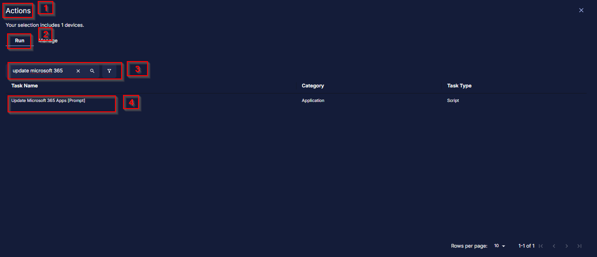

- Task summary will open, click Next
  
  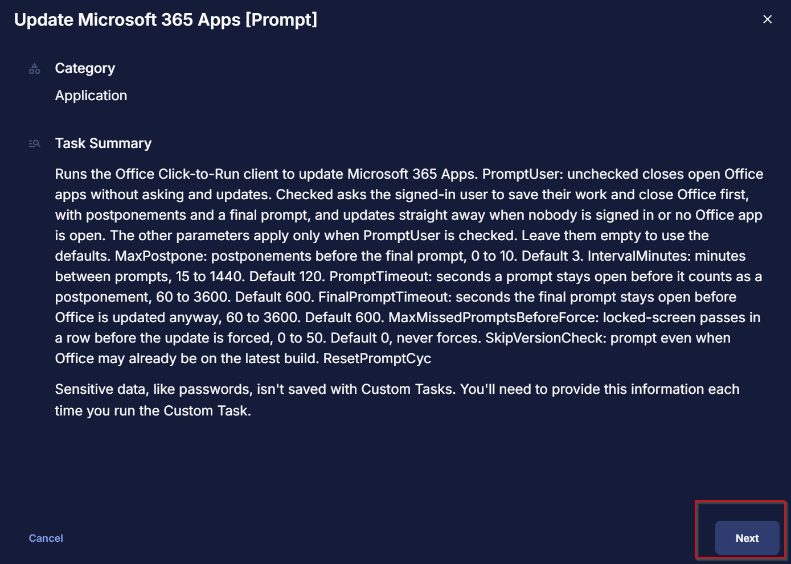

- Choose target(s) and Click Next
  
  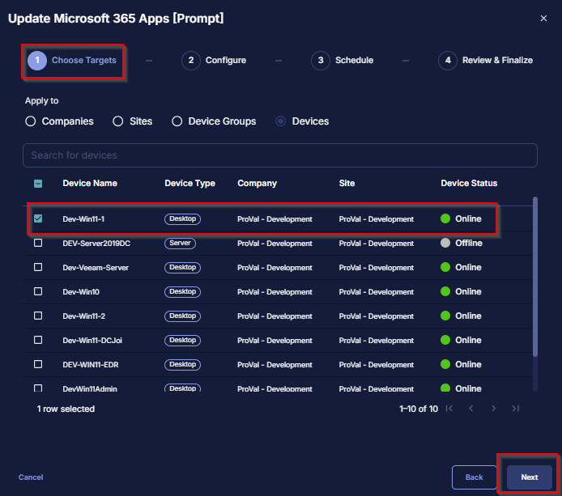

- Configure and provide the parameter values.
  
- **Example 1:** Update without prompting
  
  Leave every parameter empty. Open Office apps are closed without warning and Office is updated, as in earlier versions of this task. The log shows the version before and after the update.

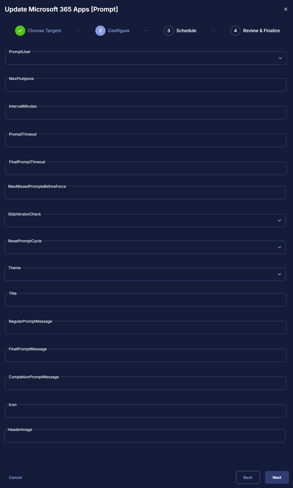

- **Example 2:** Prompt with the defaults
  
  The user can postpone up to 3 times, 2 hours apart. Each prompt stays open for 10 minutes, and an unanswered prompt counts as a postponement. The final prompt updates Office after 10 minutes without an answer.
  
  **PromptUser:** `True`

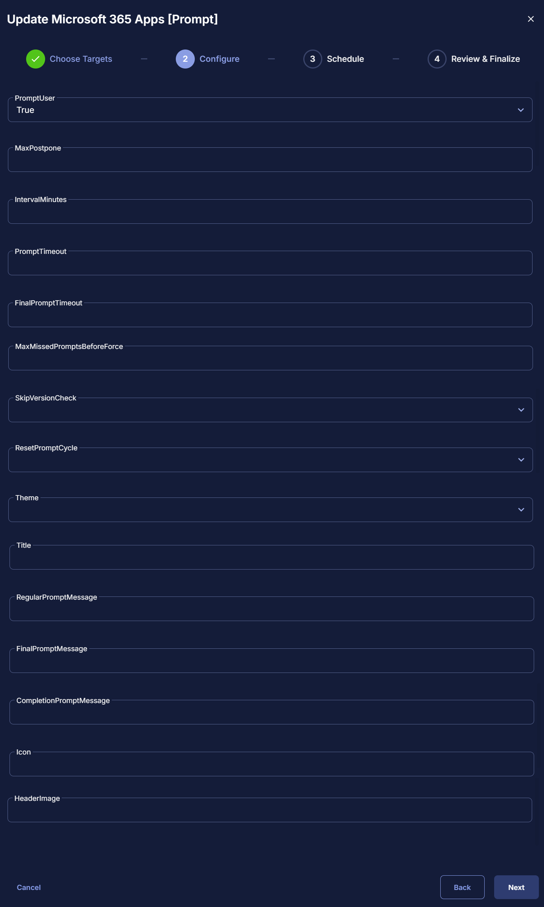

- **Example 3:** Single warning before the update
  
  The user sees the final prompt straight away, with 15 minutes to save their work before Office is updated.

  **PromptUser:** `True`

  **MaxPostpone:** 0

  **FinalPromptTimeout:** 900

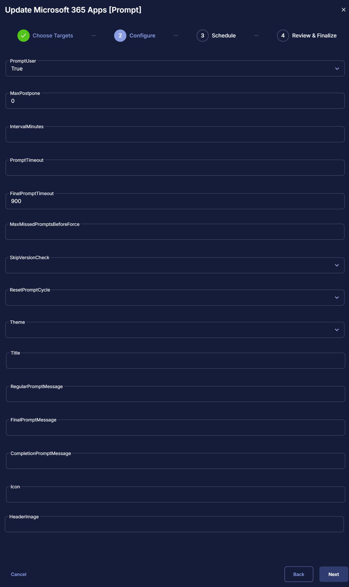

- **Example 4:** Hourly prompts, and force the update on machines left locked
  
  Prompts come every hour. If 4 passes in a row find the screen locked with Office open, the update runs without a prompt. The count resets when the user is found at an unlocked screen.

  **PromptUser:** `True`
  
  **IntervalMinutes:** 60
  
  **MaxMissedPromptsBeforeForce:** 4

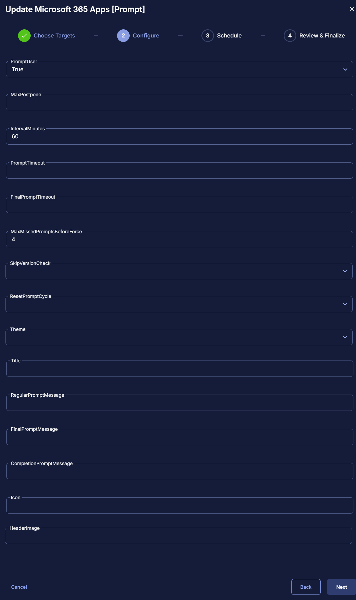

- **Example 5:** Machines that update from a network share or Configuration Manager
  
  Prompts without first comparing the installed build with Microsoft's latest build. Use it when the endpoints do not take updates from the Office CDN, because their latest available build can differ from Microsoft's.
  
  **PromptUser:** `True`
  
  **SkipVersionCheck:** `True`

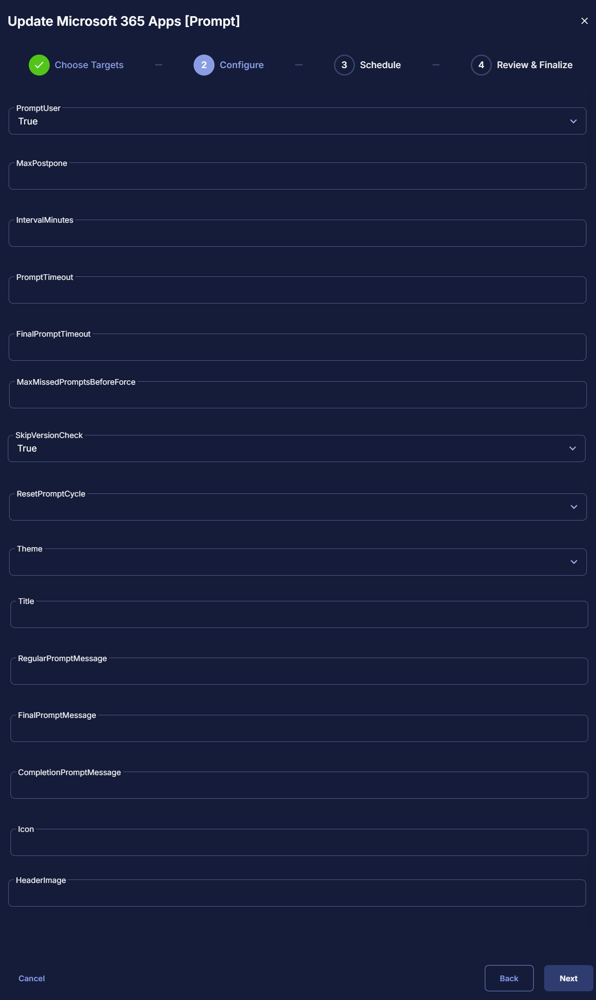

- **Example 6:** Restart a prompt cycle in progress
  
  Discards the postponements and scheduled prompts left by an earlier run and starts again from the first prompt. Without ResetPromptCycle, a run that finds a cycle in progress logs its state and exits.
  
  **PromptUser:** `True`
  
  **ResetPromptCycle:** `True`

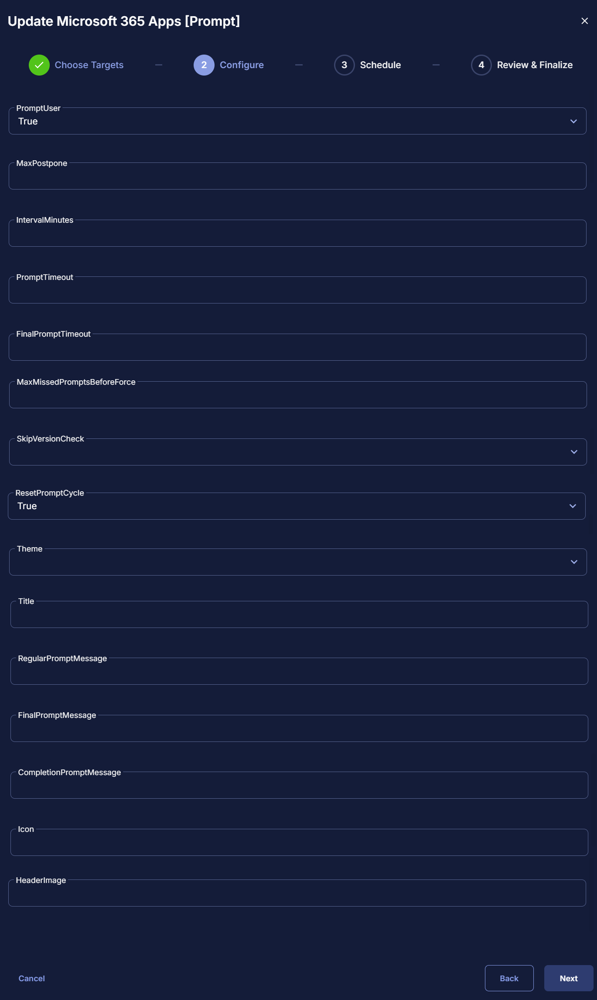

- **Example 7:** Company branding and custom wording
  
  Shows the prompt with a company title, a light theme, the company icon and custom text. UserName, OpenApplications and PostponesLeft are replaced with live values, and \n starts a new line.
  
  **PromptUser:** `True`
  
  **Title:** ProValTech - Office update
  
  **Theme:** Light
  
  **Icon:** https://proval.com/icon.webp
  
  **RegularPromptMessage:** Hi UserName, Office needs to update. Please save your work in OpenApplications and click Update Now.\n\nYou can postpone PostponesLeft more time(s).

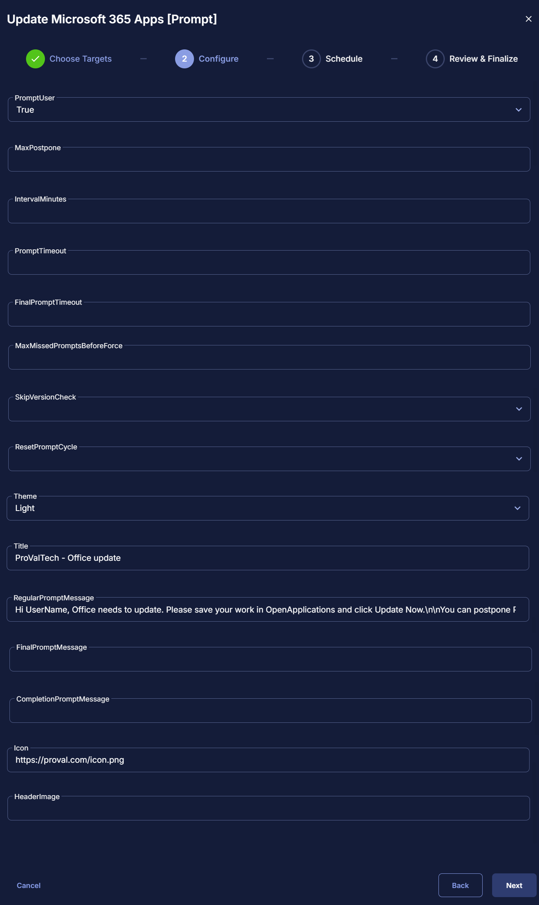

- **Example 8:** Fast cycle for testing
  
  Uses short intervals so the whole prompt cycle can be seen quickly. SkipVersionCheck makes the prompt appear on a test machine that is already up to date.
  
  **PromptUser:** `True`
  
  **MaxPostpone:** 2
  
  **IntervalMinutes:** 15
  
  **FinalPromptTimeout:** 60
  
  **SkipVersionCheck:** `True`

  **Icon:** https://proval.com/icon.webp

  **HeaderImage:** https://proval.com/office-update-header.webp

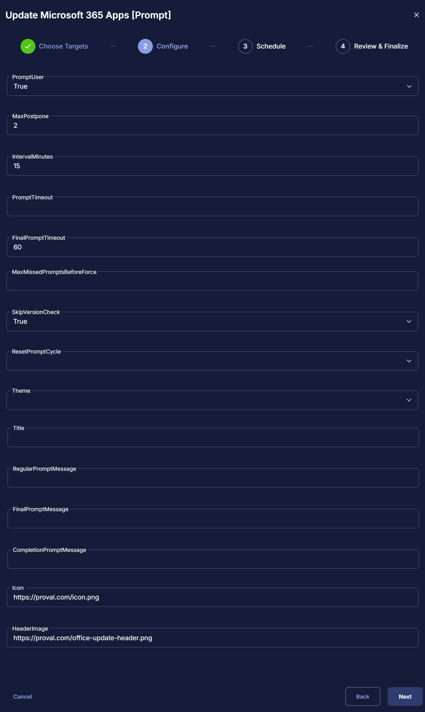

- Schedule the task by selected `Run Now`
  
  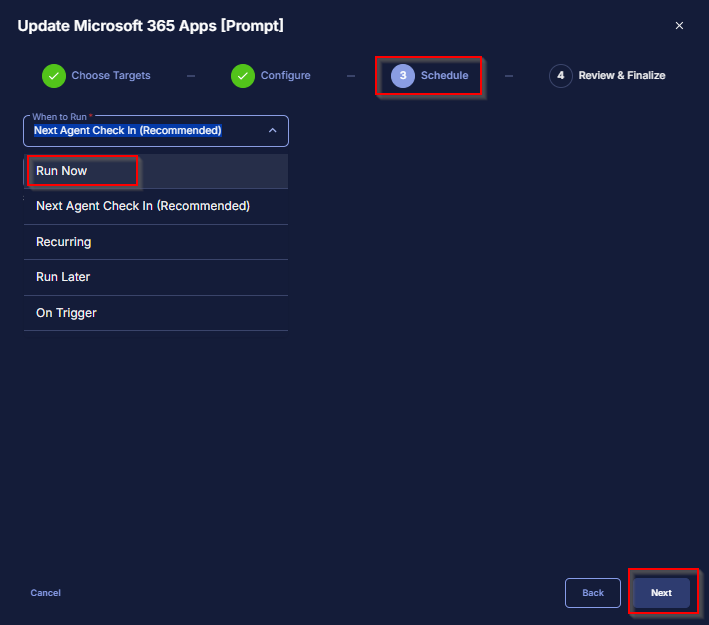

- Review and finalize and click `Run`
  
  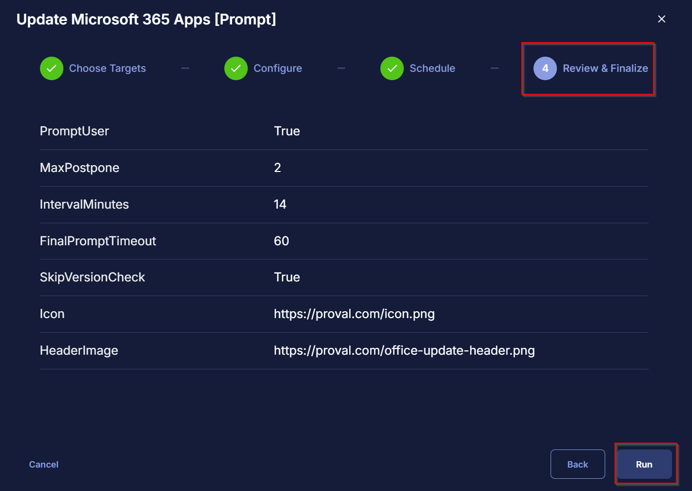

Outcome:

1. With Word open, the user sees the regular prompt with two postponements left and clicks **Postpone**. The task ends, and the script schedules its next pass on the endpoint 15 minutes later.
2. At the next pass, the regular prompt shows one postponement left. The user clicks **Postpone** again.
3. At the third pass, the final prompt offers **Update Now** only. When the user clicks it, or after 60 seconds without an answer, Word closes and Microsoft 365 Apps updates.
4. If the update raised the Office version, a short notice tells the user they can reopen Office. On a test machine that was already up to date, no update is applied, so the notice does not appear and the log reports that the version did not increase.
   
   For screenshots of the prompts, see [Sample Prompts](/docs/498075f7-623c-4b92-9fbc-fe0f5e7113a4#sample-prompts) in the Update-Office document.

## Dependencies

- [PowerShell: Update-Office](/docs/498075f7-623c-4b92-9fbc-fe0f5e7113a4)
- [OmniPrompt](/docs/8ead1ffd-dade-4e17-9958-3313da9a7aa8): Downloaded by the agnostic script when a prompt is needed.
- [SilentLauncher](/docs/b0b9f423-eee3-4148-b8a0-e99400c45698): Downloaded by the agnostic script when a prompt is needed.

## User Parameters

| Name | Example | Accepted Values | Required | Default | Type | Description |
| ---- | ------- | --------------- | -------- | ------- | ---- | ----------- |
| `PromptUser` | `Checked` | `Checked` or `Unchecked` | False | `Unchecked` | Flag | When it's checked, the signed-in user is asked to save their work and close Office before the update. When it's unchecked, open Office apps are closed without asking, as in earlier versions of this task. |
| `MaxPostpone` | `2` | `0` to `10` | False | `3` | Number Value | Times the user can postpone before the final prompt. A prompt left unanswered also uses one. `0` shows the final prompt straight away. |
| `IntervalMinutes` | `60` | `15` to `1440` | False | `120` | Number Value | Minutes between prompts after a postponement, an unanswered prompt, a locked screen or a prompt that failed to display. |
| `PromptTimeout` | `300` | `60` to `3600` | False | `600` | Number Value | Seconds a regular prompt stays open before it counts as a postponement. |
| `FinalPromptTimeout` | `900` | `60` to `3600` | False | `600` | Number Value | Seconds the final prompt stays open before Office is closed and updated anyway. |
| `MaxMissedPromptsBeforeForce` | `4` | `0` to `50` | False | `0` | Number Value | Passes in a row that find the screen locked with Office open before the update is forced without a prompt. `0` never forces. |
| `SkipVersionCheck` | `Checked` | `Checked` or `Unchecked` | False | `Unchecked` | Flag | Prompts even when Office may already be on the latest build. Use it for endpoints that update from a network share or Configuration Manager, or for testing. |
| `ResetPromptCycle` | `Checked` | `Checked` or `Unchecked` | False | `Unchecked` | Flag | Discards a prompt cycle left by an earlier run and starts again from the first prompt. Passed to the agnostic script as `-Force`. |
| `Theme` | `Light` | `Dark`, `Light` | False | `Dark` | DropDown | Prompt window theme. |
| `Title` | `ProValTech - Office update` | Plain text | False | `Microsoft 365 Apps Update` | Text String | Title of the regular and final prompts, also used for the completion notice. |
| `RegularPromptMessage` | See Example 7 | Plain text | False | Built-in message | Text String | Message of the regular prompt. |
| `FinalPromptMessage` | `Office will now update. Please save your work in OpenApplications.` | Plain text | False | Built-in message | Text String | Message of the final prompt. |
| `CompletionPromptMessage` | `Office is now on NewVersion. You can reopen your apps.` | Plain text | False | Built-in message | Text String | Message of the notice shown after the update. |
| `Icon` | `https://proval.com/icon.webp` | URL, local path or UNC path | False | | Text String | Icon shown in the prompt. |
| `HeaderImage` | `https://proval.com/office-update-header.webp` | URL, local path or UNC path | False | | Text String | Header image shown at the top of the prompt. |

:::note

- Every parameter except `PromptUser` applies only when `PromptUser` is checked. When it's unchecked, any other value entered is ignored and listed in the task output.
- A parameter left empty uses the default shown, which is the agnostic script's own default.
- With `PromptUser` checked, a number outside its accepted range stops the task before anything is changed, and the task output names the value to fix.
- Titles and messages accept the [substitution variables](/docs/498075f7-623c-4b92-9fbc-fe0f5e7113a4#substitution-variables), such as `UserName`, `OpenApplications` and `PostponesLeft`, and `\n` for a line break. Keep custom text to plain ASCII characters.
- The built-in titles and messages are shown in Dutch when the signed-in user's display language is Dutch. See [Default Messages](/docs/498075f7-623c-4b92-9fbc-fe0f5e7113a4#default-messages) for the full text.

:::

### What happens when PromptUser is checked

Each run works through these checks in order, and the first one that applies decides what happens.

| Situation on the endpoint | Result |
| ------------------------- | ------ |
| A prompt cycle from an earlier run is still in progress | Logs the cycle state and exits, unless `ResetPromptCycle` is checked. |
| Office is already on the latest build of its channel | Exits without prompting or updating, unless `SkipVersionCheck` is checked. |
| More than one user is signed in, for example on a terminal server | Logs a warning and does not update, because closing Office could cost other users unsaved work. Update these endpoints with `PromptUser` unchecked in a maintenance window. |
| Nobody is signed in | Updates straight away. |
| No Office app is open | Updates straight away. |
| The screen is locked | Defers the update to the next pass, or forces it once `MaxMissedPromptsBeforeForce` is reached. |
| Office is open and the user is at the desktop | Shows the regular prompt, or the final prompt once the postponements are used up. |

For more details and troubleshooting, see [Update-Office](/docs/498075f7-623c-4b92-9fbc-fe0f5e7113a4).

## Task Creation

Create a new `Script Editor` style script in the system to implement this task.

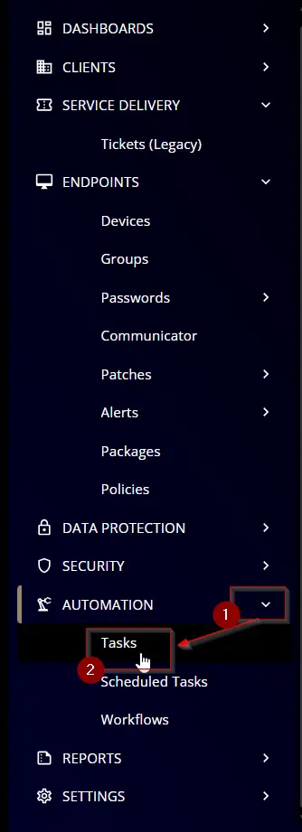  
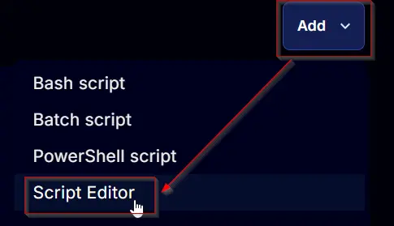  

**Name:** `Update Microsoft 365 Apps [Prompt]`  

**Description:** `Runs the Office Click-to-Run client to update Microsoft 365 Apps.
PromptUser: unchecked closes open Office apps without asking and updates. Checked asks the signed-in user to save their work and close Office first, with postponements and a final prompt, and updates straight away when nobody is signed in or no Office app is open.
The other parameters apply only when PromptUser is checked. Leave them empty to use the defaults.
MaxPostpone: postponements before the final prompt, 0 to 10. Default 3.
IntervalMinutes: minutes between prompts, 15 to 1440. Default 120.
PromptTimeout: seconds a prompt stays open before it counts as a postponement, 60 to 3600. Default 600.
FinalPromptTimeout: seconds the final prompt stays open before Office is updated anyway, 60 to 3600. Default 600.
MaxMissedPromptsBeforeForce: locked-screen passes in a row before the update is forced, 0 to 50. Default 0, never forces.
SkipVersionCheck: prompt even when Office may already be on the latest build.
ResetPromptCycle: discard a prompt cycle in progress and start again.
Theme: Dark or Light. Title, RegularPromptMessage, FinalPromptMessage, CompletionPromptMessage: custom prompt text. Icon, HeaderImage: URL or path of the prompt images.`

**Category:** `Application`  

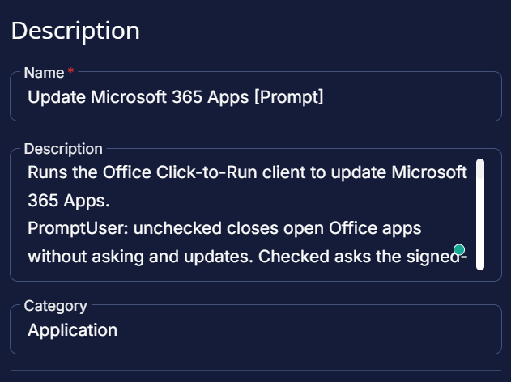

## Task

Navigate to the Script Editor section and start by adding a row. You can do this by clicking the `Add Row` button at the bottom of the script page.  
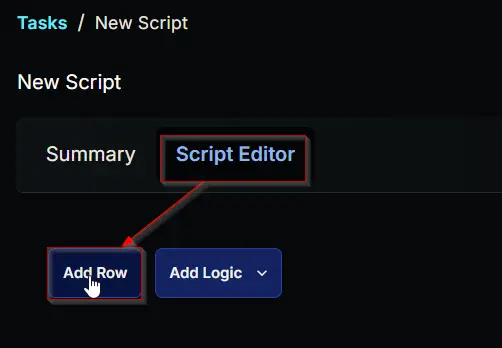  

A blank function will appear.  
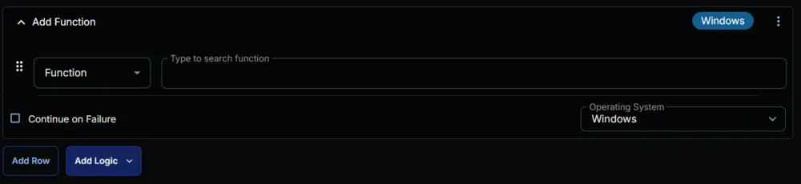  

### Create Script Parameters

- Click on Add Parameter and add the below parameters as mentioned and Click Save and Confirm.

### Parameters

| Parameter Name | Required Field | Parameter Type | Default Value |
| -------------- | -------------- | -------------- | ------------- |
| PromptUser | Disabled | Flag | Disabled |
| MaxPostpone | Disabled | Number Value | Disabled |
| IntervalMinutes | Disabled | Number Value | Disabled |
| PromptTimeout | Disabled | Number Value | Disabled |
| FinalPromptTimeout | Disabled | Number Value | Disabled |
| MaxMissedPromptsBeforeForce | Disabled | Number Value | Disabled |
| SkipVersionCheck | Disabled | Flag | Disabled |
| ResetPromptCycle | Disabled | Flag | Disabled |
| Theme | Disabled | Dropdown | Disabled |
| Title | Disabled | Text String | Disabled |
| RegularPromptMessage | Disabled | Text String | Disabled |
| FinalPromptMessage | Disabled | Text String | Disabled |
| CompletionPromptMessage | Disabled | Text String | Disabled |
| Icon | Disabled | Text String | Disabled |
| HeaderImage | Disabled | Text String | Disabled |

**Theme:** Select `String` as the Option Type and add `Dark` and `Light` as the options.

:::note

Name the parameters exactly as shown. The script reads them by these names.  
Leave a parameter empty to use its default from the [Update-Office](/docs/498075f7-623c-4b92-9fbc-fe0f5e7113a4) script.  
All parameters except `PromptUser` are ignored unless `PromptUser` is checked.  
`ResetPromptCycle` maps to the script's `-Force` switch.

:::

### Row 1 Function: PowerShell Script

Search and select the `PowerShell Script` function.  

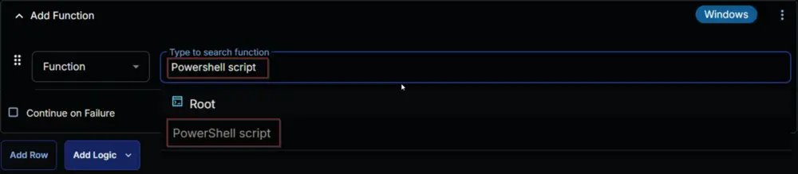  
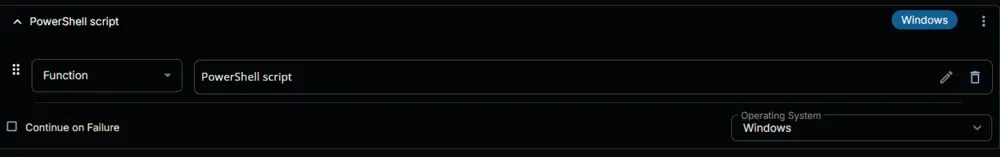  

The following function will pop up on the screen:  
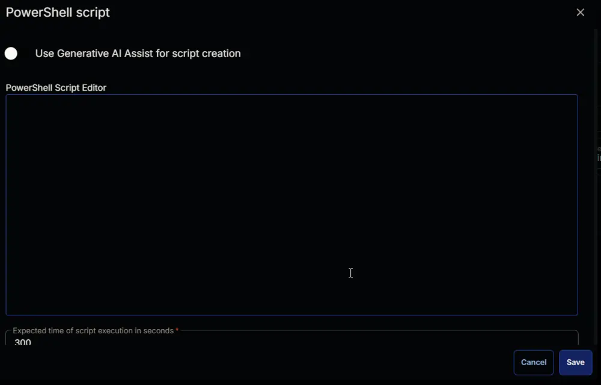  

Paste in the following PowerShell script and set the `Expected time of script execution in seconds` to `3600` seconds. Click the `Save` button.

[PowerShell Script](https://github.com/ProVal-Tech/cw-rmm/blob/main/tasks/update-microsoft-365-apps/script.ps1)

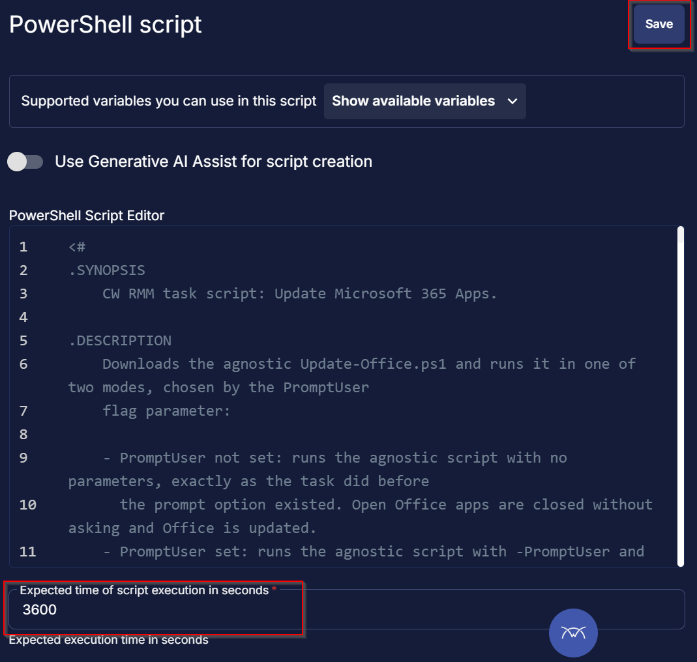

### Row 2 Function: Script Log

Add a new row by clicking the `Add Row` button.  
  

A blank function will appear.  
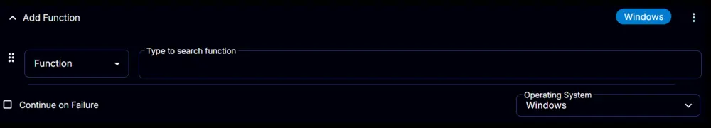  

Search and select the `Script Log` function.  
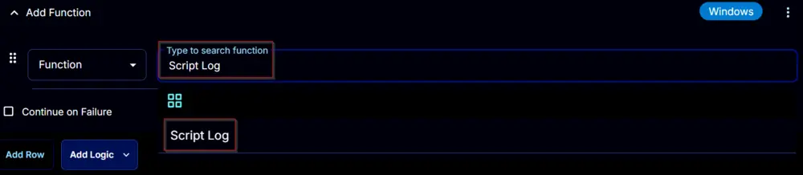  

The following function will pop up on the screen:  
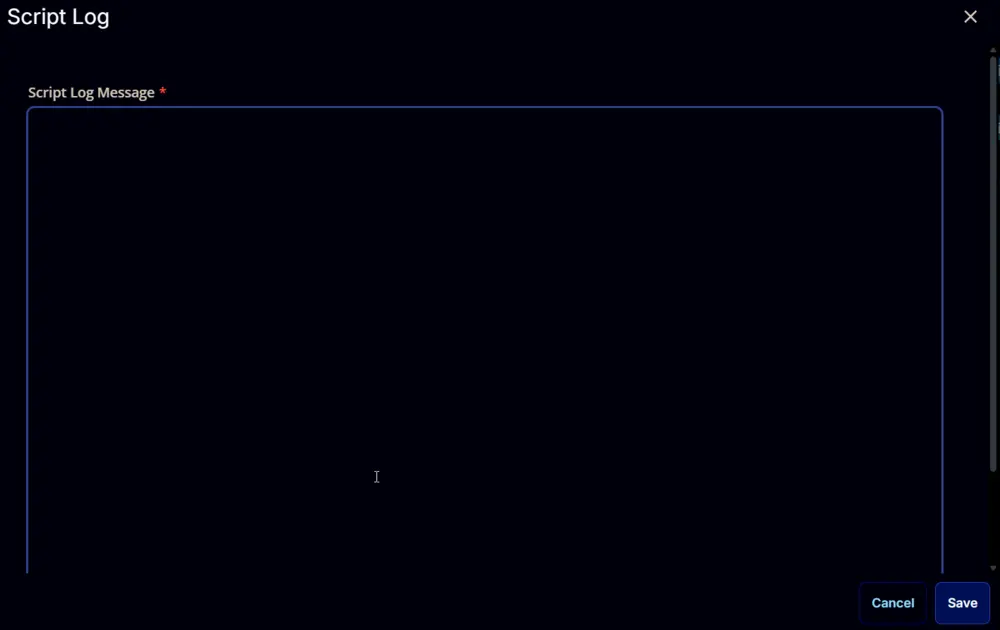  

In the script log message, simply type `%Output%` and click the `Save` button.  
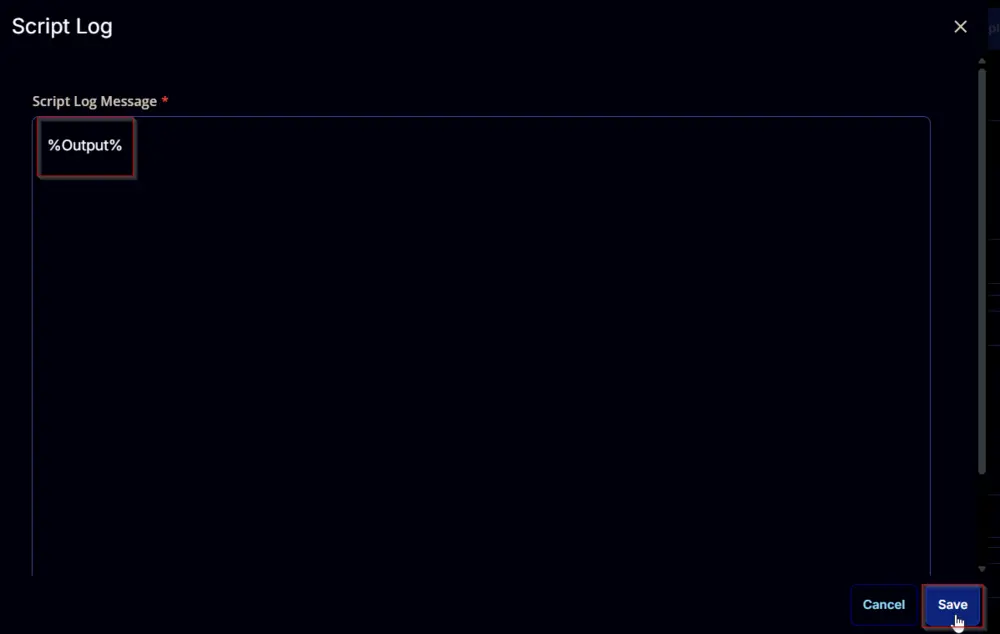  

Click the `Save` button at the top-right corner of the screen to save the script.  
  

## Completed Task

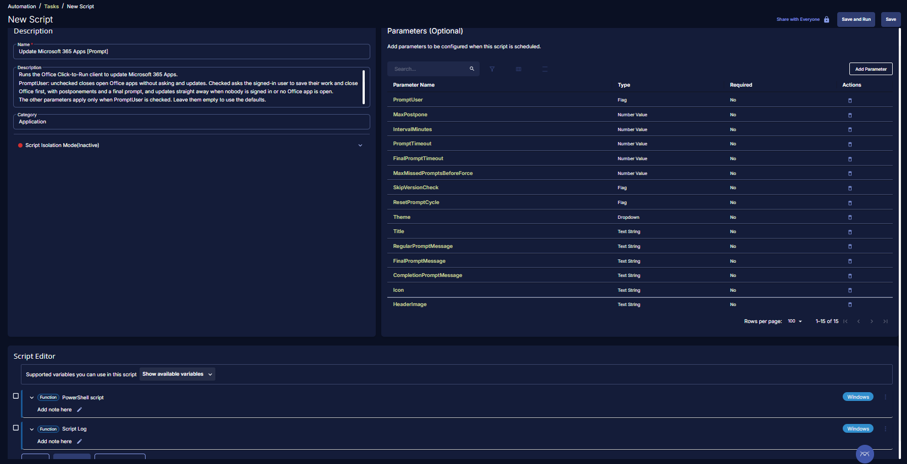

## Output

- Script Log, which shows the mode used, any parameters that were ignored and the agnostic script's log for this run
- Log files on the endpoint, for the run started by the task:
  - `C:\ProgramData\_Automation\Script\Update-Office\Update-Office-log.txt`
  - `C:\ProgramData\_Automation\Script\Update-Office\Update-Office-error.txt`
- Log files on the endpoint, for the prompt passes the script schedules for itself when `PromptUser` is checked:
  - `C:\ProgramData\_Automation\Script\Update-Office\Scheduled\Update-Office-log.txt`
  - `C:\ProgramData\_Automation\Script\Update-Office\Scheduled\Update-Office-error.txt`

The task's script log shows the result of the run started by the task, such as an update, a postponement or "already up to date". The outcome of later prompt passes is only in the endpoint log under `Scheduled`.

## Schedule Task

### Task Details

- **Name:** `Update Microsoft 365 Apps [Prompt]`
- **Category:** `Application`

### Schedule

- **Schedule Type:** `Schedule`
- **Timezone:** `Local Machine Time`
- **Start:** `<Current Date>`
- **Trigger:** `Time` `At` `<Time during business hours>`
- **Recurrence:** `Every week`
- **Execute at next agent check-in:** `True`
- **Stop After:** `22`
- **Unit:** `Hour(s)`

These settings are for `PromptUser` checked. A weekly run picks up each new Office build within a week. A run that finds Office already up to date, or a prompt cycle still in progress, exits without prompting, so repeating the task is safe.

With `PromptUser` unchecked, open Office apps are closed without warning, so schedule the task outside business hours instead.

### Parameters

- **PromptUser:** `True`
- Fill in only the other parameters that should differ from their defaults, as in the [Sample Run](#sample-run) examples, and leave the rest empty.

### Targeted Resource

- **Device Group:** `Windows Workstations with Microsoft 365 Apps`

### Completed Scheduled Task

## Changelog

### 2026-11-20

- Added the `PromptUser` parameter. When it's checked, the signed-in user is asked to save their work and close Office before the update, can postpone it a set number of times, and gets a final prompt. When it's unchecked, the task works as before.
- Added 14 parameters that set the postponements, timeouts, prompt text and branding when `PromptUser` is checked.
- With `PromptUser` checked, a number outside its accepted range now stops the task with a message instead of running with no effect.
- Raised `Expected time of script execution in seconds` from `300` to `3600`.
- Rewrote the document on the current template, with a sample run for each way to use the parameters.

### 2025-04-10

- Initial version of the document