## Summary

Audits the user profiles and local user accounts on Windows machines and stores the results in the [User Profiles](/docs/e390856a-cc1c-4dde-93e4-f714f2d08258) custom field. For each user, it records the username, whether it's a local account, whether it has local administrator rights, the profile size in MB, and whether the account is enabled. Nothing on the machine is changed.

The task runs in five steps:

1. **Collects the data.** Confirms the machine is not a domain controller and runs Windows 10, Windows 11, or Windows Server 2016 or later, before anything is downloaded. It then downloads the [Get-UserProfiles](/docs/dee76265-9071-47bb-9262-d656dd8b5c6d) script, verifies its digital signature, runs it, and saves the formatted results to `C:\ProgramData\_Automation\Script\Get-UserProfiles\Get-UserProfiles-output.txt`. The file from the previous run is removed first, so old data is never reused.
2. **Logs the result.** Shows the script log, including the exact value that will be stored in the custom field.
3. **Reads the results.** Returns the content of the saved file, escaping backslashes so usernames such as `CONTOSO\jdoe` are stored correctly.
4. **Logs the value.** Records the value returned by the previous step.
5. **Stores the value.** Writes it to the **User Profiles** custom field.

The custom field accepts at most 999 characters from automation. When the results are longer, whole entries are dropped from the end of the list until they fit, and the log shows a warning with both the stored value and the complete list.

If any step fails, the task stops and the custom field keeps its previous value.

**Note:** The task requires PowerShell 5.1 and internet access to `contentrepo.net` and the PowerShell Gallery.

## Sample Run

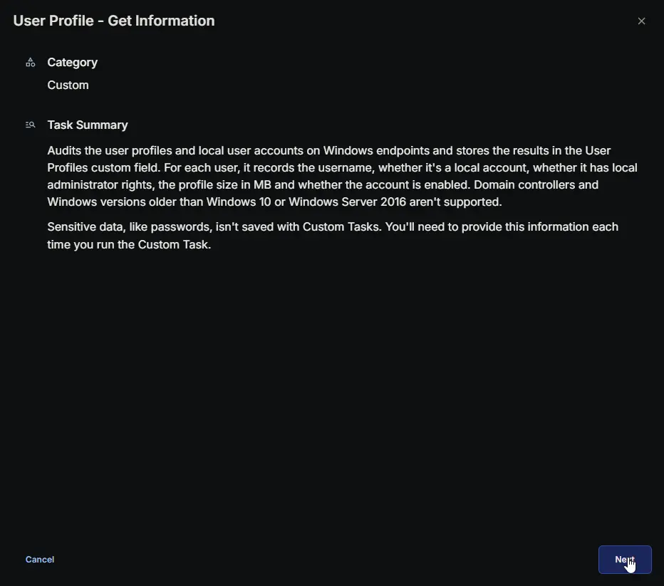

## Dependencies

- [Custom Field: User Profiles](/docs/e390856a-cc1c-4dde-93e4-f714f2d08258)
- [Group: Windows Machines (Non‑DC)](/docs/aa76fac8-dac7-44d9-897d-d0f6f15609dc)
- [PowerShell: Get-UserProfiles](/docs/dee76265-9071-47bb-9262-d656dd8b5c6d)
- [PowerShell: Install-PSGalleryModule](/docs/858fa597-2e08-4da4-ad6d-27ca62858547)
- [Solution: Windows User Profiles](/docs/0ebb7e89-d2d8-40d4-ba1e-330ab20f86cd)

## Task Setup Path

**Tasks Path:** `AUTOMATION` ➞ `Tasks`  
**Task Type:** `Script Editor`

## Task Creation

### Description

- **Name:** `User Profile - Get Information`  
- **Description:** `Audits the user profiles and local user accounts on Windows endpoints and stores the results in the User Profiles custom field. For each user, it records the username, whether it's a local account, whether it has local administrator rights, the profile size in MB and whether the account is enabled. Domain controllers and Windows versions older than Windows 10 or Windows Server 2016 aren't supported.`  
- **Category:** `Custom`

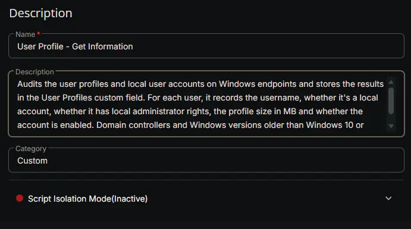

### Script Editor

#### Step 1: Row -> PowerShell script

- **Use Generative AI Assist for script creation:** `False`  
- **Expected time of script execution in seconds:** `1800`  
- **Operating System:** `Windows`  
- **Continue on Failure:** `False`  
- **Run As:** `System`  
- **PowerShell Script Editor:**

[PowerShell Script](https://github.com/ProVal-Tech/cw-rmm/blob/main/tasks/user-profile-get-information/script1.ps1)

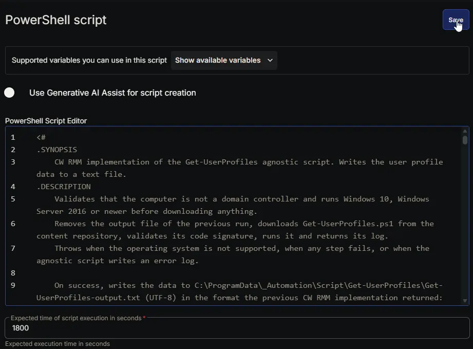

#### Step 2: Row -> Script Log

- **Script Log Message:** `%Output%`  
- **Continue on Failure:** `False`  
- **Operating System:** `Windows`

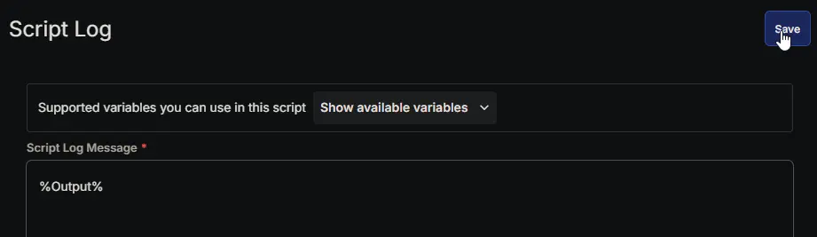

#### Step 3: Row -> PowerShell script

- **Use Generative AI Assist for script creation:** `False`  
- **Expected time of script execution in seconds:** `300`  
- **Operating System:** `Windows`  
- **Continue on Failure:** `False`  
- **Run As:** `System`  
- **PowerShell Script Editor:**

[PowerShell Script](https://github.com/ProVal-Tech/cw-rmm/blob/main/tasks/user-profile-get-information/script2.ps1)

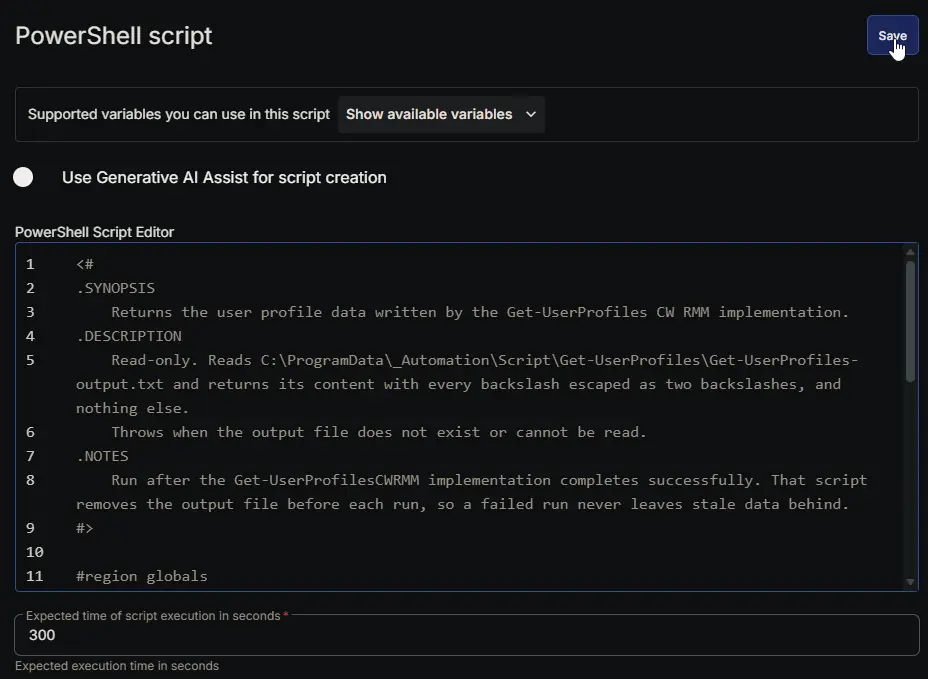

#### Step 4: Row -> Script Log

- **Script Log Message:** `%Output%`  
- **Continue on Failure:** `False`  
- **Operating System:** `Windows`

#### Step 5: Row -> Set Custom Field ( User Profiles = %Output% )

- **Custom Field:** `User Profiles`  
- **Value:** `%Output%`  
- **Operating System:** `Windows`  
- **Continue on Failure:** `False`

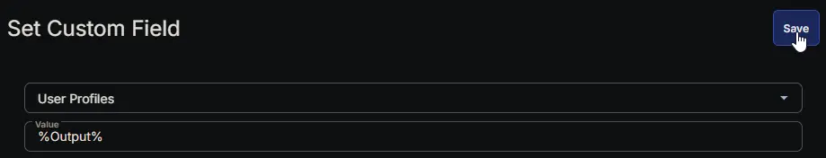

## Completed Script

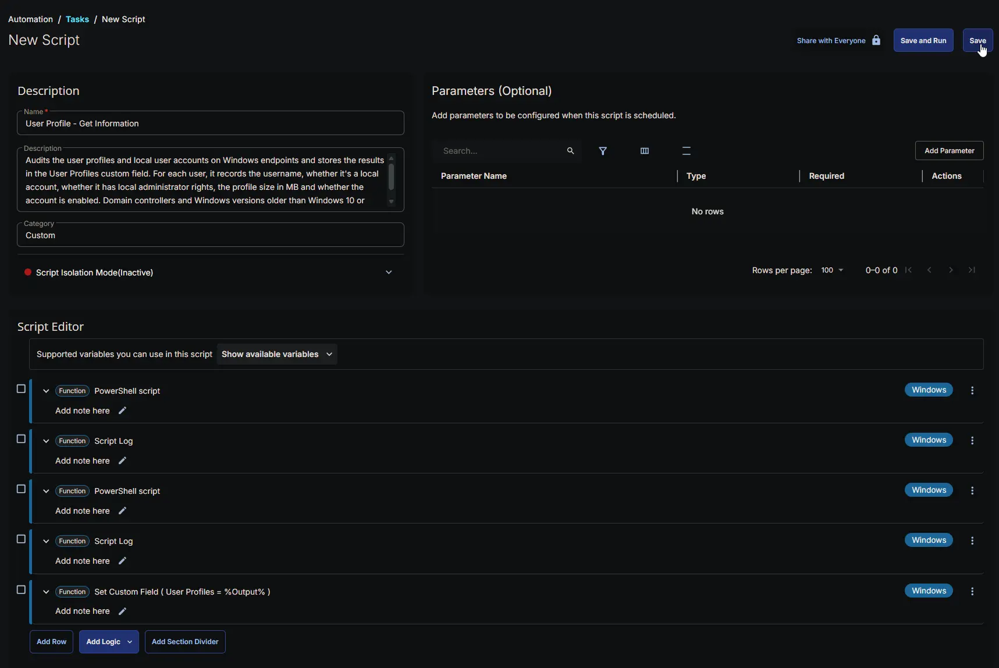

## Output

- Script Log
- Custom Field

## Schedule Task

### Task Details

- **Name:** `User Profile - Get Information`  
- **Description:** `Audits the user profiles and local user accounts on Windows endpoints and stores the results in the User Profiles custom field. For each user, it records the username, whether it's a local account, whether it has local administrator rights, the profile size in MB and whether the account is enabled. Domain controllers and Windows versions older than Windows 10 or Windows Server 2016 aren't supported.`  
- **Category:** `Custom`

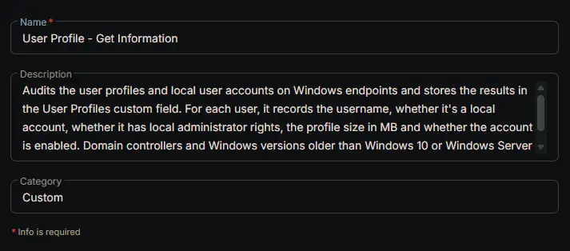

### Schedule

- **Schedule Type:** `Schedule`  
- **Timezone:** `Local Machine Time`  
- **Start:** `<Current Date>`  
- **Trigger:** `Time` `At` `<Current Time>`  
- **Recurrence:** `Every day`  
- **Execute at next agent check-in:** `15` `Day(s)`

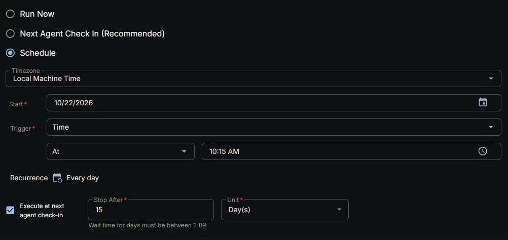

### Targeted Resource

**Device Group:** `Windows Machines (Non‑DC)`

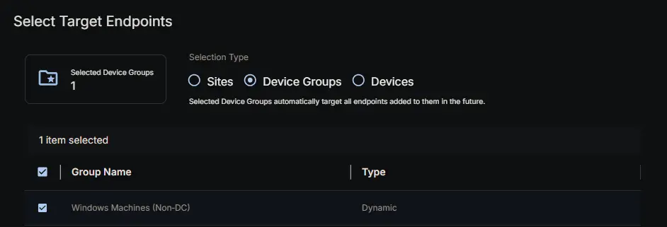

### Completed Scheduled Task

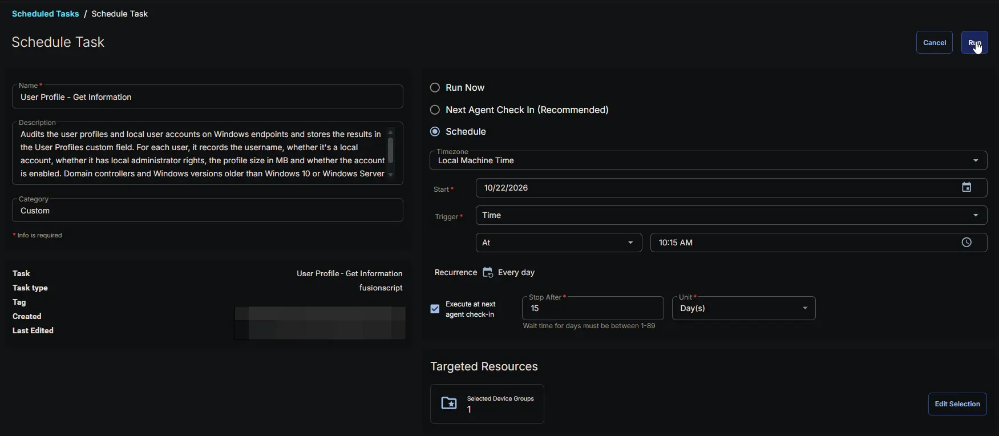

## Changelog

### 2026-10-22

- Replaced the task logic with five rows: two PowerShell scripts, two script logs, and a Set Custom Field row.
- The task now verifies the downloaded script's digital signature, shows the script log, and stops without changing the custom field if anything fails.
- Values longer than the custom field's 999-character limit are shortened by dropping whole entries from the end of the list, and the log shows the complete data.
- Domain controllers and Windows versions older than Windows 10 or Windows Server 2016 now fail before anything is downloaded.
- Rewrote the document.

### 2026-03-11

- Initial version of the document
