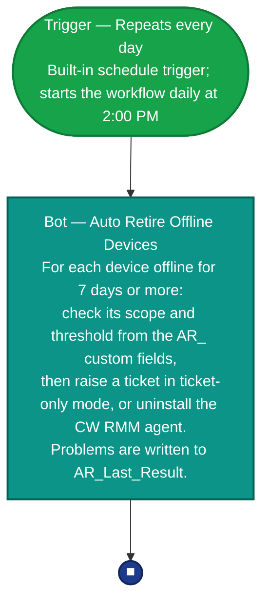
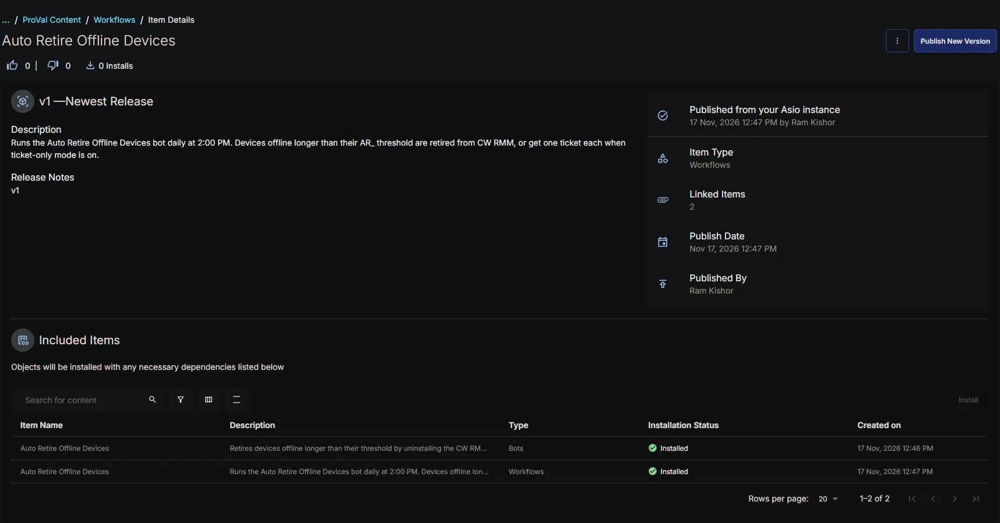
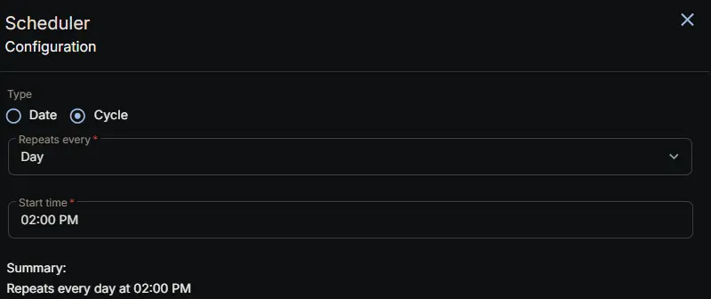
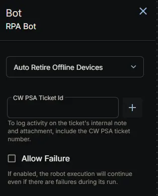
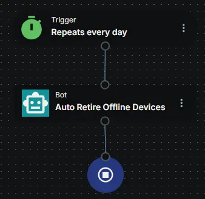

## Summary

The **Auto Retire Offline Devices** workflow runs the [Auto Retire Offline Devices](/docs/6ae2e972-aa74-4fc8-b266-bf702722cb4b) bot once a day at 2:00 PM. It uses CW RMM's built-in schedule trigger, so there's no separate trigger to import.

The run is set for 2:00 PM so it happens during working hours. A device caught offline in the middle of the working day is far more likely to be truly offline, and a device that's only used now and then is most likely to be switched on during working hours, which gives it a few more hours to check in before it's retired.

**How it works:**

1. The schedule trigger starts the workflow every day at 2:00 PM.
2. The workflow runs the bot, which handles every device that's been offline for longer than its threshold, as set by the AR_ custom fields.
3. Devices that can't be handled keep the reason in [AR_Last_Result](/docs/b539484e-1f3b-4383-8ad7-4e37c19ef9eb) and are tried again at the next run.

## Details

| Name | Description | Category tags | Trigger |
| ---- | ----------- | ------------- | ------- |
| Auto Retire Offline Devices | Runs the Auto Retire Offline Devices bot daily at 2:00 PM. Devices offline longer than their AR_ threshold are retired from CW RMM, or get one ticket each when ticket-only mode is on. | `Offboard` | Built-in schedule trigger: `Repeats every day` |

## Dependencies

- [Solution: Auto Retire Offline Devices](/docs/e73836cc-f9c8-432c-bc6f-dc3bf2d36065)
- [Bots: Auto Retire Offline Devices](/docs/6ae2e972-aa74-4fc8-b266-bf702722cb4b)
- [Custom Field: AR_Enable](/docs/5563ad64-f1a5-4245-9c3f-ded7303a1ae1)
- [Custom Field: AR_Threshold_Days](/docs/b0574e34-64f1-4c4f-9371-8c0a0b8a1b44)
- [Custom Field: AR_Ticket_Only](/docs/7579b40b-c4f1-4f78-afce-7507516787c8)
- [Custom Field: AR_Enable_Site](/docs/3bbf928b-d145-4fc9-9de4-16145479308d)
- [Custom Field: AR_Threshold_Days_Site](/docs/3eb97aa2-def8-4c0d-a956-856a22c826a7)
- [Custom Field: AR_Ticket_Only_Site](/docs/5b330773-7b20-41a7-a3f7-8c542c876d63)
- [Custom Field: AR_Enable_Endpoint](/docs/13205a0e-1d98-45b6-9806-5278edde1459)
- [Custom Field: AR_Threshold_Days_Endpoint](/docs/e078f89d-a405-471c-8b26-55a138657fdb)
- [Custom Field: AR_Ticket_Only_Endpoint](/docs/4b815d93-67d7-4071-ba16-e787f6b3174c)
- [Custom Field: AR_Ticket_Number](/docs/0fba3c3b-e142-43ce-9a28-5bdce021bd68)
- [Custom Field: AR_Last_Result](/docs/b539484e-1f3b-4383-8ad7-4e37c19ef9eb)

The bot must be installed and published before this workflow is imported. A workflow that references a bot that doesn't exist in the environment can't be saved.

## Workflow Setup Path

- **Tasks Path:** `Automation` ➞ `Workflows` ➞ `All Workflows`

## Usage Example

A company has [AR_Enable](/docs/5563ad64-f1a5-4245-9c3f-ded7303a1ae1) set to `Windows Workstations Only`, [AR_Threshold_Days](/docs/b0574e34-64f1-4c4f-9371-8c0a0b8a1b44) left at its default of `30`, and [AR_Ticket_Only](/docs/7579b40b-c4f1-4f78-afce-7507516787c8) set to `Enabled`. Its laptop `LAPTOP-021` last checked in 45 days ago.

1. At 2:00 PM, the workflow runs the bot. `LAPTOP-021` is a Windows workstation that's been offline longer than 30 days, so the bot raises a ticket with the laptop attached and stores the ticket number in [AR_Ticket_Number](/docs/0fba3c3b-e142-43ce-9a28-5bdce021bd68).
2. At the next day's run, the ticket is still open, so nothing more is done for the laptop.
3. A technician confirms the laptop was replaced and sets [AR_Ticket_Only_Endpoint](/docs/4b815d93-67d7-4071-ba16-e787f6b3174c) to `Disabled` on it.
4. At the next 2:00 PM run, the laptop's CW RMM agent is uninstalled and it's removed from CW RMM.

Had the technician found the laptop was only used for site visits, setting [AR_Enable_Endpoint](/docs/13205a0e-1d98-45b6-9806-5278edde1459) to `Disabled` would have kept it out of Auto Retire for good.

## Component Used

*This workflow uses the following ConnectWise RMM workflow components:*

- **Schedule Trigger (Repeats every day):** The built-in trigger that starts the workflow every day at 2:00 PM.
- **Bot:** Runs the [Auto Retire Offline Devices](/docs/6ae2e972-aa74-4fc8-b266-bf702722cb4b) custom bot, which does all of the work.

## Diagram

*End-to-end flow of the workflow. The workflow itself is a single bot step; the bot node lists what the bot does on each run. Colour coding matches the workflow builder (green = trigger, teal = bot, blue circle = stop).*

### Legend

- 🟩 **Trigger** – the built-in schedule trigger that starts the workflow once a day (entry point).
- 🟦 **Bot** (teal) – the custom RPA bot step that does all of the work.
- 🔵 **Stop** (■) – the end of the workflow.

### Node Descriptions

1. **Trigger (Repeats every day):** Starts the workflow every day at 2:00 PM. Once a day is the most often a scheduled workflow can run.
2. **Auto Retire Offline Devices (Bot):** Finds the devices offline for longer than their threshold and retires them, or raises a ticket for each one in ticket-only mode. The bot takes no input from the workflow. See the [bot document](/docs/6ae2e972-aa74-4fc8-b266-bf702722cb4b) for exactly what it checks and removes.

## Workflow Creation

Install the workflow from the `ProVal - Content` Community. The [Auto Retire Offline Devices](/docs/6ae2e972-aa74-4fc8-b266-bf702722cb4b) bot must already be installed and published, otherwise the bot step can't resolve. After installation, check the following settings.

### 1. Confirm the Schedule

1. Open the workflow and select the **Trigger** node.
2. Confirm it's set to **Repeats every day** at 2:00 PM. You can choose a different time, but keep it to once a day and within working hours.

### 2. Confirm the Bot Action

1. Select the **Bot** node and confirm the selected bot is **Auto Retire Offline Devices**.
2. Leave **Allow Failure** unchecked, so a failed run shows as a workflow failure rather than passing silently.
3. Save the workflow.

**Primary Note: User Permissions**  
The workflow runs under the account that created it. Create it with an account that has access to every device you want handled and is allowed to uninstall agents. The bot can't handle devices that account can't access, and if agent uninstallation is turned off for it, each device due for retirement fails with `ErrAgentUninstallationDisabled` in [AR_Last_Result](/docs/b539484e-1f3b-4383-8ad7-4e37c19ef9eb).

**Primary Note: Running the Workflow Outside Its Schedule**  
A workflow that runs a bot has no **Test** button, so the only way to run it now is to move the trigger time. See [Testing the Workflow](/docs/e73836cc-f9c8-432c-bc6f-dc3bf2d36065#testing-the-workflow) in the solution document.

## Completed Screenshot

## Changelog

### 2026-11-17

- Initial version of the document
