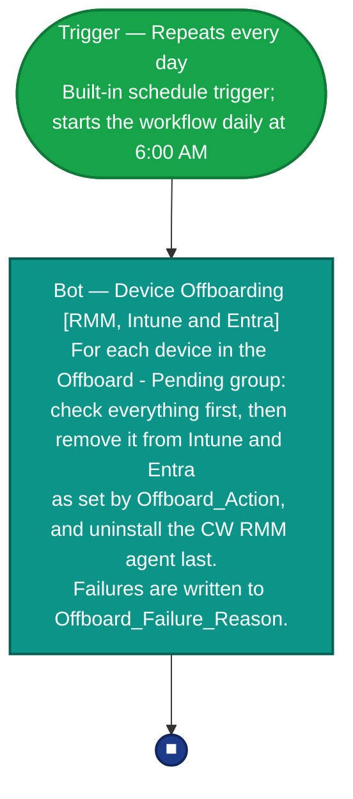
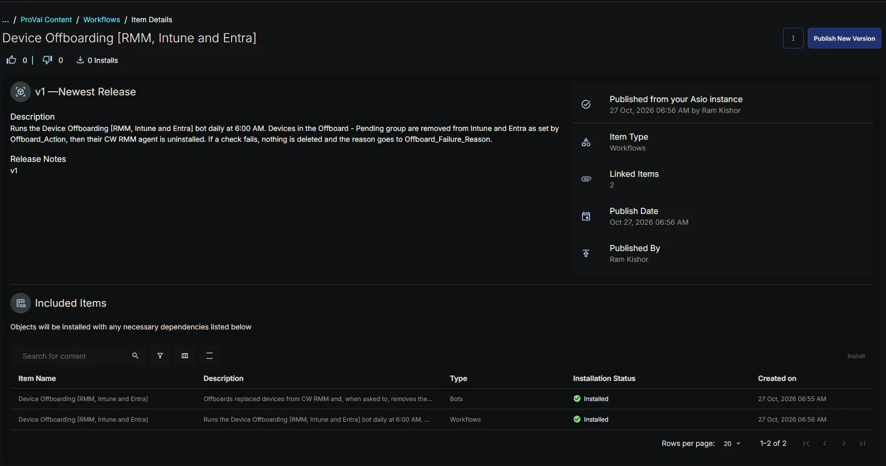
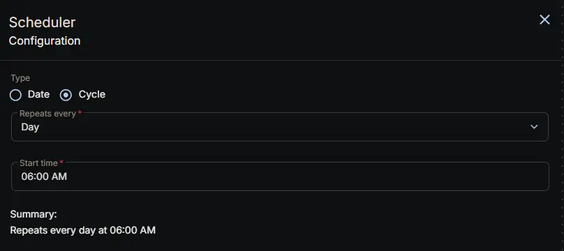
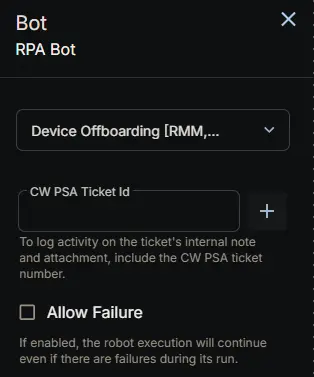
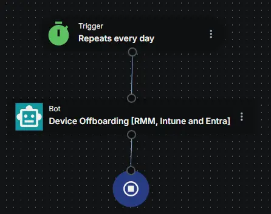

## Summary

The **Device Offboarding [RMM, Intune and Entra]** workflow runs the [Device Offboarding [RMM, Intune and Entra]](/docs/39a88b59-e48a-4c72-bba3-fbe5ff1839ab) bot once a day at 6:00 AM. It uses CW RMM's built-in schedule trigger, so there's no separate trigger to import.

Once a day is the most often a scheduled workflow can run, so a device marked for offboarding is handled at the next morning's run.

**How it works:**

1. The schedule trigger starts the workflow every day at 6:00 AM.
2. The workflow runs the bot, which offboards every device in the [Offboard - Pending](/docs/0208ca42-8ad2-4026-8c77-1eb5d23d7d15) group as set by each device's [Offboard_Action](/docs/e18f1709-6273-4086-b9f0-43bbb62c8644).
3. Devices that can't be offboarded keep the reason in [Offboard_Failure_Reason](/docs/674f4c6d-b2e7-4ee8-a25a-d8674ec7e704) and are retried at the next run.

## Details

| Name | Description | Category tags | Trigger |
| ---- | ----------- | ------------- | ------- |
| Device Offboarding [RMM, Intune and Entra] | Runs the Device Offboarding [RMM, Intune and Entra] bot daily at 6:00 AM. Devices in the Offboard - Pending group are removed from Intune and Entra as set by Offboard_Action, then their CW RMM agent is uninstalled. If a check fails, nothing is deleted and the reason goes to Offboard_Failure_Reason. | Device Management | Built-in schedule trigger: `Repeats every day` |

## Dependencies

- [Bots: Device Offboarding [RMM, Intune and Entra]](/docs/39a88b59-e48a-4c72-bba3-fbe5ff1839ab)
- [Group: Offboard - Pending](/docs/0208ca42-8ad2-4026-8c77-1eb5d23d7d15)
- [Custom Field: Offboard_Action](/docs/e18f1709-6273-4086-b9f0-43bbb62c8644)
- [Custom Field: Offboard_Skip_Offline_Check](/docs/e767b472-e81b-44cf-9b80-dffbd039b090)
- [Custom Field: Offboard_Failure_Reason](/docs/674f4c6d-b2e7-4ee8-a25a-d8674ec7e704)
- [Custom Field: Offboard_Tenant_ID](/docs/7cd5a6d6-655c-4b39-8819-1122c799f24a)
- [Custom Field: Offboard_App_Client_ID](/docs/7857a579-d691-4a79-a959-211c45a09d8f)
- [Custom Field: Offboard_App_Client_Secret](/docs/c51ae730-a3fd-4ad6-818f-25b5ec4e2936)

The bot must be installed and published before this workflow is imported. A workflow that references a bot that doesn't exist in the environment can't be saved.

## Workflow Setup Path

- **Tasks Path:** `Automation` ➞ `Workflows` ➞ `All Workflows`

## Usage Example

A client replaces the laptop `LAPTOP-014` with a new one that reuses the same name.

1. On Monday afternoon, a technician sets [Offboard_Action](/docs/e18f1709-6273-4086-b9f0-43bbb62c8644) on the old `LAPTOP-014` to `RMM Intune and Entra`. The device joins the [Offboard - Pending](/docs/0208ca42-8ad2-4026-8c77-1eb5d23d7d15) group.
2. At 6:00 AM on Tuesday, the workflow runs the bot. It finds the old laptop in Intune by its name and serial number, so the new `LAPTOP-014` isn't touched.
3. The old laptop is deleted from Intune and Entra, then its CW RMM agent is uninstalled.

If the old laptop is already wiped and offline, the technician also checks [Offboard_Skip_Offline_Check](/docs/e767b472-e81b-44cf-9b80-dffbd039b090). Otherwise the bot skips it and writes the skip to [Offboard_Failure_Reason](/docs/674f4c6d-b2e7-4ee8-a25a-d8674ec7e704).

## Component Used

*This workflow uses the following ConnectWise RMM workflow components:*

- **Schedule Trigger (Repeats every day):** The built-in trigger that starts the workflow every day at 6:00 AM.
- **Bot:** Runs the [Device Offboarding [RMM, Intune and Entra]](/docs/39a88b59-e48a-4c72-bba3-fbe5ff1839ab) custom bot, which does all of the offboarding work.

## Diagram

*End-to-end flow of the workflow. The workflow itself is a single bot step; the bot node lists what the bot does on each run. Colour coding matches the workflow builder (green = trigger, teal = bot, blue circle = stop).*

### Legend

- 🟩 **Trigger** – the built-in schedule trigger that starts the workflow once a day (entry point).
- 🟦 **Bot** (teal) – the custom RPA bot step that does all of the offboarding work.
- 🔵 **Stop** (■) – the end of the workflow.

### Node Descriptions

1. **Trigger (Repeats every day):** Starts the workflow every day at 6:00 AM. This is the most often a scheduled workflow can run.
2. **Device Offboarding [RMM, Intune and Entra] (Bot):** Reads the members of the [Offboard - Pending](/docs/0208ca42-8ad2-4026-8c77-1eb5d23d7d15) group and offboards each one as set by its [Offboard_Action](/docs/e18f1709-6273-4086-b9f0-43bbb62c8644). The bot takes no input from the workflow. See the [bot document](/docs/39a88b59-e48a-4c72-bba3-fbe5ff1839ab) for exactly what it checks and removes.

## Workflow Creation

Install the workflow from the `ProVal - Content` Community. The [Device Offboarding [RMM, Intune and Entra]](/docs/39a88b59-e48a-4c72-bba3-fbe5ff1839ab) bot must already be installed and published, otherwise the bot step can't resolve. After installation, check the following settings.

### 1. Confirm the Schedule

1. Open the workflow and select the **Trigger** node.
2. Confirm it's set to **Repeats every day** at 6:00 AM. You can choose a different time, but keep it to once a day.

### 2. Confirm the Bot Action

1. Select the **Bot** node and confirm the selected bot is **Device Offboarding [RMM, Intune and Entra]**.
2. Leave **Allow Failure** unchecked, so a failed run shows as a workflow failure rather than passing silently.
3. Save the workflow.

**Primary Note: User Permissions**  
The workflow runs under the account that created it. Create it with an account that has access to every device you'll offboard and is allowed to uninstall agents. The bot can't offboard devices that account can't access, and if agent uninstallation is turned off for it, each device fails with `ErrAgentUninstallationDisabled` in [Offboard_Failure_Reason](/docs/674f4c6d-b2e7-4ee8-a25a-d8674ec7e704).

## Completed Screenshot

## Changelog

### 2026-10-27

- Initial version of the document
